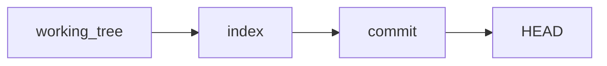
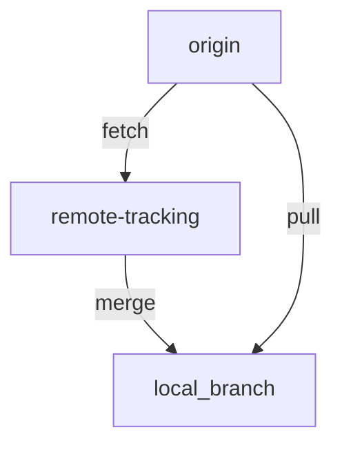
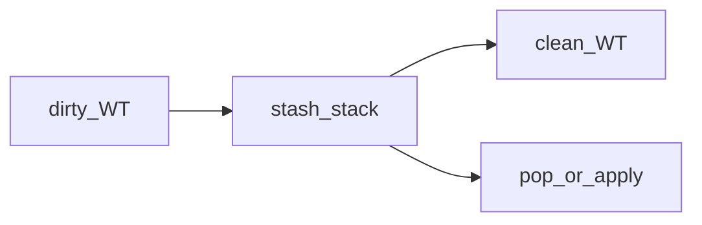
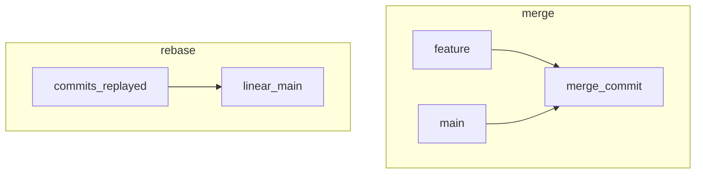
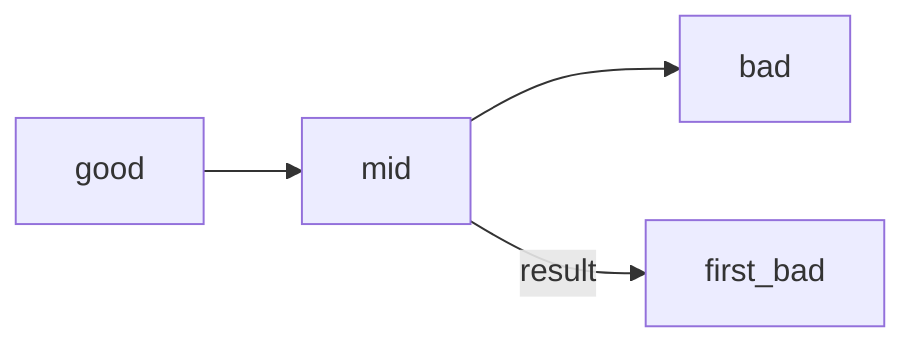
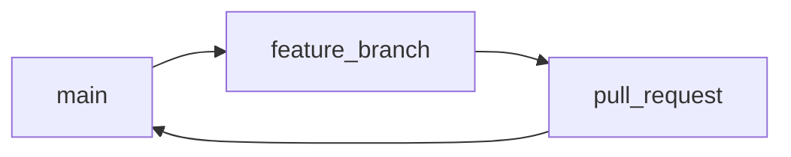

## Введение

База Git на собесе: что такое commit, как появляется репозиторий и зачем stage. Практика без диска — в [/game/git](/game/git). Старт сезона: [B02](/game/learn/b01-karta).

**Remotes и fetch/pull.** После локального commit появляется remote. На собесе ждут `remote -v`, смену URL и чёткое отличие **fetch** от **pull**. Практика: [/game/git](/game/git).

**Stash и reset.** Три бытовых навыка: временно убрать грязный worktree (**stash**), откатить локальный commit (**reset**) и выкинуть файл из индекса, не удаляя с диска (**rm --cached**). В QA кратко: [QA11](/game/learn/qa-pytest-ci-git).

**Merge и rebase.** На собесе почти всегда спрашивают **merge vs rebase**. В [B06](/game/learn/b05-api-check) rebase откладывали — здесь разбираем. В симуляторе [/game/git](/game/git) есть линейный merge; интерактивный squash — на машине.

**Tag, bisect, hooks.** Три «взрослых» инструмента: **tag** как метка релиза, **bisect** как бинарный поиск бага в истории, **pre-commit** как автоматическая проверка перед снимком. В [/game/git](/game/git) — tag и упрощённый bisect; живые hooks — на машине.

**Flow и config.** Закрываем шпаргалку: **модели ветвления**, **config**, как смотреть «что в commit». Связка с практикой веток: [B06](/game/learn/b05-api-check), [S01E03](/game/learn/s01e03-git).

## Раздел: Как отвечать одним блоком

Этот выпуск собрал соседние короткие темы трека: «Commit и stage», «Remotes и fetch/pull», «Stash и reset», «Merge и rebase», «Tag, bisect, hooks», «Flow и config». Раньше каждая занимала отдельную карточку на несколько минут, а на собеседовании их спрашивают одним блоком. Ниже у каждой темы свой раздел, затем общие лабы, один тест и одна колода карточек. В ответе сначала назовите, какую тему спросили, потом определение и один пример. Не проговаривайте все разделы, если спросили один. Лабы можно пройти по порядку исходного трека. Если времени мало, сделайте первую и последнюю: первая ставит язык, последняя проверяет, что соседние темы вы не перепутали.

## Раздел: Commit и stage: Commit как снимок

**Commit** — снимок дерева файлов плюс метаданные: автор, время, сообщение и ссылки на родителей (обычно один; у merge — два). История — DAG, а не «папка с zip».

```bash
git init
git add README.md
git commit -m "init: учебный репозиторий"
```

**init** создаёт пустой локальный репозиторий. **clone** копирует уже существующий remote со всей историей.

**Вопрос.** Из чего состоит commit? Дерево файлов + родители + автор/время/сообщение; идентичность — хеш содержимого.

## Раздел: Commit и stage: Working tree, index, HEAD

Три области:

- **working tree** — файлы, которые вы правите;
- **index (stage)** — что войдёт в следующий commit (`git add`);
- **HEAD** — указатель на текущий commit (часто через имя ветки).

```bash
git status
git add file.txt
git diff
git diff --staged
```

Без `add` commit не увидит правки — это и есть ответ на «что такое stage».

## Раздел: Remotes и fetch/pull: remote add и set-url

```bash
git remote -v
git remote add origin https://github.com/you/notes.git
git remote set-url origin https://github.com/you/notes.git
```

**add** регистрирует короткое имя (обычно `origin`). **set-url** меняет адрес без удаления remote — типичный ответ на «как поменять ссылку на удалённый репозиторий».

## Раздел: Remotes и fetch/pull: fetch vs pull

- **fetch** — скачивает объекты и обновляет remote-tracking refs, **не** сливает в текущую ветку.
- **pull** — fetch + merge (или rebase, если так настроено) в текущую ветку.

```bash
git fetch origin
git pull origin
```

**Вопрос.** Чем pull отличается от fetch? Pull ещё и интегрирует изменения в вашу ветку; fetch только забирает данные.

## Раздел: Remotes и fetch/pull: Переименовать ветку

```bash
# текущая ветка
git branch -m new-name
# любая ветка
git branch -m old-name new-name
```

Локальное переименование не переименовывает ветку на GitHub само — там отдельно push и удаление старого имени.

## Раздел: Stash и reset: stash

```bash
git stash
git stash list
git stash pop
git stash apply
git stash drop
git stash clear
```

**stash** сохраняет незакоммиченные изменения и очищает worktree. **pop** применяет и удаляет запись; **apply** оставляет запись в списке.

## Раздел: Stash и reset: Отмена неопубликованного commit

Если commit ещё не запушен:

```bash
git reset HEAD~
```

**mixed** (по умолчанию) двигает ветку назад, index становится как у родителя, правки остаются в worktree. **--hard** ещё и затирает worktree — опаснее. **--soft** оставляет index как был.

На опубликованной истории reset + force-push согласовывайте с командой.

## Раздел: Stash и reset: rm --cached

```bash
git rm --cached secret.env
```

Убирает путь из индекса (и из следующего commit), **файл на диске остаётся**. Типичный кейс: случайно добавили `.env` до gitignore.

## Раздел: Merge и rebase: merge

```bash
git switch main
git merge feature
```

**merge** создаёт merge-commit с двумя родителями (если не fast-forward). История ветвления сохраняется, «шум» merge-коммитов возможен.

Проверка «влита ли ветка»:

```bash
git branch --merged
```

## Раздел: Merge и rebase: rebase

```bash
git switch feature
git rebase main
```

**rebase** переносит ваши коммиты «поверх» другой базы: хеши меняются, история выглядит линейной. На общих ветках rebase переписывает чужую историю — согласовывайте.

## Раздел: Merge и rebase: squash через rebase -i

```bash
git rebase -i HEAD~3
# в редакторе: pick первого, squash/s остальных
git push --force-with-lease
```

Склеивает несколько коммитов в один. После переписывания истории на уже запушенной ветке нужен force-push — только на личной feature-ветке и с `--force-with-lease`.

В браузерном тренажёре полного `rebase -i` нет: отработайте merge в задаче [merge-feature](/game/git?task=merge-feature).

## Раздел: Tag, bisect, hooks: tag

```bash
git tag v1.0
git tag -a v1.0 -m "release 1.0"
git push origin v1.0
```

Легковесный tag — указатель на commit. Annotated (`-a`) хранит автора, дату и сообщение — предпочтительнее для релизов.

## Раздел: Tag, bisect, hooks: bisect

```bash
git bisect start
git bisect bad                # текущий сломан
git bisect good <good-hash>   # известный рабочий
# git проверяет середину; вы говорите good/bad
git bisect reset
```

**bisect** ищет первый плохой commit бинарным поиском. В тренажёре: [bisect-find](/game/git?task=bisect-find).

## Раздел: Tag, bisect, hooks: pre-commit hooks

Хук **pre-commit** — скрипт в `.git/hooks/pre-commit` (или менеджер вроде **husky** / pre-commit framework), который Git запускает перед созданием commit. Упал хук — commit не создался. Типично: lint, format, быстрые unit-тесты. Не путать с CI: хук — локальный шлагбаум, CI — командный.

## Раздел: Flow и config: Ответ вслух

Я выбираю поток под команду: долгие релизы — отдельная линия, короткие поставки — одна основная ветка и короткоживущие. Конфиг имени и почты называю, потому что им подписывается коммит. Показать, что вошло в коммит, могу через show, не только через память.

## Раздел: Flow и config: Плохой ответ

«Мы используем GitFlow, потому что так принято». Нет боли, которую лечит развилка.

## Раздел: Flow и config: Термины

Поток — flow. Основная ветка — main. Коммит — commit. Подпись автора — author identity.

## Раздел: Flow и config: GitFlow и GitHub Flow

**GitFlow** — долгоживущие `main` и `develop`, плюс feature/release/hotfix ветки. Подходит релизным циклам с версиями.

**GitHub Flow** — одна основная `main`, короткие feature-ветки и PR/review/deploy. Проще для непрерывной поставки.

На собесе достаточно назвать обе и сказать, что выбирает команда под частоту релизов.

## Раздел: Flow и config: git config

```bash
git config user.name "Ada"
git config user.email "ada@example.com"
git config --list
git config --get user.email
```

Настройки бывают `--system`, `--global`, `--local` (репозиторий). Локальные перекрывают global.

## Раздел: Flow и config: log и show

```bash
git log --oneline
git show <hash>
```

**show** показывает метаданные commit и diff (в симуляторе — список файлов снимка). Ответ на «как найти файлы, изменившиеся в commit».

## Лаба

**Commit и stage.**

**Цель.** В [/game/git?task=init-commit](/game/git?task=init-commit) сделать init, README и commit.

**Шаги.**
1. Откройте задачу init-commit.
2. `git init`, `write README.md hello`, `git add`, `git commit -m "init: …"`.
3. Нажмите Check. Дополнительно: [stage-index](/game/git?task=stage-index).

**Готово, если…**
- [ ] Объясняете commit без «это просто save»
- [ ] Отличаете init от clone
- [ ] Показываете status до и после add

**Remotes и fetch/pull.**

**Цель.** Задачи [remote-set-url](/game/git?task=remote-set-url), [fetch-vs-pull](/game/git?task=fetch-vs-pull), [branch-rename](/game/git?task=branch-rename).

**Шаги.**
1. Добавьте origin и смените URL на `https://github.com/you/notes.git`.
2. В сценарии «remote ahead» сделайте `git pull origin`.
3. Переименуйте ветку через `git branch -m`.

**Готово, если…**
- [ ] Объясняете fetch vs pull одним предложением
- [ ] Меняете URL через set-url, не через «удалить и добавить вслепую»
- [ ] Знаете `branch -m`

**Stash и reset.**

**Цель.** [/game/git?task=stash-roundtrip](/game/git?task=stash-roundtrip), [reset-soft-local](/game/git?task=reset-soft-local), [rm-cached](/game/git?task=rm-cached).

**Шаги.**
1. Stash грязного файла до clean worktree.
2. Отмените последний commit через `git reset HEAD~`.
3. Уберите `secret.env` из index через `rm --cached`.

**Готово, если…**
- [ ] Отличаете pop от apply
- [ ] Не путаете reset --hard с mixed
- [ ] Знаете rm --cached для секретов в индексе

**Merge и rebase.**

**Цель.** Смержить feature в main в [/game/git?task=merge-feature](/game/git?task=merge-feature). Локально (по желанию) сделайте squash трёх WIP-коммитов.

**Шаги.**
1. Check задачи merge-feature.
2. На бумаге сравните граф после merge и после rebase.
3. Проговорите, когда force-push запрещён (main/shared).

**Готово, если…**
- [ ] Одним предложением отличаете merge и rebase
- [ ] Знаете branch --merged
- [ ] Не предлагаете rebase published main

**Tag, bisect, hooks.**

**Цель.** [tag-release](/game/git?task=tag-release) и [bisect-find](/game/git?task=bisect-find).

**Шаги.**
1. Поставьте тег v1.0.
2. Прогоните bisect start / bad / good HEAD~2.
3. На своей машине гляньте `.git/hooks/pre-commit.sample`.

**Готово, если…**
- [ ] Отличаете lightweight и annotated tag
- [ ] Объясняете bisect без «перебираю все коммиты вручную»
- [ ] Знаете, где живёт pre-commit

**Flow и config.**

**Цель.** Повторите [merge-feature](/game/git?task=merge-feature) и [tag-release](/game/git?task=tag-release); в песочнице выполните `git config user.name` и `git show` / `git log --oneline`.

**Шаги.**
1. Выставьте user.name в симуляторе.
2. Сделайте commit и `git show`.
3. Нарисуйте, чем GitHub Flow проще GitFlow для учебного notes.

**Готово, если…**
- [ ] Называете GitFlow и GitHub Flow
- [ ] Знаете уровни config
- [ ] Открываете содержимое commit через show/log

## Схема: Commit и stage: Три области



## Схема: Remotes и fetch/pull: fetch и pull



## Схема: Stash и reset: stash



## Схема: Merge и rebase: merge vs rebase



## Схема: Tag, bisect, hooks: bisect



## Схема: Flow и config: GitHub Flow



## Тест

### Из чего состоит commit?

**Ответ:** дерево файлов + родители + метаданные

**Пояснение:** хеш считается от содержимого; сообщение — для людей и review.

### Как посмотреть remote URL?

**Ответ:** git remote -v

**Пояснение:** показывает fetch/push URL для каждого remote.

### Зачем git stash?

**Ответ:** временно сохранить незакоммиченные правки и очистить WT

**Пояснение:** удобно перед switch/pull.

### Чем merge отличается от rebase?

**Ответ:** merge сохраняет ветвление; rebase переписывает историю линейно

**Пояснение:** у merge часто два родителя; rebase меняет хеши.

### Зачем tag?

**Ответ:** именованная точка в истории, часто релиз

**Пояснение:** удобнее, чем помнить хеш.

## Шпаргалка

<ul><li>Commit = снимок + родители + метаданные</li><li>Stage = то, что войдёт в commit</li><li>git remote -v git remote add origin &lt;url&gt; git remote set-url origin &lt;url&gt; git fetch origin git pull origin git branch -m new-name</li><li>git stash / list / pop / apply / drop git reset HEAD~ git reset --hard HEAD~ git rm --cached &lt;path&gt;</li><li>git merge feature git rebase main git rebase -i HEAD~N git branch --merged git push --force-with-lease</li><li>git tag v1.0 git tag -a v1.0 -m "msg" git bisect start / bad / good / reset # hooks: .git/hooks/pre-commit</li><li>git config user.name "…" git config user.email "…" git log --oneline git show &lt;hash&gt; # GitHub Flow: main + short feature + PR # GitFlow: main + develop + release/hotfix</li></ul>

## Anki

### Front: Что хранит commit?

Back: Снимок дерева, родители, автор, время, сообщение

### Front: git remote -v?

Back: Список remote с URL fetch/push

### Front: git stash?

Back: Прячет незакоммиченные изменения во временный стек

### Front: merge vs rebase?

Back: merge сохраняет развилку; rebase переносит коммиты на новую базу

### Front: tag?

Back: Указатель на commit с человекочитаемым именем

### Front: GitHub Flow?

Back: main + короткие feature + PR

## Мнемоника

### link: Коммит

**Задание:** Из чего состоит снимок.

**Элементы:**
- рабочее дерево
- индекс
- объект
- указатель ветки

**Подсказка:** Commit не смотрит на файл, пока тот не в индексе.

**Ответ:** worktree → index → object → ref

## Итоги

- Commit — узел графа истории, не «файл сохранения»
- Stage отделяет «правили» от «готово к снимку»
- Тренажёр: /game/git
- remote — ярлык на URL
- fetch безопаснее «просто посмотреть»; pull меняет вашу ветку
- branch -m — локальное переименование
- stash — карман для WIP
- reset локально ок; на shared history — осторожно

## Ссылки

- [B02 · Git init](/game/learn/b01-karta)
- [Pro Git](https://git-scm.com/book/ru/v2)
- [Habr: лист Q&A (индекс тем)](https://habr.com/ru/articles/813513/)
- [Тренажёр Git](/game/git)
- [S01E03 · Git](/game/learn/s01e03-git)
- [Pro Git · remotes](https://git-scm.com/book/ru/v2/Основы-Git-Работа-с-удалёнными-репозиториями)
- [QA11 · pytest Git CI](/game/learn/qa-pytest-ci-git)
- [B06 · ветка](/game/learn/b05-api-check)
- [Pro Git · rebase](https://git-scm.com/book/ru/v2/Ветвление-в-Git-Rebase)
- [Pro Git · tags](https://git-scm.com/book/ru/v2/Основы-Git-Работа-с-метками)
- [git-bisect](https://git-scm.com/docs/git-bisect)
- [GitHub Flow](https://docs.github.com/ru/get-started/using-github/github-flow)
