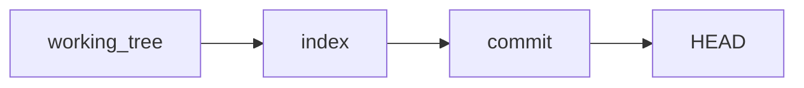

## Введение

База Git на собесе: что такое commit, как появляется репозиторий и зачем stage. Практика без диска — в [/game/git](/game/git). Старт сезона: [B02](/game/learn/b02-git).

## Раздел: Commit как снимок

**Commit** — снимок дерева файлов плюс метаданные: автор, время, сообщение и ссылки на родителей (обычно один; у merge — два). История — DAG, а не «папка с zip».

```bash
git init
git add README.md
git commit -m "init: учебный репозиторий"
```

**init** создаёт пустой локальный репозиторий. **clone** копирует уже существующий remote со всей историей.

**Вопрос.** Из чего состоит commit? Дерево файлов + родители + автор/время/сообщение; идентичность — хеш содержимого.

## Раздел: Working tree, index, HEAD

Три области:

- **working tree** — файлы, которые вы правите;
- **index (stage)** — что войдёт в следующий commit (`git add`);
- **HEAD** — указатель на текущий commit (часто через имя ветки).

```bash
git status
git add file.txt
git diff
git diff --staged
```

Без `add` commit не увидит правки — это и есть ответ на «что такое stage».

## Лаба

**Цель.** В [/game/git?task=init-commit](/game/git?task=init-commit) сделать init, README и commit.

**Шаги.**
1. Откройте задачу init-commit.
2. `git init`, `write README.md hello`, `git add`, `git commit -m "init: …"`.
3. Нажмите Check. Дополнительно: [stage-index](/game/git?task=stage-index).

**Готово, если…**
- [ ] Объясняете commit без «это просто save»
- [ ] Отличаете init от clone
- [ ] Показываете status до и после add

## Схема: Три области



## Тест

### Из чего состоит commit?

**Ответ:** дерево файлов + родители + метаданные

**Пояснение:** хеш считается от содержимого; сообщение — для людей и review.

### Чем git init отличается от clone?

**Ответ:** init — пустой локальный repo; clone — копия remote с историей

**Пояснение:** clone обычно сразу настраивает origin.

### Что такое stage/index?

**Ответ:** область файлов, готовых к следующему commit

**Пояснение:** попадание через git add.

### Зачем git status?

**Ответ:** показывает WT, index и текущую ветку

**Пояснение:** первая команда при «что-то сломалось».

### Где потренировать без диска?

**Ответ:** /game/git

**Пояснение:** симулятор команд на 9to18.

## Шпаргалка

<h3>Команды</h3>
<pre><code>git init
git clone &lt;url&gt;
git status
git add &lt;path&gt;
git commit -m "message"
</code></pre>
<ul>
<li>Commit = снимок + родители + метаданные</li>
<li>Stage = то, что войдёт в commit</li>
</ul>

## Anki

### Front: Что хранит commit?

Back: Снимок дерева, родители, автор, время, сообщение

### Front: git init — что делает?

Back: Создаёт новый пустой локальный репозиторий

### Front: git clone — что делает?

Back: Копирует remote-репозиторий с историей

### Front: Как попасть в index?

Back: git add

### Front: HEAD — это?

Back: Указатель на текущий commit (часто через ветку)

### Front: Зачем понятное сообщение commit?

Back: История и code review читаются людьми

## Итоги

- Commit — узел графа истории, не «файл сохранения»
- Stage отделяет «правили» от «готово к снимку»
- Тренажёр: /game/git

## Ссылки

- [B02 · Git init](/game/learn/b02-git)
- [Pro Git](https://git-scm.com/book/ru/v2)
- [Habr: лист Q&A (индекс тем)](https://habr.com/ru/articles/813513/)
- [Тренажёр Git](/game/git)
- [Далее: remotes](/game/learn/git-remotes-fetch-pull)
