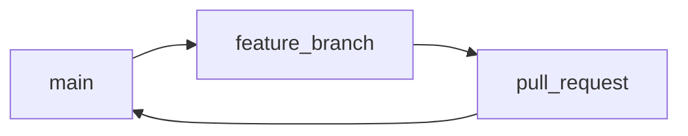

## Введение

Закрываем шпаргалку: **модели ветвления**, **config**, как смотреть «что в commit». Связка с практикой веток: [B06](/game/learn/b06-git-branch), [S01E03](/game/learn/s01e03-git).

## Раздел: GitFlow и GitHub Flow

**GitFlow** — долгоживущие `main` и `develop`, плюс feature/release/hotfix ветки. Подходит релизным циклам с версиями.

**GitHub Flow** — одна основная `main`, короткие feature-ветки и PR/review/deploy. Проще для непрерывной поставки.

На собесе достаточно назвать обе и сказать, что выбирает команда под частоту релизов.

## Раздел: git config

```bash
git config user.name "Ada"
git config user.email "ada@example.com"
git config --list
git config --get user.email
```

Настройки бывают `--system`, `--global`, `--local` (репозиторий). Локальные перекрывают global.

## Раздел: log и show

```bash
git log --oneline
git show <hash>
```

**show** показывает метаданные commit и diff (в симуляторе — список файлов снимка). Ответ на «как найти файлы, изменившиеся в commit».

## Лаба

**Цель.** Повторите [merge-feature](/game/git?task=merge-feature) и [tag-release](/game/git?task=tag-release); в песочнице выполните `git config user.name` и `git show` / `git log --oneline`.

**Шаги.**
1. Выставьте user.name в симуляторе.
2. Сделайте commit и `git show`.
3. Нарисуйте, чем GitHub Flow проще GitFlow для учебного notes.

**Готово, если…**
- [ ] Называете GitFlow и GitHub Flow
- [ ] Знаете уровни config
- [ ] Открываете содержимое commit через show/log

## Схема: GitHub Flow



## Тест

### Чем GitHub Flow отличается от GitFlow?

**Ответ:** одна main и короткие feature; у GitFlow ещё develop/release/hotfix

**Пояснение:** GitFlow тяжелее, зато явные релизы.

### Зачем git config user.email?

**Ответ:** подпись автора в commit

**Пояснение:** без неё Git может ругаться или взять системное имя.

### Как посмотреть файлы commit?

**Ответ:** git show &lt;hash&gt; или git log -p

**Пояснение:** сначала log, потом show по хешу.

### Где хранится local config?

**Ответ:** в .git/config репозитория

**Пояснение:** global обычно в ~/.gitconfig.

### Когда выбрать GitFlow?

**Ответ:** при редких версионированных релизах и нескольких линиях поддержки

**Пояснение:** иначе часто хватает GitHub Flow.

## Шпаргалка

<pre><code>git config user.name "…"
git config user.email "…"
git log --oneline
git show &lt;hash&gt;
# GitHub Flow: main + short feature + PR
# GitFlow: main + develop + release/hotfix
</code></pre>

## Anki

### Front: GitHub Flow?

Back: main + короткие feature + PR

### Front: GitFlow?

Back: main/develop + feature/release/hotfix

### Front: git config уровни?

Back: system, global, local (local сильнее)

### Front: git show?

Back: Показать commit и его изменения

### Front: Зачем email в config?

Back: Идентификация автора в истории

### Front: branch --merged снова?

Back: Какие ветки уже влиты в текущую

## Итоги

- Модель ветвления — договорённость команды
- config задаёт автора
- show/log — глаза в истории

## Ссылки

- [GitHub Flow](https://docs.github.com/ru/get-started/using-github/github-flow)
- [Pro Git](https://git-scm.com/book/ru/v2)
- [Habr Q&A](https://habr.com/ru/articles/813513/)
- [B06](/game/learn/b06-git-branch)
- [Тренажёр](/game/git)
