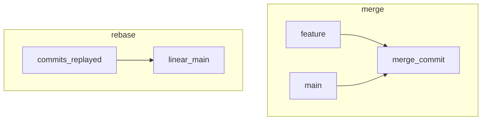

## Введение

На собесе почти всегда спрашивают **merge vs rebase**. В [B06](/game/learn/b06-git-branch) rebase откладывали — здесь разбираем. В симуляторе [/game/git](/game/git) есть линейный merge; интерактивный squash — на машине.

## Раздел: merge

```bash
git switch main
git merge feature
```

**merge** создаёт merge-commit с двумя родителями (если не fast-forward). История ветвления сохраняется, «шум» merge-коммитов возможен.

Проверка «влита ли ветка»:

```bash
git branch --merged
```

## Раздел: rebase

```bash
git switch feature
git rebase main
```

**rebase** переносит ваши коммиты «поверх» другой базы: хеши меняются, история выглядит линейной. На общих ветках rebase переписывает чужую историю — согласовывайте.

## Раздел: squash через rebase -i

```bash
git rebase -i HEAD~3
# в редакторе: pick первого, squash/s остальных
git push --force-with-lease
```

Склеивает несколько коммитов в один. После переписывания истории на уже запушенной ветке нужен force-push — только на личной feature-ветке и с `--force-with-lease`.

В браузерном тренажёре полного `rebase -i` нет: отработайте merge в задаче [merge-feature](/game/git?task=merge-feature).

## Лаба

**Цель.** Смержить feature в main в [/game/git?task=merge-feature](/game/git?task=merge-feature). Локально (по желанию) сделайте squash трёх WIP-коммитов.

**Шаги.**
1. Check задачи merge-feature.
2. На бумаге сравните граф после merge и после rebase.
3. Проговорите, когда force-push запрещён (main/shared).

**Готово, если…**
- [ ] Одним предложением отличаете merge и rebase
- [ ] Знаете branch --merged
- [ ] Не предлагаете rebase published main

## Схема: merge vs rebase



## Тест

### Чем merge отличается от rebase?

**Ответ:** merge сохраняет ветвление; rebase переписывает историю линейно

**Пояснение:** у merge часто два родителя; rebase меняет хеши.

### Когда rebase опасен?

**Ответ:** на уже опубликованной общей ветке

**Пояснение:** коллеги получат конфликтующую историю.

### Как склеить коммиты?

**Ответ:** git rebase -i и squash

**Пояснение:** затем осторожный force-with-lease на feature.

### git branch --merged?

**Ответ:** список веток, уже влитых в текущую

**Пояснение:** удобно чистить старые feature.

### Fast-forward merge — что это?

**Ответ:** указатель ветки просто сдвинули, merge-commit не нужен

**Пояснение:** история уже линейна относительно цели.

## Шпаргалка

<pre><code>git merge feature
git rebase main
git rebase -i HEAD~N
git branch --merged
git push --force-with-lease
</code></pre>

## Anki

### Front: merge vs rebase?

Back: merge сохраняет развилку; rebase переносит коммиты на новую базу

### Front: squash как?

Back: interactive rebase, пометить commits как squash/fixup

### Front: force-with-lease зачем?

Back: Не затереть чужие новые коммиты на remote вслепую

### Front: branch --merged?

Back: Ветки, чьи коммиты уже достижимы из HEAD

### Front: Когда merge-commit неизбежен?

Back: Когда истории разошлись и нужен явный узел слияния

### Front: Rebase main у всех?

Back: Обычно нет; политика команды важнее «красивой линии»

## Итоги

- merge — безопасно для shared истории
- rebase — для локальной/личной feature
- squash + force только осознанно

## Ссылки

- [B06 · ветка](/game/learn/b06-git-branch)
- [Pro Git · rebase](https://git-scm.com/book/ru/v2/Ветвление-в-Git-Rebase)
- [Habr Q&A](https://habr.com/ru/articles/813513/)
- [Тренажёр](/game/git)
- [Далее: tags/bisect](/game/learn/git-tags-bisect-hooks)
