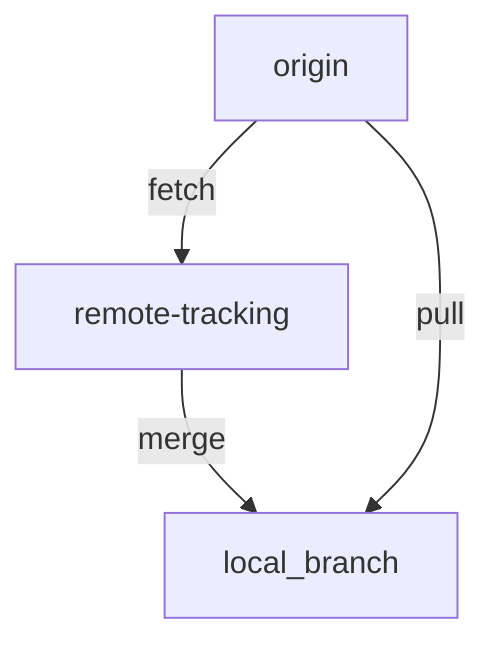

## Введение

После локального commit появляется remote. На собесе ждут `remote -v`, смену URL и чёткое отличие **fetch** от **pull**. Практика: [/game/git](/game/git).

## Раздел: remote add и set-url

```bash
git remote -v
git remote add origin https://github.com/you/notes.git
git remote set-url origin https://github.com/you/notes.git
```

**add** регистрирует короткое имя (обычно `origin`). **set-url** меняет адрес без удаления remote — типичный ответ на «как поменять ссылку на удалённый репозиторий».

## Раздел: fetch vs pull

- **fetch** — скачивает объекты и обновляет remote-tracking refs, **не** сливает в текущую ветку.
- **pull** — fetch + merge (или rebase, если так настроено) в текущую ветку.

```bash
git fetch origin
git pull origin
```

**Вопрос.** Чем pull отличается от fetch? Pull ещё и интегрирует изменения в вашу ветку; fetch только забирает данные.

## Раздел: Переименовать ветку

```bash
# текущая ветка
git branch -m new-name
# любая ветка
git branch -m old-name new-name
```

Локальное переименование не переименовывает ветку на GitHub само — там отдельно push и удаление старого имени.

## Лаба

**Цель.** Задачи [remote-set-url](/game/git?task=remote-set-url), [fetch-vs-pull](/game/git?task=fetch-vs-pull), [branch-rename](/game/git?task=branch-rename).

**Шаги.**
1. Добавьте origin и смените URL на `https://github.com/you/notes.git`.
2. В сценарии «remote ahead» сделайте `git pull origin`.
3. Переименуйте ветку через `git branch -m`.

**Готово, если…**
- [ ] Объясняете fetch vs pull одним предложением
- [ ] Меняете URL через set-url, не через «удалить и добавить вслепую»
- [ ] Знаете `branch -m`

## Схема: fetch и pull



## Тест

### Как посмотреть remote URL?

**Ответ:** git remote -v

**Пояснение:** показывает fetch/push URL для каждого remote.

### Чем fetch отличается от pull?

**Ответ:** fetch не сливает; pull = fetch + merge

**Пояснение:** после fetch рабочая ветка не двигается сама.

### Как сменить URL origin?

**Ответ:** git remote set-url origin &lt;url&gt;

**Пояснение:** не нужно удалять remote, если меняется только адрес.

### Как переименовать текущую ветку?

**Ответ:** git branch -m new-name

**Пояснение:** для чужой ветки: git branch -m old new.

### Что делает git remote add?

**Ответ:** регистрирует имя и URL удалённого репозитория

**Пояснение:** обычно имя origin.

## Шпаргалка

<pre><code>git remote -v
git remote add origin &lt;url&gt;
git remote set-url origin &lt;url&gt;
git fetch origin
git pull origin
git branch -m new-name
</code></pre>

## Anki

### Front: git remote -v?

Back: Список remote с URL fetch/push

### Front: fetch vs pull?

Back: fetch только забирает; pull ещё сливает в текущую ветку

### Front: set-url зачем?

Back: Сменить адрес remote без удаления записи

### Front: branch -m?

Back: Переименовать ветку

### Front: Типичное имя remote?

Back: origin

### Front: После локального rename на GitHub?

Back: Нужен push новой ветки и удаление старой на remote

## Итоги

- remote — ярлык на URL
- fetch безопаснее «просто посмотреть»; pull меняет вашу ветку
- branch -m — локальное переименование

## Ссылки

- [S01E03 · Git](/game/learn/s01e03-git)
- [Pro Git · remotes](https://git-scm.com/book/ru/v2/Основы-Git-Работа-с-удалёнными-репозиториями)
- [Habr Q&A](https://habr.com/ru/articles/813513/)
- [Тренажёр](/game/git)
- [Далее: stash/reset](/game/learn/git-stash-reset-rm)
