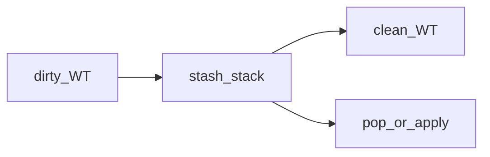

## Введение

Три бытовых навыка: временно убрать грязный worktree (**stash**), откатить локальный commit (**reset**) и выкинуть файл из индекса, не удаляя с диска (**rm --cached**). В QA кратко: [QA11](/game/learn/qa-pytest-ci-git).

## Раздел: stash

```bash
git stash
git stash list
git stash pop
git stash apply
git stash drop
git stash clear
```

**stash** сохраняет незакоммиченные изменения и очищает worktree. **pop** применяет и удаляет запись; **apply** оставляет запись в списке.

## Раздел: Отмена неопубликованного commit

Если commit ещё не запушен:

```bash
git reset HEAD~
```

**mixed** (по умолчанию) двигает ветку назад, index становится как у родителя, правки остаются в worktree. **--hard** ещё и затирает worktree — опаснее. **--soft** оставляет index как был.

На опубликованной истории reset + force-push согласовывайте с командой.

## Раздел: rm --cached

```bash
git rm --cached secret.env
```

Убирает путь из индекса (и из следующего commit), **файл на диске остаётся**. Типичный кейс: случайно добавили `.env` до gitignore.

## Лаба

**Цель.** [/game/git?task=stash-roundtrip](/game/git?task=stash-roundtrip), [reset-soft-local](/game/git?task=reset-soft-local), [rm-cached](/game/git?task=rm-cached).

**Шаги.**
1. Stash грязного файла до clean worktree.
2. Отмените последний commit через `git reset HEAD~`.
3. Уберите `secret.env` из index через `rm --cached`.

**Готово, если…**
- [ ] Отличаете pop от apply
- [ ] Не путаете reset --hard с mixed
- [ ] Знаете rm --cached для секретов в индексе

## Схема: stash



## Тест

### Зачем git stash?

**Ответ:** временно сохранить незакоммиченные правки и очистить WT

**Пояснение:** удобно перед switch/pull.

### Чем stash pop отличается от apply?

**Ответ:** pop удаляет запись из списка; apply оставляет

**Пояснение:** apply безопаснее, если не уверены.

### Как отменить последний локальный commit, сохранив правки?

**Ответ:** git reset HEAD~

**Пояснение:** mixed по умолчанию; --hard опаснее.

### Что делает git rm --cached file?

**Ответ:** убирает file из index, файл на диске остаётся

**Пояснение:** частый фикс для случайного .env.

### Когда reset на опубликованной ветке опасен?

**Ответ:** нужен force-push и согласие команды

**Пояснение:** переписывает историю, которую уже кто-то скачал.

## Шпаргалка

<pre><code>git stash / list / pop / apply / drop
git reset HEAD~
git reset --hard HEAD~
git rm --cached &lt;path&gt;
</code></pre>

## Anki

### Front: git stash?

Back: Прячет незакоммиченные изменения во временный стек

### Front: stash pop vs apply?

Back: pop применяет и удаляет запись; apply только применяет

### Front: reset HEAD~?

Back: Откат указателя ветки на родителя

### Front: reset --hard?

Back: Ещё и затирает working tree и index

### Front: rm --cached?

Back: Убрать из индекса, оставить файл на диске

### Front: .env попал в add — первый шаг?

Back: rm --cached, дописать gitignore, ротация секрета если уже push

## Итоги

- stash — карман для WIP
- reset локально ок; на shared history — осторожно
- rm --cached спасает индекс от секретов

## Ссылки

- [QA11 · pytest Git CI](/game/learn/qa-pytest-ci-git)
- [Pro Git](https://git-scm.com/book/ru/v2)
- [Habr Q&A](https://habr.com/ru/articles/813513/)
- [Тренажёр](/game/git)
- [Далее: merge/rebase](/game/learn/git-merge-rebase)
