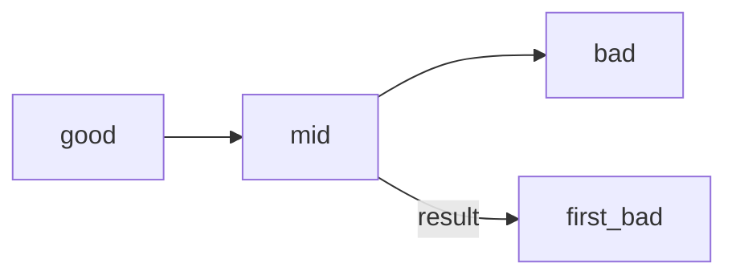

## Введение

Три «взрослых» инструмента: **tag** как метка релиза, **bisect** как бинарный поиск бага в истории, **pre-commit** как автоматическая проверка перед снимком. В [/game/git](/game/git) — tag и упрощённый bisect; живые hooks — на машине.

## Раздел: tag

```bash
git tag v1.0
git tag -a v1.0 -m "release 1.0"
git push origin v1.0
```

Легковесный tag — указатель на commit. Annotated (`-a`) хранит автора, дату и сообщение — предпочтительнее для релизов.

## Раздел: bisect

```bash
git bisect start
git bisect bad                # текущий сломан
git bisect good <good-hash>   # известный рабочий
# git проверяет середину; вы говорите good/bad
git bisect reset
```

**bisect** ищет первый плохой commit бинарным поиском. В тренажёре: [bisect-find](/game/git?task=bisect-find).

## Раздел: pre-commit hooks

Хук **pre-commit** — скрипт в `.git/hooks/pre-commit` (или менеджер вроде **husky** / pre-commit framework), который Git запускает перед созданием commit. Упал хук — commit не создался. Типично: lint, format, быстрые unit-тесты. Не путать с CI: хук — локальный шлагбаум, CI — командный.

## Лаба

**Цель.** [tag-release](/game/git?task=tag-release) и [bisect-find](/game/git?task=bisect-find).

**Шаги.**
1. Поставьте тег v1.0.
2. Прогоните bisect start / bad / good HEAD~2.
3. На своей машине гляньте `.git/hooks/pre-commit.sample`.

**Готово, если…**
- [ ] Отличаете lightweight и annotated tag
- [ ] Объясняете bisect без «перебираю все коммиты вручную»
- [ ] Знаете, где живёт pre-commit

## Схема: bisect



## Тест

### Зачем tag?

**Ответ:** именованная точка в истории, часто релиз

**Пояснение:** удобнее, чем помнить хеш.

### Чем annotated tag лучше lightweight?

**Ответ:** хранит автора, дату и сообщение

**Пояснение:** для релизов обычно -a.

### Что делает git bisect?

**Ответ:** бинарный поиск commit, сломавшего поведение

**Пояснение:** помечаете good/bad, Git выбирает середину.

### Где настраивают pre-commit?

**Ответ:** .git/hooks или менеджер husky/pre-commit

**Пояснение:** выполняется локально перед commit.

### Заменяет ли hook CI?

**Ответ:** нет, дополняет

**Пояснение:** hook можно обойти; CI — общий контроль.

## Шпаргалка

<pre><code>git tag v1.0
git tag -a v1.0 -m "msg"
git bisect start / bad / good / reset
# hooks: .git/hooks/pre-commit
</code></pre>

## Anki

### Front: tag?

Back: Указатель на commit с человекочитаемым именем

### Front: annotated tag?

Back: Tag-объект с автором, датой и сообщением

### Front: bisect?

Back: Бинарный поиск первого bad commit

### Front: pre-commit hook?

Back: Скрипт проверки перед созданием commit

### Front: husky?

Back: Популярный менеджер git-hooks в JS-проектах

### Front: tag push?

Back: Обычный push не всегда шлёт tags — push origin v1.0

## Итоги

- tag — метка релиза
- bisect экономит часы бисекта «на глаз»
- hooks — локальная дисциплина, не замена CI

## Ссылки

- [Pro Git · tags](https://git-scm.com/book/ru/v2/Основы-Git-Работа-с-метками)
- [git-bisect](https://git-scm.com/docs/git-bisect)
- [Habr Q&A](https://habr.com/ru/articles/813513/)
- [Тренажёр](/game/git)
- [Далее: flow/config](/game/learn/git-flow-config-show)
