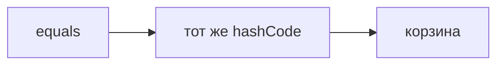

## Введение

Java-собес почти сразу открывает коллекции. HashMap — витрина: равенство, хеш и то, что порядок корзин не обещан. Это не серия про JDBC.

## Раздел: Контракт

Если equals говорит «равны», hashCode обязан совпасть. Иначе объект кладут в одну корзину, а ищут в другой. Мутировать поле, которое входит в хеш, пока ключ уже в карте — способ потерять запись. Список выбирают, когда важен порядок и допускают линейный поиск. Множество — когда важен факт присутствия.

## Раздел: Ответ вслух

Я говорю контракт: равные объекты имеют один hashCode. Обратное не обязательно: разные объекты могут столкнуться. Ключ в карте не меняю. Если нужен порядок обхода, HashMap не обещаю, беру структуру, которая это говорит вслух.

## Раздел: Плохой ответ

Плохой ответ: «HashMap всегда O(1)». Худший случай и контракт equals забыты.

## Раздел: Термины

Равенство — equals. Хеш-код — hashCode. Корзина — bucket. Столкновение — collision.

## Лаба

**20 минут.** На бумаге положите два объекта с одинаковым equals и разным hashCode в воображаемую карту. Найдите, почему get не находит значение.

## Схема: Контракт

## Тест

### equals истинно, hashCode разный. get найдёт ключ?

**Ответ:** нет

**Пояснение:** Искать будут в другой корзине.

### hashCode совпал, equals нет. Это ошибка контракта?

**Ответ:** нет, это столкновение

**Пояснение:** Контракт требует только одну сторону.

### Поменяли поле ключа после put. Что с записью?

**Ответ:** её можно потерять

**Пояснение:** Корзина посчитана по старому хешу.

### Нужен порядок вставки. HashMap подойдёт?

**Ответ:** нет

**Пояснение:** Порядок корзин не часть контракта.

### Список на миллион поисков одного id. Хороший выбор?

**Ответ:** нет, нужен словарь

**Пояснение:** Иначе линейный проход.

## Шпаргалка

<ul><li>Равные — один хеш</li><li>Ключ не мутировать</li><li>Порядок HashMap не обещает</li></ul>

## Anki

### Front: Контракт equals и hashCode?

Back: Равные объекты — одинаковый hashCode.

### Front: Одинаковый hashCode значит equals?

Back: Нет, возможна коллизия.

### Front: Почему не менять ключ?

Back: Карта запомнила старую корзину.

### Front: HashMap гарантирует порядок?

Back: Нет.

### Front: Худший случай поиска?

Back: Длинная цепочка в одной корзине.

### Front: Когда список, а не карта?

Back: Мало данных или важен индекс, поиск не главный.

## Итоги

- Равные — один хеш
- Ключ не мутировать
- Порядок HashMap не обещает

## Ссылки

- [Потоки](/game/learn/jc-concurrency)
- [Обзор JVM](/game/learn/jv-se-jvm)
