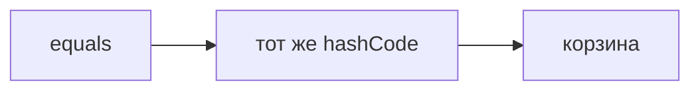
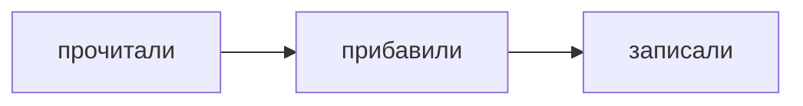
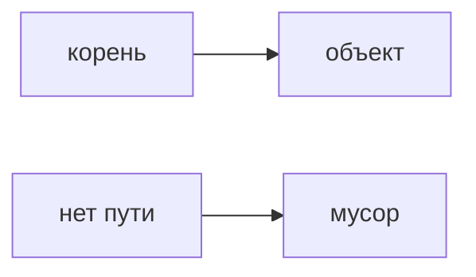
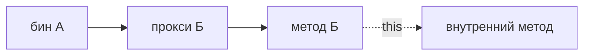

## Введение

Java-собес почти сразу открывает коллекции. HashMap — витрина: равенство, хеш и то, что порядок корзин не обещан. Это не серия про JDBC.

**Потоки.** Два потока без договорённости о памяти видят разное. volatile делает запись видимой, но не делает составное действие атомарным. synchronized и пул закрывают другие дыры.

**Сборщик.** Сборщик забирает объекты, до которых больше нет пути от корней. Пауза — это цена части работы, когда приложение стоит. На собесе достаточно поколений и фразы, что утечка — это живая ссылка, а не «GC сломался».

**Spring.** Spring-собес упирается в две вещи: контейнер создаёт бин и подсовывает зависимости, а транзакция — это прокси вокруг вызова снаружи. Вызов метода этого же класса прокси не проходит.

## Раздел: Как отвечать одним блоком

Этот выпуск собрал соседние короткие темы трека: «HashMap», «Потоки», «Сборщик», «Spring». Раньше каждая занимала отдельную карточку на несколько минут, а на собеседовании их спрашивают одним блоком. Ниже у каждой темы свой раздел, затем общие лабы, один тест и одна колода карточек. В ответе сначала назовите, какую тему спросили, потом определение и один пример. Не проговаривайте все разделы, если спросили один. Лабы можно пройти по порядку исходного трека. Если времени мало, сделайте первую и последнюю: первая ставит язык, последняя проверяет, что соседние темы вы не перепутали.

## Раздел: HashMap: Контракт

Если equals говорит «равны», hashCode обязан совпасть. Иначе объект кладут в одну корзину, а ищут в другой. Мутировать поле, которое входит в хеш, пока ключ уже в карте — способ потерять запись. Список выбирают, когда важен порядок и допускают линейный поиск. Множество — когда важен факт присутствия.

## Раздел: HashMap: Ответ вслух

Я говорю контракт: равные объекты имеют один hashCode. Обратное не обязательно: разные объекты могут столкнуться. Ключ в карте не меняю. Если нужен порядок обхода, HashMap не обещаю, беру структуру, которая это говорит вслух.

## Раздел: HashMap: Плохой ответ

Плохой ответ: «HashMap всегда O(1)». Худший случай и контракт equals забыты.

## Раздел: HashMap: Термины

Равенство — equals. Хеш-код — hashCode. Корзина — bucket. Столкновение — collision.

## Раздел: Потоки: Границы

`i++` даже у volatile не атомарен: прочитали, прибавили, записали. Для счётчика нужен атомарный тип или блок. Пул потоков ограничивает число, очередь задач и переиспользование. `new Thread` на каждый запрос так не умеет. Общую HashMap без синхронизации два потока портят.

## Раздел: Потоки: Ответ вслух

volatile я беру, когда нужна видимость одного флага. Счётчик так не защищаю. Критическую секцию закрываю синхронизацией или готовым атомарным классом. Потоки беру из пула, чтобы не создавать их без предела.

## Раздел: Потоки: Плохой ответ

Плохой ответ: «поставил volatile на счётчик, гонок нет». Прибавление всё ещё из трёх шагов.

## Раздел: Потоки: Термины

Видимость — visibility. Гонка — race. Атомарность — atomicity. Пул — thread pool. Критическая секция — critical section.

## Раздел: Сборщик: Поколения

Новые объекты умирают часто, их собирают отдельно и дёшево. То, что пережило, уезжает в старшее поколение, собирать его дороже. Статическая коллекция, куда всё добавляют и не удаляют, держит объекты живыми: сборщику нечего забирать.

## Раздел: Сборщик: Ответ вслух

Я говорю: мусор — то, до чего нет ссылки от корней. Молодые умирают быстро. Если паузы длинные, смотрю, не удерживаем ли мы граф случайно. Утечка в Java чаще живая коллекция, чем сломанный сборщик.

## Раздел: Сборщик: Плохой ответ

Плохой ответ: «вызвать System.gc и утечка пройдёт». Подсказка сборщику не обрывает ваши ссылки.

## Раздел: Сборщик: Термины

Сборщик — garbage collector. Корень — GC root. Поколение — generation. Пауза — pause, stop-the-world на части циклов.

## Раздел: Spring: Граница

Зависимость приходит снаружи, объект не ищет её через new, если хотите подмену в тесте. `@Transactional` на public-методе, который зовут из другого бина. Внутренний вызов `this.method()` не стартует новую транзакцию. Исключение, которое прокси не считает поводом для отката, зафиксирует изменения.

## Раздел: Spring: Ответ вслух

Бин собирает контейнер. Транзакцию включает прокси на внешнем вызове. Если метод зовёт соседний метод того же объекта, я не жду второй транзакции. Откат говорю вместе с типом исключения, не «аннотация всё откатит».

## Раздел: Spring: Плохой ответ

Плохой ответ: «поставил аннотацию на private, транзакция есть». Прокси этот вызов не видит.

## Раздел: Spring: Термины

Внедрение — dependency injection. Бин — bean. Прокси — proxy. Откат — rollback. Граница — transaction boundary.

## Раздел: Формулировки из исходных выпусков

HashMap. Вопрос «equals истинно, hashCode разный. get найдёт ключ?»: нет. Искать будут в другой корзине.

HashMap. Вопрос «hashCode совпал, equals нет. Это ошибка контракта?»: нет, это столкновение. Контракт требует только одну сторону.

HashMap. Вопрос «Поменяли поле ключа после put. Что с записью?»: её можно потерять. Корзина посчитана по старому хешу.

HashMap. Вопрос «Нужен порядок вставки. HashMap подойдёт?»: нет. Порядок корзин не часть контракта.

HashMap. Вопрос «Список на миллион поисков одного id. Хороший выбор?»: нет, нужен словарь. Иначе линейный проход.

HashMap. Карточка «Контракт equals и hashCode?» — Равные объекты — одинаковый hashCode..

HashMap. Карточка «Одинаковый hashCode значит equals?» — Нет, возможна коллизия..

HashMap. Карточка «Почему не менять ключ?» — Карта запомнила старую корзину..

HashMap. Карточка «HashMap гарантирует порядок?» — Нет..

HashMap. Карточка «Худший случай поиска?» — Длинная цепочка в одной корзине..

HashMap. Карточка «Когда список, а не карта?» — Мало данных или важен индекс, поиск не главный..

Потоки. Вопрос «volatile на int и i++. Гонка возможна?»: да. Нет атомарности прибавления.

Потоки. Вопрос «Два потока пишут в HashMap без замка. Можно?»: нет. Структура рвётся.

Потоки. Вопрос «Зачем пул, если можно new Thread?»: предел и переиспользование. Иначе потоков станет сколько запросов.

Потоки. Вопрос «Флаг остановки volatile. Уместный случай?»: да, если это одна запись. Видимости хватает.

Потоки. Вопрос «synchronized на весь метод длинного отчёта. Чем плохо?»: держат замок зря. Секция должна быть короткой.

Потоки. Карточка «Что даёт volatile?» — Видимость записи другим потокам..

Потоки. Карточка «Что volatile не даёт?» — Атомарность составного действия..

Потоки. Карточка «Почему i++ не атомарен?» — Чтение, прибавление и запись — разные шаги..

Потоки. Карточка «Зачем thread pool?» — Ограничить число потоков и переиспользовать их..

Потоки. Карточка «Общая HashMap без синхронизации?» — Нельзя, если пишут несколько потоков..

Потоки. Карточка «Что такое race?» — Итог зависит от порядка без договорённости..

Сборщик. Вопрос «На объект нет ссылок. Он ещё в куче. Это утечка?»: нет, его заберут. Утечка — когда ссылка есть и не нужна.

Сборщик. Вопрос «Список static растёт всегда. Кто виноват?»: код, который не чистит. Сборщик видит живые ссылки.

Сборщик. Вопрос «System.gc лечит утечку?»: нет. Ссылки остаются.

Сборщик. Вопрос «Почему молодые объекты собирают чаще?»: они чаще мертвы. Так дешевле.

Сборщик. Вопрос «Длинная пауза. Первый вопрос?»: что удерживает большой граф. Не «выключить сборщик».

Сборщик. Карточка «Когда объект мусор?» — От корней до него нет пути..

Сборщик. Карточка «Что такое утечка в Java?» — Ненужный объект всё ещё достижим..

Сборщик. Карточка «Зачем поколения?» — Молодые умирают часто, их дёшево собирать..

Сборщик. Карточка «System.gc удаляет утечку?» — Нет..

Сборщик. Карточка «Что такое pause?» — Отрезок, когда приложение ждёт сборщика..

Сборщик. Карточка «Типичный корень-ошибка?» — Статическая коллекция без удаления..

Spring. Вопрос «Метод с транзакцией вызван через this. Прокси сработал?»: нет. Вызов не выходил наружу.

Spring. Вопрос «Зависимость создают через new внутри бина. Её легко подменить в тесте?»: нет. Контейнер её не подсовывал.

Spring. Вопрос «Аннотация на private. На что рассчитываете?»: что её не увидят. Прокси обычно на публичной границе.

Spring. Вопрос «Исключение поймали внутри метода и не бросили дальше. Откат будет?»: обычно нет. Прокси видит то, что вышло наружу.

Spring. Вопрос «Два бина, вызов снаружи. Где граница транзакции?»: на прокси вызываемого. Не на внутренней строке метода.

Spring. Карточка «Кто создаёт бин?» — Контейнер Spring..

Spring. Карточка «Зачем внедрение снаружи?» — Чтобы подменить зависимость..

Spring. Карточка «Где срабатывает транзакция?» — На внешнем вызове через прокси..

Spring. Карточка «this.method() откроет транзакцию?» — Нет..

Spring. Карточка «Пойманное внутри исключение откатит?» — Нет, если наружу оно не вышло..

Spring. Карточка «Private с аннотацией?» — Плохая граница, прокси мимо..

## Лаба

**HashMap.**

**20 минут.** На бумаге положите два объекта с одинаковым equals и разным hashCode в воображаемую карту. Найдите, почему get не находит значение.

**Потоки.**

**20 минут.** На бумаге разложите `count++` на три шага двух потоков. Покажите потерю прибавления. Рядом напишите, чем заменили бы поле.

**Сборщик.**

**15 минут.** Назовите три корня, которые держат объект живым: локальная переменная, статическое поле, поток. Для каждого — как отпустить.

**Spring.**

**20 минут.** Нарисуйте два бина: сервис А вызывает сервис Б. Отметьте, где живёт прокси. Вторым цветом покажите вызов this внутри Б и почему он мимо прокси.

## Схема: HashMap: Контракт

## Схема: Потоки: Три шага

## Схема: Сборщик: Живой объект

## Схема: Spring: Прокси

## Тест

### equals истинно, hashCode разный. get найдёт ключ?

**Ответ:** нет

**Пояснение:** Искать будут в другой корзине.

### volatile на int и i++. Гонка возможна?

**Ответ:** да

**Пояснение:** Нет атомарности прибавления.

### На объект нет ссылок. Он ещё в куче. Это утечка?

**Ответ:** нет, его заберут

**Пояснение:** Утечка — когда ссылка есть и не нужна.

### Метод с транзакцией вызван через this. Прокси сработал?

**Ответ:** нет

**Пояснение:** Вызов не выходил наружу.

### hashCode совпал, equals нет. Это ошибка контракта?

**Ответ:** нет, это столкновение

**Пояснение:** Контракт требует только одну сторону.

## Шпаргалка

<ul><li>Равные — один хеш</li><li>Ключ не мутировать</li><li>Порядок HashMap не обещает</li><li>Видимость не атомарность</li><li>Счётчик не volatile</li><li>Пул вместо бесконечных Thread</li><li>Мусор — недостижимое</li><li>Утечка — лишняя ссылка</li><li>Пауза имеет причину в графе</li><li>Контейнер собирает объект</li><li>Транзакция на внешней границе</li><li>Внутренний вызов прокси не видит</li></ul>

## Anki

### Front: Контракт equals и hashCode?

Back: Равные объекты — одинаковый hashCode.

### Front: Что даёт volatile?

Back: Видимость записи другим потокам.

### Front: Когда объект мусор?

Back: От корней до него нет пути.

### Front: Кто создаёт бин?

Back: Контейнер Spring.

### Front: Одинаковый hashCode значит equals?

Back: Нет, возможна коллизия.

### Front: Что volatile не даёт?

Back: Атомарность составного действия.

## Мнемоника

### link: HashMap

**Задание:** Что происходит при put.

**Элементы:**
- hash
- корзина
- equals
- resize

**Подсказка:** Одинаковый hash не значит одинаковый ключ. Дальше equals.

**Ответ:** hash → bucket → equals → resize

## Итоги

- Равные — один хеш
- Ключ не мутировать
- Порядок HashMap не обещает
- Видимость не атомарность
- Счётчик не volatile
- Пул вместо бесконечных Thread
- Мусор — недостижимое
- Утечка — лишняя ссылка

## Ссылки

- [Обзор JVM](/game/learn/jv-se-jvm)
- [JDBC рядом](/game/learn/jv-shell-process)
