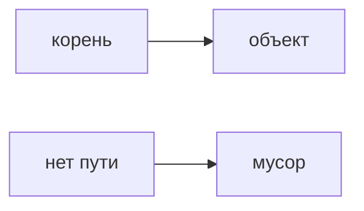

## Введение

Сборщик забирает объекты, до которых больше нет пути от корней. Пауза — это цена части работы, когда приложение стоит. На собесе достаточно поколений и фразы, что утечка — это живая ссылка, а не «GC сломался».

## Раздел: Поколения

Новые объекты умирают часто, их собирают отдельно и дёшево. То, что пережило, уезжает в старшее поколение, собирать его дороже. Статическая коллекция, куда всё добавляют и не удаляют, держит объекты живыми: сборщику нечего забирать.

## Раздел: Ответ вслух

Я говорю: мусор — то, до чего нет ссылки от корней. Молодые умирают быстро. Если паузы длинные, смотрю, не удерживаем ли мы граф случайно. Утечка в Java чаще живая коллекция, чем сломанный сборщик.

## Раздел: Плохой ответ

Плохой ответ: «вызвать System.gc и утечка пройдёт». Подсказка сборщику не обрывает ваши ссылки.

## Раздел: Термины

Сборщик — garbage collector. Корень — GC root. Поколение — generation. Пауза — pause, stop-the-world на части циклов.

## Лаба

**15 минут.** Назовите три корня, которые держат объект живым: локальная переменная, статическое поле, поток. Для каждого — как отпустить.

## Схема: Живой объект

## Тест

### На объект нет ссылок. Он ещё в куче. Это утечка?

**Ответ:** нет, его заберут

**Пояснение:** Утечка — когда ссылка есть и не нужна.

### Список static растёт всегда. Кто виноват?

**Ответ:** код, который не чистит

**Пояснение:** Сборщик видит живые ссылки.

### System.gc лечит утечку?

**Ответ:** нет

**Пояснение:** Ссылки остаются.

### Почему молодые объекты собирают чаще?

**Ответ:** они чаще мертвы

**Пояснение:** Так дешевле.

### Длинная пауза. Первый вопрос?

**Ответ:** что удерживает большой граф

**Пояснение:** Не «выключить сборщик».

## Шпаргалка

<ul><li>Мусор — недостижимое</li><li>Утечка — лишняя ссылка</li><li>Пауза имеет причину в графе</li></ul>

## Anki

### Front: Когда объект мусор?

Back: От корней до него нет пути.

### Front: Что такое утечка в Java?

Back: Ненужный объект всё ещё достижим.

### Front: Зачем поколения?

Back: Молодые умирают часто, их дёшево собирать.

### Front: System.gc удаляет утечку?

Back: Нет.

### Front: Что такое pause?

Back: Отрезок, когда приложение ждёт сборщика.

### Front: Типичный корень-ошибка?

Back: Статическая коллекция без удаления.

## Итоги

- Мусор — недостижимое
- Утечка — лишняя ссылка
- Пауза имеет причину в графе

## Ссылки

- [Потоки](/game/learn/jc-concurrency)
- [Spring](/game/learn/jc-spring-di-tx)
