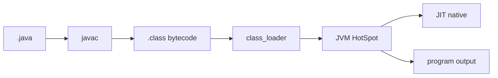
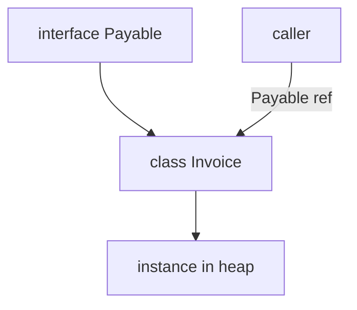

## Введение

На junior-собесе по Java почти всегда начинают с картины исполнения: чем JDK отличается от JRE, что делает JVM и почему «Java компилируется, но не в нативный код сразу». Этот выпуск закрывает вводный блок своими формулировками по мотивам Oracle Java Tutorials (SE) — без копипаста учебника.

**ООП vs Python.** После JVM спрашивают модель типов и ООП: класс vs интерфейс, `static`, наследование и «чем это не как в Python». Выпуск опирается на Oracle Tutorials (ООП) и даёт **оригинальные** сравнения с [PY06](/game/learn/py-oop-basics) — без копипаста учебников.

## Раздел: Как отвечать одним блоком

Этот выпуск собрал соседние короткие темы трека: «Java SE и JVM на собесе», «ООП vs Python». Раньше каждая занимала отдельную карточку на несколько минут, а на собеседовании их спрашивают одним блоком. Ниже у каждой темы свой раздел, затем общие лабы, один тест и одна колода карточек. В ответе сначала назовите, какую тему спросили, потом определение и один пример. Не проговаривайте все разделы, если спросили один. Лабы можно пройти по порядку исходного трека. Если времени мало, сделайте первую и последнюю: первая ставит язык, последняя проверяет, что соседние темы вы не перепутали.

## Раздел: Java SE и JVM на собесе: JDK, JRE и JVM

**JDK** (Java Development Kit) — комплект разработчика: `javac`, отладчик, `jar`, утилиты и обычно runtime. **JRE** — среда запуска приложений (исторически отдельный пакет; в современных дистрибутивах JDK часто «всё в одном»). **JVM** — виртуальная машина: загружает bytecode (`.class` / модули), проверяет, интерпретирует и/или компилирует JIT в нативный код.

Цепочка на собесе: `.java` → `javac` → `.class` → class loader → JVM. Фраза «Java только интерпретируется» — ловушка: есть шаг компиляции в bytecode и часто HotSpot JIT.

Типичная ошибка: путать JDK и JVM («JDK исполняет код»). Исполняет JVM; JDK — набор инструментов *плюс* runtime.

## Раздел: Java SE и JVM на собесе: Classpath, модули и поиск классов

Classpath (и module path в JPMS) говорит JVM, **где искать классы и ресурсы**. `ClassNotFoundException` / `NoClassDefFoundError` на практике чаще всего — неверный путь, забытый jar в контейнере или конфликт версий зависимостей.

```text
java -cp "app.jar:lib/*" com.example.Main
```

На Windows разделитель — `;`, в Linux/macOS — `:`. В Maven/Gradle classpath собирает инструмент; вручную его правят редко, но на собесе ждут понимание идеи.

Ошибка новичка: класть исходники в classpath вместо скомпилированных классов или путать `CLASSPATH` env с `-cp` флагом (флаг обычно приоритетнее).

## Раздел: Java SE и JVM на собесе: Примитивы, ссылки и память

Восемь примитивов (`int`, `long`, `boolean` …) хранят **значение**. Ссылочные типы (`String`, массивы, свои классы) хранят **ссылку** на объект в heap. Стек кадра метода держит локальные переменные (примитивы и ссылки); объекты — в куче, пока на них есть достижимые ссылки (затем GC).

`Integer` — объект-обёртка; autoboxing связывает `int` ↔ `Integer`. Ловушка: сравнение обёрток через `==` вместо `equals` (кэш `-128…127` для `Integer` маскирует баг на малых числах).

Кратко vs Python (см. [PY01](/game/learn/py-intro-python)): в Java типы у переменных статические на уровне языка; в Python тип у объекта, имя — ссылка без объявленного типа.

## Раздел: Java SE и JVM на собесе: Частые вопросы с собеседования

**Вопрос.** Чем `==` отличается от `equals` для строк и объектов?

**Ответ.** Оператор `==` сравнивает ссылки: для двух объектов true только если это один и тот же экземпляр в heap. Метод `equals` сравнивает содержимое по контракту класса (у String — посимвольно). На собесе приводят `new String("a") == new String("a")` (false) и `"a".equals("a")` (true). Для сущностей в коллекциях без переопределённого equals/hashCode сравнение ссылок ломает Set/Map.

**Вопрос.** Что такое string pool (intern) и зачем он на собесе?

**Ответ.** Литералы и некоторые строки JVM хранит в пуле в heap: одинаковые литералы могут указывать на один объект. Метод `intern()` кладёт строку в пул или возвращает уже существующую копию. Поэтому `"ab" == "ab"` часто true, а конкатенация через `new` — нет. Пул экономит память, но не отменяет правило: для логики сравнения строк используйте `equals`.

**Вопрос.** Checked и unchecked исключения — в чём разница?

**Ответ.** Checked (`Exception`, кроме `RuntimeException`) компилятор заставляет обрабатывать или объявлять в `throws`. Unchecked (`RuntimeException`, `Error`) можно не декларировать — это ошибки программирования или сбои VM. На собесе связывают с JDBC: `SQLException` — checked, NPE — unchecked. Спор «все ли делать unchecked» — про стиль API, но знать контракт языка обязательно.

**Вопрос.** Зачем bytecode, если есть JIT?

**Ответ.** Bytecode — переносимый слой между компилятором и конкретной JVM: один `.class` на разных ОС при одной VM. JIT включается позже для «горячих» участков и не заменяет этап загрузки и верификации bytecode. Ответ «Java медленная, потому что интерпретируется» устарел: HotSpot компилирует hot paths в native. Bytecode остаётся форматом деплоя и безопасности (verifier).

## Раздел: ООП vs Python: Класс, объект и контракт интерфейса

В Java класс описывает состояние и поведение; объект — экземпляр. Поля экземпляра живут у объекта; `static`-члены принадлежат типу. **Интерфейс** задаёт контракт (что можно вызвать), класс — реализацию. С Java 8 у интерфейсов есть `default`/`static` методы, но на junior-собесе ядро — «множественное наследование типов через implements, одно extends у класса».

```java
interface Payable { Money amount(); }
final class Invoice implements Payable {
  private final Money total;
  public Invoice(Money total) { this.total = total; }
  public Money amount() { return total; }
}
```

Ошибка: делать «божественный» базовый класс вместо композиции и интерфейсов ролей. Вторая ошибка: путать `abstract class` (частичная реализация + состояние) с interface (контракт; состояние — через поля реализации).

## Раздел: ООП vs Python: Инкапсуляция, доступ и final

Модификаторы `private` / package / `protected` / `public` — часть языка, не «договор чести». Инкапсуляция на собесе: скрыть представление, открыть поведение. `final` у класса запрещает наследование; у метода — переопределение; у переменной — повторное присваивание ссылки/примитива (объект при этом может мутировать, если не иммутабелен).

Vs Python: нет настоящих private (есть `_` / `__` name mangling как соглашение). Duck typing vs nominal typing: в Java тип должен быть объявлен/совместим компилятором; в Python «если есть нужные методы — подойдёт», пока не упадёт в runtime.

## Раздел: ООП vs Python: Полиморфизм и типичные ловушки

Полиморфизм через переопределение (`@Override`) и ссылку базового типа/интерфейса — стандартный ответ. Перегрузка (`overload`) — другой compile-time механизм, не путать с override.

Ловушки на собесе:
- вызов переопределённого метода из конструктора базового класса (объект ещё не достроен);
- забытый `equals`/`hashCode` контракт для сущностей в `HashSet`/`HashMap`;
- `static` «полиморфизм» не работает — связывание по типу ссылки, не runtime-диспетч экземпляра.

Связка с Python: MRO и множественное наследование классов там норма; в Java для классов — одиночное extends + интерфейсы.

## Раздел: ООП vs Python: Частые вопросы с собеседования

**Вопрос.** Почему для `String` нельзя полагаться на `==`?

**Ответ.** У строк `==` сравнивает ссылки, а не текст; литералы могут шарить один объект из пула, а `new String(...)` или результат некоторых операций — другой. Контракт сравнения содержимого — `equals`, при необходимости с учётом регистра `equalsIgnoreCase`. Это та же ловушка, что у обёрток `Integer`, но на собесе чаще спрашивают именно про String.

**Вопрос.** Что такое string pool одной фразой?

**Ответ.** Область heap, где JVM дедuplicирует строковые литералы и результаты `intern()`, чтобы одинаковый текст не занимал много копий. Сравнение литералов через `==` иногда «случайно» работает — это не повод игнорировать `equals`. Пул не делает строки immutable иначе: они immutable по спецификации класса String.

**Вопрос.** Checked exception — когда компилятор заставит `throws`?

**Ответ.** Если метод бросает checked-тип (например `IOException`), вызывающий код должен поймать try/catch или пробросить в сигнатуре. `RuntimeException` и наследники — unchecked, компилятор молчит. На junior-собесе достаточно примера: чтение файла vs деление на ноль. В enterprise-коде checked часто оборачивают в доменные unchecked с контекстом.

**Вопрос.** JDK, JRE, JVM — повторите за 20 секунд.

**Ответ.** JDK — kit разработчика (javac, jar, tools + runtime). JRE — среда запуска (исторически отдельно). JVM — процесс/VM, исполняющий bytecode. Цепочка: `.java` → javac → `.class` → class loader → JVM. Путаница «JDK исполняет» режут: исполняет JVM.

## Лаба

**Java SE и JVM на собесе.**

**Цель.** Устный ответ на 60–90 секунд: «Как Java запускает программу от исходника до результата?»

**Шаги.**
1. Установите JDK и выполните `javac -version` и `java -version` — запишите vendor и major.
2. Создайте `Hello.java` с `public static void main`, скомпилируйте и запустите.
3. Нарисуйте на бумаге: JDK / JRE / JVM и стрелку `.java → .class → JVM`.
4. Объясните одному коллеге разницу `int` и `Integer` и риск `==` у обёрток.
5. Сравните одной фразой с циклом исполнения Python (bytecode → CPython).

**В группу:** партнёр путает JDK и JVM — исправьте без жаргона «магия».

**Готово, если…**
- [ ] Отличаете JDK, JRE и JVM без шпаргалки
- [ ] Объясняете classpath на примере ошибки ClassNotFound
- [ ] Приводите пример примитива vs ссылки и ловушку autoboxing

**ООП vs Python.**

**Цель.** Сравнить устно за 90 секунд модель ООП Java и Python на одном примере «платёж / счёт».

**Шаги.**
1. Напишите интерфейс + класс (5–15 строк) с одним методом контракта.
2. Добавьте `static` фабрику и объясните, почему это не полиморфизм экземпляра.
3. Перечислите 3 отличия от Python OOP (типы, private, наследование).
4. Назовите один кейс, где в Java лучше interface, а не abstract class.
5. Свяжите с [JV01](/game/learn/jv-se-jvm): где живут поля экземпляра.

**В группу:** один защищает «всё через наследование», второй — композицию; зафиксируйте вердикт.

**Готово, если…**
- [ ] Отличаете interface и abstract class
- [ ] Объясняете override vs overload
- [ ] Даёте ≥3 контраста с Python без воды

## Схема: Java SE и JVM на собесе: От исходника до JVM



## Схема: ООП vs Python: Тип, контракт, реализация



## Тест

### Чем JDK отличается от JRE?

**Ответ:** JDK = tools + runtime; JRE = запуск

**Пояснение:** JVM исполняет bytecode в обоих случаях; JDK добавляет компилятор и утилиты разработки.

### Зачем interface, если есть class?

**Ответ:** контракт без одной реализации

**Пояснение:** несколько классов могут реализовать один контракт; удобно для подмены и тестов.

### Что делает JVM с `.class`?

**Ответ:** загружает и исполняет bytecode

**Пояснение:** class loader + verifier + interpreter/JIT; не «читает .java напрямую».

### Чем abstract class отличается от interface?

**Ответ:** состояние и частичная реализация

**Пояснение:** abstract class может хранить поля и шаблонные методы; interface — в первую очередь контракт.

### Где JVM ищет классы приложения?

**Ответ:** classpath / module path

**Пояснение:** неверный путь — частая причина ClassNotFoundException в проде и на лабе.

## Шпаргалка

<ul><li>JDK ⊃ инструменты; JVM исполняет bytecode</li><li>.java → javac → .class → class loader → JVM</li><li>classpath / module path = где искать классы</li><li>примитив = значение; ссылка = адрес объекта в heap</li><li>class = реализация; interface = контракт</li><li>extends одно; implements — много</li><li>override ≠ overload; static не полиморфен</li><li>Java: nominal types; Python: duck typing + соглашения</li></ul>

## Anki

### Front: Что входит в JDK сверх среды запуска?

Back: компилятор javac, jar, отладчик и другие tools разработчика

### Front: Что описывает Java-интерфейс на junior-собесе?

Back: контракт методов, который класс обязуется реализовать

### Front: Кто исполняет Java-bytecode — JDK или JVM?

Back: JVM; JDK — комплект, в котором runtime/JVM обычно присутствует

### Front: Сколько классов может extends один Java-класс?

Back: ровно один; дополнительно — много implements интерфейсов

### Front: Что такое classpath одной фразой?

Back: список мест (jar/dirs), где JVM ищет классы и ресурсы

### Front: Чем override отличается от overload?

Back: override — та же сигнатура в иерархии; overload — разные параметры, выбор на компиляции

## Итоги

- Картина SE: инструменты JDK, исполнитель JVM, формат bytecode
- Classpath — практическая боль деплоя и собеса
- Примитивы vs ссылки и autoboxing — база следующих выпусков
- ООП Java держится на контрактах, доступе и nominal types
- Static, equals/hashCode и конструкторы — частые ловушки
- Сравнение с Python показывает, *почему* церемония Java окупается в больших кодовых базах

## Ссылки

- [Oracle Java Tutorials — Getting Started](https://docs.oracle.com/javase/tutorial/getStarted/)
- [Oracle Java Tutorials — Essential Classes](https://docs.oracle.com/javase/tutorial/essential/)
- [PY01 Intro Python](/game/learn/py-intro-python)
- [Oracle Java Tutorials — Classes and Objects](https://docs.oracle.com/javase/tutorial/java/javaOO/)
- [Oracle Java Tutorials — Interfaces and Inheritance](https://docs.oracle.com/javase/tutorial/java/IandI/)
- [PY06 OOP basics](/game/learn/py-oop-basics)
- [Shell и процесс JVM](/game/learn/jv-shell-process)
