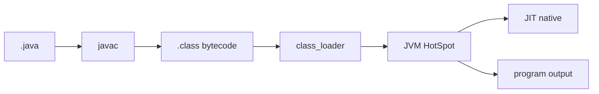

## Введение

На junior-собесе по Java почти всегда начинают с картины исполнения: чем JDK отличается от JRE, что делает JVM и почему «Java компилируется, но не в нативный код сразу». Этот выпуск закрывает вводный блок своими формулировками по мотивам Oracle Java Tutorials (SE) — без копипаста учебника.

## Раздел: JDK, JRE и JVM

**JDK** (Java Development Kit) — комплект разработчика: `javac`, отладчик, `jar`, утилиты и обычно runtime. **JRE** — среда запуска приложений (исторически отдельный пакет; в современных дистрибутивах JDK часто «всё в одном»). **JVM** — виртуальная машина: загружает bytecode (`.class` / модули), проверяет, интерпретирует и/или компилирует JIT в нативный код.

Цепочка на собесе: `.java` → `javac` → `.class` → class loader → JVM. Фраза «Java только интерпретируется» — ловушка: есть шаг компиляции в bytecode и часто HotSpot JIT.

Типичная ошибка: путать JDK и JVM («JDK исполняет код»). Исполняет JVM; JDK — набор инструментов *плюс* runtime.

## Раздел: Classpath, модули и поиск классов

Classpath (и module path в JPMS) говорит JVM, **где искать классы и ресурсы**. `ClassNotFoundException` / `NoClassDefFoundError` на практике чаще всего — неверный путь, забытый jar в контейнере или конфликт версий зависимостей.

```text
java -cp "app.jar:lib/*" com.example.Main
```

На Windows разделитель — `;`, в Linux/macOS — `:`. В Maven/Gradle classpath собирает инструмент; вручную его правят редко, но на собесе ждут понимание идеи.

Ошибка новичка: класть исходники в classpath вместо скомпилированных классов или путать `CLASSPATH` env с `-cp` флагом (флаг обычно приоритетнее).

## Раздел: Примитивы, ссылки и память

Восемь примитивов (`int`, `long`, `boolean` …) хранят **значение**. Ссылочные типы (`String`, массивы, свои классы) хранят **ссылку** на объект в heap. Стек кадра метода держит локальные переменные (примитивы и ссылки); объекты — в куче, пока на них есть достижимые ссылки (затем GC).

`Integer` — объект-обёртка; autoboxing связывает `int` ↔ `Integer`. Ловушка: сравнение обёрток через `==` вместо `equals` (кэш `-128…127` для `Integer` маскирует баг на малых числах).

Кратко vs Python (см. [PY01](/game/learn/py-intro-python)): в Java типы у переменных статические на уровне языка; в Python тип у объекта, имя — ссылка без объявленного типа.

## Раздел: Частые вопросы с собеседования

**Вопрос.** Чем `==` отличается от `equals` для строк и объектов?

**Ответ.** Оператор `==` сравнивает ссылки: для двух объектов true только если это один и тот же экземпляр в heap. Метод `equals` сравнивает содержимое по контракту класса (у String — посимвольно). На собесе приводят `new String("a") == new String("a")` (false) и `"a".equals("a")` (true). Для сущностей в коллекциях без переопределённого equals/hashCode сравнение ссылок ломает Set/Map.

**Вопрос.** Что такое string pool (intern) и зачем он на собесе?

**Ответ.** Литералы и некоторые строки JVM хранит в пуле в heap: одинаковые литералы могут указывать на один объект. Метод `intern()` кладёт строку в пул или возвращает уже существующую копию. Поэтому `"ab" == "ab"` часто true, а конкатенация через `new` — нет. Пул экономит память, но не отменяет правило: для логики сравнения строк используйте `equals`.

**Вопрос.** Checked и unchecked исключения — в чём разница?

**Ответ.** Checked (`Exception`, кроме `RuntimeException`) компилятор заставляет обрабатывать или объявлять в `throws`. Unchecked (`RuntimeException`, `Error`) можно не декларировать — это ошибки программирования или сбои VM. На собесе связывают с JDBC: `SQLException` — checked, NPE — unchecked. Спор «все ли делать unchecked» — про стиль API, но знать контракт языка обязательно.

**Вопрос.** Зачем bytecode, если есть JIT?

**Ответ.** Bytecode — переносимый слой между компилятором и конкретной JVM: один `.class` на разных ОС при одной VM. JIT включается позже для «горячих» участков и не заменяет этап загрузки и верификации bytecode. Ответ «Java медленная, потому что интерпретируется» устарел: HotSpot компилирует hot paths в native. Bytecode остаётся форматом деплоя и безопасности (verifier).

## Лаба

**Цель.** Устный ответ на 60–90 секунд: «Как Java запускает программу от исходника до результата?»

**Шаги.**
1. Установите JDK и выполните `javac -version` и `java -version` — запишите vendor и major.
2. Создайте `Hello.java` с `public static void main`, скомпилируйте и запустите.
3. Нарисуйте на бумаге: JDK / JRE / JVM и стрелку `.java → .class → JVM`.
4. Объясните одному коллеге разницу `int` и `Integer` и риск `==` у обёрток.
5. Сравните одной фразой с циклом исполнения Python (bytecode → CPython).

**В группу:** партнёр путает JDK и JVM — исправьте без жаргона «магия».

**Готово, если…**
- [ ] Отличаете JDK, JRE и JVM без шпаргалки
- [ ] Объясняете classpath на примере ошибки ClassNotFound
- [ ] Приводите пример примитива vs ссылки и ловушку autoboxing

## Схема: От исходника до JVM



## Тест

### Чем JDK отличается от JRE?

**Ответ:** JDK = tools + runtime; JRE = запуск

**Пояснение:** JVM исполняет bytecode в обоих случаях; JDK добавляет компилятор и утилиты разработки.

### Что делает JVM с `.class`?

**Ответ:** загружает и исполняет bytecode

**Пояснение:** class loader + verifier + interpreter/JIT; не «читает .java напрямую».

### Где JVM ищет классы приложения?

**Ответ:** classpath / module path

**Пояснение:** неверный путь — частая причина ClassNotFoundException в проде и на лабе.

### Чем `int` отличается от `Integer`?

**Ответ:** примитив vs объект-обёртка

**Пояснение:** autoboxing связывает их; у обёртки есть null и семантика equals/`==`.

### Java — «чисто интерпретируемый» язык?

**Ответ:** нет — bytecode + часто JIT

**Пояснение:** сначала компиляция в bytecode, затем исполнение VM с возможной JIT-компиляцией.

## Шпаргалка

<h3>Суть</h3>
<ul>
<li>JDK ⊃ инструменты; JVM исполняет bytecode</li>
<li>.java → javac → .class → class loader → JVM</li>
<li>classpath / module path = где искать классы</li>
<li>примитив = значение; ссылка = адрес объекта в heap</li>
</ul>
<h3>Фразы на собесе</h3>
<pre><code>bytecode + HotSpot JIT
ClassNotFound ≠ «Java сломалась» — проверь path
int vs Integer: == ловушка
</code></pre>

## Anki

### Front: Что входит в JDK сверх среды запуска?

Back: компилятор javac, jar, отладчик и другие tools разработчика

### Front: Кто исполняет Java-bytecode — JDK или JVM?

Back: JVM; JDK — комплект, в котором runtime/JVM обычно присутствует

### Front: Что такое classpath одной фразой?

Back: список мест (jar/dirs), где JVM ищет классы и ресурсы

### Front: Где живут объекты обычных ссылочных типов?

Back: в heap; локальная переменная на стеке хранит ссылку

### Front: Чем опасен `==` для двух Integer?

Back: сравнивает ссылки, не значение; кэш малых чисел маскирует баг

### Front: Что делает JIT в HotSpot?

Back: компилирует «горячий» bytecode в нативный код для ускорения

## Итоги

- Картина SE: инструменты JDK, исполнитель JVM, формат bytecode
- Classpath — практическая боль деплоя и собеса
- Примитивы vs ссылки и autoboxing — база следующих выпусков

## Ссылки

- [Oracle Java Tutorials — Getting Started](https://docs.oracle.com/javase/tutorial/getStarted/)
- [Oracle Java Tutorials — Essential Classes](https://docs.oracle.com/javase/tutorial/essential/)
- Learn | [PY01 Intro Python](/game/learn/py-intro-python)
- Далее: [ООП Java vs Python](/game/learn/jv-oop-vs-python)
