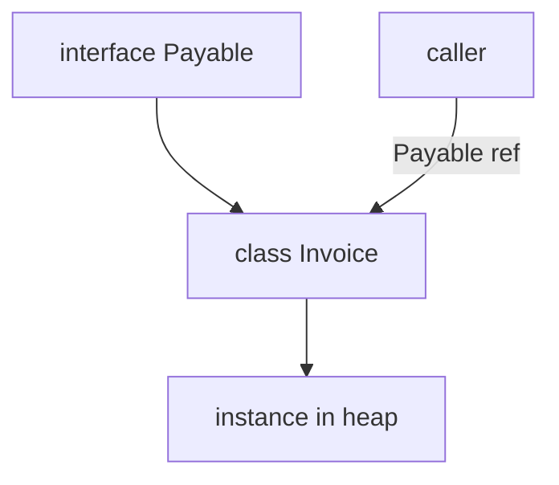

## Введение

После JVM спрашивают модель типов и ООП: класс vs интерфейс, `static`, наследование и «чем это не как в Python». Выпуск опирается на Oracle Tutorials (ООП) и даёт **оригинальные** сравнения с [PY06](/game/learn/py-oop-basics) — без копипаста учебников.

## Раздел: Класс, объект и контракт интерфейса

В Java класс описывает состояние и поведение; объект — экземпляр. Поля экземпляра живут у объекта; `static`-члены принадлежат типу. **Интерфейс** задаёт контракт (что можно вызвать), класс — реализацию. С Java 8 у интерфейсов есть `default`/`static` методы, но на junior-собесе ядро — «множественное наследование типов через implements, одно extends у класса».

```java
interface Payable { Money amount(); }
final class Invoice implements Payable {
  private final Money total;
  public Invoice(Money total) { this.total = total; }
  public Money amount() { return total; }
}
```

Ошибка: делать «божественный» базовый класс вместо композиции и интерфейсов ролей. Вторая ошибка: путать `abstract class` (частичная реализация + состояние) с interface (контракт; состояние — через поля реализации).

## Раздел: Инкапсуляция, доступ и final

Модификаторы `private` / package / `protected` / `public` — часть языка, не «договор чести». Инкапсуляция на собесе: скрыть представление, открыть поведение. `final` у класса запрещает наследование; у метода — переопределение; у переменной — повторное присваивание ссылки/примитива (объект при этом может мутировать, если не иммутабелен).

Vs Python: нет настоящих private (есть `_` / `__` name mangling как соглашение). Duck typing vs nominal typing: в Java тип должен быть объявлен/совместим компилятором; в Python «если есть нужные методы — подойдёт», пока не упадёт в runtime.

## Раздел: Полиморфизм и типичные ловушки

Полиморфизм через переопределение (`@Override`) и ссылку базового типа/интерфейса — стандартный ответ. Перегрузка (`overload`) — другой compile-time механизм, не путать с override.

Ловушки на собесе:
- вызов переопределённого метода из конструктора базового класса (объект ещё не достроен);
- забытый `equals`/`hashCode` контракт для сущностей в `HashSet`/`HashMap`;
- `static` «полиморфизм» не работает — связывание по типу ссылки, не runtime-диспетч экземпляра.

Связка с Python: MRO и множественное наследование классов там норма; в Java для классов — одиночное extends + интерфейсы.

## Раздел: Частые вопросы с собеседования

**Вопрос.** Почему для `String` нельзя полагаться на `==`?

**Ответ.** У строк `==` сравнивает ссылки, а не текст; литералы могут шарить один объект из пула, а `new String(...)` или результат некоторых операций — другой. Контракт сравнения содержимого — `equals`, при необходимости с учётом регистра `equalsIgnoreCase`. Это та же ловушка, что у обёрток `Integer`, но на собесе чаще спрашивают именно про String.

**Вопрос.** Что такое string pool одной фразой?

**Ответ.** Область heap, где JVM дедuplicирует строковые литералы и результаты `intern()`, чтобы одинаковый текст не занимал много копий. Сравнение литералов через `==` иногда «случайно» работает — это не повод игнорировать `equals`. Пул не делает строки immutable иначе: они immutable по спецификации класса String.

**Вопрос.** Checked exception — когда компилятор заставит `throws`?

**Ответ.** Если метод бросает checked-тип (например `IOException`), вызывающий код должен поймать try/catch или пробросить в сигнатуре. `RuntimeException` и наследники — unchecked, компилятор молчит. На junior-собесе достаточно примера: чтение файла vs деление на ноль. В enterprise-коде checked часто оборачивают в доменные unchecked с контекстом.

**Вопрос.** JDK, JRE, JVM — повторите за 20 секунд.

**Ответ.** JDK — kit разработчика (javac, jar, tools + runtime). JRE — среда запуска (исторически отдельно). JVM — процесс/VM, исполняющий bytecode. Цепочка: `.java` → javac → `.class` → class loader → JVM. Путаница «JDK исполняет» режут: исполняет JVM.

## Лаба

**Цель.** Сравнить устно за 90 секунд модель ООП Java и Python на одном примере «платёж / счёт».

**Шаги.**
1. Напишите интерфейс + класс (5–15 строк) с одним методом контракта.
2. Добавьте `static` фабрику и объясните, почему это не полиморфизм экземпляра.
3. Перечислите 3 отличия от Python OOP (типы, private, наследование).
4. Назовите один кейс, где в Java лучше interface, а не abstract class.
5. Свяжите с [JV01](/game/learn/jv-se-jvm): где живут поля экземпляра.

**В группу:** один защищает «всё через наследование», второй — композицию; зафиксируйте вердикт.

**Готово, если…**
- [ ] Отличаете interface и abstract class
- [ ] Объясняете override vs overload
- [ ] Даёте ≥3 контраста с Python без воды

## Схема: Тип, контракт, реализация



## Тест

### Зачем interface, если есть class?

**Ответ:** контракт без одной реализации

**Пояснение:** несколько классов могут реализовать один контракт; удобно для подмены и тестов.

### Чем abstract class отличается от interface?

**Ответ:** состояние и частичная реализация

**Пояснение:** abstract class может хранить поля и шаблонные методы; interface — в первую очередь контракт.

### Что такое override?

**Ответ:** замена метода в подклассе

**Пояснение:** runtime-диспетчеризация по фактическому типу объекта при вызове через базовую ссылку.

### Работает ли полиморфизм для static-методов?

**Ответ:** нет — связывание по типу ссылки

**Пояснение:** `static` принадлежит типу; «переопределение» static — скрытие (hide), не виртуальный вызов.

### Главное отличие ООП Java от Python на собесе?

**Ответ:** номинальная статическая типизация

**Пояснение:** совместимость типов проверяет компилятор; в Python чаще duck typing и соглашения о видимости.

## Шпаргалка

<h3>Суть</h3>
<ul>
<li>class = реализация; interface = контракт</li>
<li>extends одно; implements — много</li>
<li>override ≠ overload; static не полиморфен</li>
<li>Java: nominal types; Python: duck typing + соглашения</li>
</ul>
<h3>Фразы на собесе</h3>
<pre><code>prefer composition over deep inheritance
equals/hashCode вместе
final = намерение «не менять контракт наследования»
</code></pre>

## Anki

### Front: Что описывает Java-интерфейс на junior-собесе?

Back: контракт методов, который класс обязуется реализовать

### Front: Сколько классов может extends один Java-класс?

Back: ровно один; дополнительно — много implements интерфейсов

### Front: Чем override отличается от overload?

Back: override — та же сигнатура в иерархии; overload — разные параметры, выбор на компиляции

### Front: Почему вызов override-метода из конструктора опасен?

Back: подкласс ещё не инициализировал свои поля

### Front: Есть ли в Python настоящий private как в Java?

Back: нет; есть соглашения `_` / name mangling `__`, не модификаторы языка

### Front: Когда на собесе выбрать abstract class, а не interface?

Back: нужна общая реализация и/или поля состояния в базе

## Итоги

- ООП Java держится на контрактах, доступе и nominal types
- Static, equals/hashCode и конструкторы — частые ловушки
- Сравнение с Python показывает, *почему* церемония Java окупается в больших кодовых базах

## Ссылки

- [Oracle Java Tutorials — Classes and Objects](https://docs.oracle.com/javase/tutorial/java/javaOO/)
- [Oracle Java Tutorials — Interfaces and Inheritance](https://docs.oracle.com/javase/tutorial/java/IandI/)
- Learn | [PY06 OOP basics](/game/learn/py-oop-basics)
- Далее: [Shell и процесс JVM](/game/learn/jv-shell-process)
