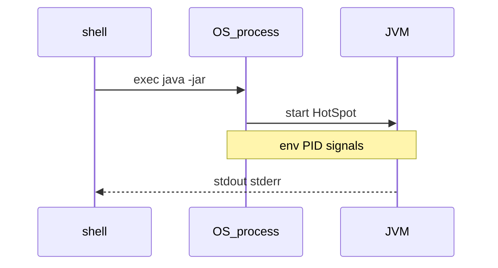
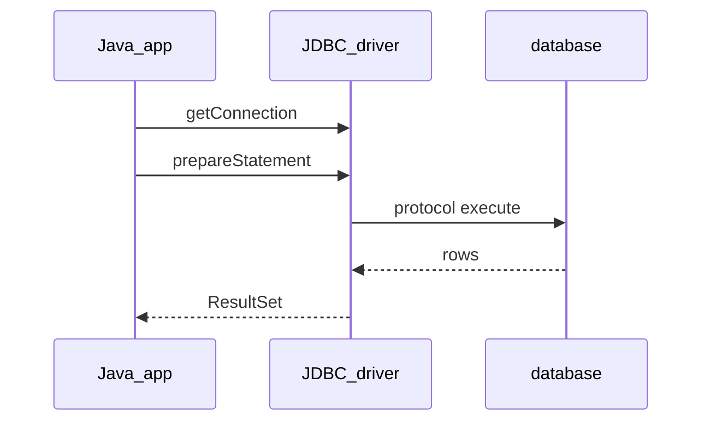
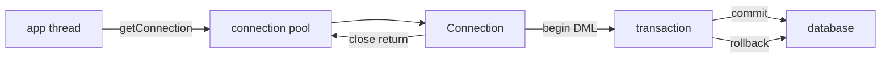

## Введение

Код на собесе умеют писать многие; процесс — меньше. Спрашивают: как запустить fat-jar, куда смотреть PID, что такое переменные окружения и чем `kill` отличается от «закрыть вкладку IDE». База — Oracle Tutorials (process/cmdline идеи) + практика shell; глубже Linux — в [QA17](/game/learn/qa-infra-linux-containers).

**JDBC основы.** На собесе «как Java ходит в Postgres?» ждут не название Hibernate, а стек JDBC: драйвер, `Connection`, `PreparedStatement`, `ResultSet`. ORM позже; сначала — контракт со стандартной библиотекой и [Oracle JDBC Tutorial](https://docs.oracle.com/javase/tutorial/jdbc/). Текст оригинальный.

**Пул соединений и транзакции.** Открывать `DriverManager.getConnection` на каждый HTTP-запрос — антипаттерн: handshake с БД дорогой. На собесе ждут пул соединений, `autocommit`, `commit`/`rollback` и связь с ACID ([sql-normalization](/game/learn/sql-normalization)). Опора — JDBC Tutorial / DataSource; текст свой.

## Раздел: Как отвечать одним блоком

Этот выпуск собрал соседние короткие темы трека: «Shell и процесс», «JDBC основы», «Пул соединений и транзакции». Раньше каждая занимала отдельную карточку на несколько минут, а на собеседовании их спрашивают одним блоком. Ниже у каждой темы свой раздел, затем общие лабы, один тест и одна колода карточек. В ответе сначала назовите, какую тему спросили, потом определение и один пример. Не проговаривайте все разделы, если спросили один. Лабы можно пройти по порядку исходного трека. Если времени мало, сделайте первую и последнюю: первая ставит язык, последняя проверяет, что соседние темы вы не перепутали.

## Раздел: Shell и процесс: Запуск и аргументы JVM

Типичный прод-запуск:

```bash
java -Xms256m -Xmx512m -jar app.jar --spring.profiles.active=prod
```

Всё до `-jar` / главного класса — **опции JVM**; после — аргументы приложения (`args` в `main`). Путать их — классика: передали `-Dfoo=bar` после `-jar` и удивились, что система свойств не увидела флаг.

`JAVA_HOME` указывает на JDK/JRE; в PATH должен быть нужный `java`. Ошибка: в CI один major, локально другой — «у меня работает».

## Раздел: Shell и процесс: Процесс, PID, env

ОС видит JVM как обычный процесс: PID, stdin/stdout/stderr, переменные окружения. Конфиг через env (`DATABASE_URL`, `JAVA_TOOL_OPTIONS`) удобен в Docker/K8s: не надо пересобирать jar ради URL БД.

```bash
ps aux | grep '[j]ava'
echo $JAVA_HOME
```

Сигналы: `SIGTERM` — «завершись корректно» (хуки shutdown); `SIGKILL` — убить без церемоний (данные/транзакции могут оборваться). На собесе: «как попросить приложение остановиться» → TERM, не KILL вслепую.

Ошибка: редирект логов «в никуда» и потом искать причину OOM только в IDE — смотрите stdout контейнера и `dmesg`/events оркестратора.

## Раздел: Shell и процесс: Слой ОС vs слой приложения

JVM не заменяет systemd/Docker: она **внутри** процесса. Healthcheck стучится в порт приложения; лимиты cgroup режут RSS/CPU снаружи. Если heap `-Xmx` больше лимита контейнера — приезжает OOM killer раньше, чем честный Java heap dump.

Мост к [QA17](/game/learn/qa-infra-linux-containers): там VM/Docker/SSH; здесь — минимальный словарь, чтобы Java-разработчик говорил с инфраструктурой на одном языке. Деплой и флаги кучи подробнее — в [JV12](/game/learn/jv-js-glue).

## Раздел: Shell и процесс: Частые вопросы с собеседования

**Вопрос.** `==` или `equals` для сравнения строк в логах/тестах?

**Ответ.** Для значения текста — всегда `equals`; `==` только если намеренно проверяете identity. В логах сравнивают сообщения через equals, иначе flaky-тесты на разных инстансах. Связь с autoboxing: та же ловушка у Integer/Long вне кэша -128…127.

**Вопрос.** String pool — зачем знать ops-инженеру Java?

**Ответ.** Пул влияет на память heap: миллионы уникальных строк без intern раздувают footprint. Утечки «строковых ключей» в static map иногда лечат контролем intern, но чаще — архитектурой кэша. На собесе достаточно: литералы могут быть одним объектом; бизнес-логика — через equals.

**Вопрос.** Checked vs unchecked — пример из I/O процесса.

**Ответ.** `IOException` при чтении конфига — checked; необработанный — код не скомпилируется без throws. NPE при разборе env — unchecked. В shell-скриптах вокруг jar ошибки JVM видны как exit code; в Java-коде тип исключения задаёт контракт API.

## Раздел: JDBC основы: Драйвер и Connection

JDBC — API в `java.sql` / `javax.sql`. Конкретный **драйвер** (например PostgreSQL) реализует протокол СУБД. Современный путь: JDBC 4+ ServiceLoader подхватывает драйвер с classpath; `Class.forName("…Driver")` — легаси-ритуал.

```java
try (Connection conn = DriverManager.getConnection(url, user, pass);
     PreparedStatement ps = conn.prepareStatement(
         "SELECT id, email FROM users WHERE id = ?")) {
  ps.setLong(1, userId);
  try (ResultSet rs = ps.executeQuery()) {
    while (rs.next()) {
      long id = rs.getLong("id");
      String email = rs.getString("email");
    }
  }
}
```

URL вида `jdbc:postgresql://host:5432/db`. Ошибка: держать `Connection` открытым «на всякий» без try-with-resources — утечки на проде.

## Раздел: JDBC основы: Statement vs PreparedStatement

`Statement` склеивает SQL строкой — риск SQL injection и лишняя компиляция плана. **`PreparedStatement`** параметризует (`?`): драйвер/сервер безопасно подставляет значения. Для batch — `addBatch`/`executeBatch`.

`executeQuery` — SELECT (ResultSet); `executeUpdate` — DML (число строк); `execute` — когда тип заранее неизвестен. Путать и игнорировать коды обновления — частая junior-ошибка.

Связь с SQL-треком: синтаксис и планы — в [sql-delete-truncate-drop](/game/learn/sql-delete-truncate-drop) / [sql-cte-window](/game/learn/sql-cte-window); здесь — *как* вызвать SQL из Java.

## Раздел: JDBC основы: ResultSet, типы и закрытие ресурсов

`ResultSet` курсором идёт по строкам; колонки — по имени или индексу (индекс с 1). SQL `NULL` → проверяйте `wasNull()` для примитивов. Иерархия закрытия: ResultSet → Statement → Connection (try-with-resources закрывает в обратном порядке объявления).

Ошибка: читать ResultSet после закрытия Statement/Connection. Вторая: тащить гигантский SELECT в память без лимита/`fetchSize` — приложение становится «складом строк».

## Раздел: JDBC основы: Частые вопросы с собеседования

**Вопрос.** Зачем connection pool, если JDBC уже даёт Connection?

**Ответ.** Открытие TCP+auth к БД дорого; на каждый HTTP-запрос — антипattern. Пул держит прогретые соединения; `close()` возвращает в пул, а не рвёт сокет. На собесе после JDBC basics ждут слова DataSource и HikariCP. Подробности — в выпуске про pool и транзакции.

**Вопрос.** Autocommit и граница транзакции в JDBC?

**Ответ.** По умолчанию autocommit=true: каждый statement — отдельная транзакция. Для атомарности нескольких DML: `setAutoCommit(false)`, work, `commit` или `rollback`. Забытый rollback при ошибке портит соединение, возвращаемое в пул. ACID-гарантии даёт СУБД; JDBC лишь выставляет границы.

**Вопрос.** Почему SQLException — checked?

**Ответ.** Доступ к БД — внешний ресурс; язык заставляет явно решить: catch, wrap или throws. Это напоминает, что сбой сети/БД — ожидаемый сценарий, не только баг. В Spring часто оборачивают в `DataAccessException` (unchecked), но JDBC-слой остаётся checked.

**Вопрос.** ORM vs «голый» JDBC — когда что на собесе?

**Ответ.** JDBC — полный контроль SQL и маппинга; ORM — меньше бойлерплейта, больше скрытого SQL. ORM не отменяет знание JDBC: в проде читают логи запросов. Отчёты, bulk, тонкий plan — часто JDBC; CRUD домена — часто JPA. Честный ответ: инструмент под задачу, не религия.

## Раздел: Пул соединений и транзакции: Зачем пул и что такое DataSource

**Пул** держит некоторое число уже открытых физических соединений и выдаёт логические «аренды» приложению. В API это обычно `javax.sql.DataSource` (HikariCP, Tomcat pool, пул контейнера). Приложение делает `getConnection()` → работает → `close()`: в пуле close **возвращает** соединение, а не рвёт TCP навсегда.

Параметры, которые спрашивают: `maximumPoolSize`, timeout ожидания, lifetime, validation query/`connectionTestQuery`. Ошибка: размер пула «как число пользователей сайта» — пул ограничивают по возможностям БД и latency, не по маркетингу.

```java
DataSource ds = /* Hikari config */;
try (Connection conn = ds.getConnection()) {
  // работа; close вернёт в пул
}
```

## Раздел: Пул соединений и транзакции: Autocommit и явная транзакция

По умолчанию у JDBC часто `autocommit=true`: каждый statement — своя транзакция. Для нескольких DML, которые должны пройти атомарно:

```java
conn.setAutoCommit(false);
try {
  // несколько update/insert
  conn.commit();
} catch (SQLException ex) {
  conn.rollback();
  throw ex;
} finally {
  conn.setAutoCommit(true); // если соединение уходит в пул
}
```

Ошибка: забыть `rollback` при исключении — «грязное» состояние сессии в пуле. Вторая: длинная транзакция с HTTP-вызовом внутри — держит ряд/соединение и убивает throughput.

## Раздел: Пул соединений и транзакции: Изоляция и границы ответственности

Уровень изоляции задаётся на соединении (`setTransactionIsolation`) и должен совпадать с ожиданиями бизнеса (грязное чтение vs аномалии). Детали аномалий — SQL-трек; здесь фраза для собеса: «JDBC только выставляет уровень, гарантии даёт СУБД».

Пул + транзакции: **нельзя** передавать Connection между потоками; один поток — одна аренда. После ошибки соединение часто нужно пометить invalid / откатить до возврата в пул (хорошие пулы помогают, но контракт приложения важен).

## Раздел: Пул соединений и транзакции: Частые вопросы с собеседования

**Вопрос.** Уровни изоляции JDBC — что назвать на собесе?

**Ответ.** READ_UNCOMMITTED, READ_COMMITTED, REPEATABLE_READ, SERIALIZABLE — через `setTransactionIsolation`. JDBC не «создаёт» изоляцию — просит у СУБД режим; аномалии (dirty read, phantom) зависят от движка. По умолчанию у Postgres часто READ COMMITTED; для отчёта и для платежа требования разные. Длинная транзакция с высокой изоляцией + pool = риск блокировок.

**Вопрос.** Что будет, если не закрыть Connection из пула?

**Ответ.** Аренда «утекает»: пул исчерпывается, запросы ждут timeout. try-with-resources на Connection из DataSource обязателен. После SQLException нужен rollback перед return в пул — иначе следующий клиент видит грязную сессию.

**Вопрос.** ORM vs JDBC в одном предложении?

**Ответ.** JDBC — вы пишете SQL и маппите строки; ORM — объектная модель и unit of work с генерацией SQL. Пул и транзакции нужны в обоих случаях на границе с БД. N+1 — болезнь ORM-слоя, не JDBC API.

**Вопрос.** PreparedStatement и транзакция — связаны?

**Ответ.** PreparedStatement живёт в рамке Connection; все statements одной транзакции делят autocommit/commit. Batch update в одной транзакции — один commit в конце. Параметры `?` не заменяют транзакционную атомарность между разными таблицами.

## Лаба

**Shell и процесс.**

**Цель.** Запустить простой jar/класс из shell и описать процесс ОС одной схемой.

**Шаги.**
1. Соберите или возьмите любой `*.jar` и запустите с `-Xmx128m`.
2. Найдите PID процесса Java (`ps` / Task Manager) и запишите его.
3. Выведите одну env-переменную, которую читает приложение (или добавьте `System.getenv` в demo).
4. Объясните разницу аргументов JVM и `main(String[] args)`.
5. Напишите 3 буллета: что сделаете при «приложение не стартует» (java version, port, logs).

**В группу:** один шлёт SIGKILL «для скорости», второй объясняет риск для транзакций.

**Готово, если…**
- [ ] Отличаете флаги JVM от args приложения
- [ ] Находите PID и понимаете роль env
- [ ] Связываете лимит контейнера с `-Xmx`

**JDBC основы.**

**Цель.** Написать минимальный JDBC-select с PreparedStatement и закрытием ресурсов.

**Шаги.**
1. Поднимите локальную БД или используйте H2 in-memory для демо.
2. Выполните SELECT с одним параметром `?`.
3. Намеренно сконкатенируйте ввод в Statement и объясните, почему это плохо.
4. Замените на PreparedStatement и сравните код.
5. Добавьте try-with-resources на Connection/PS/RS.

**В группу:** один ищет SQL injection в сниппете, второй предлагает фикс.

**Готово, если…**
- [ ] Можете объяснить роль драйвера
- [ ] Используете PreparedStatement без конкатенации
- [ ] Закрываете ресурсы через try-with-resources

**Пул соединений и транзакции.**

**Цель.** Описать на схеме: два UPDATE в одной транзакции и откат при сбое второго.

**Шаги.**
1. Включите `setAutoCommit(false)` и выполните два связанных UPDATE.
2. Broсайте исключение между ними и сделайте rollback.
3. Повторите с commit — проверьте итог в БД.
4. Назовите 3 параметра пула, которые посмотрели бы в проде.
5. Свяжите с ACID одной фразой (A — commit/rollback границ).

**В группу:** один пишет «транзакция на весь request + вызов внешней оплаты», второй находит риск.

**Готово, если…**
- [ ] Объясняете, что делает close() у пула
- [ ] Пишете commit/rollback без утечки autocommit
- [ ] Не шарите Connection между потоками

## Схема: Shell и процесс: Shell → процесс → JVM



## Схема: JDBC основы: JDBC вызов



## Схема: Пул соединений и транзакции: Пул и транзакция



## Тест

### Куда писать `-Xmx` — до или после `-jar`?

**Ответ:** до `-jar`, это флаг JVM

**Пояснение:** после `-jar` идут аргументы приложения, не опции виртуальной машины.

### Что такое JDBC?

**Ответ:** стандартный API доступа к БД

**Пояснение:** Java-код говорит с `java.sql`; драйвер реализует протокол конкретной СУБД.

### Зачем connection pool?

**Ответ:** переиспользовать дорогие соединения

**Пояснение:** установка TCP/SSL/сессии СУБД дороже, чем взять готовое из пула.

### Что такое PID для Java-приложения?

**Ответ:** идентификатор процесса ОС

**Пояснение:** ОС управляет процессом java; внутри него работает JVM и потоки приложения.

### Зачем PreparedStatement вместо склейки строк?

**Ответ:** защита от SQL injection

**Пояснение:** параметры отделены от текста SQL; плюс часто лучше переиспользование плана.

## Шпаргалка

<ul><li>java [JVM opts] -jar app.jar [app args]</li><li>env + PID + signals = язык Ops</li><li>TERM для стопа; KILL — крайняя мера</li><li>лимит cgroup и -Xmx должны согласоваться</li><li>Driver → Connection → PreparedStatement → ResultSet</li><li>никогда не склеивать user input в SQL</li><li>try-with-resources обязателен</li><li>NULL и типы колонок проверяйте явно</li><li>DataSource + pool вместо DriverManager на каждый запрос</li><li>autocommit=false → commit / rollback</li><li>close = return to pool</li><li>короткие транзакции; без внешнего I/O внутри</li></ul>

## Anki

### Front: Где в командной строке место для `-Xms`/`-Xmx`?

Back: среди опций JVM до `-jar` или имени главного класса

### Front: Какой пакет JDBC использует приложение чаще всего?

Back: java.sql (Connection, PreparedStatement, ResultSet)

### Front: Чем DataSource удобнее прямого DriverManager в сервисе?

Back: стандартная точка получения соединений, обычно из пула с конфигом

### Front: Что хранит переменная окружения для процесса Java?

Back: внешний конфиг (URL, профиль, JAVA_TOOL_OPTIONS), видимый через getenv

### Front: Кто реализует протокол Postgres в JDBC-стеке?

Back: JDBC-драйвер СУБД на classpath

### Front: Что означает maximumPoolSize?

Back: верхняя граница одновременно арендованных соединений к БД

## Мнемоника

### link: Процесс Java

**Задание:** Что смотрят, когда сервис «ест память».

**Элементы:**
- pid
- heap
- GC лог
- лимит контейнера

**Подсказка:** Лимит контейнера может убить процесс раньше, чем heap кончится.

**Ответ:** pid → heap → gc → cgroup

## Итоги

- Разработчик Java обязан понимать процесс ОС, не только классы
- Флаги JVM, env и сигналы — частый мост к DevOps-вопросам
- Дальше — доступ к БД через JDBC без магии ORM
- JDBC — фундамент до любого ORM
- PreparedStatement и закрытие ресурсов — must-have на собесе
- Дальше — пулы соединений и транзакции
- Пул — обязательная прод-привычка, не «оптимизация потом»
- Границы транзакции должны совпадать с бизнес-атомарностью

## Ссылки

- [Oracle Java Tutorials — The Platform Environment](https://docs.oracle.com/javase/tutorial/essential/environment/)
- [Oracle Java Tutorials — Command-Line Arguments](https://docs.oracle.com/javase/tutorial/essential/environment/cmdLineArgs.html)
- [QA17 Infra Linux/containers](/game/learn/qa-infra-linux-containers)
- [Oracle JDBC Database Access Tutorial](https://docs.oracle.com/javase/tutorial/jdbc/)
- [PostgreSQL JDBC Driver docs](https://jdbc.postgresql.org/documentation/)
- [SQL joins](/game/learn/sql-delete-truncate-drop)
- [Oracle JDBC Tutorial — Connections](https://docs.oracle.com/javase/tutorial/jdbc/basics/connecting.html)
- [Oracle JDBC Tutorial — Transactions](https://docs.oracle.com/javase/tutorial/jdbc/basics/transactions.html)
- [SQL ACID](/game/learn/sql-normalization)
- [ORM concepts](/game/learn/jv-orm-concepts)
