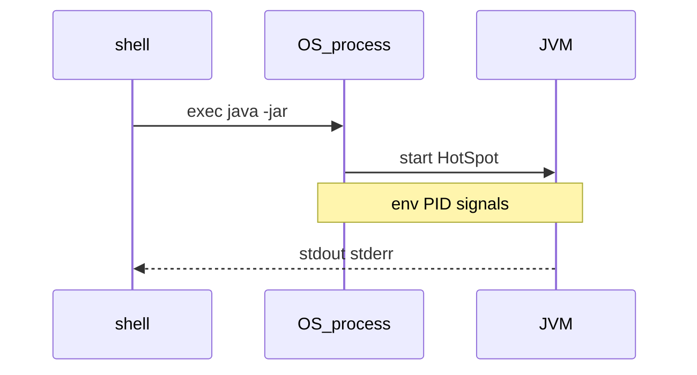

## Введение

Код на собесе умеют писать многие; процесс — меньше. Спрашивают: как запустить fat-jar, куда смотреть PID, что такое переменные окружения и чем `kill` отличается от «закрыть вкладку IDE». База — Oracle Tutorials (process/cmdline идеи) + практика shell; глубже Linux — в [QA17](/game/learn/qa-infra-linux-containers).

## Раздел: Запуск и аргументы JVM

Типичный прод-запуск:

```bash
java -Xms256m -Xmx512m -jar app.jar --spring.profiles.active=prod
```

Всё до `-jar` / главного класса — **опции JVM**; после — аргументы приложения (`args` в `main`). Путать их — классика: передали `-Dfoo=bar` после `-jar` и удивились, что система свойств не увидела флаг.

`JAVA_HOME` указывает на JDK/JRE; в PATH должен быть нужный `java`. Ошибка: в CI один major, локально другой — «у меня работает».

## Раздел: Процесс, PID, env

ОС видит JVM как обычный процесс: PID, stdin/stdout/stderr, переменные окружения. Конфиг через env (`DATABASE_URL`, `JAVA_TOOL_OPTIONS`) удобен в Docker/K8s: не надо пересобирать jar ради URL БД.

```bash
ps aux | grep '[j]ava'
echo $JAVA_HOME
```

Сигналы: `SIGTERM` — «завершись корректно» (хуки shutdown); `SIGKILL` — убить без церемоний (данные/транзакции могут оборваться). На собесе: «как попросить приложение остановиться» → TERM, не KILL вслепую.

Ошибка: редирект логов «в никуда» и потом искать причину OOM только в IDE — смотрите stdout контейнера и `dmesg`/events оркестратора.

## Раздел: Слой ОС vs слой приложения

JVM не заменяет systemd/Docker: она **внутри** процесса. Healthcheck стучится в порт приложения; лимиты cgroup режут RSS/CPU снаружи. Если heap `-Xmx` больше лимита контейнера — приезжает OOM killer раньше, чем честный Java heap dump.

Мост к [QA17](/game/learn/qa-infra-linux-containers): там VM/Docker/SSH; здесь — минимальный словарь, чтобы Java-разработчик говорил с инфраструктурой на одном языке. Деплой и флаги кучи подробнее — в [JV12](/game/learn/jv-jvm-hosting).

## Раздел: Частые вопросы с собеседования

**Вопрос.** `==` или `equals` для сравнения строк в логах/тестах?

**Ответ.** Для значения текста — всегда `equals`; `==` только если намеренно проверяете identity. В логах сравнивают сообщения через equals, иначе flaky-тесты на разных инстансах. Связь с autoboxing: та же ловушка у Integer/Long вне кэша -128…127.

**Вопрос.** String pool — зачем знать ops-инженеру Java?

**Ответ.** Пул влияет на память heap: миллионы уникальных строк без intern раздувают footprint. Утечки «строковых ключей» в static map иногда лечат контролем intern, но чаще — архитектурой кэша. На собесе достаточно: литералы могут быть одним объектом; бизнес-логика — через equals.

**Вопрос.** Checked vs unchecked — пример из I/O процесса.

**Ответ.** `IOException` при чтении конфига — checked; необработанный — код не скомпилируется без throws. NPE при разборе env — unchecked. В shell-скриптах вокруг jar ошибки JVM видны как exit code; в Java-коде тип исключения задаёт контракт API.

## Лаба

**Цель.** Запустить простой jar/класс из shell и описать процесс ОС одной схемой.

**Шаги.**
1. Соберите или возьмите любой `*.jar` и запустите с `-Xmx128m`.
2. Найдите PID процесса Java (`ps` / Task Manager) и запишите его.
3. Выведите одну env-переменную, которую читает приложение (или добавьте `System.getenv` в demo).
4. Объясните разницу аргументов JVM и `main(String[] args)`.
5. Напишите 3 буллета: что сделаете при «приложение не стартует» (java version, port, logs).

**В группу:** один шлёт SIGKILL «для скорости», второй объясняет риск для транзакций.

**Готово, если…**
- [ ] Отличаете флаги JVM от args приложения
- [ ] Находите PID и понимаете роль env
- [ ] Связываете лимит контейнера с `-Xmx`

## Схема: Shell → процесс → JVM



## Тест

### Куда писать `-Xmx` — до или после `-jar`?

**Ответ:** до `-jar`, это флаг JVM

**Пояснение:** после `-jar` идут аргументы приложения, не опции виртуальной машины.

### Что такое PID для Java-приложения?

**Ответ:** идентификатор процесса ОС

**Пояснение:** ОС управляет процессом java; внутри него работает JVM и потоки приложения.

### Зачем передавать конфиг через env?

**Ответ:** менять настройки без пересборки

**Пояснение:** удобно в контейнерах и разных средах (dev/stage/prod).

### Чем SIGTERM лучше SIGKILL для стопа?

**Ответ:** даёт шанс graceful shutdown

**Пояснение:** приложение может закрыть пул, дописать логи, откатить/завершить транзакции.

### Почему `-Xmx` больше лимита Docker опасно?

**Ответ:** OOM killer снаружи JVM

**Пояснение:** контейнер убивают по cgroup раньше, чем Java успеет среагировать «по-своему».

## Шпаргалка

<h3>Суть</h3>
<ul>
<li>java [JVM opts] -jar app.jar [app args]</li>
<li>env + PID + signals = язык Ops</li>
<li>TERM для стопа; KILL — крайняя мера</li>
<li>лимит cgroup и -Xmx должны согласоваться</li>
</ul>
<h3>Команды</h3>
<pre><code>java -version
ps aux | grep '[j]ava'
kill -TERM &lt;pid&gt;
</code></pre>

## Anki

### Front: Где в командной строке место для `-Xms`/`-Xmx`?

Back: среди опций JVM до `-jar` или имени главного класса

### Front: Что хранит переменная окружения для процесса Java?

Back: внешний конфиг (URL, профиль, JAVA_TOOL_OPTIONS), видимый через getenv

### Front: Что означает graceful shutdown одной фразой?

Back: корректная остановка по сигналу с закрытием ресурсов

### Front: Чем `JAVA_HOME` полезен в shell?

Back: указывает, какой JDK/JRE использовать скриптам и инструментам

### Front: Почему «у меня в IDE работает» слабый аргумент на собесе?

Back: другой java major, cwd, env и способ запуска, чем в проде

### Front: Куда смотреть, если процесс java исчез в Docker?

Back: логи контейнера и события OOM/рестартов оркестратора

## Итоги

- Разработчик Java обязан понимать процесс ОС, не только классы
- Флаги JVM, env и сигналы — частый мост к DevOps-вопросам
- Дальше — доступ к БД через JDBC без магии ORM

## Ссылки

- [Oracle Java Tutorials — The Platform Environment](https://docs.oracle.com/javase/tutorial/essential/environment/)
- [Oracle Java Tutorials — Command-Line Arguments](https://docs.oracle.com/javase/tutorial/essential/environment/cmdLineArgs.html)
- Learn | [QA17 Infra Linux/containers](/game/learn/qa-infra-linux-containers)
- Далее: [JDBC basics](/game/learn/jv-jdbc-basics)
