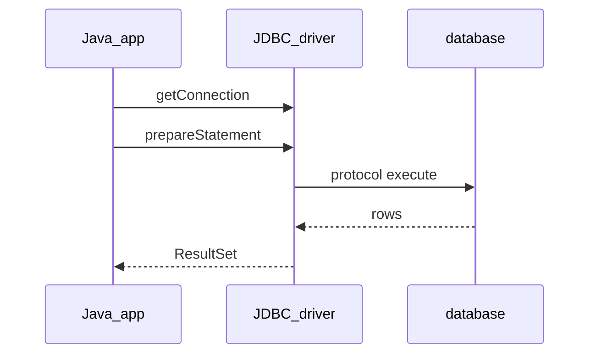

## Введение

На собесе «как Java ходит в Postgres?» ждут не название Hibernate, а стек JDBC: драйвер, `Connection`, `PreparedStatement`, `ResultSet`. ORM позже; сначала — контракт со стандартной библиотекой и [Oracle JDBC Tutorial](https://docs.oracle.com/javase/tutorial/jdbc/). Текст оригинальный.

## Раздел: Драйвер и Connection

JDBC — API в `java.sql` / `javax.sql`. Конкретный **драйвер** (например PostgreSQL) реализует протокол СУБД. Современный путь: JDBC 4+ ServiceLoader подхватывает драйвер с classpath; `Class.forName("…Driver")` — легаси-ритуал.

```java
try (Connection conn = DriverManager.getConnection(url, user, pass);
     PreparedStatement ps = conn.prepareStatement(
         "SELECT id, email FROM users WHERE id = ?")) {
  ps.setLong(1, userId);
  try (ResultSet rs = ps.executeQuery()) {
    while (rs.next()) {
      long id = rs.getLong("id");
      String email = rs.getString("email");
    }
  }
}
```

URL вида `jdbc:postgresql://host:5432/db`. Ошибка: держать `Connection` открытым «на всякий» без try-with-resources — утечки на проде.

## Раздел: Statement vs PreparedStatement

`Statement` склеивает SQL строкой — риск SQL injection и лишняя компиляция плана. **`PreparedStatement`** параметризует (`?`): драйвер/сервер безопасно подставляет значения. Для batch — `addBatch`/`executeBatch`.

`executeQuery` — SELECT (ResultSet); `executeUpdate` — DML (число строк); `execute` — когда тип заранее неизвестен. Путать и игнорировать коды обновления — частая junior-ошибка.

Связь с SQL-треком: синтаксис и планы — в [sql-joins](/game/learn/sql-joins) / [sql-performance-explain](/game/learn/sql-performance-explain); здесь — *как* вызвать SQL из Java.

## Раздел: ResultSet, типы и закрытие ресурсов

`ResultSet` курсором идёт по строкам; колонки — по имени или индексу (индекс с 1). SQL `NULL` → проверяйте `wasNull()` для примитивов. Иерархия закрытия: ResultSet → Statement → Connection (try-with-resources закрывает в обратном порядке объявления).

Ошибка: читать ResultSet после закрытия Statement/Connection. Вторая: тащить гигантский SELECT в память без лимита/`fetchSize` — приложение становится «складом строк».

## Раздел: Частые вопросы с собеседования

**Вопрос.** Зачем connection pool, если JDBC уже даёт Connection?

**Ответ.** Открытие TCP+auth к БД дорого; на каждый HTTP-запрос — антипattern. Пул держит прогретые соединения; `close()` возвращает в пул, а не рвёт сокет. На собесе после JDBC basics ждут слова DataSource и HikariCP. Подробности — в выпуске про pool и транзакции.

**Вопрос.** Autocommit и граница транзакции в JDBC?

**Ответ.** По умолчанию autocommit=true: каждый statement — отдельная транзакция. Для атомарности нескольких DML: `setAutoCommit(false)`, work, `commit` или `rollback`. Забытый rollback при ошибке портит соединение, возвращаемое в пул. ACID-гарантии даёт СУБД; JDBC лишь выставляет границы.

**Вопрос.** Почему SQLException — checked?

**Ответ.** Доступ к БД — внешний ресурс; язык заставляет явно решить: catch, wrap или throws. Это напоминает, что сбой сети/БД — ожидаемый сценарий, не только баг. В Spring часто оборачивают в `DataAccessException` (unchecked), но JDBC-слой остаётся checked.

**Вопрос.** ORM vs «голый» JDBC — когда что на собесе?

**Ответ.** JDBC — полный контроль SQL и маппинга; ORM — меньше бойлерплейта, больше скрытого SQL. ORM не отменяет знание JDBC: в проде читают логи запросов. Отчёты, bulk, тонкий plan — часто JDBC; CRUD домена — часто JPA. Честный ответ: инструмент под задачу, не религия.

## Лаба

**Цель.** Написать минимальный JDBC-select с PreparedStatement и закрытием ресурсов.

**Шаги.**
1. Поднимите локальную БД или используйте H2 in-memory для демо.
2. Выполните SELECT с одним параметром `?`.
3. Намеренно сконкатенируйте ввод в Statement и объясните, почему это плохо.
4. Замените на PreparedStatement и сравните код.
5. Добавьте try-with-resources на Connection/PS/RS.

**В группу:** один ищет SQL injection в сниппете, второй предлагает фикс.

**Готово, если…**
- [ ] Можете объяснить роль драйвера
- [ ] Используете PreparedStatement без конкатенации
- [ ] Закрываете ресурсы через try-with-resources

## Схема: JDBC вызов



## Тест

### Что такое JDBC?

**Ответ:** стандартный API доступа к БД

**Пояснение:** Java-код говорит с `java.sql`; драйвер реализует протокол конкретной СУБД.

### Зачем PreparedStatement вместо склейки строк?

**Ответ:** защита от SQL injection

**Пояснение:** параметры отделены от текста SQL; плюс часто лучше переиспользование плана.

### Чем executeQuery отличается от executeUpdate?

**Ответ:** SELECT vs DML-счётчик

**Пояснение:** query возвращает ResultSet; update — число затронутых строк.

### Как безопасно закрывать Connection?

**Ответ:** try-with-resources

**Пояснение:** AutoCloseable гарантирует close даже при исключении.

### Нужен ли всегда Class.forName для драйвера?

**Ответ:** нет, JDBC 4+ ServiceLoader

**Пояснение:** драйвер на classpath регистрируется сам; forName — устаревший обычай.

## Шпаргалка

<h3>Суть</h3>
<ul>
<li>Driver → Connection → PreparedStatement → ResultSet</li>
<li>никогда не склеивать user input в SQL</li>
<li>try-with-resources обязателен</li>
<li>NULL и типы колонок проверяйте явно</li>
</ul>
<h3>Мини-шаблон</h3>
<pre><code>try (Connection c = …;
     PreparedStatement ps = c.prepareStatement(sql)) {
  ps.set…(…);
  try (ResultSet rs = ps.executeQuery()) { … }
}
</code></pre>

## Anki

### Front: Какой пакет JDBC использует приложение чаще всего?

Back: java.sql (Connection, PreparedStatement, ResultSet)

### Front: Кто реализует протокол Postgres в JDBC-стеке?

Back: JDBC-драйвер СУБД на classpath

### Front: Почему конкатенация SQL с вводом пользователя опасна?

Back: SQL injection — злоумышленник меняет смысл запроса

### Front: С какого индекса нумеруются параметры `?` в PreparedStatement?

Back: с единицы (1-based)

### Front: Что вернёт getInt при SQL NULL без проверки?

Back: 0; нужно смотреть wasNull()

### Front: В каком порядке try-with-resources закроет Connection и ResultSet?

Back: в обратном порядке объявления — сначала ResultSet/Statement, потом Connection

## Итоги

- JDBC — фундамент до любого ORM
- PreparedStatement и закрытие ресурсов — must-have на собесе
- Дальше — пулы соединений и транзакции

## Ссылки

- [Oracle JDBC Database Access Tutorial](https://docs.oracle.com/javase/tutorial/jdbc/)
- [PostgreSQL JDBC Driver docs](https://jdbc.postgresql.org/documentation/)
- Learn | [SQL joins](/game/learn/sql-joins)
- Далее: [JDBC pool и транзакции](/game/learn/jv-jdbc-pool-tx)
