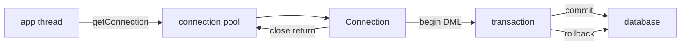

## Введение

Открывать `DriverManager.getConnection` на каждый HTTP-запрос — антипаттерн: handshake с БД дорогой. На собесе ждут пул соединений, `autocommit`, `commit`/`rollback` и связь с ACID ([sql-acid-transactions](/game/learn/sql-acid-transactions)). Опора — JDBC Tutorial / DataSource; текст свой.

## Раздел: Зачем пул и что такое DataSource

**Пул** держит некоторое число уже открытых физических соединений и выдаёт логические «аренды» приложению. В API это обычно `javax.sql.DataSource` (HikariCP, Tomcat pool, пул контейнера). Приложение делает `getConnection()` → работает → `close()`: в пуле close **возвращает** соединение, а не рвёт TCP навсегда.

Параметры, которые спрашивают: `maximumPoolSize`, timeout ожидания, lifetime, validation query/`connectionTestQuery`. Ошибка: размер пула «как число пользователей сайта» — пул ограничивают по возможностям БД и latency, не по маркетингу.

```java
DataSource ds = /* Hikari config */;
try (Connection conn = ds.getConnection()) {
  // работа; close вернёт в пул
}
```

## Раздел: Autocommit и явная транзакция

По умолчанию у JDBC часто `autocommit=true`: каждый statement — своя транзакция. Для нескольких DML, которые должны пройти атомарно:

```java
conn.setAutoCommit(false);
try {
  // несколько update/insert
  conn.commit();
} catch (SQLException ex) {
  conn.rollback();
  throw ex;
} finally {
  conn.setAutoCommit(true); // если соединение уходит в пул
}
```

Ошибка: забыть `rollback` при исключении — «грязное» состояние сессии в пуле. Вторая: длинная транзакция с HTTP-вызовом внутри — держит ряд/соединение и убивает throughput.

## Раздел: Изоляция и границы ответственности

Уровень изоляции задаётся на соединении (`setTransactionIsolation`) и должен совпадать с ожиданиями бизнеса (грязное чтение vs аномалии). Детали аномалий — SQL-трек; здесь фраза для собеса: «JDBC только выставляет уровень, гарантии даёт СУБД».

Пул + транзакции: **нельзя** передавать Connection между потоками; один поток — одна аренда. После ошибки соединение часто нужно пометить invalid / откатить до возврата в пул (хорошие пулы помогают, но контракт приложения важен).

## Раздел: Частые вопросы с собеседования

**Вопрос.** Уровни изоляции JDBC — что назвать на собесе?

**Ответ.** READ_UNCOMMITTED, READ_COMMITTED, REPEATABLE_READ, SERIALIZABLE — через `setTransactionIsolation`. JDBC не «создаёт» изоляцию — просит у СУБД режим; аномалии (dirty read, phantom) зависят от движка. По умолчанию у Postgres часто READ COMMITTED; для отчёта и для платежа требования разные. Длинная транзакция с высокой изоляцией + pool = риск блокировок.

**Вопрос.** Что будет, если не закрыть Connection из пула?

**Ответ.** Аренда «утекает»: пул исчерпывается, запросы ждут timeout. try-with-resources на Connection из DataSource обязателен. После SQLException нужен rollback перед return в пул — иначе следующий клиент видит грязную сессию.

**Вопрос.** ORM vs JDBC в одном предложении?

**Ответ.** JDBC — вы пишете SQL и маппите строки; ORM — объектная модель и unit of work с генерацией SQL. Пул и транзакции нужны в обоих случаях на границе с БД. N+1 — болезнь ORM-слоя, не JDBC API.

**Вопрос.** PreparedStatement и транзакция — связаны?

**Ответ.** PreparedStatement живёт в рамке Connection; все statements одной транзакции делят autocommit/commit. Batch update в одной транзакции — один commit в конце. Параметры `?` не заменяют транзакционную атомарность между разными таблицами.

## Лаба

**Цель.** Описать на схеме: два UPDATE в одной транзакции и откат при сбое второго.

**Шаги.**
1. Включите `setAutoCommit(false)` и выполните два связанных UPDATE.
2. Broсайте исключение между ними и сделайте rollback.
3. Повторите с commit — проверьте итог в БД.
4. Назовите 3 параметра пула, которые посмотрели бы в проде.
5. Свяжите с ACID одной фразой (A — commit/rollback границ).

**В группу:** один пишет «транзакция на весь request + вызов внешней оплаты», второй находит риск.

**Готово, если…**
- [ ] Объясняете, что делает close() у пула
- [ ] Пишете commit/rollback без утечки autocommit
- [ ] Не шарите Connection между потоками

## Схема: Пул и транзакция



## Тест

### Зачем connection pool?

**Ответ:** переиспользовать дорогие соединения

**Пояснение:** установка TCP/SSL/сессии СУБД дороже, чем взять готовое из пула.

### Что делает close() у соединения из пула?

**Ответ:** возвращает соединение в пул

**Пояснение:** физический канал обычно живёт дальше; логическая аренда заканчивается.

### Зачем setAutoCommit(false)?

**Ответ:** объединить DML в одну транзакцию

**Пояснение:** иначе каждый statement коммитится отдельно.

### Что делать при SQLException в середине tx?

**Ответ:** rollback

**Пояснение:** иначе частично применённые изменения и «грязное» соединение в пуле.

### Можно ли шарить Connection между потоками?

**Ответ:** нет

**Пояснение:** JDBC Connection не потокобезопасен; у каждого потока своя аренда из пула.

## Шпаргалка

<h3>Суть</h3>
<ul>
<li>DataSource + pool вместо DriverManager на каждый запрос</li>
<li>autocommit=false → commit / rollback</li>
<li>close = return to pool</li>
<li>короткие транзакции; без внешнего I/O внутри</li>
</ul>
<h3>Чеклист пула</h3>
<pre><code>max size, connection timeout,
idle timeout, leak detection,
validation before borrow
</code></pre>

## Anki

### Front: Чем DataSource удобнее прямого DriverManager в сервисе?

Back: стандартная точка получения соединений, обычно из пула с конфигом

### Front: Что означает maximumPoolSize?

Back: верхняя граница одновременно арендованных соединений к БД

### Front: Что такое autocommit=true в JDBC?

Back: каждый statement завершает свою транзакцию автоматически

### Front: Какой метод фиксирует успешную транзакцию?

Back: Connection.commit()

### Front: Почему долгая транзакция вредна под нагрузкой?

Back: держит соединение и блокировки, снижает throughput

### Front: Куда смотреть теорию аномалий чтения рядом с JDBC?

Back: SQL ACID / уровни изоляции (трек SQL)

## Итоги

- Пул — обязательная прод-привычка, не «оптимизация потом»
- Границы транзакции должны совпадать с бизнес-атомарностью
- Следующий шаг — зачем поверх JDBC появляются ORM

## Ссылки

- [Oracle JDBC Tutorial — Connections](https://docs.oracle.com/javase/tutorial/jdbc/basics/connecting.html)
- [Oracle JDBC Tutorial — Transactions](https://docs.oracle.com/javase/tutorial/jdbc/basics/transactions.html)
- Learn | [SQL ACID](/game/learn/sql-acid-transactions)
- Далее: [ORM concepts](/game/learn/jv-orm-concepts)
