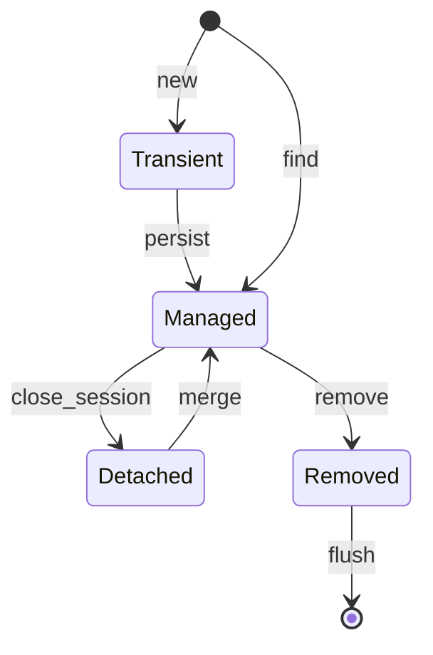
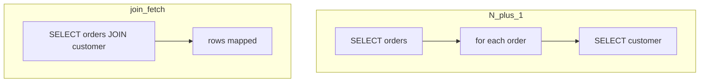

## Введение

«Зачем Hibernate, если есть JDBC?» — вопрос-фильтр. Ждут: ORM отображает таблицы на объекты, держит **persistence context**, гарантирует identity map и сам замечает dirty-поля. Спецификация — Jakarta Persistence; популярная реализация — Hibernate. Здесь концепции без ухода в N+1 (это [JV07](/game/learn/jv-orm-concepts)).

**JPA/Hibernate обзор и N+1.** Middle-собес по данным: что такое entity, чем LAZY отличается от EAGER, как выглядит N+1 и чем лечить. Канон — Jakarta Persistence + Hibernate User Guide (fetch, entity graph). Посты Vlad Mihalcea — **доп. чтение**, не источник копипаста. SQL-планы — [sql-cte-window](/game/learn/sql-cte-window).

## Раздел: Как отвечать одним блоком

Этот выпуск собрал соседние короткие темы трека: «Понятия ORM», «JPA/Hibernate обзор и N+1». Раньше каждая занимала отдельную карточку на несколько минут, а на собеседовании их спрашивают одним блоком. Ниже у каждой темы свой раздел, затем общие лабы, один тест и одна колода карточек. В ответе сначала назовите, какую тему спросили, потом определение и один пример. Не проговаривайте все разделы, если спросили один. Лабы можно пройти по порядку исходного трека. Если времени мало, сделайте первую и последнюю: первая ставит язык, последняя проверяет, что соседние темы вы не перепутали.

## Раздел: Понятия ORM: Mapping и unit of work

ORM связывает класс сущности с таблицей, поля — с колонками, ассоциации — с FK/join table. Разработчик мыслит объектами; SQL генерируется (или пишется JPQL/SQL). **Unit of Work / persistence context** — набор управляемых сущностей в рамках сессии/`EntityManager`: загрузили, изменили, при flush ушли UPDATE/INSERT/DELETE.

Vs JDBC: вы сами пишете SQL и маппите ResultSet. ORM экономит бойлерплейт, но добавляет скрытое поведение — его нужно понимать, иначе «магия» бьёт по перфу.

Ошибка: считать ORM «заменой знания SQL». На собесе и в проде SQL всё равно читают в логах.

## Раздел: Понятия ORM: Identity map

В одном persistence context одна строка БД с данным id ↔ **один** объект Java. Повторный `find(id)` возвращает тот же instance (пока контекст жив). Это упрощает сравнение ссылок и накопление изменений.

```text
em.find(Order.class, 1) == em.find(Order.class, 1)  // true в одном контексте
```

Ошибка: сравнивать сущности из разных сессий через `==` или тащить detached-объект как «истину» без merge. Вторая: класть сущность в HashSet без стабильного бизнес-ключа/`equals` стратегии — сюрпризы при detach.

## Раздел: Понятия ORM: Dirty checking и состояния сущности

Типичные состояния: *transient* (новый), *managed* (в контексте), *detached* (был managed, сессия закрыта), *removed*. **Dirty checking**: у managed-сущности ORM сравнивает текущие поля со снимком и сам готовит UPDATE при flush/commit — без ручного `UPDATE …` на каждое поле.

```java
Order order = em.find(Order.class, id); // managed
order.setStatus(PAID);                  // dirty
// flush/commit → UPDATE
```

Ошибка: менять сущность после закрытия сессии и ждать авто-UPDATE. Вторая: огромный граф managed-объектов → тяжёлый flush. Когда JDBC уместнее: массовые batch, сложный SQL-отчёт, тонкий контроль текста запроса.

Дальше по чтению (не копипаст): [Vlad Mihalcea — blog](https://vladmihalcea.com/) как доп. разборы паттернов; канон API — Jakarta Persistence / Hibernate User Guide.

## Раздел: Понятия ORM: Частые вопросы с собеседования

**Вопрос.** ORM vs raw SQL — аргументы «за» и «против»?

**Ответ.** ORM снимает маппинг ResultSet и даёт identity/dirty checking; цена — неочевидные запросы и N+1. Raw SQL/JDBC — прозрачный plan и batch; цена — бойлерплейт и ручная синхронизация изменений. На middle-собесе ждут: «ORM не заменяет SQL, а скрывает его до логов».

**Вопрос.** Что такое N+1 одной фразой до отдельного выпуска?

**Ответ.** Один запрос за списком родителей и N запросов за детьми в цикле — лишние round-trip к БД. Лечат fetch join, entity graph, batch size или DTO-запрос. Это следствие LAZY и наивного обхода графа, не «магия Hibernate».

**Вопрос.** JPA и Hibernate — не одно и то же?

**Ответ.** JPA — спецификация API (EntityManager, аннотации); Hibernate — популярная реализация плюс расширения. На собесе «JPA» часто означает стек Spring Data + Hibernate. Концепции persistence context из выпуска — язык спецификации.

**Вопрос.** Когда dirty checking не спасёт?

**Ответ.** Если сущность detached после закрытия сессии — изменения не попадут в UPDATE без merge. Массовые изменения тысяч строк эффективнее bulk SQL/JDBC, чем per-entity flush. Отчёты с агрегациями — SQL, не ORM-обход графа.

## Раздел: JPA/Hibernate обзор и N+1: Entity, Session и LAZY

`@Entity` — класс, связанный с таблицей, с id. Ассоциации (`@ManyToOne`, `@OneToMany` …) имеют `FetchType`: **LAZY** откладывает загрузку коллекции/прокси до первого доступа; **EAGER** тянет сразу (часто слишком жадно).

```java
@Entity
class Order {
  @Id Long id;
  @ManyToOne(fetch = FetchType.LAZY) Customer customer;
}
```

Ошибка: EAGER «на всякий» на всех связях → тяжёлые SELECT JOIN даже когда нужен один id. Вторая: трогать LAZY-коллекцию **вне** сессии → `LazyInitializationException`.

## Раздел: JPA/Hibernate обзор и N+1: Как рождается N+1

Паттерн: один запрос загружает список родителей, затем в цикле для каждого родителя отдельный SELECT связи.

```text
SELECT * FROM orders;           -- 1
SELECT * FROM customers WHERE id=?  -- × N в цикле
```

Симптом в логах: пачка одинаковых SQL. На собесе рисуют Order→Customer или Post→Comments. Это не «баг Hibernate», а цена наивного LAZY + цикл в сервисе/шаблоне.

Связь с SQL14: даже «один красивый SQL» может быть медленным без индексов; N+1 — сначала уберите лишние round-trip, потом смотрите plan.

## Раздел: JPA/Hibernate обзор и N+1: Лечение fetch-стратегий

Практические рычаги (ориентир по User Guide):
- `join fetch` / `FETCH JOIN` в JPQL;
- `@EntityGraph` / named entity graph;
- `batch size` / `@BatchSize` — подгрузка пачками, не по одному;
- DTO-проекции / отдельный запрос ids, когда полный граф не нужен.

```java
em.createQuery(
  "select o from Order o join fetch o.customer where o.created > :from",
  Order.class);
```

Ошибка: cartesian product при join fetch нескольких коллекций сразу — раздувание результата. Вторая: «починил N+1» огромным EAGER — стало хуже на других экранах. Включайте SQL-лог в dev (`show_sql` / datasource proxy) и смотрите счётчик запросов на сценарий.

Доп. разборы паттернов: [vladmihalcea.com](https://vladmihalcea.com/) — further reading.

## Раздел: JPA/Hibernate обзор и N+1: Частые вопросы с собеседования

**Вопрос.** EAGER vs LAZY — что ответить за 30 секунд?

**Ответ.** LAZY грузит связь при первом доступе; EAGER — сразу с родителем. EAGER «везде» раздувает JOIN и память; LAZY без открытой сессии даёт LazyInitializationException. Компромисс — явный fetch на сценарий (join fetch / graph), не глобальный EAGER.

**Вопрос.** JOIN FETCH vs `@EntityGraph`?

**Ответ.** Оба задают, какой граф подтянуть одним запросом; join fetch — в JPQL, graph — декларативно на методе репозитория. Оба могут дать cartesian product на нескольких коллекциях — нужен дизайн запроса. Цель — один-два SQL вместо N+1, не «максимум JOIN любой ценой».

**Вопрос.** ORM vs SQL для отчёта с GROUP BY?

**Ответ.** Агрегации и окна — зона SQL/JDBC или native query; тащить entity-граф ради SUM — лишний overhead. DTO projection / interface projection часто быстрее полного entity. ORM хорош для transactional CRUD; аналитика — честный SQL с explain.

**Вопрос.** Почему `==` для двух Entity опасен?

**Ответ.** В одном persistence context один id — один instance (identity map); `==` может совпасть. Между сессиями или после detach — разные объекты с одним id; сравнивайте id или equals по бизнес-правилам. Путаница с Java equals/hashCode для Set сущностей — отдельная ловушка.

## Лаба

**Понятия ORM.**

**Цель.** Объяснить на примере Order: identity map + dirty checking vs два отдельных JDBC UPDATE.

**Шаги.**
1. Нарисуйте 4 состояния сущности и переходы find/persist/detach/remove.
2. Опишите, почему два find одного id дают один объект.
3. Покажите псевдокод изменения поля без явного SQL.
4. Назовите 2 случая, когда предпочтёте JDBC.
5. Свяжите с [JV05](/game/learn/jv-shell-process): кто всё равно держит Connection под сессией.

**В группу:** один хвалит ORM «за скорость разработки», второй — риски скрытого SQL; итоговая таблица плюс/минус.

**Готово, если…**
- [ ] Можете определить identity map
- [ ] Объясняете dirty checking без магии
- [ ] Знаете отличие managed vs detached

**JPA/Hibernate обзор и N+1.**

**Цель.** Найти N+1 в псевдокоде списка заказов и предложить join fetch или graph.

**Шаги.**
1. Псевдокод: `findAll Orders` + `order.getCustomer().getName()` в цикле — посчитайте SQL.
2. Перепишите с `join fetch` и снова посчитайте.
3. Назовите риск LazyInitializationException.
4. Включите мысленно лог SQL — какие строки ищете.
5. Откройте [SQL14](/game/learn/sql-cte-window) и добавьте одну мысль про индекс на FK.

**В группу:** один пишет антипаттерн шаблона, второй — фикс без EAGER everywhere.

**Готово, если…**
- [ ] Рисуете N+1 на доске
- [ ] Знаете ≥2 способа лечения
- [ ] Помните про LazyInitializationException

## Схема: Понятия ORM: Persistence context



## Схема: JPA/Hibernate обзор и N+1: N+1 vs join fetch



## Тест

### Чем ORM отличается от JDBC на собесе?

**Ответ:** объекты + persistence context

**Пояснение:** JDBC — SQL и ResultSet вручную; ORM управляет сущностями и SQL-генерацией.

### Что такое N+1 в ORM?

**Ответ:** 1 список + N запросов связей

**Пояснение:** цикл обращается к LAZY-ассоциации и порождает отдельный SQL на элемент.

### Что такое identity map?

**Ответ:** один id → один объект в контексте

**Пояснение:** повторная загрузка того же ключа возвращает тот же instance в рамках сессии.

### Чем FetchType.LAZY полезен?

**Ответ:** не тащить граф всегда

**Пояснение:** откладывает загрузку; опасен вне сессии и в слепых циклах.

### Что делает dirty checking?

**Ответ:** сам замечает изменённые поля

**Пояснение:** при flush генерирует UPDATE для managed-сущностей без ручного SQL на каждое поле.

## Шпаргалка

<ul><li>JPA = спецификация; Hibernate = реализация</li><li>persistence context = unit of work</li><li>identity map + dirty checking</li><li>SQL всё равно нужно читать</li><li>логируйте SQL на сценарий UI/API</li><li>N+1 = цикл + LAZY</li><li>join fetch / entity graph / batch</li><li>см. SQL14 для планов</li></ul>

## Anki

### Front: Что такое persistence context одной фразой?

Back: набор управляемых сущностей и их снимков в рамках сессии ORM

### Front: Как на логох узнать N+1?

Back: один SELECT списка и серия одинаковых SELECT по id связи

### Front: Зачем ORM нужен identity map?

Back: чтобы одна строка БД не превращалась в несколько конфликтующих объектов

### Front: Что делает JPQL join fetch?

Back: загружает ассоциацию вместе с корнем в одном запросе

### Front: Когда срабатывает dirty checking?

Back: при flush/commit для managed-сущностей с изменёнными полями

### Front: Зачем @EntityGraph?

Back: декларативно задать, какие атрибуты/связи подтянуть в этом find/query

## Мнемоника

### keyword: N+1 в JPA

**Задание:** Один термин и его смысл.

**Элементы:**
- N+1
- запрос на каждую связь

**Подсказка:** Ленивая коллекция в цикле — классика.

**Ответ:** N+1 = 1 запрос списка + N за связей

## Итоги

- ORM = mapping + unit of work, не «магия без БД»
- Identity и dirty checking объясняют половину поведения JPA
- Дальше — ленивые связи и классика N+1
- LAZY — инструмент, не враг; враг — слепой цикл
- Лечение выбирают под use-case, не «EAGER forever»
- Перф закрывают связкой ORM-логи + SQL explain

## Ссылки

- [Jakarta Persistence specification](https://jakarta.ee/specifications/persistence/)
- [Hibernate User Guide](https://docs.jboss.org/hibernate/orm/current/userguide/html_single/Hibernate_User_Guide.html)
- [vladmihalcea.com](https://vladmihalcea.com/)
- [Hibernate User Guide — Fetching](https://docs.jboss.org/hibernate/orm/current/userguide/html_single/Hibernate_User_Guide.html#fetching)
- [SQL14 Explain](/game/learn/sql-cte-window)
- [JMS](/game/learn/jv-jms)
