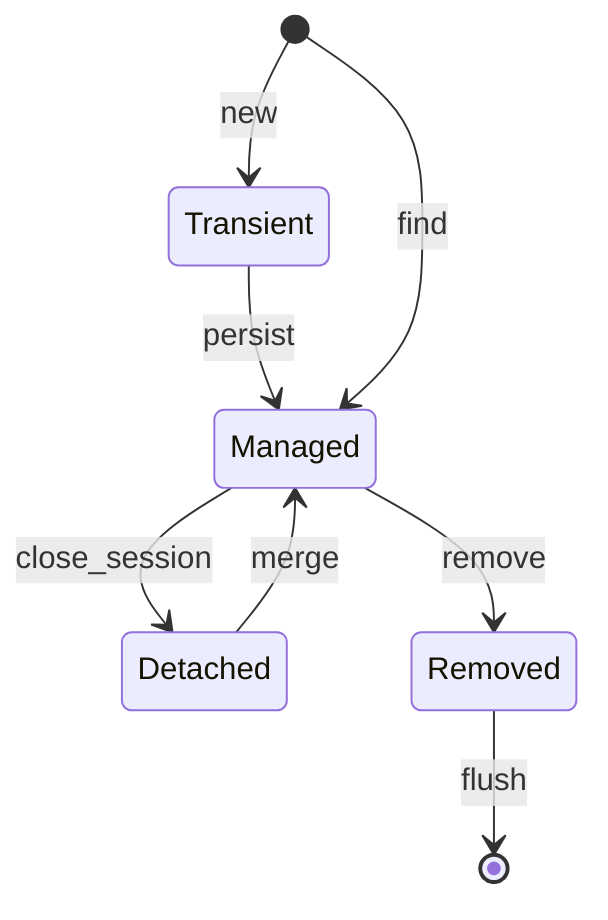

## Введение

«Зачем Hibernate, если есть JDBC?» — вопрос-фильтр. Ждут: ORM отображает таблицы на объекты, держит **persistence context**, гарантирует identity map и сам замечает dirty-поля. Спецификация — Jakarta Persistence; популярная реализация — Hibernate. Здесь концепции без ухода в N+1 (это [JV07](/game/learn/jv-jpa-nplus1)).

## Раздел: Mapping и unit of work

ORM связывает класс сущности с таблицей, поля — с колонками, ассоциации — с FK/join table. Разработчик мыслит объектами; SQL генерируется (или пишется JPQL/SQL). **Unit of Work / persistence context** — набор управляемых сущностей в рамках сессии/`EntityManager`: загрузили, изменили, при flush ушли UPDATE/INSERT/DELETE.

Vs JDBC: вы сами пишете SQL и маппите ResultSet. ORM экономит бойлерплейт, но добавляет скрытое поведение — его нужно понимать, иначе «магия» бьёт по перфу.

Ошибка: считать ORM «заменой знания SQL». На собесе и в проде SQL всё равно читают в логах.

## Раздел: Identity map

В одном persistence context одна строка БД с данным id ↔ **один** объект Java. Повторный `find(id)` возвращает тот же instance (пока контекст жив). Это упрощает сравнение ссылок и накопление изменений.

```text
em.find(Order.class, 1) == em.find(Order.class, 1)  // true в одном контексте
```

Ошибка: сравнивать сущности из разных сессий через `==` или тащить detached-объект как «истину» без merge. Вторая: класть сущность в HashSet без стабильного бизнес-ключа/`equals` стратегии — сюрпризы при detach.

## Раздел: Dirty checking и состояния сущности

Типичные состояния: *transient* (новый), *managed* (в контексте), *detached* (был managed, сессия закрыта), *removed*. **Dirty checking**: у managed-сущности ORM сравнивает текущие поля со снимком и сам готовит UPDATE при flush/commit — без ручного `UPDATE …` на каждое поле.

```java
Order order = em.find(Order.class, id); // managed
order.setStatus(PAID);                  // dirty
// flush/commit → UPDATE
```

Ошибка: менять сущность после закрытия сессии и ждать авто-UPDATE. Вторая: огромный граф managed-объектов → тяжёлый flush. Когда JDBC уместнее: массовые batch, сложный SQL-отчёт, тонкий контроль текста запроса.

Дальше по чтению (не копипаст): [Vlad Mihalcea — blog](https://vladmihalcea.com/) как доп. разборы паттернов; канон API — Jakarta Persistence / Hibernate User Guide.

## Раздел: Частые вопросы с собеседования

**Вопрос.** ORM vs raw SQL — аргументы «за» и «против»?

**Ответ.** ORM снимает маппинг ResultSet и даёт identity/dirty checking; цена — неочевидные запросы и N+1. Raw SQL/JDBC — прозрачный plan и batch; цена — бойлерплейт и ручная синхронизация изменений. На middle-собесе ждут: «ORM не заменяет SQL, а скрывает его до логов».

**Вопрос.** Что такое N+1 одной фразой до отдельного выпуска?

**Ответ.** Один запрос за списком родителей и N запросов за детьми в цикле — лишние round-trip к БД. Лечат fetch join, entity graph, batch size или DTO-запрос. Это следствие LAZY и наивного обхода графа, не «магия Hibernate».

**Вопрос.** JPA и Hibernate — не одно и то же?

**Ответ.** JPA — спецификация API (EntityManager, аннотации); Hibernate — популярная реализация плюс расширения. На собесе «JPA» часто означает стек Spring Data + Hibernate. Концепции persistence context из выпуска — язык спецификации.

**Вопрос.** Когда dirty checking не спасёт?

**Ответ.** Если сущность detached после закрытия сессии — изменения не попадут в UPDATE без merge. Массовые изменения тысяч строк эффективнее bulk SQL/JDBC, чем per-entity flush. Отчёты с агрегациями — SQL, не ORM-обход графа.

## Лаба

**Цель.** Объяснить на примере Order: identity map + dirty checking vs два отдельных JDBC UPDATE.

**Шаги.**
1. Нарисуйте 4 состояния сущности и переходы find/persist/detach/remove.
2. Опишите, почему два find одного id дают один объект.
3. Покажите псевдокод изменения поля без явного SQL.
4. Назовите 2 случая, когда предпочтёте JDBC.
5. Свяжите с [JV05](/game/learn/jv-jdbc-pool-tx): кто всё равно держит Connection под сессией.

**В группу:** один хвалит ORM «за скорость разработки», второй — риски скрытого SQL; итоговая таблица плюс/минус.

**Готово, если…**
- [ ] Можете определить identity map
- [ ] Объясняете dirty checking без магии
- [ ] Знаете отличие managed vs detached

## Схема: Persistence context



## Тест

### Чем ORM отличается от JDBC на собесе?

**Ответ:** объекты + persistence context

**Пояснение:** JDBC — SQL и ResultSet вручную; ORM управляет сущностями и SQL-генерацией.

### Что такое identity map?

**Ответ:** один id → один объект в контексте

**Пояснение:** повторная загрузка того же ключа возвращает тот же instance в рамках сессии.

### Что делает dirty checking?

**Ответ:** сам замечает изменённые поля

**Пояснение:** при flush генерирует UPDATE для managed-сущностей без ручного SQL на каждое поле.

### Что такое detached сущность?

**Ответ:** была managed, сессия закрыта

**Пояснение:** изменения больше не отслеживаются, пока не сделаете merge/новую сессию.

### Когда честнее взять raw JDBC?

**Ответ:** batch/сложный SQL/жёсткий контроль

**Пояснение:** ORM удобен для доменных CRUD; отчёты и массовые операции часто проще SQL.

## Шпаргалка

<h3>Суть</h3>
<ul>
<li>JPA = спецификация; Hibernate = реализация</li>
<li>persistence context = unit of work</li>
<li>identity map + dirty checking</li>
<li>SQL всё равно нужно читать</li>
</ul>
<h3>Состояния</h3>
<pre><code>transient → managed → detached
managed → removed → flush/delete
</code></pre>

## Anki

### Front: Что такое persistence context одной фразой?

Back: набор управляемых сущностей и их снимков в рамках сессии ORM

### Front: Зачем ORM нужен identity map?

Back: чтобы одна строка БД не превращалась в несколько конфликтующих объектов

### Front: Когда срабатывает dirty checking?

Back: при flush/commit для managed-сущностей с изменёнными полями

### Front: Чем transient отличается от managed?

Back: transient ещё не связан с контекстом; managed отслеживается ORM

### Front: JPA и Hibernate — это одно и то же?

Back: нет; JPA/Jakarta Persistence — API/спека, Hibernate — реализация

### Front: Почему «ORM вместо SQL» — плохой ответ на собесе?

Back: ORM генерирует SQL; без понимания запросов ловите перф и баги

## Итоги

- ORM = mapping + unit of work, не «магия без БД»
- Identity и dirty checking объясняют половину поведения JPA
- Дальше — ленивые связи и классика N+1

## Ссылки

- [Jakarta Persistence specification](https://jakarta.ee/specifications/persistence/)
- [Hibernate User Guide](https://docs.jboss.org/hibernate/orm/current/userguide/html_single/Hibernate_User_Guide.html)
- Доп. чтение: [vladmihalcea.com](https://vladmihalcea.com/)
- Далее: [JPA N+1](/game/learn/jv-jpa-nplus1)
