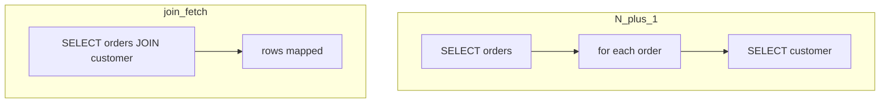

## Введение

Middle-собес по данным: что такое entity, чем LAZY отличается от EAGER, как выглядит N+1 и чем лечить. Канон — Jakarta Persistence + Hibernate User Guide (fetch, entity graph). Посты Vlad Mihalcea — **доп. чтение**, не источник копипаста. SQL-планы — [sql-performance-explain](/game/learn/sql-performance-explain).

## Раздел: Entity, Session и LAZY

`@Entity` — класс, связанный с таблицей, с id. Ассоциации (`@ManyToOne`, `@OneToMany` …) имеют `FetchType`: **LAZY** откладывает загрузку коллекции/прокси до первого доступа; **EAGER** тянет сразу (часто слишком жадно).

```java
@Entity
class Order {
  @Id Long id;
  @ManyToOne(fetch = FetchType.LAZY) Customer customer;
}
```

Ошибка: EAGER «на всякий» на всех связях → тяжёлые SELECT JOIN даже когда нужен один id. Вторая: трогать LAZY-коллекцию **вне** сессии → `LazyInitializationException`.

## Раздел: Как рождается N+1

Паттерн: один запрос загружает список родителей, затем в цикле для каждого родителя отдельный SELECT связи.

```text
SELECT * FROM orders;           -- 1
SELECT * FROM customers WHERE id=?  -- × N в цикле
```

Симптом в логах: пачка одинаковых SQL. На собесе рисуют Order→Customer или Post→Comments. Это не «баг Hibernate», а цена наивного LAZY + цикл в сервисе/шаблоне.

Связь с SQL14: даже «один красивый SQL» может быть медленным без индексов; N+1 — сначала уберите лишние round-trip, потом смотрите plan.

## Раздел: Лечение fetch-стратегий

Практические рычаги (ориентир по User Guide):
- `join fetch` / `FETCH JOIN` в JPQL;
- `@EntityGraph` / named entity graph;
- `batch size` / `@BatchSize` — подгрузка пачками, не по одному;
- DTO-проекции / отдельный запрос ids, когда полный граф не нужен.

```java
em.createQuery(
  "select o from Order o join fetch o.customer where o.created > :from",
  Order.class);
```

Ошибка: cartesian product при join fetch нескольких коллекций сразу — раздувание результата. Вторая: «починил N+1» огромным EAGER — стало хуже на других экранах. Включайте SQL-лог в dev (`show_sql` / datasource proxy) и смотрите счётчик запросов на сценарий.

Доп. разборы паттернов: [vladmihalcea.com](https://vladmihalcea.com/) — further reading.

## Раздел: Частые вопросы с собеседования

**Вопрос.** EAGER vs LAZY — что ответить за 30 секунд?

**Ответ.** LAZY грузит связь при первом доступе; EAGER — сразу с родителем. EAGER «везде» раздувает JOIN и память; LAZY без открытой сессии даёт LazyInitializationException. Компромисс — явный fetch на сценарий (join fetch / graph), не глобальный EAGER.

**Вопрос.** JOIN FETCH vs `@EntityGraph`?

**Ответ.** Оба задают, какой граф подтянуть одним запросом; join fetch — в JPQL, graph — декларативно на методе репозитория. Оба могут дать cartesian product на нескольких коллекциях — нужен дизайн запроса. Цель — один-два SQL вместо N+1, не «максимум JOIN любой ценой».

**Вопрос.** ORM vs SQL для отчёта с GROUP BY?

**Ответ.** Агрегации и окна — зона SQL/JDBC или native query; тащить entity-граф ради SUM — лишний overhead. DTO projection / interface projection часто быстрее полного entity. ORM хорош для transactional CRUD; аналитика — честный SQL с explain.

**Вопрос.** Почему `==` для двух Entity опасен?

**Ответ.** В одном persistence context один id — один instance (identity map); `==` может совпасть. Между сессиями или после detach — разные объекты с одним id; сравнивайте id или equals по бизнес-правилам. Путаница с Java equals/hashCode для Set сущностей — отдельная ловушка.

## Лаба

**Цель.** Найти N+1 в псевдокоде списка заказов и предложить join fetch или graph.

**Шаги.**
1. Псевдокод: `findAll Orders` + `order.getCustomer().getName()` в цикле — посчитайте SQL.
2. Перепишите с `join fetch` и снова посчитайте.
3. Назовите риск LazyInitializationException.
4. Включите мысленно лог SQL — какие строки ищете.
5. Откройте [SQL14](/game/learn/sql-performance-explain) и добавьте одну мысль про индекс на FK.

**В группу:** один пишет антипаттерн шаблона, второй — фикс без EAGER everywhere.

**Готово, если…**
- [ ] Рисуете N+1 на доске
- [ ] Знаете ≥2 способа лечения
- [ ] Помните про LazyInitializationException

## Схема: N+1 vs join fetch



## Тест

### Что такое N+1 в ORM?

**Ответ:** 1 список + N запросов связей

**Пояснение:** цикл обращается к LAZY-ассоциации и порождает отдельный SQL на элемент.

### Чем FetchType.LAZY полезен?

**Ответ:** не тащить граф всегда

**Пояснение:** откладывает загрузку; опасен вне сессии и в слепых циклах.

### Как лечить N+1 типовым JPQL?

**Ответ:** join fetch

**Пояснение:** подтянуть нужную связь одним (или контролируемым) SQL.

### Что такое LazyInitializationException?

**Ответ:** LAZY вне persistence context

**Пояснение:** сессия закрыта, прокси не может выполнить SELECT.

### Почему EAGER на всём — плохой дефолт?

**Ответ:** лишние тяжёлые JOIN

**Пояснение:** каждый use-case тянет разный граф; EAGER фиксирует жадность глобально.

## Шпаргалка

<h3>Суть</h3>
<ul>
<li>логируйте SQL на сценарий UI/API</li>
<li>N+1 = цикл + LAZY</li>
<li>join fetch / entity graph / batch</li>
<li>см. SQL14 для планов</li>
</ul>
<h3>Чеклист</h3>
<pre><code>count queries per request
fetch only what screen needs
avoid multi-collection join fetch
</code></pre>

## Anki

### Front: Как на логох узнать N+1?

Back: один SELECT списка и серия одинаковых SELECT по id связи

### Front: Что делает JPQL join fetch?

Back: загружает ассоциацию вместе с корнем в одном запросе

### Front: Зачем @EntityGraph?

Back: декларативно задать, какие атрибуты/связи подтянуть в этом find/query

### Front: Чем batch-size помогает против N+1?

Back: подгружает связи пачками IN (...), меньше round-trip чем по одному

### Front: Когда join fetch нескольких коллекций опасен?

Back: декартово раздувание результата

### Front: Где канонично читать про fetch в Hibernate?

Back: Hibernate User Guide (раздел fetching) + Jakarta Persistence

## Итоги

- LAZY — инструмент, не враг; враг — слепой цикл
- Лечение выбирают под use-case, не «EAGER forever»
- Перф закрывают связкой ORM-логи + SQL explain

## Ссылки

- [Jakarta Persistence](https://jakarta.ee/specifications/persistence/)
- [Hibernate User Guide — Fetching](https://docs.jboss.org/hibernate/orm/current/userguide/html_single/Hibernate_User_Guide.html#fetching)
- Доп. чтение: [vladmihalcea.com](https://vladmihalcea.com/)
- Learn | [SQL14 Explain](/game/learn/sql-performance-explain)
- Далее: [JMS](/game/learn/jv-jms)
