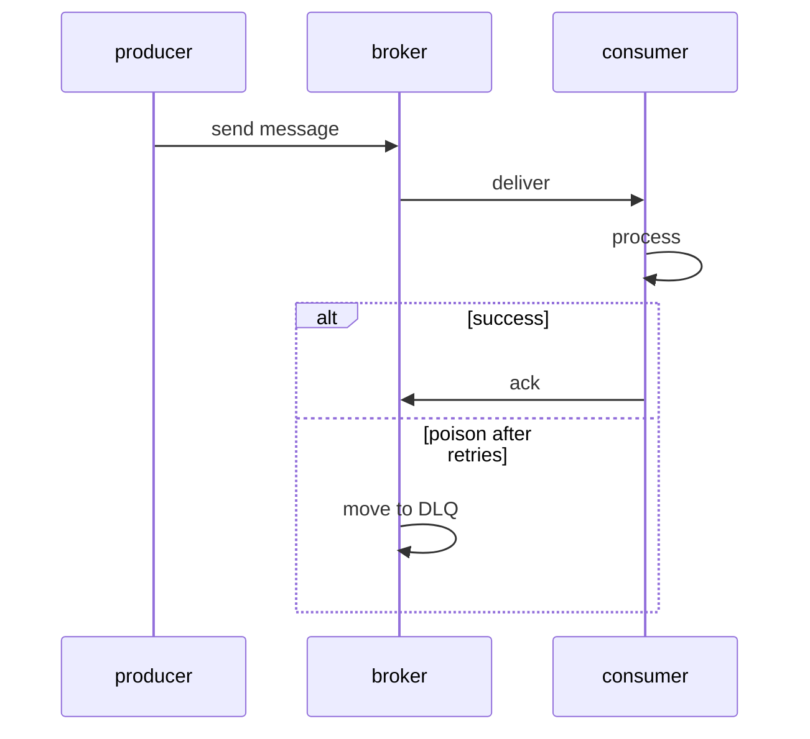

## Введение

Асинхронная интеграция на Java-собесе: очередь vs топик, кто consumer, что такое ack и куда деваются «ядовитые» сообщения. API — **Jakarta Messaging** (исторически JMS). Это не Kafka client API: общая идея брокера есть, модели и гарантии отличаются. Контекст очередей у аналитиков — [SA10](/game/learn/sa-sync-async-queues).

## Раздел: PTP queue и pub/sub topic

**Queue (point-to-point):** сообщение забирает один consumer из группы конкурирующих; работа делится. **Topic (publish/subscribe):** каждый подписчик (с своей подпиской) получает копию по правилам durable/shared (в современных спеках есть shared subscriptions — уточняйте версию API на собесе).

```text
Producer → Destination (Queue|Topic) → Consumer(s)
```

Ошибка: назвать Kafka «просто JMS topic». Kafka — лог с offset; JMS — классическая messaging-модель с ack на уровне API. Можно строить похожие паттерны, но ответы «это одно и то же» режут.

## Раздел: Сессии, delivery и acknowledgement

Клиент открывает connection/session (в classic API), создаёт producer/consumer. Режимы ack: auto, client, duplicates-ok (детали — в спеке). Смысл на собесе: **пока не ack — брокер может передоставить** сообщение после сбоя consumer.

Идемпотентность обработчика важнее слепой веры в «exactly once из коробки». At-least-once + идемпотентный consumer — честная прод-формула.

Ошибка: долгая обработка без ack и с коротким visibility/redelivery — шторм дублей. Вторая: глотать исключения и ack «успех» — потеря бизнеса.

## Раздел: DLQ, poison message и транзакции

**Poison message** — сообщение, которое стабильно валит consumer (плохой payload, баг кода). После N попыток брокер/мост кладёт его в **DLQ** (dead-letter queue) для разбора, а не крутит бесконечно.

Транзакционная сессия JMS может согласовывать receive/send; связка с JDBC — отдельный уровень (XA/outbox). На собесе junior/middle часто достаточно: «не делать вид, что локальный DB commit и JMS ack всегда атомарны без паттерна». Лаба склейки — [JV13](/game/learn/jv-integration-lab).

## Раздел: Частые вопросы с собеседования

**Вопрос.** Чем durable subscription отличается от временной на topic?

**Ответ.** Durable подписка переживает отключение consumer: брокер хранит сообщения для subscriber id, пока тот не вернётся (в пределах политики). Недurable — сообщения для «offline» подписчика теряются. На собесе связывают с redelivery и необходимостью идемпотентной обработки. Shared subscription (Jakarta Messaging) делит нагрузку между несколькими инстансами одной логической подписки.

**Вопрос.** SOAP vs REST — когда что в Java-интegrations?

**Ответ.** SOAP/WSDL — сильный контракт, codegen, WS-*; цена — XML и tooling. REST/JSON — проще для браузеров и микросервисов; контракт — OpenAPI и дисциплина версий. Легаси и гос. API часто SOAP; новый внутренний контур — чаще REST. Java-клиент SOAP — отдельный выпуск серии.

**Вопрос.** Acknowledgement — зачем спрашивают?

**Ответ.** Пока consumer не подтвердил обработку, брокер может redeliver после сбоя — at-least-once. Auto-ack до завершения бизнес-логики — риск потери при падении после ack. Идемпотентный handler важнее мифа exactly-once «из коробки».

**Вопрос.** JMS и JDBC в одной транзакции без паттерна?

**Ответ.** Локальный commit БД и ack брокера — две системы; «сделаем всё в одном try» не атомарно. Outbox/XA/inbox — осознанный выбор; на собесе называют dual write problem. Лаба интеграции в JV13.

## Лаба

**Цель.** Устно за 90 секунд объяснить выбор queue vs topic и роль DLQ.

**Шаги.**
1. Нарисуйте продюсера и двух consumer для queue и для topic — кто что получит.
2. Опишите сценарий redelivery после падения consumer до ack.
3. Придумайте poison JSON и путь в DLQ.
4. Напишите 3 правила идемпотентного consumer (ключ дедупа).
5. Сравните одной фразой с Kafka offset (без углубления в партиции).

**В группу:** один предлагает ack до записи в БД, второй — после; зафиксируйте компромисс и риск дублей.

**Готово, если…**
- [ ] Отличаете queue и topic
- [ ] Объясняете ack/redelivery
- [ ] Знаете зачем DLQ

## Схема: Producer → broker → consumer



## Тест

### Чем queue отличается от topic?

**Ответ:** один consumer vs подписчики

**Пояснение:** в PTP сообщение обрабатывает один; в pub/sub — по модели подписок получают копии.

### Зачем acknowledgement?

**Ответ:** подтвердить успешную обработку

**Пояснение:** без ack брокер считает доставку незавершённой и может redeliver.

### Что такое DLQ?

**Ответ:** очередь «отравленных» сообщений

**Пояснение:** после исчерпания ретраев сообщение уводят с основной очереди для анализа.

### JMS — это то же самое, что Kafka?

**Ответ:** нет, разные модели API

**Пояснение:** общая идея асинхронности есть; семантика, API и эксплуатация различаются.

### Почему consumer должен быть идемпотентным?

**Ответ:** возможны дубли at-least-once

**Пояснение:** redelivery и ретраи повторяют обработку; повтор не должен ломать данные.

## Шпаргалка

<h3>Суть</h3>
<ul>
<li>Jakarta Messaging = API; брокер = ActiveMQ/Artemis/IBM…</li>
<li>queue = конкурирующие consumers; topic = pub/sub</li>
<li>ack + redelivery → проектируйте идемпотентность</li>
<li>DLQ для poison messages</li>
</ul>
<h3>Фразы на собесе</h3>
<pre><code>at-least-once + idempotent handler
don't ack before durable side-effect (обычно)
DLQ + alert, не бесконечный retry
</code></pre>

## Anki

### Front: Что стандартизует Jakarta Messaging?

Back: Java API для отправки/получения сообщений через провайдера JMS

### Front: Кто получает сообщение из обычной queue при двух consumer?

Back: один из них (конкурирующие потребители)

### Front: Что происходит при падении consumer до ack?

Back: брокер может доставить сообщение снова (redelivery)

### Front: Что такое poison message?

Back: сообщение, которое стабильно ломает обработку и крутится в ретраях

### Front: Зачем нужен dead-letter destination?

Back: изолировать проблемные сообщения от основной очереди

### Front: Почему «exactly once» нельзя обещать одной галочкой JMS?

Back: нужны согласование с БД/паттерны; API само по себе не отменяет дубли побочных эффектов

## Итоги

- Messaging — про доставку и семантику, не только про «отправили JSON»
- Queue/topic, ack, DLQ — минимальный словарный запас middle
- Дальше — адаптеры и ESB-мышление вокруг шины

## Ссылки

- [Jakarta Messaging specification](https://jakarta.ee/specifications/messaging/)
- Learn | [SA10 Sync/async queues](/game/learn/sa-sync-async-queues)
- Далее: [Адаптер и ESB](/game/learn/jv-esb-adapter)
