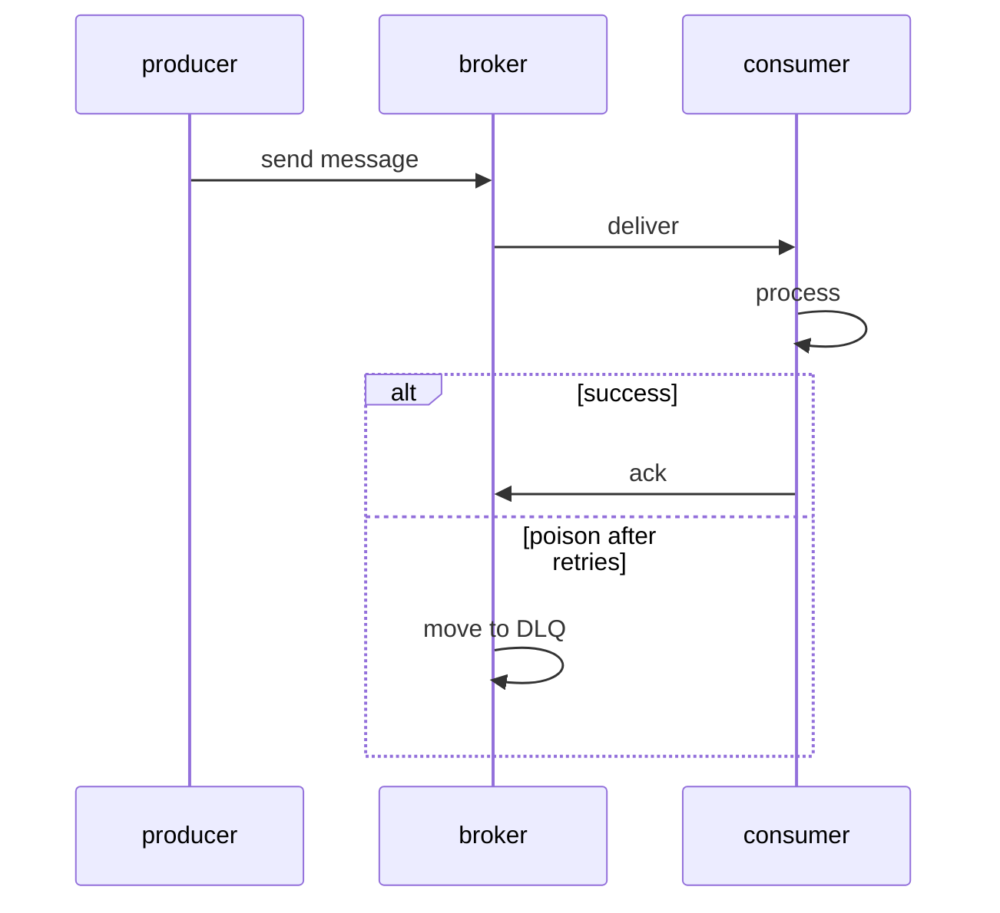
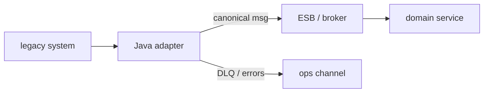
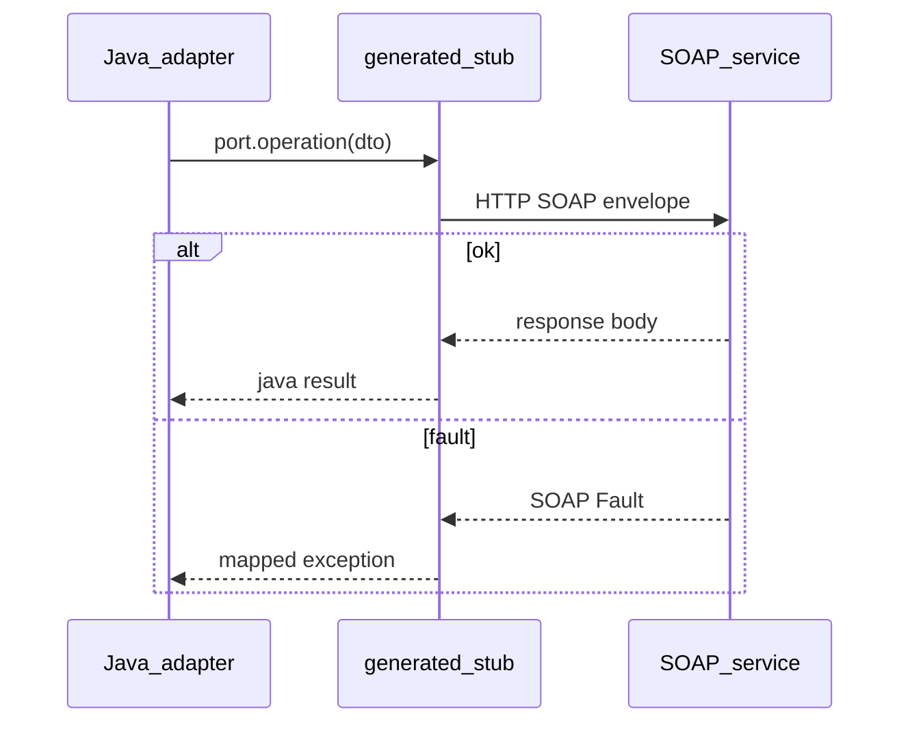

## Введение

Асинхронная интеграция на Java-собесе: очередь vs топик, кто consumer, что такое ack и куда деваются «ядовитые» сообщения. API — **Jakarta Messaging** (исторически JMS). Это не Kafka client API: общая идея брокера есть, модели и гарантии отличаются. Контекст очередей у аналитиков — [SA10](/game/learn/sa-sync-async-queues).

**Адаптер и ESB со стороны.** На middle/senior собесе «интеграции» часто звучит ESB. Разработчику важно не пересказать маркетинг шины, а объяснить **роль адаптера**: антикоррупционный слой, протокол, идемпотентность, наблюдаемость. Продуктовая/аналитическая рамка — [SA13](/game/learn/sa-soap-xml); здесь — взгляд Java-команды. Текст оригинальный.

**SOAP-клиент в Java.** Легаси и гос/enterprise API часто отдают SOAP. На собесе ждут: что такое WSDL, envelope, чем клиент отличается от «просто HTTP POST», где живут таймауты и ошибки. Теория для аналитиков — [SA12](/game/learn/sa-soap-xml); здесь — практика Java-клиента. Стандарты: SOAP / WSDL (W3C); текст оригинальный.

## Раздел: Как отвечать одним блоком

Этот выпуск собрал соседние короткие темы трека: «Очереди JMS», «Адаптер и ESB со стороны», «SOAP-клиент в Java». Раньше каждая занимала отдельную карточку на несколько минут, а на собеседовании их спрашивают одним блоком. Ниже у каждой темы свой раздел, затем общие лабы, один тест и одна колода карточек. В ответе сначала назовите, какую тему спросили, потом определение и один пример. Не проговаривайте все разделы, если спросили один. Лабы можно пройти по порядку исходного трека. Если времени мало, сделайте первую и последнюю: первая ставит язык, последняя проверяет, что соседние темы вы не перепутали.

## Раздел: Очереди JMS: PTP queue и pub/sub topic

**Queue (point-to-point):** сообщение забирает один consumer из группы конкурирующих; работа делится. **Topic (publish/subscribe):** каждый подписчик (с своей подпиской) получает копию по правилам durable/shared (в современных спеках есть shared subscriptions — уточняйте версию API на собесе).

```text
Producer → Destination (Queue|Topic) → Consumer(s)
```

Ошибка: назвать Kafka «просто JMS topic». Kafka — лог с offset; JMS — классическая messaging-модель с ack на уровне API. Можно строить похожие паттерны, но ответы «это одно и то же» режут.

## Раздел: Очереди JMS: Сессии, delivery и acknowledgement

Клиент открывает connection/session (в classic API), создаёт producer/consumer. Режимы ack: auto, client, duplicates-ok (детали — в спеке). Смысл на собесе: **пока не ack — брокер может передоставить** сообщение после сбоя consumer.

Идемпотентность обработчика важнее слепой веры в «exactly once из коробки». At-least-once + идемпотентный consumer — честная прод-формула.

Ошибка: долгая обработка без ack и с коротким visibility/redelivery — шторм дублей. Вторая: глотать исключения и ack «успех» — потеря бизнеса.

## Раздел: Очереди JMS: DLQ, poison message и транзакции

**Poison message** — сообщение, которое стабильно валит consumer (плохой payload, баг кода). После N попыток брокер/мост кладёт его в **DLQ** (dead-letter queue) для разбора, а не крутит бесконечно.

Транзакционная сессия JMS может согласовывать receive/send; связка с JDBC — отдельный уровень (XA/outbox). На собесе junior/middle часто достаточно: «не делать вид, что локальный DB commit и JMS ack всегда атомарны без паттерна». Лаба склейки — [JV13](/game/learn/jv-js-glue).

## Раздел: Очереди JMS: Частые вопросы с собеседования

**Вопрос.** Чем durable subscription отличается от временной на topic?

**Ответ.** Durable подписка переживает отключение consumer: брокер хранит сообщения для subscriber id, пока тот не вернётся (в пределах политики). Недurable — сообщения для «offline» подписчика теряются. На собесе связывают с redelivery и необходимостью идемпотентной обработки. Shared subscription (Jakarta Messaging) делит нагрузку между несколькими инстансами одной логической подписки.

**Вопрос.** SOAP vs REST — когда что в Java-интegrations?

**Ответ.** SOAP/WSDL — сильный контракт, codegen, WS-*; цена — XML и tooling. REST/JSON — проще для браузеров и микросервисов; контракт — OpenAPI и дисциплина версий. Легаси и гос. API часто SOAP; новый внутренний контур — чаще REST. Java-клиент SOAP — отдельный выпуск серии.

**Вопрос.** Acknowledgement — зачем спрашивают?

**Ответ.** Пока consumer не подтвердил обработку, брокер может redeliver после сбоя — at-least-once. Auto-ack до завершения бизнес-логики — риск потери при падении после ack. Идемпотентный handler важнее мифа exactly-once «из коробки».

**Вопрос.** JMS и JDBC в одной транзакции без паттерна?

**Ответ.** Локальный commit БД и ack брокера — две системы; «сделаем всё в одном try» не атомарно. Outbox/XA/inbox — осознанный выбор; на собесе называют dual write problem. Лаба интеграции в JV13.

## Раздел: Адаптер и ESB со стороны: Шина vs точечные связи

Точечные интеграции (`N` систем × `N` связей) взрывают сопровождение. **ESB / integration bus** централизует маршрутизацию, трансформацию, иногда оркестрацию. Java-приложение редко «является всей шиной»; чаще оно — **адаптер**: говорит с канонической моделью шины с одной стороны и с легаси/БД/SOAP/JMS с другой.

```text
System A ↔ Adapter A ↔ Bus ↔ Adapter B ↔ System B
```

Ошибка: тащить доменную логику заказа глубоко в маппинг XML «потому что так удобнее в шине». Логика размазывается, тестировать невозможно.

## Раздел: Адаптер и ESB со стороны: Что делает хороший адаптер

Обязанности адаптера на собесе:
- **протокол**: HTTP/SOAP/JMS/file → внутренний контракт;
- **маппинг** канонической модели ↔ внешней;
- **идемпотентность** (ключ операции, upsert, dedup store);
- **ретраи с политикой** и DLQ/ошибочный канал;
- **корреляция** (correlation id / saga id в заголовках);
- **метрики и логи** без утечки ПДн.

В Java это часто Spring Integration / Camel / тонкий сервис + JMS из [JV08](/game/learn/jv-jms). Выбор фреймворка вторичен; важны границы.

Ошибка: ретраить non-idempotent POST оплаты бесконечно. Вторая: глотать ошибку валидации и слать ack в брокер.

## Раздел: Адаптер и ESB со стороны: Когда шина — overkill

ESB окупается при многих участниках, разных протоколах, необходимости централизованных политик. Для двух сервисов одной команды часто достаточно прямого API + брокер событий. Честный ответ на собесе: «шина — инструмент операционной сложности интеграций, не серебряная пуля». Решение фиксируют ADR — практика в [JV14](/game/learn/jv-adr-bus-vs-broker) и [SA20](/game/learn/sa-architecture-decisions).

Стандарты сообщений/SOAP рядом: [JV10](/game/learn/jv-jms). Не путать ESB с API Gateway: gateway — вход для клиентов API; ESB — клей между enterprise-системами (границы на практике размыты — проговорите контекст).

## Раздел: Адаптер и ESB со стороны: Частые вопросы с собеседования

**Вопрос.** SOAP vs REST на периметре ESB?

**Ответ.** Шина часто принимает SOAP/XML от легаси и отдаёт каноническую модель адаптерам. Внутренний контур продукта чаще REST/JSON; адаптер переводит протокол и схему. REST без WSDL не заменяет codegen SOAP-клиента один в один — разные контракты.

**Вопрос.** Queue vs topic у адаптера к брокеру?

**Ответ.** Очередь — конкурирующие воркеры адаптера масштабируют обработку. Topic — несколько подсистем слушают одно событие (склад, биллинг). Адаптер не должен смешивать доменные события с техническими retry-очередями без именования.

**Вопрос.** Идempotency key — что сказать на собесе?

**Ответ.** Повтор доставки JMS неизбежен; адаптер хранит ключ операции и игнорирует дубликат или делает upsert. Без ключа retry оплаты/заказа опасен. Ключ в заголовке сообщения + уникальный индекс в БД — типичная схема.

## Раздел: SOAP-клиент в Java: WSDL как контракт

**WSDL** описывает операции, сообщения, привязки (обычно SOAP over HTTP) и адрес endpoint. По WSDL генерируют **stub/proxy** (wsimport, Apache CXF, JAX-WS tooling): вы вызываете Java-метод, стек собирает XML-envelope.

```text
WSDL → codegen → Port interface → invoke → SOAP XML → HTTP → service
```

Ошибка: править сгенерированный код руками «на пять минут» — следующее обновление WSDL сотрёт правки. Держите кастом в адаптере/mapper рядом ([JV09](/game/learn/jv-jms)).

## Раздел: SOAP-клиент в Java: Envelope, headers иfaults

SOAP-сообщение: envelope → header (метаданные, WS-Security и т.п.) + body (полезная нагрузка). Ошибки часто приходят как **Fault**, а не только HTTP 500 с HTML. Клиент должен маппить fault code/detail в доменные исключения.

```xml
<!-- схематично, не копипаст учебника -->
<Envelope>
  <Header><!-- correlation, auth --></Header>
  <Body><!-- operation payload --></Body>
</Envelope>
```

Vs REST: у SOAP сильнее контракт и tooling codegen; цена — тяжёлый XML, версионирование schemа, сложнее отладка «человеческим глазом». Не говорите «SOAP устарел всегда» — в интеграциях он жив.

## Раздел: SOAP-клиент в Java: Эксплуатация клиента

Прод-чеклист Java SOAP-клиента:
- connect/read timeouts;
- пул HTTP-соединений / keep-alive;
- логирование correlation id (без секретов и ПДн в clear-text);
- retry только для идемпотентных операций или с ключом дедупа;
- отдельный truststore при mTLS;
- совместимость при смене WSDL (minor vs breaking).

Ошибка: бесконечный retry на fault бизнес-валидации. Вторая: таймаут 5 минут «чтобы успело» — держит потоки Tomcat/Netty и валит хвост латентности.

## Раздел: SOAP-клиент в Java: Частые вопросы с собеседования

**Вопрос.** Когда retry вызова SOAP-операции опасен?

**Ответ.** Повтор без идempotency key на операции оплаты или создания заказа может продублировать побочный эффект на стороне сервиса. Fault бизнес-валидации (4xx-смысл в faultcode) ретраить бессмысленно — нужен fix payload. Транспортные таймауты и 5xx иногда ретраят с backoff и dedup. На собесе связывают с политикой из раздела эксплуатации клиента.

**Вопрос.** Чем Fault отличается от HTTP 500?

**Ответ.** SOAP может вернуть 200 с Fault в теле envelope; клиент парсит faultcode/detail. REST чаще кодирует ошибку статусом и JSON problem.details. Java-клиент должен маппить оба класса в доменные исключения.

**Вопрос.** Checked exceptions в JAX-WS/SOAP клиенте?

**Ответ.** Сгенерированные вызовы часто бросают checked (WebServiceException и обёртки); их ловят или оборачивают в runtime с контекстом correlation id. Unchecked NPE в mapper — отдельно от транспортной ошибки.

**Вопрос.** WSDL — что должно быть в ответе за минуту?

**Ответ.** Описание операций, типов сообщений, binding (SOAP over HTTP) и endpoint URL. По WSDL генерируют port interface; ручные правки в generated code хрупки. Версионирование WSDL — breaking vs compatible изменения XSD.

## Лаба

**Очереди JMS.**

**Цель.** Устно за 90 секунд объяснить выбор queue vs topic и роль DLQ.

**Шаги.**
1. Нарисуйте продюсера и двух consumer для queue и для topic — кто что получит.
2. Опишите сценарий redelivery после падения consumer до ack.
3. Придумайте poison JSON и путь в DLQ.
4. Напишите 3 правила идемпотентного consumer (ключ дедупа).
5. Сравните одной фразой с Kafka offset (без углубления в партиции).

**В группу:** один предлагает ack до записи в БД, второй — после; зафиксируйте компромисс и риск дублей.

**Готово, если…**
- [ ] Отличаете queue и topic
- [ ] Объясняете ack/redelivery
- [ ] Знаете зачем DLQ

**Адаптер и ESB со стороны.**

**Цель.** Нарисовать адаптер между «1С/легаси» и внутренней очередью заказов.

**Шаги.**
1. Перечислите входной протокол и выходной (например SOAP → JMS).
2. Опишите каноническое сообщение OrderCreated (поля, id, версия).
3. Добавьте правило идемпотентности по externalId.
4. Укажите, куда идут ошибки валидации vs ошибки инфраструктуры.
5. Свяжите с SA13 одной фразой «зачем шина бизнесу».

**В группу:** один предлагает «всю логику в ESB», второй — «тонкие адаптеры»; выберите сторону и аргумент.

**Готово, если…**
- [ ] Можете определить роль адаптера
- [ ] Называете ≥4 обязанности адаптера
- [ ] Отличаете кейс «шина» vs «прямой API»

**SOAP-клиент в Java.**

**Цель.** Описать вызов одной операции «как на дизайн-ревью» без живого endpoint.

**Шаги.**
1. Найдите публичный пример WSDL (или схему из SA12) и назовите 2 операции.
2. Перечислите, что сгенерирует tooling (port, types).
3. Напишите псевдокод: create port → set timeout → call → map fault.
4. Добавьте правило: какие ошибки ретраим.
5. Свяжите с адаптером: куда кладёте маппинг в доменную модель.

**В группу:** один логирует весь XML, второй объясняет риск ПДн/секретов; договоритесь о redaction.

**Готово, если…**
- [ ] Объясняете роль WSDL
- [ ] Отличаете Fault от «просто 500»
- [ ] Называете таймауты и политику retry

## Схема: Очереди JMS: Producer → broker → consumer



## Схема: Адаптер и ESB со стороны: Адаптер на границе



## Схема: SOAP-клиент в Java: Вызов SOAP из Java



## Тест

### Чем queue отличается от topic?

**Ответ:** один consumer vs подписчики

**Пояснение:** в PTP сообщение обрабатывает один; в pub/sub — по модели подписок получают копии.

### Что делает адаптер в ESB-ландшафте?

**Ответ:** мост протокола и модели данных

**Пояснение:** переводит внешний контракт в канонический и обратно, без расползания домена.

### Зачем нужен WSDL клиенту?

**Ответ:** контракт для генерации stub

**Пояснение:** описывает операции и типы; tooling строит типобезопасный Java-клиент.

### Зачем acknowledgement?

**Ответ:** подтвердить успешную обработку

**Пояснение:** без ack брокер считает доставку незавершённой и может redeliver.

### Чем точечные интеграции плохи при росте N систем?

**Ответ:** взрыв числа связей

**Пояснение:** каждая пара тянет свой протокол и сопровождение; шина централизует политики.

## Шпаргалка

<ul><li>Jakarta Messaging = API; брокер = ActiveMQ/Artemis/IBM…</li><li>queue = конкурирующие consumers; topic = pub/sub</li><li>ack + redelivery → проектируйте идемпотентность</li><li>DLQ для poison messages</li><li>адаптер = anti-corruption + protocol</li><li>каноническая модель + версии сообщений</li><li>idempotency, retries, DLQ, correlation id</li><li>шина ≠ автоматическое решение всех интеграций</li><li>WSDL = контракт; stub = сгенерированный клиент</li><li>envelope = header + body; ошибки → Fault</li><li>таймауты, идемпотентный retry, redaction логов</li><li>см. SA12 для XML/схем глазами аналитика</li></ul>

## Anki

### Front: Что стандартизует Jakarta Messaging?

Back: Java API для отправки/получения сообщений через провайдера JMS

### Front: Что такое anti-corruption layer в контексте адаптера?

Back: изоляция модели легаси от внутренней канонической модели

### Front: Что генерируют из WSDL в типичном Java-стеке?

Back: интерфейс порта и классы типов сообщений (stub/proxy)

### Front: Кто получает сообщение из обычной queue при двух consumer?

Back: один из них (конкурирующие потребители)

### Front: Какие два преобразования почти всегда делает адаптер?

Back: протокол (транспорт) и формат/схема данных

### Front: Где в SOAP-сообщении обычно метаданные вроде security?

Back: в Header конверта Envelope

## Итоги

- Messaging — про доставку и семантику, не только про «отправили JSON»
- Queue/topic, ack, DLQ — минимальный словарный запас middle
- Дальше — адаптеры и ESB-мышление вокруг шины
- Java-роль в ESB — адаптер с чёткими границами
- Идемпотентность и наблюдаемость важнее выбора брэнда шины
- Следующий выпуск — SOAP-клиент как частый внешний протокол
- SOAP-клиент — контрактный codegen + эксплуатационные настройки
- Faults, таймауты и идемпотентность решают прод-судьбу

## Ссылки

- [Jakarta Messaging specification](https://jakarta.ee/specifications/messaging/)
- [SA10 Sync/async queues](/game/learn/sa-sync-async-queues)
- [SA13 ESB integrations](/game/learn/sa-soap-xml)
- [W3C SOAP](https://www.w3.org/TR/soap/)
- [W3C WSDL](https://www.w3.org/TR/wsdl/)
- [SA12 SOAP/XML](/game/learn/sa-soap-xml)
- [JS glue](/game/learn/jv-js-glue)
