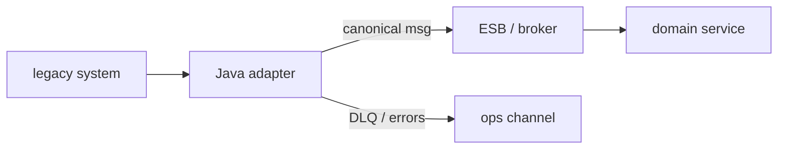

## Введение

На middle/senior собесе «интеграции» часто звучит ESB. Разработчику важно не пересказать маркетинг шины, а объяснить **роль адаптера**: антикоррупционный слой, протокол, идемпотентность, наблюдаемость. Продуктовая/аналитическая рамка — [SA13](/game/learn/sa-esb-integrations); здесь — взгляд Java-команды. Текст оригинальный.

## Раздел: Шина vs точечные связи

Точечные интеграции (`N` систем × `N` связей) взрывают сопровождение. **ESB / integration bus** централизует маршрутизацию, трансформацию, иногда оркестрацию. Java-приложение редко «является всей шиной»; чаще оно — **адаптер**: говорит с канонической моделью шины с одной стороны и с легаси/БД/SOAP/JMS с другой.

```text
System A ↔ Adapter A ↔ Bus ↔ Adapter B ↔ System B
```

Ошибка: тащить доменную логику заказа глубоко в маппинг XML «потому что так удобнее в шине». Логика размазывается, тестировать невозможно.

## Раздел: Что делает хороший адаптер

Обязанности адаптера на собесе:
- **протокол**: HTTP/SOAP/JMS/file → внутренний контракт;
- **маппинг** канонической модели ↔ внешней;
- **идемпотентность** (ключ операции, upsert, dedup store);
- **ретраи с политикой** и DLQ/ошибочный канал;
- **корреляция** (correlation id / saga id в заголовках);
- **метрики и логи** без утечки ПДн.

В Java это часто Spring Integration / Camel / тонкий сервис + JMS из [JV08](/game/learn/jv-jms). Выбор фреймворка вторичен; важны границы.

Ошибка: ретраить non-idempotent POST оплаты бесконечно. Вторая: глотать ошибку валидации и слать ack в брокер.

## Раздел: Когда шина — overkill

ESB окупается при многих участниках, разных протоколах, необходимости централизованных политик. Для двух сервисов одной команды часто достаточно прямого API + брокер событий. Честный ответ на собесе: «шина — инструмент операционной сложности интеграций, не серебряная пуля». Решение фиксируют ADR — практика в [JV14](/game/learn/jv-adr-bus-vs-broker) и [SA20](/game/learn/sa-architecture-decisions).

Стандарты сообщений/SOAP рядом: [JV10](/game/learn/jv-soap-client). Не путать ESB с API Gateway: gateway — вход для клиентов API; ESB — клей между enterprise-системами (границы на практике размыты — проговорите контекст).

## Раздел: Частые вопросы с собеседования

**Вопрос.** SOAP vs REST на периметре ESB?

**Ответ.** Шина часто принимает SOAP/XML от легаси и отдаёт каноническую модель адаптерам. Внутренний контур продукта чаще REST/JSON; адаптер переводит протокол и схему. REST без WSDL не заменяет codegen SOAP-клиента один в один — разные контракты.

**Вопрос.** Queue vs topic у адаптера к брокеру?

**Ответ.** Очередь — конкурирующие воркеры адаптера масштабируют обработку. Topic — несколько подсистем слушают одно событие (склад, биллинг). Адаптер не должен смешивать доменные события с техническими retry-очередями без именования.

**Вопрос.** Идempotency key — что сказать на собесе?

**Ответ.** Повтор доставки JMS неизбежен; адаптер хранит ключ операции и игнорирует дубликат или делает upsert. Без ключа retry оплаты/заказа опасен. Ключ в заголовке сообщения + уникальный индекс в БД — типичная схема.

## Лаба

**Цель.** Нарисовать адаптер между «1С/легаси» и внутренней очередью заказов.

**Шаги.**
1. Перечислите входной протокол и выходной (например SOAP → JMS).
2. Опишите каноническое сообщение OrderCreated (поля, id, версия).
3. Добавьте правило идемпотентности по externalId.
4. Укажите, куда идут ошибки валидации vs ошибки инфраструктуры.
5. Свяжите с SA13 одной фразой «зачем шина бизнесу».

**В группу:** один предлагает «всю логику в ESB», второй — «тонкие адаптеры»; выберите сторону и аргумент.

**Готово, если…**
- [ ] Можете определить роль адаптера
- [ ] Называете ≥4 обязанности адаптера
- [ ] Отличаете кейс «шина» vs «прямой API»

## Схема: Адаптер на границе



## Тест

### Что делает адаптер в ESB-ландшафте?

**Ответ:** мост протокола и модели данных

**Пояснение:** переводит внешний контракт в канонический и обратно, без расползания домена.

### Чем точечные интеграции плохи при росте N систем?

**Ответ:** взрыв числа связей

**Пояснение:** каждая пара тянет свой протокол и сопровождение; шина централизует политики.

### Зачем идемпотентность в адаптере?

**Ответ:** безопасные ретраи дублей

**Пояснение:** доставка at-least-once и повторы с шины не должны плодить заказы.

### ESB всегда лучше прямого REST?

**Ответ:** нет — зависит от числа участников

**Пояснение:** для пары сервисов шина часто overkill и лишняя операционная сложность.

### Чем ESB не стоит подменять?

**Ответ:** доменную логику ядра

**Пояснение:** маппинг и маршрутизация — да; правила бизнеса заказа — в доменном сервисе.

## Шпаргалка

<h3>Суть</h3>
<ul>
<li>адаптер = anti-corruption + protocol</li>
<li>каноническая модель + версии сообщений</li>
<li>idempotency, retries, DLQ, correlation id</li>
<li>шина ≠ автоматическое решение всех интеграций</li>
</ul>
<h3>Связи</h3>
<pre><code>SA13 — взгляд аналитика
JV08 — JMS как транспорт
JV14 — ADR bus vs broker
</code></pre>

## Anki

### Front: Что такое anti-corruption layer в контексте адаптера?

Back: изоляция модели легаси от внутренней канонической модели

### Front: Какие два преобразования почти всегда делает адаптер?

Back: протокол (транспорт) и формат/схема данных

### Front: Зачем correlation id в сообщениях шины?

Back: связать логи и шаги процесса через несколько систем

### Front: Куда отправлять poison-сообщения адаптера?

Back: в DLQ / ошибочный канал с алертом, не в бесконечный retry

### Front: Когда на собесе честно сказать «шина не нужна»?

Back: мало участников, один протокол, команда владеет обоими концами

### Front: Чем опасна бизнес-логика внутри маппинга ESB?

Back: её нельзя нормально тестировать и версионировать как код домена

## Итоги

- Java-роль в ESB — адаптер с чёткими границами
- Идемпотентность и наблюдаемость важнее выбора брэнда шины
- Следующий выпуск — SOAP-клиент как частый внешний протокол

## Ссылки

- Learn | [SA13 ESB integrations](/game/learn/sa-esb-integrations)
- Learn | [SA10 Sync/async queues](/game/learn/sa-sync-async-queues)
- Далее: [SOAP client](/game/learn/jv-soap-client)
