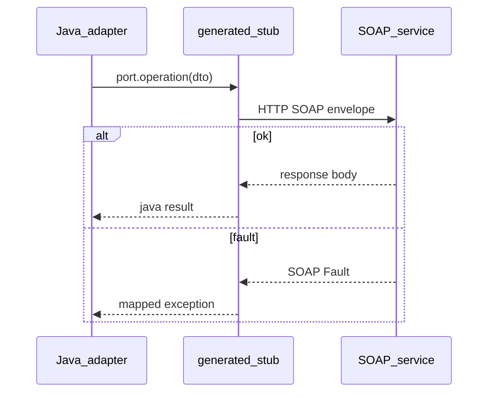

## Введение

Легаси и гос/enterprise API часто отдают SOAP. На собесе ждут: что такое WSDL, envelope, чем клиент отличается от «просто HTTP POST», где живут таймауты и ошибки. Теория для аналитиков — [SA12](/game/learn/sa-soap-xml); здесь — практика Java-клиента. Стандарты: SOAP / WSDL (W3C); текст оригинальный.

## Раздел: WSDL как контракт

**WSDL** описывает операции, сообщения, привязки (обычно SOAP over HTTP) и адрес endpoint. По WSDL генерируют **stub/proxy** (wsimport, Apache CXF, JAX-WS tooling): вы вызываете Java-метод, стек собирает XML-envelope.

```text
WSDL → codegen → Port interface → invoke → SOAP XML → HTTP → service
```

Ошибка: править сгенерированный код руками «на пять минут» — следующее обновление WSDL сотрёт правки. Держите кастом в адаптере/mapper рядом ([JV09](/game/learn/jv-esb-adapter)).

## Раздел: Envelope, headers иfaults

SOAP-сообщение: envelope → header (метаданные, WS-Security и т.п.) + body (полезная нагрузка). Ошибки часто приходят как **Fault**, а не только HTTP 500 с HTML. Клиент должен маппить fault code/detail в доменные исключения.

```xml
<!-- схематично, не копипаст учебника -->
<Envelope>
  <Header><!-- correlation, auth --></Header>
  <Body><!-- operation payload --></Body>
</Envelope>
```

Vs REST: у SOAP сильнее контракт и tooling codegen; цена — тяжёлый XML, версионирование schemа, сложнее отладка «человеческим глазом». Не говорите «SOAP устарел всегда» — в интеграциях он жив.

## Раздел: Эксплуатация клиента

Прод-чеклист Java SOAP-клиента:
- connect/read timeouts;
- пул HTTP-соединений / keep-alive;
- логирование correlation id (без секретов и ПДн в clear-text);
- retry только для идемпотентных операций или с ключом дедупа;
- отдельный truststore при mTLS;
- совместимость при смене WSDL (minor vs breaking).

Ошибка: бесконечный retry на fault бизнес-валидации. Вторая: таймаут 5 минут «чтобы успело» — держит потоки Tomcat/Netty и валит хвост латентности.

## Раздел: Частые вопросы с собеседования

**Вопрос.** Когда retry вызова SOAP-операции опасен?

**Ответ.** Повтор без идempotency key на операции оплаты или создания заказа может продублировать побочный эффект на стороне сервиса. Fault бизнес-валидации (4xx-смысл в faultcode) ретраить бессмысленно — нужен fix payload. Транспортные таймауты и 5xx иногда ретраят с backoff и dedup. На собесе связывают с политикой из раздела эксплуатации клиента.

**Вопрос.** Чем Fault отличается от HTTP 500?

**Ответ.** SOAP может вернуть 200 с Fault в теле envelope; клиент парсит faultcode/detail. REST чаще кодирует ошибку статусом и JSON problem.details. Java-клиент должен маппить оба класса в доменные исключения.

**Вопрос.** Checked exceptions в JAX-WS/SOAP клиенте?

**Ответ.** Сгенерированные вызовы часто бросают checked (WebServiceException и обёртки); их ловят или оборачивают в runtime с контекстом correlation id. Unchecked NPE в mapper — отдельно от транспортной ошибки.

**Вопрос.** WSDL — что должно быть в ответе за минуту?

**Ответ.** Описание операций, типов сообщений, binding (SOAP over HTTP) и endpoint URL. По WSDL генерируют port interface; ручные правки в generated code хрупки. Версионирование WSDL — breaking vs compatible изменения XSD.

## Лаба

**Цель.** Описать вызов одной операции «как на дизайн-ревью» без живого endpoint.

**Шаги.**
1. Найдите публичный пример WSDL (или схему из SA12) и назовите 2 операции.
2. Перечислите, что сгенерирует tooling (port, types).
3. Напишите псевдокод: create port → set timeout → call → map fault.
4. Добавьте правило: какие ошибки ретраим.
5. Свяжите с адаптером: куда кладёте маппинг в доменную модель.

**В группу:** один логирует весь XML, второй объясняет риск ПДн/секретов; договоритесь о redaction.

**Готово, если…**
- [ ] Объясняете роль WSDL
- [ ] Отличаете Fault от «просто 500»
- [ ] Называете таймауты и политику retry

## Схема: Вызов SOAP из Java



## Тест

### Зачем нужен WSDL клиенту?

**Ответ:** контракт для генерации stub

**Пояснение:** описывает операции и типы; tooling строит типобезопасный Java-клиент.

### Что такое SOAP Fault?

**Ответ:** структурированная ошибка операции

**Пояснение:** приходит в envelope; её нужно маппить, а не считать «просто сломанный HTTP».

### Почему не правят generated stub вручную?

**Ответ:** перегенерация сотрёт правки

**Пояснение:** кастом живёт в адаптере/обёртке рядом со stub.

### SOAP всегда хуже REST?

**Ответ:** нет — зависит от ландшафта

**Пояснение:** в enterprise/легаси контракт и WS-* всё ещё решают; для новых публичных API чаще REST/JSON.

### Какие таймауты обязательны у клиента?

**Ответ:** connect и read

**Пояснение:** без них потоки зависают на сети и роняют пул приложения.

## Шпаргалка

<h3>Суть</h3>
<ul>
<li>WSDL = контракт; stub = сгенерированный клиент</li>
<li>envelope = header + body; ошибки → Fault</li>
<li>таймауты, идемпотентный retry, redaction логов</li>
<li>см. SA12 для XML/схем глазами аналитика</li>
</ul>
<h3>Стандарты</h3>
<pre><code>SOAP 1.1/1.2 (W3C)
WSDL 1.1 / 2.0
</code></pre>

## Anki

### Front: Что генерируют из WSDL в типичном Java-стеке?

Back: интерфейс порта и классы типов сообщений (stub/proxy)

### Front: Где в SOAP-сообщении обычно метаданные вроде security?

Back: в Header конверта Envelope

### Front: Чем SOAP Fault полезнее сырого HTML 500?

Back: машинно читаемый код/детали ошибки операции

### Front: Когда retry SOAP-вызова опасен?

Back: если операция неидемпотентна (повтор создаст дубликат эффекта)

### Front: Зачем отдельно настраивать connect и read timeout?

Back: connect — установка соединения; read — ожидание ответа после отправки

### Front: Куда вынести маппинг SOAP DTO → домен?

Back: в адаптер рядом со stub, не внутрь сгенерированного кода

## Итоги

- SOAP-клиент — контрактный codegen + эксплуатационные настройки
- Faults, таймауты и идемпотентность решают прод-судьбу
- Дальше — зачем Java-бэкенду иногда нужен JavaScript как glue

## Ссылки

- [W3C SOAP](https://www.w3.org/TR/soap/)
- [W3C WSDL](https://www.w3.org/TR/wsdl/)
- Learn | [SA12 SOAP/XML](/game/learn/sa-soap-xml)
- Далее: [JS glue](/game/learn/jv-js-glue)
