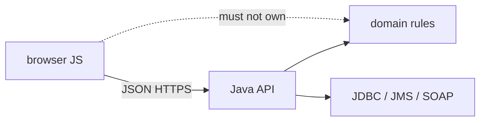

## Введение

Java-собес иногда уходит в «а фронт/скрипты?». Здесь не курс React, а **polyglot glue**: где JS появляется рядом с JVM-системой, какие границы безопасны и чего ждать от браузера vs Node. Текст оригинальный; при необходимости деталей Web API — [MDN](https://developer.mozilla.org/).

## Раздел: Где JS реально встречается у Java-команды

Типичные точки касания:
- админские SPA, которые ходят в Java REST;
- server-side шаблоны + немного DOM-скриптов в легаси;
- Node-утилиты в CI (сборка UI, линтеры) рядом с Maven/Gradle;
- serverless/edge glue, который дергает ваш API;
- редкий Nashorn/GraalJS внутри JVM (знать, что существует; не делать ядром архитектуры без причины).

Ошибка: тащить бизнес-правила заказа в браузерный JS «потому что так быстрее нарисовать форму» — источник правды разъезжается с Java-сервисом.

## Раздел: Контракт важнее фреймворка

Граница Java ↔ JS — **HTTP/JSON (или OpenAPI)**, куки/токены, коды ошибок, идемпотентность. Фронт не должен угадывать схему; бэкенд не должен отдавать внутренние entity «как есть» без DTO.

```text
Browser JS → HTTPS + JSON → Java API → DB / broker
```

События UI (клик, debounce поиска) не равны доменным событиям JMS. Путаница терминов — частая ловушка на собесе.

Ошибка: CORS «откроем *» на проде. Вторая: хранить долгоживущий access-токен в localStorage без понимания XSS (см. общие auth-практики продукта).

## Раздел: Что Java-дев должен уметь сказать про JS

Минимум для middle:
- JS однопоточный event loop в браузере; async через промисы/await — не «потоки Java»;
- типы: без TypeScript дисциплина слабее, чем у Java;
- сборка UI (Vite/webpack) отдельна от jar, артефакты раздают nginx/CDN;
- SSR/SPA выбор влияет на SEO и auth cookies — не на алгоритм биллинга в JVM.

Polyglot-правило: **один домен — один source of truth**. JS — presentation/glue; Java — транзакции, инварианты, интеграции из JV04–JV10.

## Раздел: Частые вопросы с собеседования

**Вопрос.** Event loop и microtasks — зачем Java-разработчику?

**Ответ.** Браузерный JS однопоточен: call stack, очередь macrotask (setTimeout), microtask (Promise.then). После sync-кода выполняются все microtasks до следующего render/macrotask. Это объясняет, почему `fetch().then` раньше `setTimeout(0)` и почему блокирующий sync-код замораживает UI.

**Вопрос.** `fetch` и `response.ok` на границе с Java API?

**Ответ.** HTTP 4xx/5xx — fulfilled Promise; без проверки ok фронт парсит HTML ошибки как JSON. Java REST должен отдавать стабильные коды и тело; JS-клиент обязан проверять status до бизнес-логики. Network fail — reject, не путать с 500.

**Вопрос.** `==` vs `===` при разборе query-параметров?

**Ответ.** Параметры приходят строками; `===` избегает coerce (`"0" == 0`). На границе Java типы строже; JS glue должен явно приводить Number/String. Согласованность с OpenAPI-схемой важнее «магии» ==.

## Лаба

**Цель.** Описать граничный контракт простого экрана «создать заказ» без написания React.

**Шаги.**
1. Нарисуйте стрелки: форма JS → API Java → БД.
2. Перечислите поля JSON и какой слой валидирует обязательно.
3. Укажите, где живёт идемпотентный ключ (заголовок/тело).
4. Назовите 2 риска, если посчитать сумму заказа только во фронте.
5. Откройте MDN fetch (по желанию) и сравните с Java HttpClient идеей «клиент → HTTP».

**В группу:** один предлагает считать скидку в JS, второй — только на сервере; зафиксируйте вердикт.

**Готово, если…**
- [ ] Отделяете UI-события от доменных
- [ ] Называете контракт JSON/API как границу
- [ ] Не путаете event loop с Java threads

## Схема: Polyglot граница



## Тест

### Зачем Java-разработчику понимать JS на собесе?

**Ответ:** граница UI и контракт API

**Пояснение:** enterprise-системы почти всегда имеют веб-клиент или скриптовый glue вокруг сервисов.

### Где должны жить инварианты заказа?

**Ответ:** на Java-сервере / домене

**Пояснение:** фронт можно обойти; сервер — источник правды для денег и статусов.

### Чем browser JS «потоки» отличаются от Java?

**Ответ:** event loop, не OS threads модели Java

**Пояснение:** async в JS — кооперативная модель очереди задач; это не Thread/ExecutorService.

### Что общее у JS fetch и Java HTTP-клиента?

**Ответ:** оба говорят по HTTP с API

**Пояснение:** разный язык, один транспортный контракт.

### Почему «откроем CORS *» опасно?

**Ответ:** любой сайт может дергать API из браузера пользователя

**Пояснение:** вместе с cookie-сессиями это усиливает риск CSRF/abuse; настраивают origin осознанно.

## Шпаргалка

<h3>Суть</h3>
<ul>
<li>JS = UI/glue; Java = домен и интеграции</li>
<li>контракт = OpenAPI/JSON, не «общая БД с фронта»</li>
<li>event loop ≠ Java threads</li>
<li>не дублировать критичные расчёты только в браузере</li>
</ul>
<h3>Фразы</h3>
<pre><code>source of truth on server
polyglot at edges, not in domain core
</code></pre>

## Anki

### Front: Что означает polyglot glue в связке Java+JS?

Back: разные языки на границах системы при одном серверном источнике правды

### Front: Почему нельзя доверять сумме заказа только из браузера?

Back: клиент подконтролен пользователю; сервер обязан пересчитать

### Front: Где обычно лежит собранный фронт относительно Spring Boot jar?

Back: отдельно на CDN/nginx или как статика в resources — но сборка UI чаще отдельный пайплайн

### Front: Чем опасен долгоживущий токен в localStorage?

Back: XSS может украсть токен скриптом страницы

### Front: Нужно ли Java middle знать React hooks глубоко?

Back: нет обязательно; нужно понимать контракт API и границы ответственности

### Front: Что такое CORS одной фразой?

Back: политика браузера, какие origin могут читать ответы вашего API из JS

## Итоги

- JS рядом с Java — про границы и контракты, не про замену JVM
- Доменные инварианты остаются на сервере
- Дальше — как этот сервер живёт в Docker с кучей и флагами

## Ссылки

- [MDN — Fetch API](https://developer.mozilla.org/en-US/docs/Web/API/Fetch_API)
- [MDN — JavaScript guide](https://developer.mozilla.org/en-US/docs/Web/JavaScript/Guide)
- Далее: [JVM hosting](/game/learn/jv-jvm-hosting)
