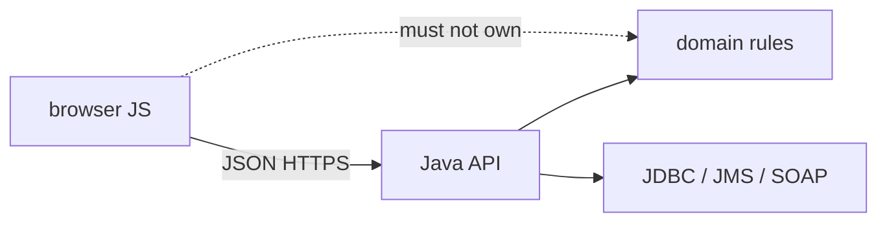
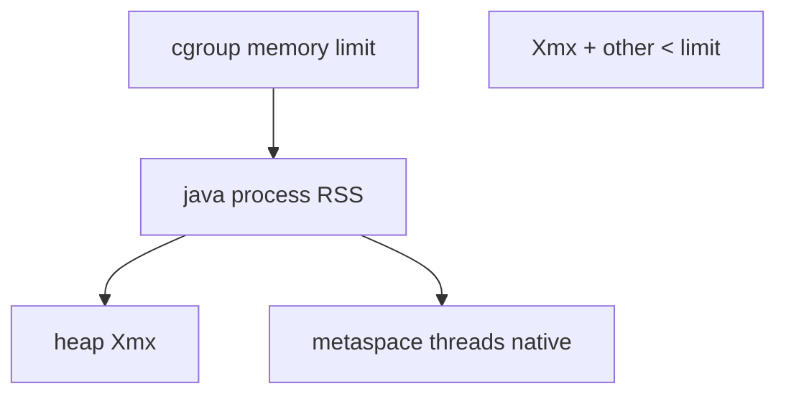
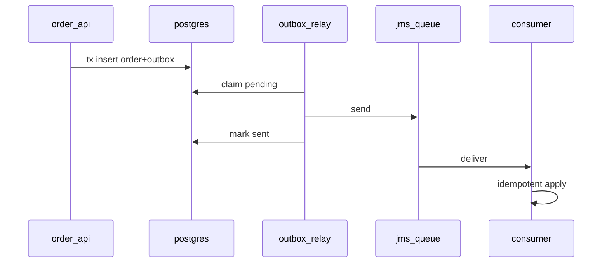

## Введение

Java-собес иногда уходит в «а фронт/скрипты?». Здесь не курс React, а **polyglot glue**: где JS появляется рядом с JVM-системой, какие границы безопасны и чего ждать от браузера vs Node. Текст оригинальный; при необходимости деталей Web API — [MDN](https://developer.mozilla.org/).

**Хостинг JVM.** «Куда положить Spring Boot?» — вопрос не про servlet XML, а про процесс: образ, лимиты, heap, GC-логи, пробы. База процесса была в [JV03](/game/learn/jv-shell-process); здесь — hosting. Инфра-словарь — [QA17](/game/learn/qa-infra-linux-containers). Текст оригинальный.

**Лаба: JDBC + JMS надёжный.** Senior-фильтр: не «умею аннотации», а умею **согласовать побочные эффекты**. Классика: записали заказ в БД и должны уведомить шину/очередь. Два ресурса — две точки отказа. Этот выпуск — лаба-дизайн на базе [JV04](/game/learn/jv-shell-process)–[JV08](/game/learn/jv-jms); выбор шины vs брокер — в [JV14](/game/learn/jv-adr-bus-vs-broker).

## Раздел: Как отвечать одним блоком

Этот выпуск собрал соседние короткие темы трека: «JavaScript как клей рядом с», «Хостинг JVM», «Лаба: JDBC + JMS надёжный». Раньше каждая занимала отдельную карточку на несколько минут, а на собеседовании их спрашивают одним блоком. Ниже у каждой темы свой раздел, затем общие лабы, один тест и одна колода карточек. В ответе сначала назовите, какую тему спросили, потом определение и один пример. Не проговаривайте все разделы, если спросили один. Лабы можно пройти по порядку исходного трека. Если времени мало, сделайте первую и последнюю: первая ставит язык, последняя проверяет, что соседние темы вы не перепутали.

## Раздел: JavaScript как клей рядом с: Где JS реально встречается у Java-команды

Типичные точки касания:
- админские SPA, которые ходят в Java REST;
- server-side шаблоны + немного DOM-скриптов в легаси;
- Node-утилиты в CI (сборка UI, линтеры) рядом с Maven/Gradle;
- serverless/edge glue, который дергает ваш API;
- редкий Nashorn/GraalJS внутри JVM (знать, что существует; не делать ядром архитектуры без причины).

Ошибка: тащить бизнес-правила заказа в браузерный JS «потому что так быстрее нарисовать форму» — источник правды разъезжается с Java-сервисом.

## Раздел: JavaScript как клей рядом с: Контракт важнее фреймворка

Граница Java ↔ JS — **HTTP/JSON (или OpenAPI)**, куки/токены, коды ошибок, идемпотентность. Фронт не должен угадывать схему; бэкенд не должен отдавать внутренние entity «как есть» без DTO.

```text
Browser JS → HTTPS + JSON → Java API → DB / broker
```

События UI (клик, debounce поиска) не равны доменным событиям JMS. Путаница терминов — частая ловушка на собесе.

Ошибка: CORS «откроем *» на проде. Вторая: хранить долгоживущий access-токен в localStorage без понимания XSS (см. общие auth-практики продукта).

## Раздел: JavaScript как клей рядом с: Что Java-дев должен уметь сказать про JS

Минимум для middle:
- JS однопоточный event loop в браузере; async через промисы/await — не «потоки Java»;
- типы: без TypeScript дисциплина слабее, чем у Java;
- сборка UI (Vite/webpack) отдельна от jar, артефакты раздают nginx/CDN;
- SSR/SPA выбор влияет на SEO и auth cookies — не на алгоритм биллинга в JVM.

Polyglot-правило: **один домен — один source of truth**. JS — presentation/glue; Java — транзакции, инварианты, интеграции из JV04–JV10.

## Раздел: JavaScript как клей рядом с: Частые вопросы с собеседования

**Вопрос.** Event loop и microtasks — зачем Java-разработчику?

**Ответ.** Браузерный JS однопоточен: call stack, очередь macrotask (setTimeout), microtask (Promise.then). После sync-кода выполняются все microtasks до следующего render/macrotask. Это объясняет, почему `fetch().then` раньше `setTimeout(0)` и почему блокирующий sync-код замораживает UI.

**Вопрос.** `fetch` и `response.ok` на границе с Java API?

**Ответ.** HTTP 4xx/5xx — fulfilled Promise; без проверки ok фронт парсит HTML ошибки как JSON. Java REST должен отдавать стабильные коды и тело; JS-клиент обязан проверять status до бизнес-логики. Network fail — reject, не путать с 500.

**Вопрос.** `==` vs `===` при разборе query-параметров?

**Ответ.** Параметры приходят строками; `===` избегает coerce (`"0" == 0`). На границе Java типы строже; JS glue должен явно приводить Number/String. Согласованность с OpenAPI-схемой важнее «магии» ==.

## Раздел: Хостинг JVM: Контейнер как единица деплоя

Типичный путь: multi-stage Docker build → JRE/JDK slim → `java -jar app.jar` (или layered Spring Boot). Оркестратор задаёт CPU/memory limits; liveness/readiness бьют в actuator/health.

```dockerfile
# идея, не догма
FROM eclipse-temurin:21-jre
COPY app.jar /app/app.jar
ENTRYPOINT ["java","-XX:+UseContainerSupport","-jar","/app/app.jar"]
```

Ошибка: тащить полный JDK и build-кэш в runtime-образ «на всякий» — размер и attack surface. Вторая: один контейнер = JVM + sidecar БД «для простоты» в проде.

## Раздел: Хостинг JVM: Heap-флаги и cgroup

Классика: `-Xms`, `-Xmx` задают кучу. В контейнере память процесса = heap + metaspace + threads + direct buffers + native. Поэтому **`-Xmx` должен быть заметно меньше memory limit**.

Современные HotSpot учитывают cgroup (`UseContainerSupport`, ergonomics). На собесе: «поставил Xmx=1g в поде на 1g» → OOM kill. Практическое правило: оставить headroom (часто обсуждают 25–50% под non-heap — цифру обоснуйте замером, не догмой).

```bash
java -Xms256m -Xmx512m \
  -XX:+HeapDumpOnOutOfMemoryError \
  -jar app.jar
```

Ошибка: крутить heap вверх без лимита контейнера и без метрик — маскирует утечку до ночного рестарта.

## Раздел: Хостинг JVM: Наблюдаемость и безопасный стоп

Минимум для middle:
- метрики JVM (heap used, GC pause) + метрики приложения;
- GC/heap dump по политике (не в secret volume публично);
- `SIGTERM` → graceful shutdown (дождаться in-flight, закрыть пул JDBC из JV05);
- не использовать `kill -9` как дефолт rolling update.

IIS/Windows hosting когда-то спрашивали в корпорациях; сегодня честный ответ: Linux-контейнеры — дефолт, Windows Service/IIS — легаси-контекст. Главное — процесс, лимиты, сигналы.

## Раздел: Хостинг JVM: Частые вопросы с собеседования

**Вопрос.** JDK vs JRE в Docker-образе?

**Ответ.** Runtime-образ часто JRE/temurin-jre; JDK нужен только если компилируете внутри контейнера. Размер и attack surface меньше у slim JRE. JVM внутри контейнера — тот же HotSpot, но лимиты cgroup влияют на ergonomics heap.

**Вопрос.** `-Xmx` больше memory limit pod — что случится?

**Ответ.** Linux OOM killer завершит процесс раньше, чем Java бросит OutOfMemoryError с heap dump. Headroom нужен под metaspace, threads, direct memory. UseContainerSupport помогает JVM видеть лимит, но не отменяет математику.

**Вопрос.** Connection pool при shutdown JVM?

**Ответ.** SIGTERM должен триггерить graceful shutdown: дождаться запросов, закрыть pool (Hikari close). kill -9 обрывает TCP к БД — на стороне Postgres висят idle until timeout. Readiness снимают до drain, liveness не должен убивать во время shutdown.

## Раздел: Лаба: JDBC + JMS надёжный: Проблема двойной записи

Наивный поток:

```text
BEGIN; INSERT order; COMMIT;
jms.send(OrderCreated);  // сеть упала → событие потеряно
```

Или наоборот: send → потом INSERT не прошёл → «событие-сирота». На собесе ждут название проблемы (dual write) и хотя бы один паттерн лечения.

Ошибка: «обернём в XA и забудем» без понимания operational cost. XA бывает уместна, но outbox часто проще сопровождать.

## Раздел: Лаба: JDBC + JMS надёжный: Transactional outbox

Идея: в **той же** JDBC-транзакции пишем бизнес-строку и строку `outbox(event_id, payload, status)`. Отдельный publisher читает outbox и шлёт в JMS; после успеха — помечает sent. Consumer на другой стороне — идемпотентен (JV08).

```text
App tx: order + outbox_row
Relay: outbox → JMS
Consumer: dedupe by event_id → apply
```

Плюсы: атомарность на одной БД. Минусы: задержка relay, нужен polling/CDC, мониторинг «застрявших» outbox.

Альтернативы для обсуждения: inbox на приёме, CDC из WAL, иногда dual write с компенсациями — честно проговорите риски.

## Раздел: Лаба: JDBC + JMS надёжный: Критерии готовности лабы

Senior-чеклист ответа:
- идемпотентность consumer и уникальный `event_id`;
- at-least-once на брокере + дедуп;
- метрики: lag outbox, fail send, DLQ depth;
- что делаем при яде payload (DLQ, алерт);
- как тестируем: unit mapper + IT с Testcontainers/брокером;
- связь с адаптером [JV09](/game/learn/jv-jms) и аналитическим контуром [SA19](/game/learn/sa-modeling-workshop).

Ошибка: лаба «только happy path» без ретраев. Вторая: гигантский payload в outbox без версии схемы.

## Раздел: Лаба: JDBC + JMS надёжный: Частые вопросы с собеседования

**Вопрос.** Dual write vs transactional outbox?

**Ответ.** Dual write — commit БД и send в брокер нез атомарны; возможна потеря или сирота-событие. Outbox пишет событие в таблицу в той же JDBC-транзакции; relay публикует асинхронно. Consumer идемпотентен по event_id; at-least-once на брокере.

**Вопрос.** Уровень изоляции outbox relay?

**Ответ.** Relay читает unsent строки; конкурентные relay нужны skip locked / lease, чтобы не дублировать send. Идempotency на consumer важнее SERIALIZABLE на всю систему. Lag outbox — метрика, не только «работает».

**Вопрос.** JMS queue vs topic в этом контуре?

**Ответ.** OrderCreated в topic — несколько подписчиков; queue — один воркер обрабатывает задачу. Outbox relay шлёт в destination по контракту; DLQ ловит poison после N попыток.

## Лаба

**JavaScript как клей рядом с.**

**Цель.** Описать граничный контракт простого экрана «создать заказ» без написания React.

**Шаги.**
1. Нарисуйте стрелки: форма JS → API Java → БД.
2. Перечислите поля JSON и какой слой валидирует обязательно.
3. Укажите, где живёт идемпотентный ключ (заголовок/тело).
4. Назовите 2 риска, если посчитать сумму заказа только во фронте.
5. Откройте MDN fetch (по желанию) и сравните с Java HttpClient идеей «клиент → HTTP».

**В группу:** один предлагает считать скидку в JS, второй — только на сервере; зафиксируйте вердикт.

**Готово, если…**
- [ ] Отделяете UI-события от доменных
- [ ] Называете контракт JSON/API как границу
- [ ] Не путаете event loop с Java threads

**Хостинг JVM.**

**Цель.** Подобрать `-Xmx` к лимиту 1 GiB и объяснить headroom.

**Шаги.**
1. Запишите формулу: limit ≥ heap + non-heap запас.
2. Предложите значения Xms/Xmx для лимита 1GiB и почему.
3. Добавьте команду/флаг для heap dump при OOM.
4. Опишите readiness vs liveness одной фразой каждый.
5. Свяжите с JV03: TERM vs KILL при rolling update.

**В группу:** один ставит Xmx=лимит, второй доказывает риск OOM killer.

**Готово, если…**
- [ ] Согласуете heap и cgroup limit
- [ ] Знаете зачем headroom beyond heap
- [ ] Описываете graceful stop

**Лаба: JDBC + JMS надёжный.**

**Цель.** Спроектировать (на бумаге/ADR-черновике) контур OrderCreated: БД + очередь.

**Шаги.**
1. Нарисуйте dual-write failure в две стороны (lost event / phantom event).
2. Опишите схему таблицы outbox (ключ, payload, status, created_at).
3. Задайте контракт сообщения и ключ идемпотентности consumer.
4. Перечислите 3 метрики и 1 алерт.
5. Напишите тест-план: что мокаете, что поднимаете реально.
6. Свяжите с [SA10](/game/learn/sa-sync-async-queues): sync API vs async уведомление.

**В группу:** один защищает XA, второй — outbox; таблица плюс/минус на 5 минут.

**Готово, если…**
- [ ] Можете объяснить dual write
- [ ] Рисуете outbox end-to-end
- [ ] Задаёте идемпотентность и DLQ

## Схема: JavaScript как клей рядом с: Polyglot граница



## Схема: Хостинг JVM: Лимиты контейнера и JVM



## Схема: Лаба: JDBC + JMS надёжный: Outbox relay



## Тест

### Зачем Java-разработчику понимать JS на собесе?

**Ответ:** граница UI и контракт API

**Пояснение:** enterprise-системы почти всегда имеют веб-клиент или скриптовый glue вокруг сервисов.

### Почему `-Xmx` нельзя равнять лимиту пода 1:1?

**Ответ:** нужен запас на non-heap

**Пояснение:** metaspace, стеки потоков, direct memory и натив тоже едят cgroup.

### Что такое dual write problem?

**Ответ:** два ресурса без общей атомарности

**Пояснение:** БД и брокер могут разойтись при сбое между операциями.

### Где должны жить инварианты заказа?

**Ответ:** на Java-сервере / домене

**Пояснение:** фронт можно обойти; сервер — источник правды для денег и статусов.

### Что даёт UseContainerSupport?

**Ответ:** учёт лимитов cgroup ergonomics

**Пояснение:** JVM видит лимит контейнера, а не всю RAM хоста (на поддерживаемых версиях).

## Шпаргалка

<ul><li>JS = UI/glue; Java = домен и интеграции</li><li>контракт = OpenAPI/JSON, не «общая БД с фронта»</li><li>event loop ≠ Java threads</li><li>не дублировать критичные расчёты только в браузере</li><li>один процесс JVM в контейнере — норма</li><li>Xmx &lt; memory limit (headroom)</li><li>метрики GC + health probes</li><li>TERM → graceful; не KILL по привычке</li><li>dual write = главная ловушка интеграции</li><li>outbox = бизнес + событие в одной tx</li><li>relay + idempotent consumer + DLQ</li><li>метрики lag важнее «классно нарисовали»</li></ul>

## Anki

### Front: Что означает polyglot glue в связке Java+JS?

Back: разные языки на границах системы при одном серверном источнике правды

### Front: Из чего примерно складывается память процесса Java сверх heap?

Back: metaspace, стеки потоков, direct buffers, native/code cache

### Front: Почему нельзя «просто» сделать INSERT и затем JMS.send?

Back: между шагами возможен сбой — потеряется событие или останется рассинхрон

### Front: Почему нельзя доверять сумме заказа только из браузера?

Back: клиент подконтролен пользователю; сервер обязан пересчитать

### Front: Что будет, если RSS упрётся в cgroup limit?

Back: OOM killer ОС/оркестратора убьёт контейнер

### Front: Что пишет приложение в outbox-таблицу?

Back: намерение опубликовать событие (id, тип, payload, статус) в одной tx с бизнесом

## Мнемоника

### peg: Где живёт JS рядом с JVM

**Задание:** Три места и граница.

**Элементы:**
- браузер
- BFF
- не внутри транзакции БД

**Подсказка:** Скрипт в браузере не участник транзакции заказа.

**Ответ:** 1 browser · 2 BFF · 3 не в транзакции

## Итоги

- JS рядом с Java — про границы и контракты, не про замену JVM
- Доменные инварианты остаются на сервере
- Дальше — как этот сервер живёт в Docker с кучей и флагами
- Hosting JVM = контейнер + согласованные лимиты + сигналы
- Heap-флаги без cgroup-картины — ловушка собеса и прода
- Дальше — senior-лаба: склеить JDBC и JMS осознанно
- Senior-интеграция начинается с failure modes, не с выбора библиотеки
- Outbox — рабочий дефолт для JDBC + JMS в многих командах

## Ссылки

- [MDN — Fetch API](https://developer.mozilla.org/en-US/docs/Web/API/Fetch_API)
- [MDN — JavaScript guide](https://developer.mozilla.org/en-US/docs/Web/JavaScript/Guide)
- [OpenJDK — Java HotSpot VM Options](https://docs.oracle.com/en/java/javase/21/docs/specs/man/java.html)
- [QA17 Infra Linux/containers](/game/learn/qa-infra-linux-containers)
- [JV03 Shell process](/game/learn/jv-shell-process)
- [JV08 JMS](/game/learn/jv-jms)
- [SA19 Integration design](/game/learn/sa-modeling-workshop)
- [SA10 Sync/async queues](/game/learn/sa-sync-async-queues)
- [ADR bus vs broker](/game/learn/jv-adr-bus-vs-broker)
