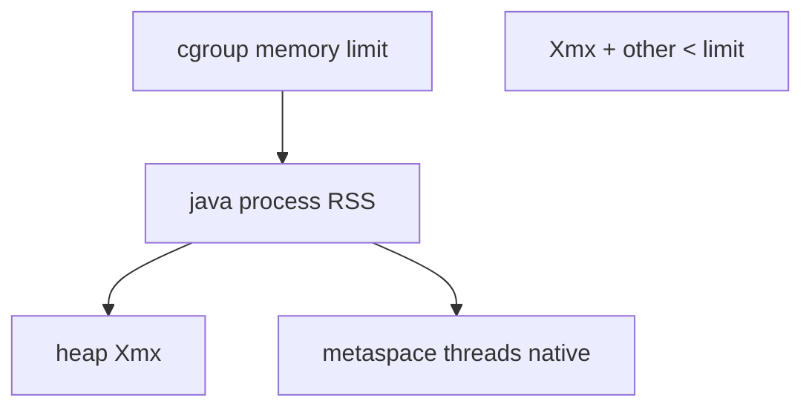

## Введение

«Куда положить Spring Boot?» — вопрос не про servlet XML, а про процесс: образ, лимиты, heap, GC-логи, пробы. База процесса была в [JV03](/game/learn/jv-shell-process); здесь — hosting. Инфра-словарь — [QA17](/game/learn/qa-infra-linux-containers). Текст оригинальный.

## Раздел: Контейнер как единица деплоя

Типичный путь: multi-stage Docker build → JRE/JDK slim → `java -jar app.jar` (или layered Spring Boot). Оркестратор задаёт CPU/memory limits; liveness/readiness бьют в actuator/health.

```dockerfile
# идея, не догма
FROM eclipse-temurin:21-jre
COPY app.jar /app/app.jar
ENTRYPOINT ["java","-XX:+UseContainerSupport","-jar","/app/app.jar"]
```

Ошибка: тащить полный JDK и build-кэш в runtime-образ «на всякий» — размер и attack surface. Вторая: один контейнер = JVM + sidecar БД «для простоты» в проде.

## Раздел: Heap-флаги и cgroup

Классика: `-Xms`, `-Xmx` задают кучу. В контейнере память процесса = heap + metaspace + threads + direct buffers + native. Поэтому **`-Xmx` должен быть заметно меньше memory limit**.

Современные HotSpot учитывают cgroup (`UseContainerSupport`, ergonomics). На собесе: «поставил Xmx=1g в поде на 1g» → OOM kill. Практическое правило: оставить headroom (часто обсуждают 25–50% под non-heap — цифру обоснуйте замером, не догмой).

```bash
java -Xms256m -Xmx512m \
  -XX:+HeapDumpOnOutOfMemoryError \
  -jar app.jar
```

Ошибка: крутить heap вверх без лимита контейнера и без метрик — маскирует утечку до ночного рестарта.

## Раздел: Наблюдаемость и безопасный стоп

Минимум для middle:
- метрики JVM (heap used, GC pause) + метрики приложения;
- GC/heap dump по политике (не в secret volume публично);
- `SIGTERM` → graceful shutdown (дождаться in-flight, закрыть пул JDBC из JV05);
- не использовать `kill -9` как дефолт rolling update.

IIS/Windows hosting когда-то спрашивали в корпорациях; сегодня честный ответ: Linux-контейнеры — дефолт, Windows Service/IIS — легаси-контекст. Главное — процесс, лимиты, сигналы.

## Раздел: Частые вопросы с собеседования

**Вопрос.** JDK vs JRE в Docker-образе?

**Ответ.** Runtime-образ часто JRE/temurin-jre; JDK нужен только если компилируете внутри контейнера. Размер и attack surface меньше у slim JRE. JVM внутри контейнера — тот же HotSpot, но лимиты cgroup влияют на ergonomics heap.

**Вопрос.** `-Xmx` больше memory limit pod — что случится?

**Ответ.** Linux OOM killer завершит процесс раньше, чем Java бросит OutOfMemoryError с heap dump. Headroom нужен под metaspace, threads, direct memory. UseContainerSupport помогает JVM видеть лимит, но не отменяет математику.

**Вопрос.** Connection pool при shutdown JVM?

**Ответ.** SIGTERM должен триггерить graceful shutdown: дождаться запросов, закрыть pool (Hikari close). kill -9 обрывает TCP к БД — на стороне Postgres висят idle until timeout. Readiness снимают до drain, liveness не должен убивать во время shutdown.

## Лаба

**Цель.** Подобрать `-Xmx` к лимиту 1 GiB и объяснить headroom.

**Шаги.**
1. Запишите формулу: limit ≥ heap + non-heap запас.
2. Предложите значения Xms/Xmx для лимита 1GiB и почему.
3. Добавьте команду/флаг для heap dump при OOM.
4. Опишите readiness vs liveness одной фразой каждый.
5. Свяжите с JV03: TERM vs KILL при rolling update.

**В группу:** один ставит Xmx=лимит, второй доказывает риск OOM killer.

**Готово, если…**
- [ ] Согласуете heap и cgroup limit
- [ ] Знаете зачем headroom beyond heap
- [ ] Описываете graceful stop

## Схема: Лимиты контейнера и JVM



## Тест

### Почему `-Xmx` нельзя равнять лимиту пода 1:1?

**Ответ:** нужен запас на non-heap

**Пояснение:** metaspace, стеки потоков, direct memory и натив тоже едят cgroup.

### Что даёт UseContainerSupport?

**Ответ:** учёт лимитов cgroup ergonomics

**Пояснение:** JVM видит лимит контейнера, а не всю RAM хоста (на поддерживаемых версиях).

### Зачем HeapDumpOnOutOfMemoryError?

**Ответ:** снимок кучи для анализа утечки

**Пояснение:** после OOM можно разобрать, кто удерживал объекты; храните дампы осторожно.

### Чем readiness отличается от liveness?

**Ответ:** готов принимать трафик vs процесс жив

**Пояснение:** not-ready убирает из балансировки; failed liveness обычно рестартует контейнер.

### Какой сигнал шлёт оркестратор при стопе?

**Ответ:** обычно SIGTERM

**Пояснение:** приложению дают grace period на shutdown hooks; затем могут убить принудительно.

## Шпаргалка

<h3>Суть</h3>
<ul>
<li>один процесс JVM в контейнере — норма</li>
<li>Xmx &lt; memory limit (headroom)</li>
<li>метрики GC + health probes</li>
<li>TERM → graceful; не KILL по привычке</li>
</ul>
<h3>Флаги старта</h3>
<pre><code>-Xms -Xmx
-XX:+HeapDumpOnOutOfMemoryError
-XX:+UseContainerSupport
</code></pre>

## Anki

### Front: Из чего примерно складывается память процесса Java сверх heap?

Back: metaspace, стеки потоков, direct buffers, native/code cache

### Front: Что будет, если RSS упрётся в cgroup limit?

Back: OOM killer ОС/оркестратора убьёт контейнер

### Front: Зачем часто ставят Xms близко к Xmx в проде?

Back: избежать пауз на расширении кучи и сделать поведение предсказуемее

### Front: Что такое graceful shutdown для Spring/Java сервиса?

Back: прекратить приём, дождаться in-flight, закрыть пулы и брокеры

### Front: Почему в runtime-образ не кладут весь Maven cache?

Back: размер, секреты сборки и лишняя поверхность атаки

### Front: Куда смотреть, если под рестартует без Java exception в логах?

Back: события OOM/evict оркестратора и лимиты памяти

## Итоги

- Hosting JVM = контейнер + согласованные лимиты + сигналы
- Heap-флаги без cgroup-картины — ловушка собеса и прода
- Дальше — senior-лаба: склеить JDBC и JMS осознанно

## Ссылки

- [OpenJDK — Java HotSpot VM Options](https://docs.oracle.com/en/java/javase/21/docs/specs/man/java.html)
- Learn | [QA17 Infra Linux/containers](/game/learn/qa-infra-linux-containers)
- Learn | [JV03 Shell process](/game/learn/jv-shell-process)
- Далее: [Integration lab](/game/learn/jv-integration-lab)
