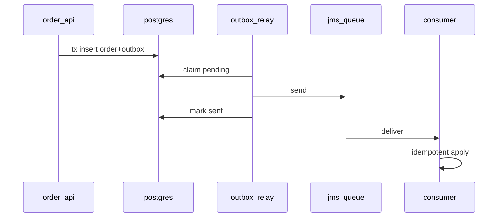

## Введение

Senior-фильтр: не «умею аннотации», а умею **согласовать побочные эффекты**. Классика: записали заказ в БД и должны уведомить шину/очередь. Два ресурса — две точки отказа. Этот выпуск — лаба-дизайн на базе [JV04](/game/learn/jv-jdbc-basics)–[JV08](/game/learn/jv-jms); выбор шины vs брокер — в [JV14](/game/learn/jv-adr-bus-vs-broker).

## Раздел: Проблема двойной записи

Наивный поток:

```text
BEGIN; INSERT order; COMMIT;
jms.send(OrderCreated);  // сеть упала → событие потеряно
```

Или наоборот: send → потом INSERT не прошёл → «событие-сирота». На собесе ждут название проблемы (dual write) и хотя бы один паттерн лечения.

Ошибка: «обернём в XA и забудем» без понимания operational cost. XA бывает уместна, но outbox часто проще сопровождать.

## Раздел: Transactional outbox

Идея: в **той же** JDBC-транзакции пишем бизнес-строку и строку `outbox(event_id, payload, status)`. Отдельный publisher читает outbox и шлёт в JMS; после успеха — помечает sent. Consumer на другой стороне — идемпотентен (JV08).

```text
App tx: order + outbox_row
Relay: outbox → JMS
Consumer: dedupe by event_id → apply
```

Плюсы: атомарность на одной БД. Минусы: задержка relay, нужен polling/CDC, мониторинг «застрявших» outbox.

Альтернативы для обсуждения: inbox на приёме, CDC из WAL, иногда dual write с компенсациями — честно проговорите риски.

## Раздел: Критерии готовности лабы

Senior-чеклист ответа:
- идемпотентность consumer и уникальный `event_id`;
- at-least-once на брокере + дедуп;
- метрики: lag outbox, fail send, DLQ depth;
- что делаем при яде payload (DLQ, алерт);
- как тестируем: unit mapper + IT с Testcontainers/брокером;
- связь с адаптером [JV09](/game/learn/jv-esb-adapter) и аналитическим контуром [SA19](/game/learn/sa-integration-design).

Ошибка: лаба «только happy path» без ретраев. Вторая: гигантский payload в outbox без версии схемы.

## Раздел: Частые вопросы с собеседования

**Вопрос.** Dual write vs transactional outbox?

**Ответ.** Dual write — commit БД и send в брокер нез атомарны; возможна потеря или сирота-событие. Outbox пишет событие в таблицу в той же JDBC-транзакции; relay публикует асинхронно. Consumer идемпотентен по event_id; at-least-once на брокере.

**Вопрос.** Уровень изоляции outbox relay?

**Ответ.** Relay читает unsent строки; конкурентные relay нужны skip locked / lease, чтобы не дублировать send. Идempotency на consumer важнее SERIALIZABLE на всю систему. Lag outbox — метрика, не только «работает».

**Вопрос.** JMS queue vs topic в этом контуре?

**Ответ.** OrderCreated в topic — несколько подписчиков; queue — один воркер обрабатывает задачу. Outbox relay шлёт в destination по контракту; DLQ ловит poison после N попыток.

## Лаба

**Цель.** Спроектировать (на бумаге/ADR-черновике) контур OrderCreated: БД + очередь.

**Шаги.**
1. Нарисуйте dual-write failure в две стороны (lost event / phantom event).
2. Опишите схему таблицы outbox (ключ, payload, status, created_at).
3. Задайте контракт сообщения и ключ идемпотентности consumer.
4. Перечислите 3 метрики и 1 алерт.
5. Напишите тест-план: что мокаете, что поднимаете реально.
6. Свяжите с [SA10](/game/learn/sa-sync-async-queues): sync API vs async уведомление.

**В группу:** один защищает XA, второй — outbox; таблица плюс/минус на 5 минут.

**Готово, если…**
- [ ] Можете объяснить dual write
- [ ] Рисуете outbox end-to-end
- [ ] Задаёте идемпотентность и DLQ

## Схема: Outbox relay



## Тест

### Что такое dual write problem?

**Ответ:** два ресурса без общей атомарности

**Пояснение:** БД и брокер могут разойтись при сбое между операциями.

### Суть transactional outbox?

**Ответ:** событие в той же DB-транзакции

**Пояснение:** публикация в брокер вынесена в relay после успешного commit бизнес-данных.

### Зачем event_id consumer?

**Ответ:** дедуп при at-least-once

**Пояснение:** повторная доставка не должна применять эффект дважды.

### Чем опасен send до commit БД?

**Ответ:** событие без зафиксированного заказа

**Пояснение:** потребитель увидит то, чего нет в источнике правды.

### Что мониторить у outbox?

**Ответ:** lag и ошибки relay

**Пояснение:** рост pending/failed — сигнал, что события не уходят в шину.

## Шпаргалка

<h3>Суть</h3>
<ul>
<li>dual write = главная ловушка интеграции</li>
<li>outbox = бизнес + событие в одной tx</li>
<li>relay + idempotent consumer + DLQ</li>
<li>метрики lag важнее «классно нарисовали»</li>
</ul>
<h3>Связи</h3>
<pre><code>JV05 tx · JV08 JMS · JV09 adapter
SA19 integration design · JV14 ADR
</code></pre>

## Anki

### Front: Почему нельзя «просто» сделать INSERT и затем JMS.send?

Back: между шагами возможен сбой — потеряется событие или останется рассинхрон

### Front: Что пишет приложение в outbox-таблицу?

Back: намерение опубликовать событие (id, тип, payload, статус) в одной tx с бизнесом

### Front: Кто физически вызывает JMS.send в outbox-паттерне?

Back: отдельный relay/publisher после commit, не обязательно тот же request-thread

### Front: Что такое phantom/event-before-state в dual write?

Back: сообщение ушло, а бизнес-строка не закоммитилась

### Front: Какой минимальный ключ идемпотентности на consumer?

Back: стабильный event_id / business operation id

### Front: Когда XA может быть альтернативой outbox?

Back: когда оба ресурса поддерживают 2PC и команда готова жить с его сложностью

## Итоги

- Senior-интеграция начинается с failure modes, не с выбора библиотеки
- Outbox — рабочий дефолт для JDBC + JMS в многих командах
- Дальше — зафиксировать выбор шины vs брокера в ADR

## Ссылки

- Learn | [JV08 JMS](/game/learn/jv-jms)
- Learn | [SA19 Integration design](/game/learn/sa-integration-design)
- Learn | [SA10 Sync/async queues](/game/learn/sa-sync-async-queues)
- Далее: [ADR bus vs broker](/game/learn/jv-adr-bus-vs-broker)
