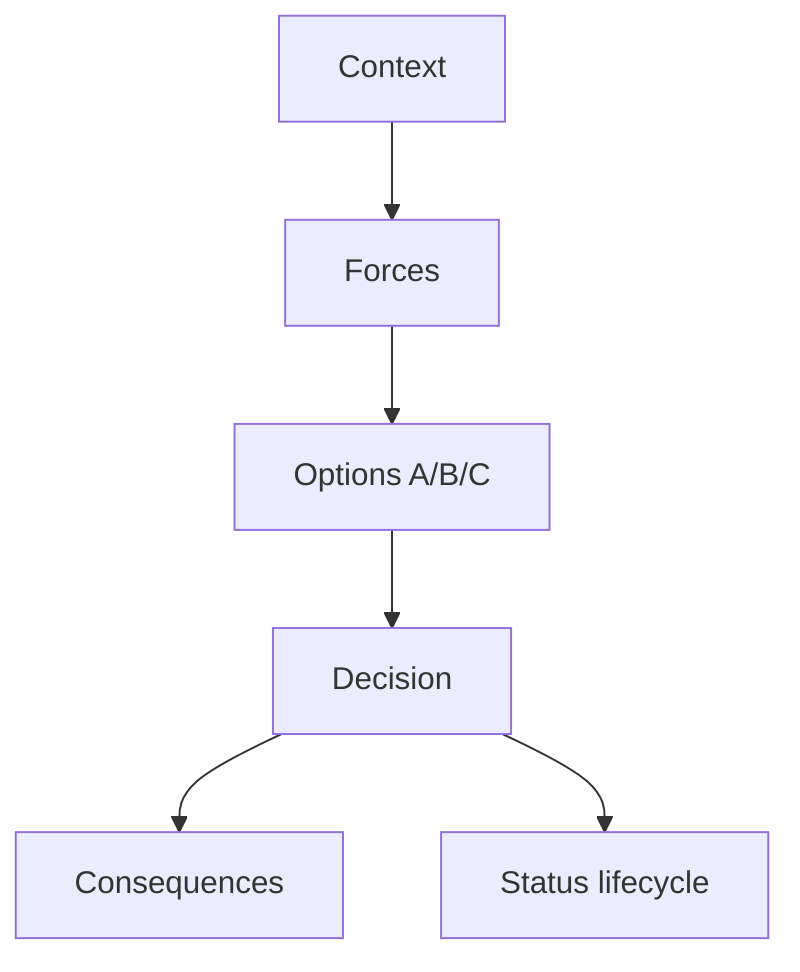
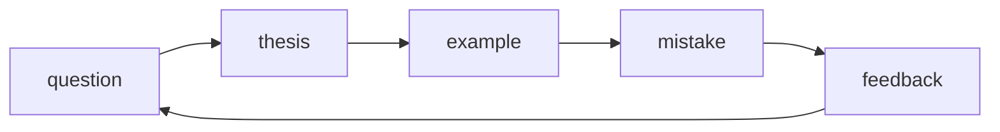
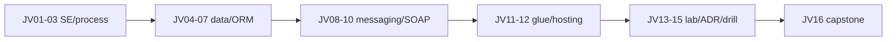

## Введение

Формат ADR — канон в [SA20](/game/learn/sa-architecture-decisions); здесь — прикладной выбор для Java-интеграций: **централизованная шина (ESB)** vs **брокер сообщений** (JMS/Kafka-класс) с тонкими сервисами. На собесе ждут структуру решения, не бренд. Опора на [JV09](/game/learn/jv-jms) и [JV08](/game/learn/jv-jms).

**Drill Java.** Drill сжимает трек в устные ответы 60–90 секунд. Цель — не вызубрить формулировки выпусков, а уметь **структурировать**: тезис → пример → ловушка. Перед капстоуном [JV16](/game/learn/jv-adr-bus-vs-broker) прогоните блоки ниже вслух.

**Чеклист Java.** Капстоун собирает трек в проверяемый чеклист: от JVM до ADR. Пройдите пункты честно — «слышал» ≠ «могу объяснить на доске». Рядом полезны капстоуны SQL/SA, если закрываете полный стек собеса.

## Раздел: Как отвечать одним блоком

Этот выпуск собрал соседние короткие темы трека: «ADR: шина vs брокер», «Drill Java», «Чеклист Java». Раньше каждая занимала отдельную карточку на несколько минут, а на собеседовании их спрашивают одним блоком. Ниже у каждой темы свой раздел, затем общие лабы, один тест и одна колода карточек. В ответе сначала назовите, какую тему спросили, потом определение и один пример. Не проговаривайте все разделы, если спросили один. Лабы можно пройти по порядку исходного трека. Если времени мало, сделайте первую и последнюю: первая ставит язык, последняя проверяет, что соседние темы вы не перепутали.

## Раздел: ADR: шина vs брокер: Контекст и силы

Контекст типичного ADR:
- много легаси-протоколов (SOAP/file) vs в основном JSON/HTTP внутри продукта;
- нужна централизованная трансформация/политика vs команды владеют контрактами;
- операционная зрелость платформенной команды;
- требования latency, объём событий, порядок, replay.

Силы (forces): time-to-market, vendor lock, стоимость лицензий ESB, навыки команды, наблюдаемость, соответствие регуляторике.

Ошибка: писать ADR «выбрали Kafka потому что модно» без сил и последствий.

## Раздел: ADR: шина vs брокер: Варианты и решение

**Вариант A — ESB:** маршрутизация и маппинг в платформе; адаптеры тонкие; каноническая модель на шине. Сильно, когда протоколов много и интеграциями живёт отдельная практика ([SA13](/game/learn/sa-soap-xml)).

**Вариант B — брокер + сервисы:** доменные сервисы публикуют/потребляют события; трансформации в коде адаптеров; платформа даёт брокер, схемы, ACL.

**Вариант C — гибрид:** брокер для доменов продукта; ESB/адаптерная зона для легаси на периметре.

Пример вердикта (не догма): «для нового контура заказов — брокер + outbox ([JV13](/game/learn/jv-js-glue)); для контура легаси SOAP — адаптеры у шины/интеграционного слоя».

## Раздел: ADR: шина vs брокер: Последствия и статус

Хороший ADR всегда содержит **Consequences**:
- что становится проще (деплой адаптера vs деплой маршрута на шине);
- что сложнее (версионирование схем, владение каноном);
- как откатываемся;
- метрики успеха решения через 3–6 месяцев.

Статусы: Proposed / Accepted / Deprecated / Superseded. На собесе проговорите, *кто* ревьюит ADR (архитектурный комитет vs тимлиды) — связь с SA20.

Ошибка: ADR на 10 страниц без Decision. Вторая: нет даты и автора — решение нельзя найти через год.

## Раздел: ADR: шина vs брокер: Частые вопросы с собеседования

**Вопрос.** ESB vs message broker — одним решением ADR?

**Ответ.** ESB централизует маршруты и канон; broker + сервисы держат логику в коде адаптеров. ADR фиксирует forces: число протоколов, зрелость платформы, latency, replay. Гибрид часто: broker внутри продукта, ESB на легаси-периметре.

**Вопрос.** JMS queue vs Kafka partition?

**Ответ.** JMS queue — competing consumers на destination; Kafka — ordered log по partition, consumer group. Replay и retention у Kafka другие; JMS ack/redelivery — классическая модель messaging API. Не смешивать термины без контекста продукта.

**Вопрос.** SOAP-адаптер vs REST-сервис в ADR?

**Ответ.** Легаси SOAP оправдывает адаптер у шины; новые доменные API — REST/event. ADR должен naming Consequences: кто владеет XSD/WSDL vs OpenAPI.

## Раздел: Drill Java: Ответ вслух

Если вопрос про корпоративную Java, я отделяю JDBC и очередь от языка. Для языка у меня отдельный короткий трек: HashMap, поток, сборщик, граница транзакции Spring. Здесь я не подменяю одно другим.

## Раздел: Drill Java: Плохой ответ

Ответить про SOAP, когда спросили про equals и hashCode. Это разные собеседования.

## Раздел: Drill Java: Термины

Коллекция — collection. Транзакция — transaction. Очередь сообщений — message queue.

## Раздел: Drill Java: JVM / JDBC / транзакции

Выстрелы:
1. JDK vs JRE vs JVM ([JV01](/game/learn/jv-se-jvm)).
2. Почему PreparedStatement ([JV04](/game/learn/jv-shell-process)).
3. Что делает close() у пула ([JV05](/game/learn/jv-shell-process)).
4. Autocommit=false — когда и rollback.
5. `-Xmx` vs cgroup limit ([JV12](/game/learn/jv-js-glue)).

Шаблон ответа: определение → зачем в проде → типичная ошибка. Ошибка drill: читать шпаргалку монологом без примера.

## Раздел: Drill Java: ORM / N+1 / messaging

Выстрелы:
1. Identity map и dirty checking ([JV06](/game/learn/jv-orm-concepts)).
2. Нарисовать N+1 и join fetch ([JV07](/game/learn/jv-orm-concepts)).
3. LazyInitializationException — когда.
4. Queue vs topic + ack ([JV08](/game/learn/jv-jms)).
5. Dual write и outbox ([JV13](/game/learn/jv-js-glue)).

Связки наружу: SQL explain — [sql-cte-window](/game/learn/sql-cte-window); очереди глазами СА — [SA10](/game/learn/sa-sync-async-queues).

## Раздел: Drill Java: Интеграции и архитектура

Выстрелы:
1. Роль адаптера ([JV09](/game/learn/jv-jms)) vs домен.
2. WSDL/Fault за 60 секунд ([JV10](/game/learn/jv-jms)).
3. Где source of truth при JS UI ([JV11](/game/learn/jv-js-glue)).
4. Каркас ADR bus vs broker ([JV14](/game/learn/jv-adr-bus-vs-broker)).
5. Одна сила + одно последствие вашего последнего решения.

Ошибка: бренд-дроп без Consequences. Сверяйтесь с [SA20](/game/learn/sa-architecture-decisions) и [SA13](/game/learn/sa-soap-xml).

## Раздел: Drill Java: Частые вопросы с собеседования

**Вопрос.** String pool и `intern()` — быстрый ответ?

**Ответ.** Литералы и interned строки шарят объект в pool; сравнение текста — equals. В drill связывают с памятью и с ловушкой `==` на String.

**Вопрос.** Checked exception — пример и позиция?

**Ответ.** SQLException, IOException — checked; RuntimeException — нет. Drill: «обработал или throws» vs «не ловим NPE compile-time».

**Вопрос.** `==` vs `equals` — три слова?

**Ответ.** Ссылки vs значение (контракт equals). String и Integer — любимые примеры.

**Вопрос.** N+1 и fetch — связка за 45 сек?

**Ответ.** Список + LAZY в цикле → N запросов; лечение join fetch/graph/batch/DTO. Сначала убрать round-trip, потом explain SQL.

**Вопрос.** Queue vs topic + ack?

**Ответ.** PTP vs pub/sub; ack после успешной обработки; DLQ для poison; идempotency consumer.

## Раздел: Чеклист Java: Ответ вслух

Я говорю, какой факт хранит база, кто перекладывает сообщение и что будет при повторе. Для вакансии на Java Core добавляю контракт HashMap и что volatile не делает прибавление атомарным.

## Раздел: Чеклист Java: Плохой ответ

Считать интеграционный чеклист подготовкой к любому Java-собесу. Коллекции и Spring там спросят отдельно.

## Раздел: Чеклист Java: Термины

Ядро языка — Java Core. Внедрение — dependency injection. Повтор — retry.

## Раздел: Чеклист Java: Чеклист Junior → Middle

Отметьте только то, что объясняете без конспекта:

**Junior (JV01–JV06)**
- [ ] JDK / JRE / JVM и classpath
- [ ] class/interface/static vs Python OOP
- [ ] процесс, env, сигналы
- [ ] JDBC PreparedStatement + try-with-resources
- [ ] pool, autocommit, commit/rollback
- [ ] identity map и dirty checking

**Middle (JV07–JV12)**
- [ ] N+1, LAZY, join fetch / graph
- [ ] JMS queue/topic, ack, DLQ
- [ ] адаптер ESB и идемпотентность
- [ ] SOAP/WSDL клиент, Fault, timeouts
- [ ] JS как glue, source of truth на сервере
- [ ] Docker limits vs `-Xmx`, graceful stop

Ошибка капстоуна: ставить галочки пачкой «потом повторю».

## Раздел: Чеклист Java: Чеклист Senior и сквозной сюжет

**Senior (JV13–JV15)**
- [ ] dual write → outbox → idempotent consumer
- [ ] ADR bus vs broker с Consequences
- [ ] drill 60–90с: тезис/пример/ловушка

**Сквозной сюжет «Заказ»** (расскажите end-to-end):
1. API принял заказ (валидация на Java, не только UI — JV11).
2. JDBC tx + outbox (JV05, JV13).
3. Relay в JMS (JV08).
4. Адаптер склада / легаси SOAP (JV09, JV10).
5. Хостинг сервиса в контейнере с лимитами (JV12).
6. Решение «шина или брокер» зафиксировано ADR (JV14).

Связки: [SA19](/game/learn/sa-modeling-workshop), [SA20](/game/learn/sa-architecture-decisions), [sql-normalization](/game/learn/sql-normalization), [sql-cte-window](/game/learn/sql-cte-window).

## Раздел: Чеклист Java: Индекс slug трека

| Ep | slug |
|----|------|
| JV01 | `jv-se-jvm` |
| JV02 | `jv-se-jvm` |
| JV03 | `jv-shell-process` |
| JV04 | `jv-shell-process` |
| JV05 | `jv-shell-process` |
| JV06 | `jv-orm-concepts` |
| JV07 | `jv-orm-concepts` |
| JV08 | `jv-jms` |
| JV09 | `jv-jms` |
| JV10 | `jv-jms` |
| JV11 | `jv-js-glue` |
| JV12 | `jv-js-glue` |
| JV13 | `jv-js-glue` |
| JV14 | `jv-adr-bus-vs-broker` |
| JV15 | `jv-adr-bus-vs-broker` |
| JV16 | `jv-adr-bus-vs-broker` |

Seed: `import_java_learn_series.py`.

## Раздел: Чеклист Java: Частые вопросы с собеседования

**Вопрос.** JDK / JRE / JVM в end-to-end рассказе «Заказ»?

**Ответ.** Jar запускает JVM-процесс; JDK было нужно при сборке. Капстоун связывает hosting (JV12) с classpath и bytecode (JV01).

**Вопрос.** `equals`/`hashCode` и `==` — где всплывают в треке?

**Ответ.** OOP и entity в Set/Map; String в интegrations; обёртки в JV01. Капстоун — не повторять определения, а указать выпуск.

**Вопрос.** JDBC pool + транзакция + outbox — одна фраза?

**Ответ.** Pool для throughput; autocommit off для атомарности; outbox согласует БД и JMS без dual write.

**Вопрос.** ORM N+1 vs explain SQL?

**Ответ.** Сначала счёт запросов на сценарий, потом plan и индексы SQL-трека.

**Вопрос.** SOAP vs REST на периметре?

**Ответ.** Легаси SOAP через адаптер; внутренний API REST/события — типичная карта JV09–JV10.

## Лаба

**ADR: шина vs брокер.**

**Цель.** Написать ADR ≤1 страницы: Bus vs Broker для «уведомление склада о заказе».

**Шаги.**
1. Заполните: Context, Decision, Status, Consequences.
2. Добавьте 3 Forces.
3. Укажите отклонённые альтернативы (минимум одна).
4. Свяжите с outbox: где живёт публикация в вашем выборе.
5. Дайте ссылку-мысль на SA20 (формат) и SA13 (ESB-контекст).

**В группу:** обмен ADR; ревьюер вычёркивает голословные «best practice».

**Готово, если…**
- [ ] Есть явное Decision одним абзацем
- [ ] Есть Consequences плюс и минус
- [ ] Альтернативы названы честно

**Drill Java.**

**Цель.** 12 ответов под таймер 75 секунд каждый; партнёр считает «тезис/пример/ловушка».

**Шаги.**
1. Распечатайте/откройте список выстрелов трёх разделов.
2. Ответьте на 4 случайных без записей.
3. Отметьте слабые → вернитесь в исходный выпуск.
4. Повторите слабые через 30 минут (spaced).
5. Запишите голосовой ответ на N+1 и outbox — прослушайте сами.

**В группу:** mock interview 20 минут: 6 вопросов + 1 система «заказ → склад».

**Готово, если…**
- [ ] 8/12 ответов укладываются в 90 секунд
- [ ] В каждом есть ловушка/ошибка
- [ ] Можете связать JDBC tx и JMS без паузы «эээ»

**Чеклист Java.**

**Цель.** Закрыть капстоун: устный end-to-end «Заказ» 5–7 минут + чеклист ≥80% галочек.

**Шаги.**
1. Пройдите чеклист Junior/Middle/Senior.
2. Выпишите 3 слабых slug и перечитайте только их.
3. Расскажите сюжет «Заказ» партнёру или на диктофон.
4. Добавьте один метрический абзац (lag outbox, DLQ, heap).
5. Обновите свой короткий ADR из JV14 статусом Accepted/Deprecated по желанию.

**В группу:** взаимное ревью рассказа — каждый вставляет один failure-mode вопрос.

**Готово, если…**
- [ ] ≥80% пунктов чеклиста уверенные
- [ ] Сюжет «Заказ» звучит связно
- [ ] Можете указать next step обучения вне трека

## Схема: ADR: шина vs брокер: Каркас ADR

## Схема: Drill Java: Цикл drill

## Схема: Чеклист Java: Карта трека

## Тест

### Зачем писать ADR, а не «решить в чате»?

**Ответ:** зафиксировать контекст и последствия

**Пояснение:** через год видны силы и отвергнутые варианты; проще onboarding и аудит.

### Структура устного ответа на drill?

**Ответ:** тезис → пример → ловушка

**Пояснение:** так проверяют глубину, а не только определение из вики.

### Что обязан уметь объяснить junior Java по JVM?

**Ответ:** bytecode и JDK/JRE/JVM

**Пояснение:** цепочка .java → javac → .class → JVM + JIT; classpath как источник ClassNotFound.

### Чем ESB отличается от брокера в ADR?

**Ответ:** шина несёт маршруты/трансформы

**Пояснение:** брокер — транспорт и доставка; ESB добавляет централизованную интеграционную логику.

### Как коротко объяснить N+1 на собесе?

**Ответ:** 1 + N запросов к детям

**Пояснение:** список родителей, затем отдельный SELECT на каждую коллекцию; лечат join fetch/entity graph/batch.

## Шпаргалка

<ul><li>Context → Forces → Options → Decision → Consequences</li><li>Status + date + links</li><li>не путать брокер (транспорт) и ESB (интеграционная платформа)</li><li>SE/JVM/process/hosting: JV01–03, JV12</li><li>Data: JV04–07 + SQL14</li><li>Messaging/integration: JV08–10, JV13–14</li><li>Polyglot edge: JV11</li><li>чеклист честнее ощущения «всё знаю»</li><li>сквозной сюжет важнее разрозненных фактов</li><li>слабые slug — точечный ретрай</li><li>ADR и метрики отличают senior-ответ</li></ul>

## Anki

### Front: Какие пять блоков минимально ждут в ADR на собесе?

Back: Context, Decision, Status, Consequences; часто отдельно Options/Forces

### Front: Назовите три части сильного устного ответа на Java-собесе

Back: тезис, конкретный пример, типичная ошибка/ловушка

### Front: Какие номера у junior-блока Java Learn?

Back: JV01–JV06

### Front: Почему «выбрали X» без Alternatives — слабый ADR?

Back: не видно, что отвергли и почему; решение выглядит случайным

### Front: Какой вопрос проверяет понимание пула JDBC?

Back: что делает close() у Connection из DataSource/pool

### Front: Какие номера у middle-блока Java Learn?

Back: JV07–JV12

## Мнемоника

### acronym: Шина или брокер

**Задание:** Четыре поля выбора.

**Элементы:**
- Кто вызывает кого
- Нужен ли ответ
- Повтор
- Владелец контракта

**Подсказка:** Шина часто прячет вызов. Брокер оставляет доставку явной.

**Ответ:** вызов, ответ, повтор, контракт

## Итоги

- ADR делает архитектурный выбор проверяемым
- Bus vs broker — про силы и последствия, не про моду
- Дальше — сжатый interview drill по всему треку
- Drill тренирует речь под таймер, не только знание фактов
- Слабые места возвращайте в исходные JV-выпуски
- Финал трека — капстоун-чеклист
- Трек закрыт, когда объясняете цепочку от JVM до ADR на одном сюжете
- Индекс slug — карта возврата к слабым местам

## Ссылки

- [SA20 Architecture decisions](/game/learn/sa-architecture-decisions)
- [SA13 ESB integrations](/game/learn/sa-soap-xml)
- [JV09 ESB adapter](/game/learn/jv-jms)
- [JV07 JPA N+1](/game/learn/jv-orm-concepts)
- [JV13 Integration lab](/game/learn/jv-js-glue)
- [SA19 Integration design](/game/learn/sa-modeling-workshop)
- [SQL ACID](/game/learn/sql-normalization)
- [`SERIES.md`](SERIES.md)
