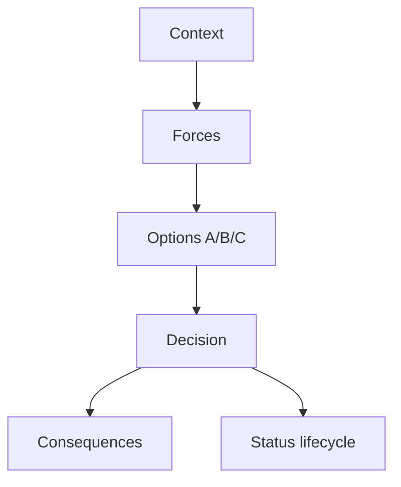

## Введение

Формат ADR — канон в [SA20](/game/learn/sa-architecture-decisions); здесь — прикладной выбор для Java-интеграций: **централизованная шина (ESB)** vs **брокер сообщений** (JMS/Kafka-класс) с тонкими сервисами. На собесе ждут структуру решения, не бренд. Опора на [JV09](/game/learn/jv-esb-adapter) и [JV08](/game/learn/jv-jms).

## Раздел: Контекст и силы

Контекст типичного ADR:
- много легаси-протоколов (SOAP/file) vs в основном JSON/HTTP внутри продукта;
- нужна централизованная трансформация/политика vs команды владеют контрактами;
- операционная зрелость платформенной команды;
- требования latency, объём событий, порядок, replay.

Силы (forces): time-to-market, vendor lock, стоимость лицензий ESB, навыки команды, наблюдаемость, соответствие регуляторике.

Ошибка: писать ADR «выбрали Kafka потому что модно» без сил и последствий.

## Раздел: Варианты и решение

**Вариант A — ESB:** маршрутизация и маппинг в платформе; адаптеры тонкие; каноническая модель на шине. Сильно, когда протоколов много и интеграциями живёт отдельная практика ([SA13](/game/learn/sa-esb-integrations)).

**Вариант B — брокер + сервисы:** доменные сервисы публикуют/потребляют события; трансформации в коде адаптеров; платформа даёт брокер, схемы, ACL.

**Вариант C — гибрид:** брокер для доменов продукта; ESB/адаптерная зона для легаси на периметре.

Пример вердикта (не догма): «для нового контура заказов — брокер + outbox ([JV13](/game/learn/jv-integration-lab)); для контура легаси SOAP — адаптеры у шины/интеграционного слоя».

## Раздел: Последствия и статус

Хороший ADR всегда содержит **Consequences**:
- что становится проще (деплой адаптера vs деплой маршрута на шине);
- что сложнее (версионирование схем, владение каноном);
- как откатываемся;
- метрики успеха решения через 3–6 месяцев.

Статусы: Proposed / Accepted / Deprecated / Superseded. На собесе проговорите, *кто* ревьюит ADR (архитектурный комитет vs тимлиды) — связь с SA20.

Ошибка: ADR на 10 страниц без Decision. Вторая: нет даты и автора — решение нельзя найти через год.

## Раздел: Частые вопросы с собеседования

**Вопрос.** ESB vs message broker — одним решением ADR?

**Ответ.** ESB централизует маршруты и канон; broker + сервисы держат логику в коде адаптеров. ADR фиксирует forces: число протоколов, зрелость платформы, latency, replay. Гибрид часто: broker внутри продукта, ESB на легаси-периметре.

**Вопрос.** JMS queue vs Kafka partition?

**Ответ.** JMS queue — competing consumers на destination; Kafka — ordered log по partition, consumer group. Replay и retention у Kafka другие; JMS ack/redelivery — классическая модель messaging API. Не смешивать термины без контекста продукта.

**Вопрос.** SOAP-адаптер vs REST-сервис в ADR?

**Ответ.** Легаси SOAP оправдывает адаптер у шины; новые доменные API — REST/event. ADR должен naming Consequences: кто владеет XSD/WSDL vs OpenAPI.

## Лаба

**Цель.** Написать ADR ≤1 страницы: Bus vs Broker для «уведомление склада о заказе».

**Шаги.**
1. Заполните: Context, Decision, Status, Consequences.
2. Добавьте 3 Forces.
3. Укажите отклонённые альтернативы (минимум одна).
4. Свяжите с outbox: где живёт публикация в вашем выборе.
5. Дайте ссылку-мысль на SA20 (формат) и SA13 (ESB-контекст).

**В группу:** обмен ADR; ревьюер вычёркивает голословные «best practice».

**Готово, если…**
- [ ] Есть явное Decision одним абзацем
- [ ] Есть Consequences плюс и минус
- [ ] Альтернативы названы честно

## Схема: Каркас ADR

## Тест

### Зачем писать ADR, а не «решить в чате»?

**Ответ:** зафиксировать контекст и последствия

**Пояснение:** через год видны силы и отвергнутые варианты; проще onboarding и аудит.

### Чем ESB отличается от брокера в ADR?

**Ответ:** шина несёт маршруты/трансформы

**Пояснение:** брокер — транспорт и доставка; ESB добавляет централизованную интеграционную логику.

### Что обязательно в секции Consequences?

**Ответ:** плюсы и минусы выбора

**Пояснение:** без цены решения ADR превращается в рекламу технологии.

### Когда уместен гибрид bus+broker?

**Ответ:** легаси на периметре, события в ядре

**Пояснение:** разные зоны интеграций требуют разных инструментов.

### Какой статус у принятого решения?

**Ответ:** Accepted

**Пояснение:** далее может стать Deprecated/Superseded новым ADR.

## Шпаргалка

<h3>Каркас</h3>
<ul>
<li>Context → Forces → Options → Decision → Consequences</li>
<li>Status + date + links</li>
<li>не путать брокер (транспорт) и ESB (интеграционная платформа)</li>
</ul>
<h3>Связи</h3>
<pre><code>SA20 формат ADR
SA13 / JV09 шина и адаптер
JV08 / JV13 брокер и outbox
</code></pre>

## Anki

### Front: Какие пять блоков минимально ждут в ADR на собесе?

Back: Context, Decision, Status, Consequences; часто отдельно Options/Forces

### Front: Почему «выбрали X» без Alternatives — слабый ADR?

Back: не видно, что отвергли и почему; решение выглядит случайным

### Front: Что такое Force в ADR?

Back: давление/ограничение, влияющее на выбор (срок, навыки, регуляторика)

### Front: Чем брокер сообщений не является сам по себе?

Back: полной ESB с централизованным маппингом всех протоколов

### Front: Когда ESB оправдан в Decision?

Back: много разнородных систем/протоколов и нужна централизованная интеграционная практика

### Front: Что значит Superseded для ADR?

Back: решение заменено более новым ADR с другим Decision

## Итоги

- ADR делает архитектурный выбор проверяемым
- Bus vs broker — про силы и последствия, не про моду
- Дальше — сжатый interview drill по всему треку

## Ссылки

- Learn | [SA20 Architecture decisions](/game/learn/sa-architecture-decisions)
- Learn | [SA13 ESB integrations](/game/learn/sa-esb-integrations)
- Learn | [JV09 ESB adapter](/game/learn/jv-esb-adapter)
- Далее: [Interview drill](/game/learn/jv-interview-drill)
