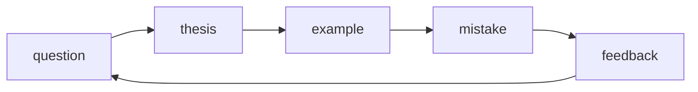

## Введение

Drill сжимает трек в устные ответы 60–90 секунд. Цель — не вызубрить формулировки выпусков, а уметь **структурировать**: тезис → пример → ловушка. Перед капстоуном [JV16](/game/learn/jv-capstone) прогоните блоки ниже вслух.

## Раздел: JVM / JDBC / транзакции

Выстрелы:
1. JDK vs JRE vs JVM ([JV01](/game/learn/jv-se-jvm)).
2. Почему PreparedStatement ([JV04](/game/learn/jv-jdbc-basics)).
3. Что делает close() у пула ([JV05](/game/learn/jv-jdbc-pool-tx)).
4. Autocommit=false — когда и rollback.
5. `-Xmx` vs cgroup limit ([JV12](/game/learn/jv-jvm-hosting)).

Шаблон ответа: определение → зачем в проде → типичная ошибка. Ошибка drill: читать шпаргалку монологом без примера.

## Раздел: ORM / N+1 / messaging

Выстрелы:
1. Identity map и dirty checking ([JV06](/game/learn/jv-orm-concepts)).
2. Нарисовать N+1 и join fetch ([JV07](/game/learn/jv-jpa-nplus1)).
3. LazyInitializationException — когда.
4. Queue vs topic + ack ([JV08](/game/learn/jv-jms)).
5. Dual write и outbox ([JV13](/game/learn/jv-integration-lab)).

Связки наружу: SQL explain — [sql-performance-explain](/game/learn/sql-performance-explain); очереди глазами СА — [SA10](/game/learn/sa-sync-async-queues).

## Раздел: Интеграции и архитектура

Выстрелы:
1. Роль адаптера ([JV09](/game/learn/jv-esb-adapter)) vs домен.
2. WSDL/Fault за 60 секунд ([JV10](/game/learn/jv-soap-client)).
3. Где source of truth при JS UI ([JV11](/game/learn/jv-js-glue)).
4. Каркас ADR bus vs broker ([JV14](/game/learn/jv-adr-bus-vs-broker)).
5. Одна сила + одно последствие вашего последнего решения.

Ошибка: бренд-дроп без Consequences. Сверяйтесь с [SA20](/game/learn/sa-architecture-decisions) и [SA13](/game/learn/sa-esb-integrations).

## Раздел: Частые вопросы с собеседования

**Вопрос.** String pool и `intern()` — быстрый ответ?

**Ответ.** Литералы и interned строки шарят объект в pool; сравнение текста — equals. В drill связывают с памятью и с ловушкой `==` на String.

**Вопрос.** Checked exception — пример и позиция?

**Ответ.** SQLException, IOException — checked; RuntimeException — нет. Drill: «обработал или throws» vs «не ловим NPE compile-time».

**Вопрос.** `==` vs `equals` — три слова?

**Ответ.** Ссылки vs значение (контракт equals). String и Integer — любимые примеры.

**Вопрос.** N+1 и fetch — связка за 45 сек?

**Ответ.** Список + LAZY в цикле → N запросов; лечение join fetch/graph/batch/DTO. Сначала убрать round-trip, потом explain SQL.

**Вопрос.** Queue vs topic + ack?

**Ответ.** PTP vs pub/sub; ack после успешной обработки; DLQ для poison; идempotency consumer.

## Лаба

**Цель.** 12 ответов под таймер 75 секунд каждый; партнёр считает «тезис/пример/ловушка».

**Шаги.**
1. Распечатайте/откройте список выстрелов трёх разделов.
2. Ответьте на 4 случайных без записей.
3. Отметьте слабые → вернитесь в исходный выпуск.
4. Повторите слабые через 30 минут (spaced).
5. Запишите голосовой ответ на N+1 и outbox — прослушайте сами.

**В группу:** mock interview 20 минут: 6 вопросов + 1 система «заказ → склад».

**Готово, если…**
- [ ] 8/12 ответов укладываются в 90 секунд
- [ ] В каждом есть ловушка/ошибка
- [ ] Можете связать JDBC tx и JMS без паузы «эээ»

## Схема: Цикл drill

## Тест

### Структура устного ответа на drill?

**Ответ:** тезис → пример → ловушка

**Пояснение:** так проверяют глубину, а не только определение из вики.

### Как коротко объяснить N+1 на собесе?

**Ответ:** 1 + N запросов к детям

**Пояснение:** список родителей, затем отдельный SELECT на каждую коллекцию; лечат join fetch/entity graph/batch.

### Какой паттерн против dual write помнить первым?

**Ответ:** transactional outbox

**Пояснение:** запись в БД и в брокер в одной транзакции через outbox; иначе рассинхрон при сбое.

### Что спросить себя в ADR-ответе?

**Ответ:** consequences и alternatives

**Пояснение:** без цены и отвергнутых вариантов ответ звучит как хайп.

### Зачем timed drill, если тема знакома?

**Ответ:** стресс и структура речи

**Пояснение:** на собесе время и волнение ломают «я это знал дома».

## Шпаргалка

<h3>Карта блоков</h3>
<ul>
<li>SE/JVM/process/hosting: JV01–03, JV12</li>
<li>Data: JV04–07 + SQL14</li>
<li>Messaging/integration: JV08–10, JV13–14</li>
<li>Polyglot edge: JV11</li>
</ul>
<h3>Таймер</h3>
<pre><code>60–90s per answer
flag weak → revisit episode
mock with partner
</code></pre>

## Anki

### Front: Назовите три части сильного устного ответа на Java-собесе

Back: тезис, конкретный пример, типичная ошибка/ловушка

### Front: Какой вопрос проверяет понимание пула JDBC?

Back: что делает close() у Connection из DataSource/pool

### Front: Какой рисунок обязателен для N+1?

Back: 1 SELECT списка и N SELECT связей в цикле

### Front: Какая пара терминов отличает JMS destinations?

Back: queue (PTP) и topic (pub/sub)

### Front: Какие два артефакта связать в ответе про dual write?

Back: таблица outbox и идемпотентный consumer

### Front: Какие секции ADR назвать даже в коротком ответе?

Back: Context/Decision/Consequences (и лучше Alternatives)

## Итоги

- Drill тренирует речь под таймер, не только знание фактов
- Слабые места возвращайте в исходные JV-выпуски
- Финал трека — капстоун-чеклист

## Ссылки

- Learn | [JV07 JPA N+1](/game/learn/jv-jpa-nplus1)
- Learn | [JV13 Integration lab](/game/learn/jv-integration-lab)
- Learn | [SA20 ADR](/game/learn/sa-architecture-decisions)
- Далее: [JV capstone](/game/learn/jv-capstone)
