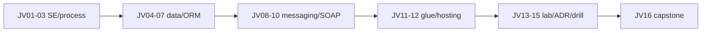

## Введение

Капстоун собирает трек в проверяемый чеклист: от JVM до ADR. Пройдите пункты честно — «слышал» ≠ «могу объяснить на доске». Рядом полезны капстоуны SQL/SA, если закрываете полный стек собеса.

## Раздел: Ответ вслух

Я говорю, какой факт хранит база, кто перекладывает сообщение и что будет при повторе. Для вакансии на Java Core добавляю контракт HashMap и что volatile не делает прибавление атомарным.

## Раздел: Плохой ответ

Считать интеграционный чеклист подготовкой к любому Java-собесу. Коллекции и Spring там спросят отдельно.

## Раздел: Термины

Ядро языка — Java Core. Внедрение — dependency injection. Повтор — retry.

## Раздел: Чеклист Junior → Middle

Отметьте только то, что объясняете без конспекта:

**Junior (JV01–JV06)**
- [ ] JDK / JRE / JVM и classpath
- [ ] class/interface/static vs Python OOP
- [ ] процесс, env, сигналы
- [ ] JDBC PreparedStatement + try-with-resources
- [ ] pool, autocommit, commit/rollback
- [ ] identity map и dirty checking

**Middle (JV07–JV12)**
- [ ] N+1, LAZY, join fetch / graph
- [ ] JMS queue/topic, ack, DLQ
- [ ] адаптер ESB и идемпотентность
- [ ] SOAP/WSDL клиент, Fault, timeouts
- [ ] JS как glue, source of truth на сервере
- [ ] Docker limits vs `-Xmx`, graceful stop

Ошибка капстоуна: ставить галочки пачкой «потом повторю».

## Раздел: Чеклист Senior и сквозной сюжет

**Senior (JV13–JV15)**
- [ ] dual write → outbox → idempotent consumer
- [ ] ADR bus vs broker с Consequences
- [ ] drill 60–90с: тезис/пример/ловушка

**Сквозной сюжет «Заказ»** (расскажите end-to-end):
1. API принял заказ (валидация на Java, не только UI — JV11).
2. JDBC tx + outbox (JV05, JV13).
3. Relay в JMS (JV08).
4. Адаптер склада / легаси SOAP (JV09, JV10).
5. Хостинг сервиса в контейнере с лимитами (JV12).
6. Решение «шина или брокер» зафиксировано ADR (JV14).

Связки: [SA19](/game/learn/sa-integration-design), [SA20](/game/learn/sa-architecture-decisions), [sql-acid-transactions](/game/learn/sql-acid-transactions), [sql-performance-explain](/game/learn/sql-performance-explain).

## Раздел: Индекс slug трека

| Ep | slug |
|----|------|
| JV01 | `jv-se-jvm` |
| JV02 | `jv-oop-vs-python` |
| JV03 | `jv-shell-process` |
| JV04 | `jv-jdbc-basics` |
| JV05 | `jv-jdbc-pool-tx` |
| JV06 | `jv-orm-concepts` |
| JV07 | `jv-jpa-nplus1` |
| JV08 | `jv-jms` |
| JV09 | `jv-esb-adapter` |
| JV10 | `jv-soap-client` |
| JV11 | `jv-js-glue` |
| JV12 | `jv-jvm-hosting` |
| JV13 | `jv-integration-lab` |
| JV14 | `jv-adr-bus-vs-broker` |
| JV15 | `jv-interview-drill` |
| JV16 | `jv-capstone` |

Seed: `import_java_learn_series.py`.

## Раздел: Частые вопросы с собеседования

**Вопрос.** JDK / JRE / JVM в end-to-end рассказе «Заказ»?

**Ответ.** Jar запускает JVM-процесс; JDK было нужно при сборке. Капстоун связывает hosting (JV12) с classpath и bytecode (JV01).

**Вопрос.** `equals`/`hashCode` и `==` — где всплывают в треке?

**Ответ.** OOP и entity в Set/Map; String в интegrations; обёртки в JV01. Капстоун — не повторять определения, а указать выпуск.

**Вопрос.** JDBC pool + транзакция + outbox — одна фраза?

**Ответ.** Pool для throughput; autocommit off для атомарности; outbox согласует БД и JMS без dual write.

**Вопрос.** ORM N+1 vs explain SQL?

**Ответ.** Сначала счёт запросов на сценарий, потом plan и индексы SQL-трека.

**Вопрос.** SOAP vs REST на периметре?

**Ответ.** Легаси SOAP через адаптер; внутренний API REST/события — типичная карта JV09–JV10.

## Лаба

**Цель.** Закрыть капстоун: устный end-to-end «Заказ» 5–7 минут + чеклист ≥80% галочек.

**Шаги.**
1. Пройдите чеклист Junior/Middle/Senior.
2. Выпишите 3 слабых slug и перечитайте только их.
3. Расскажите сюжет «Заказ» партнёру или на диктофон.
4. Добавьте один метрический абзац (lag outbox, DLQ, heap).
5. Обновите свой короткий ADR из JV14 статусом Accepted/Deprecated по желанию.

**В группу:** взаимное ревью рассказа — каждый вставляет один failure-mode вопрос.

**Готово, если…**
- [ ] ≥80% пунктов чеклиста уверенные
- [ ] Сюжет «Заказ» звучит связно
- [ ] Можете указать next step обучения вне трека

## Схема: Карта трека

## Тест

### Что обязан уметь объяснить junior Java по JVM?

**Ответ:** bytecode и JDK/JRE/JVM

**Пояснение:** цепочка .java → javac → .class → JVM + JIT; classpath как источник ClassNotFound.

### Зачем transactional outbox в интеграции?

**Ответ:** атомарность БД и события

**Пояснение:** иначе dual write: коммит в БД прошёл, а publish в брокер упал (или наоборот).

### Чем ADR лучше «просто выбрали Kafka»?

**Ответ:** контекст и последствия

**Пояснение:** фиксируете alternatives и consequences — на собесе это звучит как инженерное решение.

### Что должно быть в финальном рассказе «Заказ»?

**Ответ:** tx, событие, адаптер, hosting

**Пояснение:** сквозной сюжет связывает data, messaging и эксплуатацию.

### Когда капстоун считать закрытым?

**Ответ:** чеклист + устный e2e

**Пояснение:** галочки без рассказа недостаточны; рассказ без чеклиста слеп к пробелам.

## Шпаргалка

<h3>Суть</h3>
<ul>
<li>чеклист честнее ощущения «всё знаю»</li>
<li>сквозной сюжет важнее разрозненных фактов</li>
<li>слабые slug — точечный ретрай</li>
<li>ADR и метрики отличают senior-ответ</li>
</ul>
<h3>Next</h3>
<pre><code>SQL perf · SA integration/ADR
повтор JV15 drill раз в неделю
</code></pre>

## Anki

### Front: Какие номера у junior-блока Java Learn?

Back: JV01–JV06

### Front: Какие номера у middle-блока Java Learn?

Back: JV07–JV12

### Front: Какие четыре senior-выпуска завершают трек?

Back: JV13 lab, JV14 ADR, JV15 drill, JV16 capstone

### Front: Назовите slug выпуска про N+1

Back: jv-jpa-nplus1

### Front: Назовите slug выпуска про hosting JVM

Back: jv-jvm-hosting

### Front: Что проверить в капстоуне кроме галочек теории?

Back: устный end-to-end сюжет с failure modes и метриками

## Итоги

- Трек закрыт, когда объясняете цепочку от JVM до ADR на одном сюжете
- Индекс slug — карта возврата к слабым местам
- Поддерживайте форму drill’ом, не разовым прочтением

## Ссылки

- Learn | [JV15 Interview drill](/game/learn/jv-interview-drill)
- Learn | [SA19 Integration design](/game/learn/sa-integration-design)
- Learn | [SA20 Architecture decisions](/game/learn/sa-architecture-decisions)
- Learn | [SQL ACID](/game/learn/sql-acid-transactions)
- Серия: [`SERIES.md`](SERIES.md)
