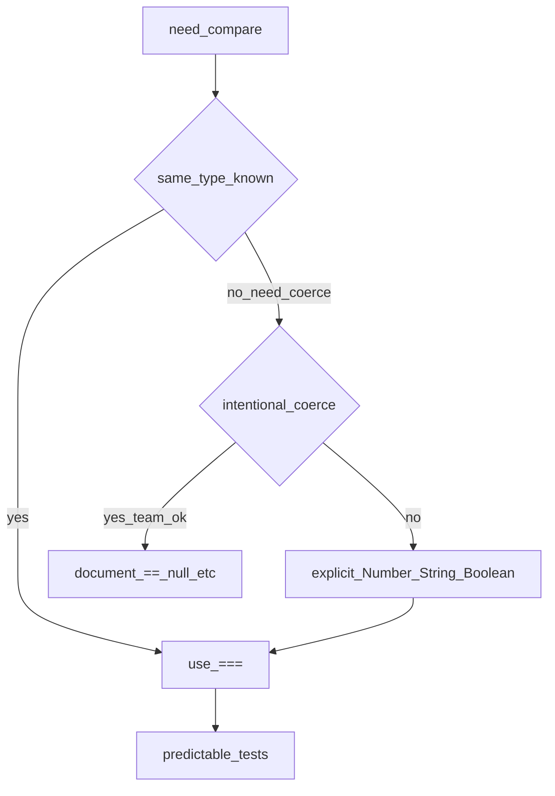
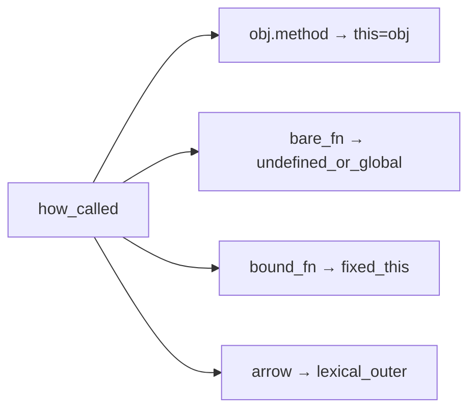
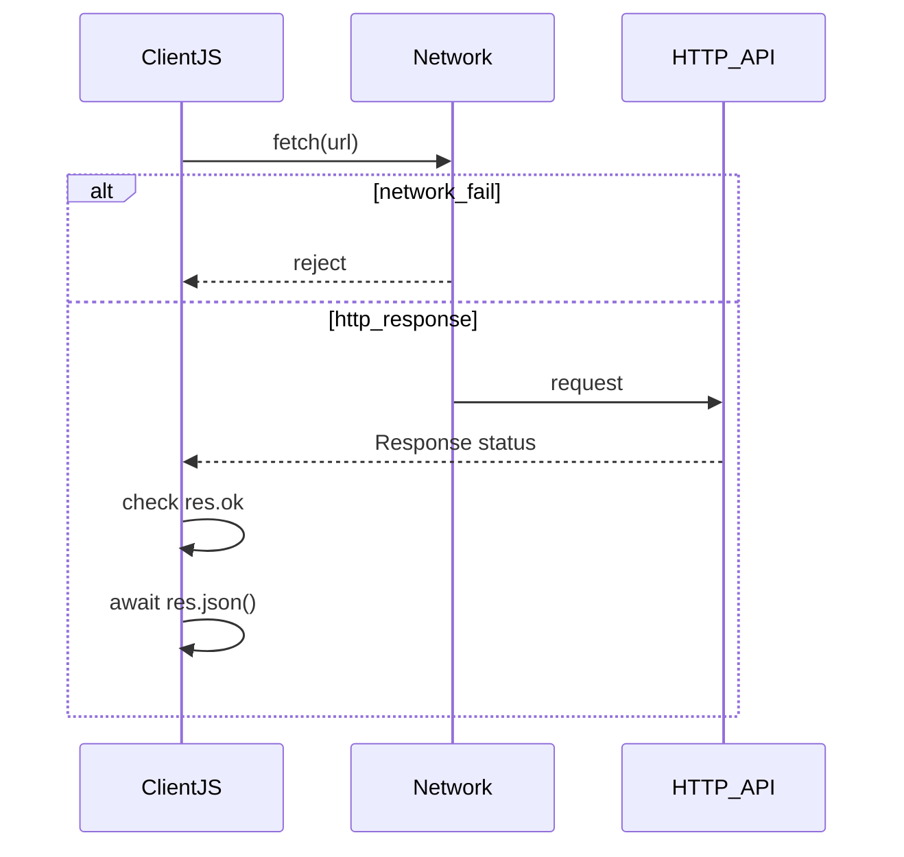

## Введение

На junior-собесе по JS почти всегда спрашивают: какие типы есть, чем `==` отличается от `===`, что такое falsy и почему `typeof null === "object"`. Ответ «я всегда пишу `===`» хороший, но недостаточно — нужно показать, *когда* язык сам приводит типы и где это ломает тесты. Этот выпуск — стартовая точка серии: без неё легко ошибиться в условиях, сравнениях и проверках ответов API.

**Функции и this.** После типов собес переходит к функциям: чем declaration отличается от expression, почему стрелка «не имеет своего this», что будет, если передать метод объекта в `setTimeout` или `addEventListener`. Нужно не зубрить таблицу, а выбрать инструмент: обычная функция — когда this должен зависеть от вызова; стрелка — когда нужен лексический контекст снаружи; `bind` — когда фиксируете метод навсегда.

**Promise, async/await и fetch.** UI не должен «зависать», пока ждёт ответ сервера: сеть и таймеры уходят в асинхронную модель. На собесе ждут три вещи: состояния Promise, синтаксис `async/await` поверх него и умение правильно читать `fetch` — особенно то, что HTTP 4xx/5xx *не* превращаются в reject сами по себе. Выбирайте `await` + проверка `response.ok` + `try/catch` для сетевых сбоев; цепочки `.then` оставляйте, когда так читабельнее или нужна композиция без async-функции.

## Раздел: Как отвечать одним блоком

Этот выпуск собрал соседние короткие темы трека: «Типы и приведение в», «Функции и this», «Promise, async/await и fetch». Раньше каждая занимала отдельную карточку на несколько минут, а на собеседовании их спрашивают одним блоком. Ниже у каждой темы свой раздел, затем общие лабы, один тест и одна колода карточек. В ответе сначала назовите, какую тему спросили, потом определение и один пример. Не проговаривайте все разделы, если спросили один. Лабы можно пройти по порядку исходного трека. Если времени мало, сделайте первую и последнюю: первая ставит язык, последняя проверяет, что соседние темы вы не перепутали.

## Раздел: Типы и приведение в: Примитивы и typeof

В современном JS семь примитивов: `number`, `string`, `boolean`, `null`, `undefined`, `symbol`, `bigint`. Всё остальное — объекты (включая массивы и функции). Оператор `typeof` возвращает строку с именем «семейства», но с двумя классическими ловушками:

```js
typeof 42;          // "number"
typeof "hi";        // "string"
typeof undefined;   // "undefined"
typeof null;        // "object"  ← исторический баг спецификации
typeof [];          // "object"
typeof (() => {});  // "function"
```

Проверять «это именно `null`» нужно через `value === null`, а не через `typeof`. Для массива — `Array.isArray(value)`.

**Типичная ошибка:** писать `if (typeof x === "object")` и считать, что отфильтровали всё «не-объектное» — туда попадут и `null`, и массивы.

## Раздел: Типы и приведение в: == с coerce и строгий ===

Оператор `===` сравнивает тип и значение без преобразования. `==` сначала приводит операнды по правилам Abstract Equality (ECMA-262), затем сравнивает. Поэтому на собесе и в прод-коде по умолчанию берут `===`, а приведения делают явно (`Number(x)`, `String(x)`, `Boolean(x)`).

```js
0 == false;       // true  — оба → число 0
0 === false;      // false — разные типы
null == undefined; // true  — особое правило ==
null === undefined; // false
"" == 0;          // true
"0" == 0;         // true
"0" === 0;        // false
```

**Типичная ошибка:** полагаться на `== null`, чтобы поймать и `null`, и `undefined` — это работает, но команда должна явно договориться; иначе ревьюер увидит «магию coerce» и попросит `x === null || x === undefined`.

## Раздел: Типы и приведение в: Falsy и явные преобразования

В условии `if (value)` к boolean приводятся шесть falsy-значений: `false`, `0`, `-0`, `0n`, `""`, `null`, `undefined`, `NaN`. Всё остальное — truthy, включая пустой объект `{}`, пустой массив `[]` и строку `"0"`.

```js
Boolean("");     // false
Boolean("0");    // true  — непустая строка
Boolean([]);     // true  — объект
Number(" 12 ");  // 12
Number("");      // 0
Number("abc");   // NaN
```

Для входных строк из форм и query-параметров лучше `Number(...)` / `parseInt(..., 10)` с проверкой `Number.isFinite`, чем «тихое» `==`.

**Типичная ошибка:** считать, что `if (arr)` защитит от пустого списка — пустой `[]` проходит как truthy; нужна проверка `arr.length === 0`.

## Раздел: Типы и приведение в: Частые вопросы с собеседования

**Вопрос.** Чем `let`, `const` и `var` отличаются?

**Ответ.** `var` function-scoped и hoisting с undefined до строки; `let`/`const` block-scoped и TDZ до инициализации. `const` запрещает переприсвоение ссылки, но объект по ссылке можно мутировать. На собесе 2025+ ожидают: новый код на let/const, var — только legacy.

**Вопрос.** Event loop: microtasks vs macrotasks?

**Ответ.** Sync-код → все microtasks (Promise.then, queueMicrotask) → render (если нужно) → macrotask (setTimeout). Поэтому then выполнится раньше setTimeout(0). Долгий sync-блок откладывает и UI, и обработку then.

**Вопрос.** `typeof null` — что сказать без шутки «баг»?

**Ответ.** Спецификация исторически вернула "object"; проверка null — `value === null`. Для массива — Array.isArray. На собесе показывают, что знаете обход, не только факт бага.

## Раздел: Функции и this: Функции как значения

В JS функции — граждане первого класса: их кладут в переменные, передают аргументом, возвращают из других функций. Формы объявления:

```js
function greet(name) {
  return `Hi, ${name}`;
}

const greetExpr = function (name) {
  return `Hi, ${name}`;
};

const greetArrow = (name) => `Hi, ${name}`;
```

Function declaration поднимается (hoisting) целиком — вызов до строки объявления в той же области обычно работает. У expression и arrow поднимается только переменная (`const` — во временной мёртвой зоне до инициализации).

**Типичная ошибка:** вызывать `const fn = () => {}` выше объявления и удивляться `ReferenceError` — путать с поведением `function declare()`.

## Раздел: Функции и this: Откуда берётся this

У обычной функции `this` определяется *способом вызова* (в non-strict в браузере «свободный» вызов даёт `window`; в strict — `undefined`):

```js
const user = {
  name: "Ann",
  hello() {
    return this.name;
  },
};

user.hello();           // "Ann" — вызов через объект
const fn = user.hello;
fn();                   // undefined / window — потерян объект-владелец

user.hello.call({ name: "Bob" }); // "Bob"
const bound = user.hello.bind(user);
bound();                // "Ann"
```

`call` / `apply` вызывают сразу с выбранным this; `bind` возвращает новую функцию с зафиксированным this.

**Типичная ошибка:** сохранить метод в переменную (`const h = obj.method`) и ждать, что this «запомнится» сам — без bind/обёртки контекст теряется.

## Раздел: Функции и this: Стрелки и лексический this

У стрелочной функции нет собственного `this`, `arguments` и её нельзя вызвать через `new`. `this` берётся из окружающей лексической области — удобно в колбэках внутри методов:

```js
const timer = {
  label: "tick",
  startBroken() {
    setTimeout(function () {
      console.log(this.label); // this ≠ timer
    }, 0);
  },
  startOk() {
    setTimeout(() => {
      console.log(this.label); // "tick" — this из startOk
    }, 0);
  },
};
```

Стрелку *не* ставят методом объекта, если внутри нужен this экземпляра: `const obj = { x: 1, getX: () => this.x }` — `this` будет снаружи (часто `undefined` в модулях).

**Типичная ошибка:** писать все методы объекта стрелками «для краткости» и ломать `this` на вызовах `obj.method()`.

## Раздел: Функции и this: Частые вопросы с собеседования

**Вопрос.** `let`/`const`/`var` и функции — что спрашивают?

**Ответ.** Function declaration hoisting отличается от const fn = () => — TDZ до `=`. var внутри if создаёт function-scoped переменную; let — block. Стрелку нельзя объявить как `function` — expression only.

**Вопрос.** Arrow vs `function` для обработчика — правило?

**Ответ.** Нужен динамический this вызова — обычная function или bind; нужен this из внешнего метода/класса — стрелка. Стрелку нельзя new; у неё нет arguments.

**Вопрос.** Event loop и `setTimeout(fn, 0)` после Promise?

**Ответ.** Promise callback — microtask; setTimeout — macrotask. Порядок: sync → все microtasks → macrotasks. Типичный вопрос: что выведется первым — then или timeout.

**Вопрос.** `==` vs `===` в колбэке?

**Ответ.** В колбэках сравнивайте id и статусы через ===; == оставляют для согласованного `x == null`. Потеря this не связана с ==, но оба блока часто идут подряд на собесе.

## Раздел: Promise, async/await и fetch: Promise и состояния

Promise — объект отложенного результата. Три состояния: `pending` → `fulfilled` (успех с value) или `rejected` (причина-ошибка). Переход одноразовый. Подписаться можно через `.then` / `.catch` / `.finally` или через `await` внутри `async`-функции.

```js
function loadUser(id) {
  return fetch(`/api/users/${id}`).then((res) => {
    if (!res.ok) throw new Error(`HTTP ${res.status}`);
    return res.json();
  });
}

loadUser(1)
  .then((user) => console.log(user.name))
  .catch((err) => console.error(err.message));
```

`async function` всегда возвращает Promise: даже `return 42` станет fulfilled-промисом с `42`; брошенное исключение — reject.

**Типичная ошибка:** забыть `return` внутри `.then` и получить цепочку с `undefined` на следующем шаге.

## Раздел: Promise, async/await и fetch: async/await как сахар

`await` приостанавливает выполнение async-функции до settle промиса, не блокируя поток браузера целиком. Ошибки из reject и из `throw` ловят `try/catch`:

```js
async function loadUser(id) {
  try {
    const res = await fetch(`/api/users/${id}`);
    if (!res.ok) {
      throw new Error(`HTTP ${res.status}`);
    }
    const data = await res.json();
    return data;
  } catch (err) {
    console.error("load failed", err);
    throw err;
  }
}
```

Параллельные независимые запросы — `Promise.all([a(), b()])`, а не два последовательных `await`, если порядок не важен.

**Типичная ошибка:** ставить `await` в цикле по независимым URL и удивляться медленности — там нужен `Promise.all` (или ограниченный пул).

## Раздел: Promise, async/await и fetch: fetch, Response и ok

`fetch(url)` возвращает Promise&lt;Response&gt;. Тело ещё не прочитано: обычно второй шаг — `await res.json()` или `res.text()`. Сетевой сбой (DNS, offline) → reject. Ответ со статусом 404/500 → **fulfilled**, но `res.ok === false` (`ok` — статусы 200–299).

```js
const res = await fetch("/api/missing");
console.log(res.status); // 404
console.log(res.ok);     // false
// без проверки ok следующий json() может распарсить HTML-страницу ошибки
```

Для тестов QA важно: «запрос упал» и «сервер вернул 500» — разные наблюдения в DevTools (failed vs красный статус в Network).

**Типичная ошибка:** писать только `const data = await (await fetch(url)).json()` без `ok` и считать любой JSON успехом бизнес-логики.

## Раздел: Promise, async/await и fetch: Частые вопросы с собеседования

**Вопрос.** Microtasks после `await`?

**Ответ.** `await` разворачивается в Promise; продолжение async-функции — microtask. Цепочка await не блокирует UI-thread, но sync-код между await — блокирует. Promise.all для параллели, не await в цикле по независимым URL.

**Вопрос.** `let`/`const` в async-функции?

**Ответ.** const res = await fetch — одна ссылка на Response; let для накопления в цикле с ограничением. var в async ловушка TDZ/hoisting в старых скриптах. Блок scope помогает не утечь res наружу.

**Вопрос.** `typeof null` при разборе JSON поля?

**Ответ.** API может вернуть null; typeof null === "object" — не фильтр. Явно: value === null || value === undefined; для optional chaining — `obj?.field`.

## Лаба

**Типы и приведение в.**

**Цель.** Разобрать пять выражений сравнения и зафиксировать правило «=== по умолчанию».

**Шаги.**
1. В консоли браузера или Node выполните `0 == false` и `0 === false`; запишите оба результата.
2. Сравните `null == undefined` и `null === undefined`.
3. Выведите `typeof null` и напишите корректную проверку на `null`.
4. Составьте список всех falsy-значений и для каждого придумайте пример `if`.
5. Возьмите строку `"08"` из «формы» и безопасно превратите в число с проверкой `Number.isFinite`.

**В группу:** блец-квиз — партнёр называет выражение, вы за 10 секунд говорите результат и *почему*.

**Готово, если…**
- [ ] По умолчанию пишете `===` и можете объяснить исключение
- [ ] Называете falsy без подсказки
- [ ] Знаете ловушку `typeof null` и проверку через `=== null`

**Функции и this.**

**Цель.** Воспроизвести потерю this и починить тремя способами.

**Шаги.**
1. Создайте объект с методом `getName`, вызовите через объект и через сохранённую ссылку — сравните.
2. Повесьте обычную `function` в `setTimeout` внутри метода; убедитесь, что `this` «уплыл».
3. Замените колбэк на стрелку — покажите лексический this.
4. Верните обычную функцию, но закрепите через `.bind(this)` (или `bind(obj)`).
5. Кратко запишите: когда стрелка удобна и когда лучше `function` + bind.

**В группу:** один человек прячет баг с this в 15 строках, второй находит и чинит за 3 минуты.

**Готово, если…**
- [ ] Объясняете разницу declaration / expression / arrow
- [ ] Показываете сценарий потери this на колбэке
- [ ] Умеете починить и стрелкой, и bind

**Promise, async/await и fetch.**

**Цель.** Написать async-загрузку JSON с проверкой статуса и разбором ошибок.

**Шаги.**
1. Вызовите `fetch` на публичный JSON (или локальный mock) и дождитесь Response.
2. Добавьте второй `await` на `res.json()`.
3. Вставьте проверку `if (!res.ok) throw …` *до* разбора тела (или сразу после статуса).
4. Оберните в `try/catch` и залогируйте сообщение.
5. Подмените URL на заведомо 404: убедитесь, что без `ok` код «успешно» парсит мусор, а с `ok` — падает осмысленно.

**В группу:** один ломает URL/статус, второй пишет минимальный клиент, который различает network error и HTTP error.

**Готово, если…**
- [ ] Называете три состояния Promise
- [ ] Пишете async-функцию с await и try/catch
- [ ] Всегда проверяете `response.ok` перед доверием к телу

## Схема: Типы и приведение в: Выбор сравнения



## Схема: Функции и this: Как выбирается this



## Схема: Promise, async/await и fetch: Путь fetch



## Тест

### Чем === отличается от ==?

**Ответ:** === без приведения типов

**Пояснение:** `==` сначала приводит операнды по правилам спецификации; `===` сравнивает тип и значение как есть.

### Что значит «функции — first-class»?

**Ответ:** функции как обычные значения

**Пояснение:** их передают, возвращают и хранят в переменных наравне с числами и объектами.

### Какие три состояния есть у Promise?

**Ответ:** pending, fulfilled, rejected

**Пояснение:** после settle состояние не откатывается; подписчики получают итог.

### Какие значения считаются falsy?

**Ответ:** false, 0, "", null, undefined, NaN

**Пояснение:** также `-0` и `0n`; пустые `[]` и `{}` — truthy, это частая путаница.

### Откуда у стрелки берётся this?

**Ответ:** из внешней лексической области

**Пояснение:** стрелка не получает this от вызова; её нельзя «перепривязать» call/apply по смыслу собственного this.

## Шпаргалка

<ul><li>Примитивы: number, string, boolean, null, undefined, symbol, bigint</li><li>По умолчанию ===; приведения — явно</li><li>Falsy: false, 0, -0, 0n, "", null, undefined, NaN</li><li>typeof null → "object"; проверка: value === null</li><li>function: this от способа вызова</li><li>arrow: this лексический, нет new/arguments</li><li>bind — новая функция с зафиксированным this</li><li>потеря this — классика setTimeout / addEventListener</li><li>Promise: pending → fulfilled | rejected</li><li>async/await — синтаксис над Promise</li><li>fetch → Response; тело читать отдельно</li><li>HTTP ошибки: проверяйте res.ok / status</li></ul>

## Anki

### Front: Какие семь примитивных типов есть в современном JavaScript?

Back: number, string, boolean, null, undefined, symbol, bigint

### Front: Чем function declaration отличается от const fn = function по hoisting?

Back: declaration поднимается целиком; у const до инициализации — Temporal Dead Zone

### Front: В каких случаях fetch обычно переходит в rejected, а не в Response?

Back: при сетевых сбоях (нет связи, DNS и т.п.), не при обычном HTTP 404/500

### Front: Почему на собесе рекомендуют === вместо ==?

Back: === не приводит типы, результат предсказуемее для тестов и ревью

### Front: Как call отличается от bind по моменту вызова?

Back: call вызывает сразу с this; bind возвращает функцию для позднего вызова

### Front: Что означает свойство response.ok у Fetch API?

Back: true только для статусов 200–299

## Мнемоника

### acronym: Приведение

**Задание:** Четыре сравнения, на которых ловят.

**Элементы:**
- == приводит
- === нет
- null и undefined
- объект к примитиву

**Подсказка:** == null ловит и null, и undefined. Это исключение, не правило.

**Ответ:** ==, ===, null, ToPrimitive

## Итоги

- Типы и сравнения — первый фильтр junior-собеса по JS
- `===` и явные преобразования снимают сюрпризы coerce
- `typeof null` и truthy-`[]` — две ловушки, которые ждут в тесте
- Функции — значения; форма объявления влияет на hoisting и this
- Обычная функция: this от вызова; стрелка: this снаружи
- Потеря this в колбэке чинится стрелкой, bind или обёрткой
- Promise и async/await — один контракт, разный синтаксис
- `fetch` отдаёт Response; бизнес-успех проверяете сами через `ok`

## Ссылки

- [MDN: typeof](https://developer.mozilla.org/en-US/docs/Web/JavaScript/Reference/Operators/typeof)
- [MDN: Equality comparisons](https://developer.mozilla.org/en-US/docs/Web/JavaScript/Equality_comparisons_and_sameness)
- [ECMA-262: Abstract Equality Comparison](https://tc39.es/ecma262/#sec-abstract-equality-comparison)
- [javascript.info: Типы данных](https://javascript.info/types)
- [javascript.info: Операторы сравнения](https://javascript.info/comparison)
- [MDN: Functions](https://developer.mozilla.org/en-US/docs/Web/JavaScript/Guide/Functions)
- [MDN: this](https://developer.mozilla.org/en-US/docs/Web/JavaScript/Reference/Operators/this)
- [MDN: Function.prototype.bind](https://developer.mozilla.org/en-US/docs/Web/JavaScript/Reference/Global_Objects/Function/bind)
- [ECMA-262: this Keyword](https://tc39.es/ecma262/#sec-this-keyword)
- [javascript.info: Функции](https://javascript.info/function-basics)
- [javascript.info: Привязка контекста](https://javascript.info/bind)
- [MDN: Using promises](https://developer.mozilla.org/en-US/docs/Web/JavaScript/Guide/Using_promises)
- [MDN: async function](https://developer.mozilla.org/en-US/docs/Web/JavaScript/Reference/Statements/async_function)
- [MDN: fetch](https://developer.mozilla.org/en-US/docs/Web/API/fetch)
- [MDN: Response.ok](https://developer.mozilla.org/en-US/docs/Web/API/Response/ok)
- [javascript.info: Промисы](https://javascript.info/promise-basics)
- [javascript.info: Fetch](https://javascript.info/fetch)
- [DOM и события](/game/learn/js-dom-events)
