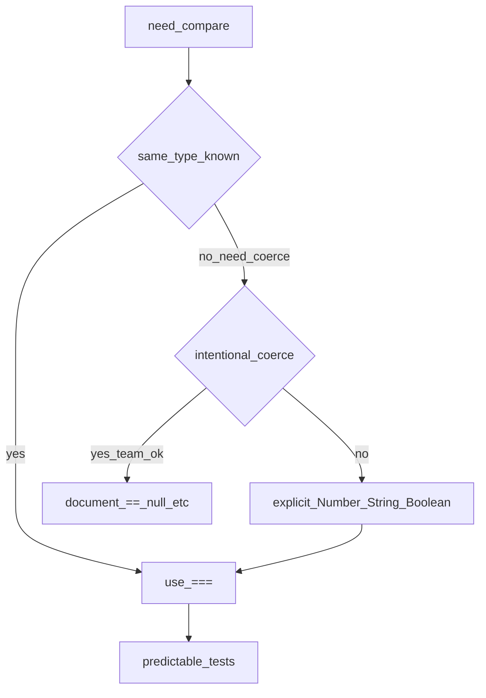

## Введение

На junior-собесе по JS почти всегда спрашивают: какие типы есть, чем `==` отличается от `===`, что такое falsy и почему `typeof null === "object"`. Ответ «я всегда пишу `===`» хороший, но недостаточно — нужно показать, *когда* язык сам приводит типы и где это ломает тесты. Этот выпуск — стартовая точка серии: без неё легко ошибиться в условиях, сравнениях и проверках ответов API.

## Раздел: Примитивы и typeof

В современном JS семь примитивов: `number`, `string`, `boolean`, `null`, `undefined`, `symbol`, `bigint`. Всё остальное — объекты (включая массивы и функции). Оператор `typeof` возвращает строку с именем «семейства», но с двумя классическими ловушками:

```js
typeof 42;          // "number"
typeof "hi";        // "string"
typeof undefined;   // "undefined"
typeof null;        // "object"  ← исторический баг спецификации
typeof [];          // "object"
typeof (() => {});  // "function"
```

Проверять «это именно `null`» нужно через `value === null`, а не через `typeof`. Для массива — `Array.isArray(value)`.

**Типичная ошибка:** писать `if (typeof x === "object")` и считать, что отфильтровали всё «не-объектное» — туда попадут и `null`, и массивы.

## Раздел: == с coerce и строгий ===

Оператор `===` сравнивает тип и значение без преобразования. `==` сначала приводит операнды по правилам Abstract Equality (ECMA-262), затем сравнивает. Поэтому на собесе и в прод-коде по умолчанию берут `===`, а приведения делают явно (`Number(x)`, `String(x)`, `Boolean(x)`).

```js
0 == false;       // true  — оба → число 0
0 === false;      // false — разные типы
null == undefined; // true  — особое правило ==
null === undefined; // false
"" == 0;          // true
"0" == 0;         // true
"0" === 0;        // false
```

**Типичная ошибка:** полагаться на `== null`, чтобы поймать и `null`, и `undefined` — это работает, но команда должна явно договориться; иначе ревьюер увидит «магию coerce» и попросит `x === null || x === undefined`.

## Раздел: Falsy и явные преобразования

В условии `if (value)` к boolean приводятся шесть falsy-значений: `false`, `0`, `-0`, `0n`, `""`, `null`, `undefined`, `NaN`. Всё остальное — truthy, включая пустой объект `{}`, пустой массив `[]` и строку `"0"`.

```js
Boolean("");     // false
Boolean("0");    // true  — непустая строка
Boolean([]);     // true  — объект
Number(" 12 ");  // 12
Number("");      // 0
Number("abc");   // NaN
```

Для входных строк из форм и query-параметров лучше `Number(...)` / `parseInt(..., 10)` с проверкой `Number.isFinite`, чем «тихое» `==`.

**Типичная ошибка:** считать, что `if (arr)` защитит от пустого списка — пустой `[]` проходит как truthy; нужна проверка `arr.length === 0`.

## Раздел: Частые вопросы с собеседования

**Вопрос.** Чем `let`, `const` и `var` отличаются?

**Ответ.** `var` function-scoped и hoisting с undefined до строки; `let`/`const` block-scoped и TDZ до инициализации. `const` запрещает переприсвоение ссылки, но объект по ссылке можно мутировать. На собесе 2025+ ожидают: новый код на let/const, var — только legacy.

**Вопрос.** Event loop: microtasks vs macrotasks?

**Ответ.** Sync-код → все microtasks (Promise.then, queueMicrotask) → render (если нужно) → macrotask (setTimeout). Поэтому then выполнится раньше setTimeout(0). Долгий sync-блок откладывает и UI, и обработку then.

**Вопрос.** `typeof null` — что сказать без шутки «баг»?

**Ответ.** Спецификация исторически вернула "object"; проверка null — `value === null`. Для массива — Array.isArray. На собесе показывают, что знаете обход, не только факт бага.

## Лаба

**Цель.** Разобрать пять выражений сравнения и зафиксировать правило «=== по умолчанию».

**Шаги.**
1. В консоли браузера или Node выполните `0 == false` и `0 === false`; запишите оба результата.
2. Сравните `null == undefined` и `null === undefined`.
3. Выведите `typeof null` и напишите корректную проверку на `null`.
4. Составьте список всех falsy-значений и для каждого придумайте пример `if`.
5. Возьмите строку `"08"` из «формы» и безопасно превратите в число с проверкой `Number.isFinite`.

**В группу:** блец-квиз — партнёр называет выражение, вы за 10 секунд говорите результат и *почему*.

**Готово, если…**
- [ ] По умолчанию пишете `===` и можете объяснить исключение
- [ ] Называете falsy без подсказки
- [ ] Знаете ловушку `typeof null` и проверку через `=== null`

## Схема: Выбор сравнения



## Тест

### Чем === отличается от ==?

**Ответ:** === без приведения типов

**Пояснение:** `==` сначала приводит операнды по правилам спецификации; `===` сравнивает тип и значение как есть.

### Какие значения считаются falsy?

**Ответ:** false, 0, "", null, undefined, NaN

**Пояснение:** также `-0` и `0n`; пустые `[]` и `{}` — truthy, это частая путаница.

### Что вернёт typeof null?

**Ответ:** строка "object"

**Пояснение:** историческая ошибка языка; проверяйте `value === null`, а не `typeof`.

### Почему `"0" == 0` истинно, а `"0" === 0` — нет?

**Ответ:** == приводит строку к числу

**Пояснение:** при `==` строка `"0"` становится `0`; при `===` типы `string` и `number` сразу дают false.

### Как безопасно проверить «это массив»?

**Ответ:** Array.isArray(value)

**Пояснение:** `typeof` для массива даёт `"object"`; `instanceof` хуже ведёт себя между realm/iframe.

## Шпаргалка

<h3>Суть</h3>
<ul>
<li>Примитивы: number, string, boolean, null, undefined, symbol, bigint</li>
<li>По умолчанию ===; приведения — явно</li>
<li>Falsy: false, 0, -0, 0n, "", null, undefined, NaN</li>
<li>typeof null → "object"; проверка: value === null</li>
</ul>
<h3>Код</h3>
<pre><code>0 === false          // false
null == undefined    // true (особое правило ==)
typeof null          // "object"
Array.isArray(x)
Number.isFinite(Number(raw))
</code></pre>

## Anki

### Front: Какие семь примитивных типов есть в современном JavaScript?

Back: number, string, boolean, null, undefined, symbol, bigint

### Front: Почему на собесе рекомендуют === вместо ==?

Back: === не приводит типы, результат предсказуемее для тестов и ревью

### Front: Что вернёт выражение typeof null и как правильно проверить null?

Back: вернёт "object"; корректная проверка — value === null

### Front: Перечислите основные falsy-значения в условии if

Back: false, 0, "", null, undefined, NaN (также -0 и 0n)

### Front: Почему пустой массив проходит проверку if (arr)?

Back: [] — объект и поэтому truthy; нужна проверка длины

### Front: Чем Number("abc") отличается от неудачного parse с точки зрения результата?

Back: Number("abc") даёт NaN; дальше проверяют Number.isFinite

## Итоги

- Типы и сравнения — первый фильтр junior-собеса по JS
- `===` и явные преобразования снимают сюрпризы coerce
- `typeof null` и truthy-`[]` — две ловушки, которые ждут в тесте

## Ссылки

- [MDN: typeof](https://developer.mozilla.org/en-US/docs/Web/JavaScript/Reference/Operators/typeof)
- [MDN: Equality comparisons](https://developer.mozilla.org/en-US/docs/Web/JavaScript/Equality_comparisons_and_sameness)
- [ECMA-262: Abstract Equality Comparison](https://tc39.es/ecma262/#sec-abstract-equality-comparison)
- [javascript.info: Типы данных](https://javascript.info/types)
- [javascript.info: Операторы сравнения](https://javascript.info/comparison)
- Далее: [Функции и this](/game/learn/js-functions-this)
