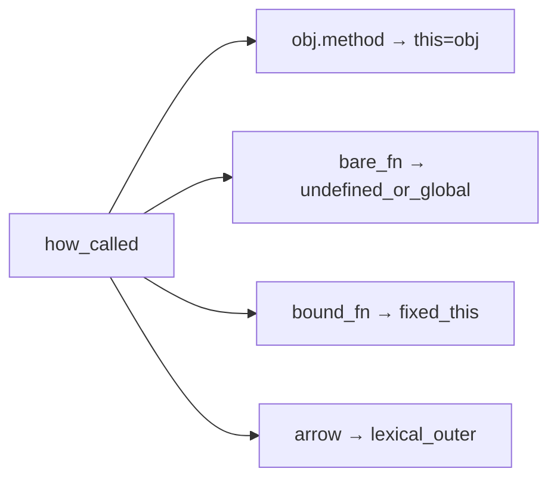

## Введение

После типов собес переходит к функциям: чем declaration отличается от expression, почему стрелка «не имеет своего this», что будет, если передать метод объекта в `setTimeout` или `addEventListener`. Нужно не зубрить таблицу, а выбрать инструмент: обычная функция — когда this должен зависеть от вызова; стрелка — когда нужен лексический контекст снаружи; `bind` — когда фиксируете метод навсегда.

## Раздел: Функции как значения

В JS функции — граждане первого класса: их кладут в переменные, передают аргументом, возвращают из других функций. Формы объявления:

```js
function greet(name) {
  return `Hi, ${name}`;
}

const greetExpr = function (name) {
  return `Hi, ${name}`;
};

const greetArrow = (name) => `Hi, ${name}`;
```

Function declaration поднимается (hoisting) целиком — вызов до строки объявления в той же области обычно работает. У expression и arrow поднимается только переменная (`const` — во временной мёртвой зоне до инициализации).

**Типичная ошибка:** вызывать `const fn = () => {}` выше объявления и удивляться `ReferenceError` — путать с поведением `function declare()`.

## Раздел: Откуда берётся this

У обычной функции `this` определяется *способом вызова* (в non-strict в браузере «свободный» вызов даёт `window`; в strict — `undefined`):

```js
const user = {
  name: "Ann",
  hello() {
    return this.name;
  },
};

user.hello();           // "Ann" — вызов через объект
const fn = user.hello;
fn();                   // undefined / window — потерян объект-владелец

user.hello.call({ name: "Bob" }); // "Bob"
const bound = user.hello.bind(user);
bound();                // "Ann"
```

`call` / `apply` вызывают сразу с выбранным this; `bind` возвращает новую функцию с зафиксированным this.

**Типичная ошибка:** сохранить метод в переменную (`const h = obj.method`) и ждать, что this «запомнится» сам — без bind/обёртки контекст теряется.

## Раздел: Стрелки и лексический this

У стрелочной функции нет собственного `this`, `arguments` и её нельзя вызвать через `new`. `this` берётся из окружающей лексической области — удобно в колбэках внутри методов:

```js
const timer = {
  label: "tick",
  startBroken() {
    setTimeout(function () {
      console.log(this.label); // this ≠ timer
    }, 0);
  },
  startOk() {
    setTimeout(() => {
      console.log(this.label); // "tick" — this из startOk
    }, 0);
  },
};
```

Стрелку *не* ставят методом объекта, если внутри нужен this экземпляра: `const obj = { x: 1, getX: () => this.x }` — `this` будет снаружи (часто `undefined` в модулях).

**Типичная ошибка:** писать все методы объекта стрелками «для краткости» и ломать `this` на вызовах `obj.method()`.

## Раздел: Частые вопросы с собеседования

**Вопрос.** `let`/`const`/`var` и функции — что спрашивают?

**Ответ.** Function declaration hoisting отличается от const fn = () => — TDZ до `=`. var внутри if создаёт function-scoped переменную; let — block. Стрелку нельзя объявить как `function` — expression only.

**Вопрос.** Arrow vs `function` для обработчика — правило?

**Ответ.** Нужен динамический this вызова — обычная function или bind; нужен this из внешнего метода/класса — стрелка. Стрелку нельзя new; у неё нет arguments.

**Вопрос.** Event loop и `setTimeout(fn, 0)` после Promise?

**Ответ.** Promise callback — microtask; setTimeout — macrotask. Порядок: sync → все microtasks → macrotasks. Типичный вопрос: что выведется первым — then или timeout.

**Вопрос.** `==` vs `===` в колбэке?

**Ответ.** В колбэках сравнивайте id и статусы через ===; == оставляют для согласованного `x == null`. Потеря this не связана с ==, но оба блока часто идут подряд на собесе.

## Лаба

**Цель.** Воспроизвести потерю this и починить тремя способами.

**Шаги.**
1. Создайте объект с методом `getName`, вызовите через объект и через сохранённую ссылку — сравните.
2. Повесьте обычную `function` в `setTimeout` внутри метода; убедитесь, что `this` «уплыл».
3. Замените колбэк на стрелку — покажите лексический this.
4. Верните обычную функцию, но закрепите через `.bind(this)` (или `bind(obj)`).
5. Кратко запишите: когда стрелка удобна и когда лучше `function` + bind.

**В группу:** один человек прячет баг с this в 15 строках, второй находит и чинит за 3 минуты.

**Готово, если…**
- [ ] Объясняете разницу declaration / expression / arrow
- [ ] Показываете сценарий потери this на колбэке
- [ ] Умеете починить и стрелкой, и bind

## Схема: Как выбирается this



## Тест

### Что значит «функции — first-class»?

**Ответ:** функции как обычные значения

**Пояснение:** их передают, возвращают и хранят в переменных наравне с числами и объектами.

### Откуда у стрелки берётся this?

**Ответ:** из внешней лексической области

**Пояснение:** стрелка не получает this от вызова; её нельзя «перепривязать» call/apply по смыслу собственного this.

### Зачем нужен Function.prototype.bind?

**Ответ:** зафиксировать this навсегда

**Пояснение:** возвращает новую функцию; часто спасает методы, уходящие в колбэки и слушатели.

### Почему `const f = obj.method; f()` ломает this?

**Ответ:** вызов без объекта-владельца

**Пояснение:** this зависит от *вызова*, а не от того, где функция была объявлена как метод.

### Когда стрелку не стоит делать методом объекта?

**Ответ:** если нужен this экземпляра

**Пояснение:** лексический this не станет объектом слева от точки при `obj.method()`.

## Шпаргалка

<h3>Суть</h3>
<ul>
<li>function: this от способа вызова</li>
<li>arrow: this лексический, нет new/arguments</li>
<li>bind — новая функция с зафиксированным this</li>
<li>потеря this — классика setTimeout / addEventListener</li>
</ul>
<h3>Код</h3>
<pre><code>obj.method()              // this = obj
const f = obj.method; f() // this потерян
f.bind(obj)()             // this = obj
setTimeout(() => this.x)  // this снаружи
</code></pre>

## Anki

### Front: Чем function declaration отличается от const fn = function по hoisting?

Back: declaration поднимается целиком; у const до инициализации — Temporal Dead Zone

### Front: Как call отличается от bind по моменту вызова?

Back: call вызывает сразу с this; bind возвращает функцию для позднего вызова

### Front: Почему стрелочная функция удобна внутри метода с setTimeout?

Back: берёт this метода лексически и не теряет его в колбэке

### Front: Можно ли использовать стрелку как конструктор с new?

Back: нет — у стрелки нет [[Construct]], будет TypeError

### Front: Что произойдёт с this при передаче метода объекта в addEventListener без bind?

Back: this станет элементом-слушателем (или undefined в строгом режиме у обёрток), не исходный объект

### Front: Что означает «this определяется способом вызова» для обычной функции?

Back: важен синтаксис вызова (obj.fn, fn(), fn.call), а не место объявления в объекте

## Итоги

- Функции — значения; форма объявления влияет на hoisting и this
- Обычная функция: this от вызова; стрелка: this снаружи
- Потеря this в колбэке чинится стрелкой, bind или обёрткой

## Ссылки

- [MDN: Functions](https://developer.mozilla.org/en-US/docs/Web/JavaScript/Guide/Functions)
- [MDN: this](https://developer.mozilla.org/en-US/docs/Web/JavaScript/Reference/Operators/this)
- [MDN: Function.prototype.bind](https://developer.mozilla.org/en-US/docs/Web/JavaScript/Reference/Global_Objects/Function/bind)
- [ECMA-262: this Keyword](https://tc39.es/ecma262/#sec-this-keyword)
- [javascript.info: Функции](https://javascript.info/function-basics)
- [javascript.info: Привязка контекста](https://javascript.info/bind)
- Назад: [Типы и приведение](/game/learn/js-types-coerce)
- Далее: [Promise, async/await и fetch](/game/learn/js-async-fetch)
