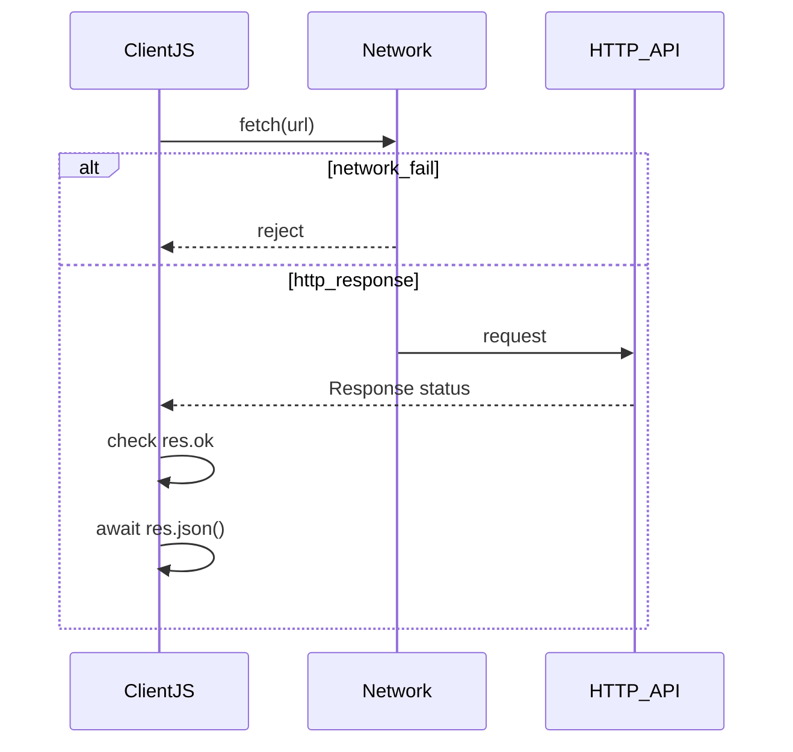

## Введение

UI не должен «зависать», пока ждёт ответ сервера: сеть и таймеры уходят в асинхронную модель. На собесе ждут три вещи: состояния Promise, синтаксис `async/await` поверх него и умение правильно читать `fetch` — особенно то, что HTTP 4xx/5xx *не* превращаются в reject сами по себе. Выбирайте `await` + проверка `response.ok` + `try/catch` для сетевых сбоев; цепочки `.then` оставляйте, когда так читабельнее или нужна композиция без async-функции.

## Раздел: Promise и состояния

Promise — объект отложенного результата. Три состояния: `pending` → `fulfilled` (успех с value) или `rejected` (причина-ошибка). Переход одноразовый. Подписаться можно через `.then` / `.catch` / `.finally` или через `await` внутри `async`-функции.

```js
function loadUser(id) {
  return fetch(`/api/users/${id}`).then((res) => {
    if (!res.ok) throw new Error(`HTTP ${res.status}`);
    return res.json();
  });
}

loadUser(1)
  .then((user) => console.log(user.name))
  .catch((err) => console.error(err.message));
```

`async function` всегда возвращает Promise: даже `return 42` станет fulfilled-промисом с `42`; брошенное исключение — reject.

**Типичная ошибка:** забыть `return` внутри `.then` и получить цепочку с `undefined` на следующем шаге.

## Раздел: async/await как сахар

`await` приостанавливает выполнение async-функции до settle промиса, не блокируя поток браузера целиком. Ошибки из reject и из `throw` ловят `try/catch`:

```js
async function loadUser(id) {
  try {
    const res = await fetch(`/api/users/${id}`);
    if (!res.ok) {
      throw new Error(`HTTP ${res.status}`);
    }
    const data = await res.json();
    return data;
  } catch (err) {
    console.error("load failed", err);
    throw err;
  }
}
```

Параллельные независимые запросы — `Promise.all([a(), b()])`, а не два последовательных `await`, если порядок не важен.

**Типичная ошибка:** ставить `await` в цикле по независимым URL и удивляться медленности — там нужен `Promise.all` (или ограниченный пул).

## Раздел: fetch, Response и ok

`fetch(url)` возвращает Promise&lt;Response&gt;. Тело ещё не прочитано: обычно второй шаг — `await res.json()` или `res.text()`. Сетевой сбой (DNS, offline) → reject. Ответ со статусом 404/500 → **fulfilled**, но `res.ok === false` (`ok` — статусы 200–299).

```js
const res = await fetch("/api/missing");
console.log(res.status); // 404
console.log(res.ok);     // false
// без проверки ok следующий json() может распарсить HTML-страницу ошибки
```

Для тестов QA важно: «запрос упал» и «сервер вернул 500» — разные наблюдения в DevTools (failed vs красный статус в Network).

**Типичная ошибка:** писать только `const data = await (await fetch(url)).json()` без `ok` и считать любой JSON успехом бизнес-логики.

## Раздел: Частые вопросы с собеседования

**Вопрос.** Microtasks после `await`?

**Ответ.** `await` разворачивается в Promise; продолжение async-функции — microtask. Цепочка await не блокирует UI-thread, но sync-код между await — блокирует. Promise.all для параллели, не await в цикле по независимым URL.

**Вопрос.** `let`/`const` в async-функции?

**Ответ.** const res = await fetch — одна ссылка на Response; let для накопления в цикле с ограничением. var в async ловушка TDZ/hoisting в старых скриптах. Блок scope помогает не утечь res наружу.

**Вопрос.** `typeof null` при разборе JSON поля?

**Ответ.** API может вернуть null; typeof null === "object" — не фильтр. Явно: value === null || value === undefined; для optional chaining — `obj?.field`.

## Лаба

**Цель.** Написать async-загрузку JSON с проверкой статуса и разбором ошибок.

**Шаги.**
1. Вызовите `fetch` на публичный JSON (или локальный mock) и дождитесь Response.
2. Добавьте второй `await` на `res.json()`.
3. Вставьте проверку `if (!res.ok) throw …` *до* разбора тела (или сразу после статуса).
4. Оберните в `try/catch` и залогируйте сообщение.
5. Подмените URL на заведомо 404: убедитесь, что без `ok` код «успешно» парсит мусор, а с `ok` — падает осмысленно.

**В группу:** один ломает URL/статус, второй пишет минимальный клиент, который различает network error и HTTP error.

**Готово, если…**
- [ ] Называете три состояния Promise
- [ ] Пишете async-функцию с await и try/catch
- [ ] Всегда проверяете `response.ok` перед доверием к телу

## Схема: Путь fetch



## Тест

### Какие три состояния есть у Promise?

**Ответ:** pending, fulfilled, rejected

**Пояснение:** после settle состояние не откатывается; подписчики получают итог.

### Что возвращает async-функция всегда?

**Ответ:** объект Promise

**Пояснение:** обычный `return` оборачивается в fulfilled; `throw` становится reject.

### Бросает ли fetch исключение на HTTP 404?

**Ответ:** нет, смотрите response.ok

**Пояснение:** reject обычно только на сетевом сбое; 4xx/5xx приходят как Response.

### Зачем второй await после fetch?

**Ответ:** прочитать и разобрать тело

**Пояснение:** первый await даёт Response; `json()`/`text()` — отдельный Promise.

### Чем Promise.all полезнее двух await подряд?

**Ответ:** параллельный запуск запросов

**Пояснение:** независимые промисы стартуют вместе; общий результат — когда все успешны (или fail-fast).

## Шпаргалка

<h3>Суть</h3>
<ul>
<li>Promise: pending → fulfilled | rejected</li>
<li>async/await — синтаксис над Promise</li>
<li>fetch → Response; тело читать отдельно</li>
<li>HTTP ошибки: проверяйте res.ok / status</li>
</ul>
<h3>Код</h3>
<pre><code>const res = await fetch(url);
if (!res.ok) throw new Error(`HTTP ${res.status}`);
const data = await res.json();
await Promise.all([loadA(), loadB()]);
</code></pre>

## Anki

### Front: В каких случаях fetch обычно переходит в rejected, а не в Response?

Back: при сетевых сбоях (нет связи, DNS и т.п.), не при обычном HTTP 404/500

### Front: Что означает свойство response.ok у Fetch API?

Back: true только для статусов 200–299

### Front: Почему цепочка then может вернуть undefined на следующем шаге?

Back: забыли return значения (или return промиса) из предыдущего then

### Front: Как обработать и reject промиса, и throw внутри async-функции одним блоком?

Back: обернуть await-код в try/catch — оба пути попадут в catch

### Front: Что вернёт вызов async function f() { return 1 } без await снаружи?

Back: Promise, который выполнится со значением 1

### Front: Когда для двух API-запросов выбрать Promise.all, а не последовательные await?

Back: когда запросы независимы и важна скорость параллельного ожидания

## Итоги

- Promise и async/await — один контракт, разный синтаксис
- `fetch` отдаёт Response; бизнес-успех проверяете сами через `ok`
- Параллельность — `Promise.all`, ошибки — явный throw + catch

## Ссылки

- [MDN: Using promises](https://developer.mozilla.org/en-US/docs/Web/JavaScript/Guide/Using_promises)
- [MDN: async function](https://developer.mozilla.org/en-US/docs/Web/JavaScript/Reference/Statements/async_function)
- [MDN: fetch](https://developer.mozilla.org/en-US/docs/Web/API/fetch)
- [MDN: Response.ok](https://developer.mozilla.org/en-US/docs/Web/API/Response/ok)
- [javascript.info: Промисы](https://javascript.info/promise-basics)
- [javascript.info: Fetch](https://javascript.info/fetch)
- Назад: [Функции и this](/game/learn/js-functions-this)
- Далее: [DOM и события](/game/learn/js-dom-events)
