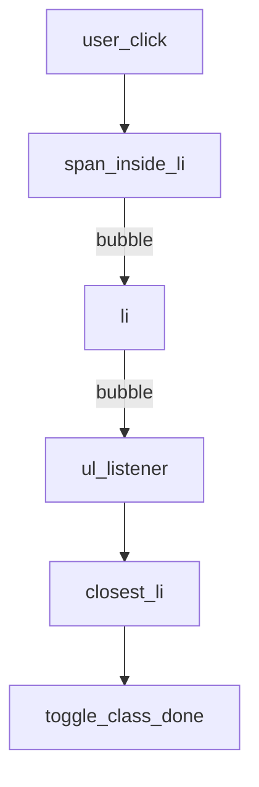
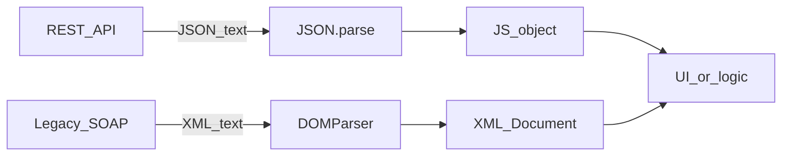
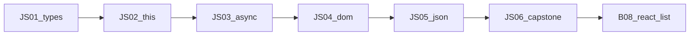

## Введение

Браузер рисует страницу как дерево узлов — Document Object Model. Разработчик меняет его скриптом; тестировщик ищет узлы в DevTools и пишет селекторы. На собесе ждут: как найти элемент, чем `textContent` безопаснее `innerHTML`, зачем один слушатель на родителе вместо N на каждом `li`. Выбирайте делегирование для динамических списков; для текста без разметки — `textContent`; `innerHTML` — только с доверенной разметкой или после санитизации.

**JSON и XML в браузере.** Клиент чаще всего говорит с API на JSON: компактно, родной синтаксис для объектов JS. XML жив в энтерпрайзе, SOAP и легаси-интеграциях. На собесе ждут: `JSON.parse` / `JSON.stringify`, что будет на битой строке, почему циклы ломают stringify, и что JSON — *не* «любой JS-объект». Выбирайте JSON для новых REST/HTTP API; XML — когда контракт уже SOAP/XSD или партнёр отдаёт только XML. Глубокая теория SOAP — в треке SA, здесь — браузерный минимум.

**Чеклист JS.** Закрывающий выпуск языкового трека JS: не новый синтаксис, а проверка, что вы *выбираете* правильный инструмент под вопрос собеса. Пройдите чеклист JS01–JS05, закройте пробелы, затем переходите к UI-компонентам — [b05-api-check](/game/learn/b05-api-check). React не отменяет typeof/`===`, this в колбэках, `fetch`+`ok`, делегирование идейно и JSON.parse: фреймворк садится поверх этой базы.

## Раздел: Как отвечать одним блоком

Этот выпуск собрал соседние короткие темы трека: «DOM и события», «JSON и XML в браузере», «Чеклист JS». Раньше каждая занимала отдельную карточку на несколько минут, а на собеседовании их спрашивают одним блоком. Ниже у каждой темы свой раздел, затем общие лабы, один тест и одна колода карточек. В ответе сначала назовите, какую тему спросили, потом определение и один пример. Не проговаривайте все разделы, если спросили один. Лабы можно пройти по порядку исходного трека. Если времени мало, сделайте первую и последнюю: первая ставит язык, последняя проверяет, что соседние темы вы не перепутали.

## Раздел: DOM и события: Поиск узлов и безопасный текст

Корень — `document`. Частые API: `querySelector` / `querySelectorAll` (CSS-селектор), `getElementById`, `closest` от события вверх по дереву.

```js
const list = document.querySelector("#todo-list");
const items = document.querySelectorAll("#todo-list li");

const title = document.querySelector("h1");
title.textContent = "Список задач"; // безопасно как текст
// title.innerHTML = userInput;    // опасно: разметка исполнится
```

`innerHTML` парсит HTML и может выполнить `<script>`/обработчики в разметке из недоверенного ввода — классический XSS в DOM. Для пользовательского текста — `textContent` или `createElement` + `textContent`.

**Типичная ошибка:** вставлять ответ API в `innerHTML` «чтобы заработали переносы» — переносы решают CSS/`<br>` из безопасного пайплайна, не сырой HTML от пользователя.

## Раздел: DOM и события: Слушатели событий

Регистрация: `element.addEventListener("click", handler)`. Удаление — той же ссылкой на функцию. В обработчике `event.target` — исходный узел события; `event.currentTarget` — узел, на котором висит слушатель.

```js
button.addEventListener("click", (event) => {
  event.preventDefault(); // для submit/ссылок
  console.log(event.currentTarget.id);
});
```

Фазы: capture (сверху вниз) и bubble (снизу вверх). По умолчанию слушатель на bubble. `stopPropagation` останавливает всплытие — используйте осознанно, иначе ломаете чужие делегированные обработчики.

**Типичная ошибка:** анонимная функция в `addEventListener` и невозможность снять слушатель при размонтировании — утечки в SPA.

## Раздел: DOM и события: Делегирование на родителе

Вместо слушателя на каждом пункте списка вешают один на `ul`/`tbody` и фильтруют `event.target`:

```js
const ul = document.querySelector("#todo-list");

ul.addEventListener("click", (event) => {
  const li = event.target.closest("li");
  if (!li || !ul.contains(li)) return;
  li.classList.toggle("done");
});
```

Плюсы: меньше подписок, новые `li` после `fetch` работают без повторной регистрации. QA видит стабильный контейнер в дереве, даже если строки перерисовываются.

**Типичная ошибка:** смотреть только на `event.target` без `closest` — клик по вложенному `<span>` внутри `li` «не находит» строку.

## Раздел: DOM и события: Частые вопросы с собеседования

**Вопрос.** `==` vs `===` при сравнении data-атрибутов?

**Ответ.** Атрибуты DOM приходят строками; `===` не приводит типы и предсказуемее в обработчике. `==` может сделать `"5" == 5` истинным и сломать ветку switch. Для nullable полей команда иногда согласует `x == null`, но id и флаги — только `===`. Это перекликается с выпуском JS01 про coerce.

**Вопрос.** Event loop и addEventListener?

**Ответ.** Обработчик click — sync на stack; если внутри await/fetch — продолжение позже microtask. Долгий handler блокирует отрисовку. debounce/throttle для input — macrotimer + знание loop.

**Вопрос.** `let` в цикле с listeners?

**Ответ.** До ES6 var в цикл давал один closure на все кнопки; let создаёт binding на итерацию. С делегированием проблема реже, но вопрос остаётся классикой.

## Раздел: JSON и XML в браузере: JSON.parse и JSON.stringify

JSON — текстовый формат: объекты, массивы, строки, числа, `true`/`false`/`null`. Нет функций, `undefined`, комментариев, `NaN`/`Infinity` как значений.

```js
const payload = { id: 1, tags: ["a", "b"], active: true };
const text = JSON.stringify(payload);
// '{"id":1,"tags":["a","b"],"active":true}'

const again = JSON.parse(text);
console.log(again.tags[0]); // "a"

try {
  JSON.parse('{"id":'); // обрезанная строка
} catch (err) {
  console.error(err instanceof SyntaxError); // true
}
```

Данные с сервера после parse — всё равно недоверенный ввод: проверяйте поля и типы перед рендером (см. XSS в DOM-выпуске).

**Типичная ошибка:** считать, что `JSON.parse` «валидирует бизнес-схему» — он только разбирает синтаксис JSON.

## Раздел: JSON и XML в браузере: Ловушки stringify и отличия от JS-объекта

`stringify` пропускает `undefined` в значениях объектов, функции и symbol-ключи; в массиве `undefined`/`function` становятся `null`. Даты превращаются в ISO-строки. Циклические ссылки без replacer → `TypeError`.

```js
const a = { name: "node" };
a.self = a;
// JSON.stringify(a); // TypeError: Converting circular structure to JSON

const withUndef = JSON.stringify({ x: undefined, y: 1 });
// '{"y":1}' — ключ x исчез
```

На собесе формулировка: «JSON — подмножество текстового представления данных; живой объект JS может содержать то, чего в JSON нет».

**Типичная ошибка:** клонировать объект через `parse(stringify(obj))` и ждать сохранения `Date`, `Map`, методов и `undefined`.

## Раздел: JSON и XML в браузере: XML рядом — DOMParser

Для XML-строки в браузере:

```js
const xmlText = `<note><to>QA</to><body>ping</body></note>`;
const doc = new DOMParser().parseFromString(xmlText, "application/xml");
const parseError = doc.querySelector("parsererror");
if (parseError) {
  throw new Error("invalid XML");
}
const to = doc.querySelector("to")?.textContent; // "QA"
```

Ответ `fetch` с XML читают как `await res.text()`, затем парсят. Не путайте с `res.json()`. Серверные контракты SOAP/XSD разбирают в [sa-soap-xml](/game/learn/sa-soap-xml); серверный Python json — в [py-oop-basics](/game/learn/py-oop-basics).

**Типичная ошибка:** кормить XML в `JSON.parse` или JSON в `DOMParser` с типом XML и читать «пустой» документ без проверки `parsererror`.

## Раздел: JSON и XML в браузере: Частые вопросы с собеседования

**Вопрос.** JSON.parse — когда бросает?

**Ответ.** SyntaxError на невалидный JSON (обрезанная строка, trailing comma в старых парсерах, NaN). Успешный parse не валидирует схему — только синтаксис. Оборачивайте try/catch и показывайте пользователю безопасное сообщение.

**Вопрос.** JSON.stringify и циклические ссылки?

**Ответ.** TypeError: Converting circular structure — без replacer/weak set. Клон через parse(stringify) теряет Date, undefined, функции. На собесе — знать ограничения, не «JSON = любой объект».

**Вопрос.** `fetch` + json vs text?

**Ответ.** res.json() для application/json; XML/SOAP — res.text() + DOMParser. Перед json проверьте ok и Content-Type при строгих контрактах.

**Вопрос.** `const` для parsed payload?

**Ответ.** const data = JSON.parse(text) — ссылку не переприсваивают; поля мутировать можно. Иммутабельность — дисциплина кода, не const.

## Раздел: Чеклист JS: Ответ вслух

По языку я объясняю тип, this и почему Promise раньше таймера. Для интерфейса добавляю: рисуется состояние, ключ списка — это личность элемента. Шести статей языка для фронтенда мало, и я так и говорю, если роль про React.

## Раздел: Чеклист JS: Плохой ответ

«Я знаю JavaScript, значит закрою фронтенд». Нет цикла событий, нет состояния, нет типов на границе сети.

## Раздел: Чеклист JS: Термины

Цикл событий — event loop. Состояние — state. Неизвестное значение — unknown.

## Раздел: Чеклист JS: Чеклист языкового трека

Пройдите вслух или письменно без подсказок:

1. **Типы (JS01):** примитивы, `===` vs `==`, falsy, `typeof null`.
2. **Функции (JS02):** first-class, потеря this, arrow vs `function`, роль `bind`.
3. **Async (JS03):** состояния Promise, `async` возвращает Promise, `fetch` ≠ авто-throw на 404.
4. **DOM (JS04):** `querySelector`, делегирование, `textContent` vs XSS через `innerHTML`.
5. **JSON/XML (JS05):** `parse`/`stringify`, SyntaxError, циклы, зачем DOMParser.

Если любой пункт «плавает» — вернитесь в соответствующий выпуск SERIES, не прыгайте сразу в React.

**Типичная ошибка:** учить хуки React, не умея объяснить, почему `await fetch` без `ok` «успешно» показывает пустой экран на 500.

## Раздел: Чеклист JS: Мини-сценарий end-to-end

Соберите в голове (или в 30–40 строках песочницы) поток:

```js
async function loadTodos(ul) {
  const res = await fetch("/api/todos");
  if (!res.ok) throw new Error(`HTTP ${res.status}`);
  const items = await res.json(); // ждать массив объектов
  ul.replaceChildren();
  for (const item of items) {
    const li = document.createElement("li");
    li.textContent = item.title; // не innerHTML
    ul.append(li);
  }
}

document.querySelector("#list").addEventListener("click", (e) => {
  const li = e.target.closest("li");
  if (li) li.classList.toggle("done");
});
```

Здесь сходятся все эпизоды: строгие проверки, async, безопасный DOM, делегирование, JSON. На собесе опишите этот поток своими словами за 2 минуты.

**Типичная ошибка:** вставлять `item.title` через `innerHTML`, «потому что так короче» — на drill это минус по безопасности.

## Раздел: Чеклист JS: Мост к React и карта серии

Дальше — компонентная модель, список и состояние: [b05-api-check](/game/learn/b05-api-check). Идеи переносятся: ключи списка ≈ стабильные id из JSON; обработчики ≈ слушатели; эффекты загрузки ≈ `async`+`fetch` с проверкой статуса. Индекс slug и порядок — в [SERIES.md](./SERIES.md) этой папки.

**Типичная ошибка:** считать capstone «можно пропустить» — на middle-собесе как раз просят связать язык с фреймворком в одном рассказе.

## Раздел: Чеклист JS: Частые вопросы с собеседования

**Вопрос.** `let`/`const`/`var` — итог серии?

**Ответ.** По умолчанию const для ссылок, let если переприсваиваете; var — legacy и hoisting-ловушки. TDZ объясняет ReferenceError до строки const.

**Вопрос.** Event loop checklist?

**Ответ.** Sync → microtasks (Promise) → macrotasks (setTimeout) → render. Связать с await/fetch и не блокировать UI sync-работой.

**Вопрос.** fetch + ok + json — минимум?

**Ответ.** await fetch; if (!res.ok) throw; await res.json(); catch network отдельно от HTTP.

**Вопрос.** Delegation + безопасный DOM?

**Ответ.** closest на списке; textContent вместо innerHTML для user/API текста.

## Лаба

**DOM и события.**

**Цель.** Сделать делегированный click по списку и сравнить с N отдельными слушателями.

**Шаги.**
1. Разметьте `ul#todo-list` с несколькими `li` (внутри — текст и вложенный `span`).
2. Повесьте один `click` на `ul`, через `closest("li")` переключайте класс.
3. Добавьте новый `li` через скрипт *после* регистрации слушателя — убедитесь, что клик работает.
4. Объясните вслух, почему не нужны N listeners.
5. Попробуйте (только локально) `li.innerHTML = ""` vs `textContent` — зафиксируйте риск XSS.

**В группу:** QA называет селектор из DevTools, разработчик показывает, какой узел реально получит делегированный обработчик.

**Готово, если…**
- [ ] Находите узлы через querySelector / closest
- [ ] Объясняете делегирование и target vs currentTarget
- [ ] Не вставляете недоверенный HTML через innerHTML

**JSON и XML в браузере.**

**Цель.** Прогнать счастливый путь JSON и сравнить идею дерева с XML.

**Шаги.**
1. Сделайте объект с вложенным массивом, выполните `stringify` и обратно `parse`.
2. Передайте в `parse` обрезанную строку — поймайте `SyntaxError` в `try/catch`.
3. Создайте объект с циклом `a.self = a` и убедитесь, что `stringify` бросает.
4. Разберите короткий XML через `DOMParser`, проверьте отсутствие `parsererror`.
5. Запишите в двух предложениях: когда в интеграции оставите XML, а когда настоятельно JSON.

**В группу:** один отдаёт битый JSON/XML, второй пишет защитный клиентский разбор с понятной ошибкой для UI.

**Готово, если…**
- [ ] Уверенно зовёте parse/stringify и ловите SyntaxError
- [ ] Знаете про циклы и «тихую» потерю undefined
- [ ] Можете указать на SA12/PY08 как канон соседних треков

**Чеклист JS.**

**Цель.** Drill из восьми шагов + явный переход к B08.

**Шаги.**
1. Напишите два выражения: одно где `==` true, а `===` false; объясните.
2. Покажите потерю this и починку стрелкой *или* bind.
3. Напишите async-загрузку с `ok` и `json()`; сломайте URL и опишите разницу network vs HTTP.
4. Реализуйте делегированный click на списке с `closest`.
5. Поймайте SyntaxError на битом JSON и TypeError на цикле в stringify.
6. Составьте personal gap-list (что повторить из JS01–JS05).
7. Откройте [b05-api-check](/game/learn/b05-api-check) и выпишите, какие три навыка языка там понадобятся сразу.
8. Прогоните тест и Anki этого выпуска без подсматривания в шпаргалку.

**В группу:** парный drill — 10 минут вопросов с обменом ролями interviewer/candidate.

**Готово, если…**
- [ ] Чеклист JS01–JS05 закрыт без критических дыр
- [ ] Можете рассказать e2e-сценарий fetch→JSON→DOM
- [ ] Есть явный следующий шаг в React B08

## Схема: DOM и события: Делегирование клика



## Схема: JSON и XML в браузере: Форматы на клиенте



## Схема: Чеклист JS: Трек JS → React



## Тест

### Зачем делегировать события на родителя?

**Ответ:** один слушатель на динамический список

**Пояснение:** новые элементы подхватываются без повторной подписки; меньше памяти и кода.

### Что бросает JSON.parse на синтаксически битой строке?

**Ответ:** SyntaxError

**Пояснение:** оборачивайте parse в try/catch и показывайте пользователю контролируемую ошибку.

### Куда логично идти после языкового трека JS?

**Ответ:** к React-списку B08

**Пояснение:** компоненты и state опираются на типы, async и работу с данными; язык не «закрывается» фреймворком.

### Чем textContent безопаснее innerHTML?

**Ответ:** не парсит HTML-разметку

**Пояснение:** пользовательский ввод остаётся текстом и не исполняет обработчики/скрипты.

### Почему JSON.stringify падает на объекте с циклом?

**Ответ:** TypeError на circular structure

**Пояснение:** без своего replacer движок не может сериализовать кольцо ссылок.

## Шпаргалка

<ul><li>querySelector — поиск по CSS; closest — вверх от target</li><li>textContent для текста; innerHTML — только доверенная разметка</li><li>делегирование: слушатель на родителе + bubble</li><li>target ≠ currentTarget</li><li>JSON.parse / JSON.stringify — основной путь REST-клиента</li><li>битый JSON → SyntaxError; цикл → TypeError</li><li>JSON ≠ полный JS-объект</li><li>XML: text → DOMParser → проверка parsererror</li><li>JS01: ===, falsy, typeof null</li><li>JS02: this от вызова; arrow лексический; bind</li><li>JS03: Promise + await; fetch → ok → json</li><li>JS04: delegation; textContent &gt; innerHTML для user data</li></ul>

## Anki

### Front: Чем event.target отличается от event.currentTarget?

Back: target — исходный узел события; currentTarget — элемент, на котором висит этот слушатель

### Front: Какие типы значений допускает формат JSON?

Back: object, array, string, number, true/false, null — без функций, undefined и комментариев

### Front: Назовите пять тем выпусков JS01–JS05 по порядку одной фразой каждую

Back: типы/coerce; функции и this; Promise/fetch; DOM/события; JSON и XML

### Front: Почему для динамического списка лучше один listener на ul?

Back: новые li получают обработку через всплытие без повторной регистрации

### Front: Что произойдёт при JSON.parse('{"a":')?

Back: будет выброшен SyntaxError из-за незакрытого синтаксиса

### Front: Какой минимальный набор проверок нужен после await fetch перед рендером списка?

Back: проверить ok/status, затем json(), затем валидировать форму данных перед textContent

## Мнемоника

### link: Клик

**Задание:** Путь события.

**Элементы:**
- цель
- всплытие
- обработчик
- stop

**Подсказка:** Делегирование слушает предка и смотрит target.

**Ответ:** target → bubble → handler → stop

## Итоги

- DOM — общее поле QA (селекторы) и разработки (мутации)
- Делегирование масштабирует списки и переживает перерисовку
- `innerHTML` с чужими данными — прямой путь к XSS
- JSON — дефолт современных HTTP API на клиенте
- parse/stringify требуют явной обработки ошибок и понимания потерь данных
- XML в браузере — DOMParser; контракты SOAP — соседний трек SA
- Языковой трек закрывается умением выбирать инструмент, а не списком API
- E2E-связка fetch → JSON → безопасный DOM — хороший рассказ на middle

## Ссылки

- [MDN: Introduction to the DOM](https://developer.mozilla.org/en-US/docs/Web/API/Document_Object_Model/Introduction)
- [MDN: EventTarget.addEventListener](https://developer.mozilla.org/en-US/docs/Web/API/EventTarget/addEventListener)
- [MDN: Event delegation](https://developer.mozilla.org/en-US/docs/Learn/JavaScript/Building_blocks/Events#event_delegation)
- [MDN: Element.innerHTML — security](https://developer.mozilla.org/en-US/docs/Web/API/Element/innerHTML#security_considerations)
- [javascript.info: DOM-дерево](https://javascript.info/dom-nodes)
- [javascript.info: Делегирование событий](https://javascript.info/event-delegation)
- [Web / HTTP / API basics](/game/learn/qa-docs-plan-cases)
- [Promise, async/await и fetch](/game/learn/js-types-coerce)
- [MDN: JSON](https://developer.mozilla.org/en-US/docs/Web/JavaScript/Reference/Global_Objects/JSON)
- [MDN: JSON.parse](https://developer.mozilla.org/en-US/docs/Web/JavaScript/Reference/Global_Objects/JSON/parse)
- [MDN: DOMParser](https://developer.mozilla.org/en-US/docs/Web/API/DOMParser)
- [javascript.info: JSON](https://javascript.info/json)
- [sa-soap-xml](/game/learn/sa-soap-xml)
- [py-oop-basics](/game/learn/py-oop-basics)
- [MDN: JavaScript Guide](https://developer.mozilla.org/en-US/docs/Web/JavaScript/Guide)
- [MDN: fetch](https://developer.mozilla.org/en-US/docs/Web/API/fetch)
- [MDN: Document Object Model](https://developer.mozilla.org/en-US/docs/Web/API/Document_Object_Model)
- [ECMA-262](https://tc39.es/ecma262/)
- [javascript.info](https://javascript.info/)
- [SERIES.md](./SERIES.md)
- [React list — B08](/game/learn/b05-api-check)
