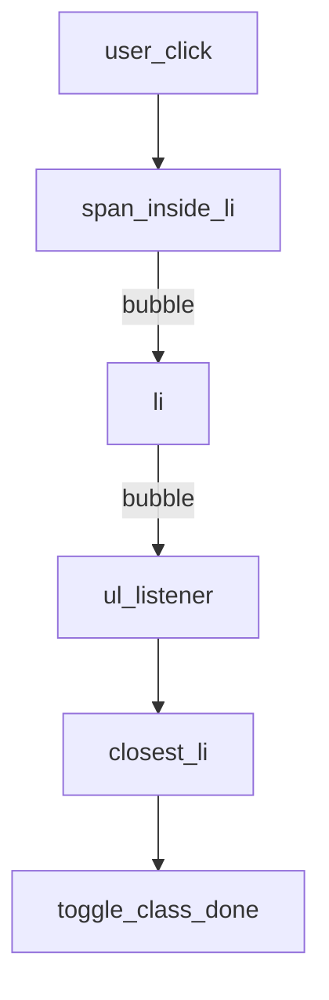

## Введение

Браузер рисует страницу как дерево узлов — Document Object Model. Разработчик меняет его скриптом; тестировщик ищет узлы в DevTools и пишет селекторы. На собесе ждут: как найти элемент, чем `textContent` безопаснее `innerHTML`, зачем один слушатель на родителе вместо N на каждом `li`. Выбирайте делегирование для динамических списков; для текста без разметки — `textContent`; `innerHTML` — только с доверенной разметкой или после санитизации.

## Раздел: Поиск узлов и безопасный текст

Корень — `document`. Частые API: `querySelector` / `querySelectorAll` (CSS-селектор), `getElementById`, `closest` от события вверх по дереву.

```js
const list = document.querySelector("#todo-list");
const items = document.querySelectorAll("#todo-list li");

const title = document.querySelector("h1");
title.textContent = "Список задач"; // безопасно как текст
// title.innerHTML = userInput;    // опасно: разметка исполнится
```

`innerHTML` парсит HTML и может выполнить `<script>`/обработчики в разметке из недоверенного ввода — классический XSS в DOM. Для пользовательского текста — `textContent` или `createElement` + `textContent`.

**Типичная ошибка:** вставлять ответ API в `innerHTML` «чтобы заработали переносы» — переносы решают CSS/`<br>` из безопасного пайплайна, не сырой HTML от пользователя.

## Раздел: Слушатели событий

Регистрация: `element.addEventListener("click", handler)`. Удаление — той же ссылкой на функцию. В обработчике `event.target` — исходный узел события; `event.currentTarget` — узел, на котором висит слушатель.

```js
button.addEventListener("click", (event) => {
  event.preventDefault(); // для submit/ссылок
  console.log(event.currentTarget.id);
});
```

Фазы: capture (сверху вниз) и bubble (снизу вверх). По умолчанию слушатель на bubble. `stopPropagation` останавливает всплытие — используйте осознанно, иначе ломаете чужие делегированные обработчики.

**Типичная ошибка:** анонимная функция в `addEventListener` и невозможность снять слушатель при размонтировании — утечки в SPA.

## Раздел: Делегирование на родителе

Вместо слушателя на каждом пункте списка вешают один на `ul`/`tbody` и фильтруют `event.target`:

```js
const ul = document.querySelector("#todo-list");

ul.addEventListener("click", (event) => {
  const li = event.target.closest("li");
  if (!li || !ul.contains(li)) return;
  li.classList.toggle("done");
});
```

Плюсы: меньше подписок, новые `li` после `fetch` работают без повторной регистрации. QA видит стабильный контейнер в дереве, даже если строки перерисовываются.

**Типичная ошибка:** смотреть только на `event.target` без `closest` — клик по вложенному `<span>` внутри `li` «не находит» строку.

## Раздел: Частые вопросы с собеседования

**Вопрос.** `==` vs `===` при сравнении data-атрибутов?

**Ответ.** Атрибуты DOM приходят строками; `===` не приводит типы и предсказуемее в обработчике. `==` может сделать `"5" == 5` истинным и сломать ветку switch. Для nullable полей команда иногда согласует `x == null`, но id и флаги — только `===`. Это перекликается с выпуском JS01 про coerce.

**Вопрос.** Event loop и addEventListener?

**Ответ.** Обработчик click — sync на stack; если внутри await/fetch — продолжение позже microtask. Долгий handler блокирует отрисовку. debounce/throttle для input — macrotimer + знание loop.

**Вопрос.** `let` в цикле с listeners?

**Ответ.** До ES6 var в цикл давал один closure на все кнопки; let создаёт binding на итерацию. С делегированием проблема реже, но вопрос остаётся классикой.

## Лаба

**Цель.** Сделать делегированный click по списку и сравнить с N отдельными слушателями.

**Шаги.**
1. Разметьте `ul#todo-list` с несколькими `li` (внутри — текст и вложенный `span`).
2. Повесьте один `click` на `ul`, через `closest("li")` переключайте класс.
3. Добавьте новый `li` через скрипт *после* регистрации слушателя — убедитесь, что клик работает.
4. Объясните вслух, почему не нужны N listeners.
5. Попробуйте (только локально) `li.innerHTML = ""` vs `textContent` — зафиксируйте риск XSS.

**В группу:** QA называет селектор из DevTools, разработчик показывает, какой узел реально получит делегированный обработчик.

**Готово, если…**
- [ ] Находите узлы через querySelector / closest
- [ ] Объясняете делегирование и target vs currentTarget
- [ ] Не вставляете недоверенный HTML через innerHTML

## Схема: Делегирование клика



## Тест

### Зачем делегировать события на родителя?

**Ответ:** один слушатель на динамический список

**Пояснение:** новые элементы подхватываются без повторной подписки; меньше памяти и кода.

### Чем textContent безопаснее innerHTML?

**Ответ:** не парсит HTML-разметку

**Пояснение:** пользовательский ввод остаётся текстом и не исполняет обработчики/скрипты.

### Что такое event.target при клике по вложенному span?

**Ответ:** сам span как источник

**Пояснение:** currentTarget при делегировании — родитель со слушателем; до li доходят через closest.

### Какой риск у присвоения сырого API-HTML в innerHTML?

**Ответ:** DOM XSS

**Пояснение:** вредоносная разметка выполняется в контексте страницы пользователя.

### Чем addEventListener лучше onclick-свойства?

**Ответ:** несколько независимых обработчиков

**Пояснение:** свойство `onclick` перезаписывается; listener API позволяет снимать конкретную функцию.

## Шпаргалка

<h3>Суть</h3>
<ul>
<li>querySelector — поиск по CSS; closest — вверх от target</li>
<li>textContent для текста; innerHTML — только доверенная разметка</li>
<li>делегирование: слушатель на родителе + bubble</li>
<li>target ≠ currentTarget</li>
</ul>
<h3>Код</h3>
<pre><code>el.addEventListener("click", handler);
const li = event.target.closest("li");
node.textContent = userString; // ok
// node.innerHTML = userString; // XSS risk
</code></pre>

## Anki

### Front: Чем event.target отличается от event.currentTarget?

Back: target — исходный узел события; currentTarget — элемент, на котором висит этот слушатель

### Front: Почему для динамического списка лучше один listener на ul?

Back: новые li получают обработку через всплытие без повторной регистрации

### Front: Как найти li, если пользователь кликнул по вложенному span?

Back: вызвать event.target.closest("li") и проверить, что узел внутри нужного родителя

### Front: Какой API вставить пользовательскую строку в DOM без HTML-парсинга?

Back: textContent (или создать Text-узел), не innerHTML

### Front: Что делает event.preventDefault в обработчике submit?

Back: отменяет действие браузера по умолчанию (отправка формы / переход по ссылке)

### Front: Почему анонимная функция в addEventListener мешает очистке?

Back: removeEventListener требует ту же ссылку на функцию — анонимку не снять

## Итоги

- DOM — общее поле QA (селекторы) и разработки (мутации)
- Делегирование масштабирует списки и переживает перерисовку
- `innerHTML` с чужими данными — прямой путь к XSS

## Ссылки

- [MDN: Introduction to the DOM](https://developer.mozilla.org/en-US/docs/Web/API/Document_Object_Model/Introduction)
- [MDN: EventTarget.addEventListener](https://developer.mozilla.org/en-US/docs/Web/API/EventTarget/addEventListener)
- [MDN: Event delegation](https://developer.mozilla.org/en-US/docs/Learn/JavaScript/Building_blocks/Events#event_delegation)
- [MDN: Element.innerHTML — security](https://developer.mozilla.org/en-US/docs/Web/API/Element/innerHTML#security_considerations)
- [javascript.info: DOM-дерево](https://javascript.info/dom-nodes)
- [javascript.info: Делегирование событий](https://javascript.info/event-delegation)
- Связка QA: [Web / HTTP / API basics](/game/learn/qa-web-http-api-basics)
- Назад: [Promise, async/await и fetch](/game/learn/js-async-fetch)
- Далее: [JSON и XML](/game/learn/js-json-xml)
