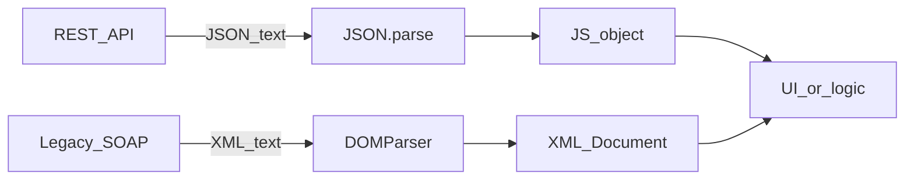

## Введение

Клиент чаще всего говорит с API на JSON: компактно, родной синтаксис для объектов JS. XML жив в энтерпрайзе, SOAP и легаси-интеграциях. На собесе ждут: `JSON.parse` / `JSON.stringify`, что будет на битой строке, почему циклы ломают stringify, и что JSON — *не* «любой JS-объект». Выбирайте JSON для новых REST/HTTP API; XML — когда контракт уже SOAP/XSD или партнёр отдаёт только XML. Глубокая теория SOAP — в треке SA, здесь — браузерный минимум.

## Раздел: JSON.parse и JSON.stringify

JSON — текстовый формат: объекты, массивы, строки, числа, `true`/`false`/`null`. Нет функций, `undefined`, комментариев, `NaN`/`Infinity` как значений.

```js
const payload = { id: 1, tags: ["a", "b"], active: true };
const text = JSON.stringify(payload);
// '{"id":1,"tags":["a","b"],"active":true}'

const again = JSON.parse(text);
console.log(again.tags[0]); // "a"

try {
  JSON.parse('{"id":'); // обрезанная строка
} catch (err) {
  console.error(err instanceof SyntaxError); // true
}
```

Данные с сервера после parse — всё равно недоверенный ввод: проверяйте поля и типы перед рендером (см. XSS в DOM-выпуске).

**Типичная ошибка:** считать, что `JSON.parse` «валидирует бизнес-схему» — он только разбирает синтаксис JSON.

## Раздел: Ловушки stringify и отличия от JS-объекта

`stringify` пропускает `undefined` в значениях объектов, функции и symbol-ключи; в массиве `undefined`/`function` становятся `null`. Даты превращаются в ISO-строки. Циклические ссылки без replacer → `TypeError`.

```js
const a = { name: "node" };
a.self = a;
// JSON.stringify(a); // TypeError: Converting circular structure to JSON

const withUndef = JSON.stringify({ x: undefined, y: 1 });
// '{"y":1}' — ключ x исчез
```

На собесе формулировка: «JSON — подмножество текстового представления данных; живой объект JS может содержать то, чего в JSON нет».

**Типичная ошибка:** клонировать объект через `parse(stringify(obj))` и ждать сохранения `Date`, `Map`, методов и `undefined`.

## Раздел: XML рядом — DOMParser

Для XML-строки в браузере:

```js
const xmlText = `<note><to>QA</to><body>ping</body></note>`;
const doc = new DOMParser().parseFromString(xmlText, "application/xml");
const parseError = doc.querySelector("parsererror");
if (parseError) {
  throw new Error("invalid XML");
}
const to = doc.querySelector("to")?.textContent; // "QA"
```

Ответ `fetch` с XML читают как `await res.text()`, затем парсят. Не путайте с `res.json()`. Серверные контракты SOAP/XSD разбирают в [sa-soap-xml](/game/learn/sa-soap-xml); серверный Python json — в [py-stdlib-re-json-copy](/game/learn/py-stdlib-re-json-copy).

**Типичная ошибка:** кормить XML в `JSON.parse` или JSON в `DOMParser` с типом XML и читать «пустой» документ без проверки `parsererror`.

## Раздел: Частые вопросы с собеседования

**Вопрос.** JSON.parse — когда бросает?

**Ответ.** SyntaxError на невалидный JSON (обрезанная строка, trailing comma в старых парсерах, NaN). Успешный parse не валидирует схему — только синтаксис. Оборачивайте try/catch и показывайте пользователю безопасное сообщение.

**Вопрос.** JSON.stringify и циклические ссылки?

**Ответ.** TypeError: Converting circular structure — без replacer/weak set. Клон через parse(stringify) теряет Date, undefined, функции. На собесе — знать ограничения, не «JSON = любой объект».

**Вопрос.** `fetch` + json vs text?

**Ответ.** res.json() для application/json; XML/SOAP — res.text() + DOMParser. Перед json проверьте ok и Content-Type при строгих контрактах.

**Вопрос.** `const` для parsed payload?

**Ответ.** const data = JSON.parse(text) — ссылку не переприсваивают; поля мутировать можно. Иммутабельность — дисциплина кода, не const.

## Лаба

**Цель.** Прогнать счастливый путь JSON и сравнить идею дерева с XML.

**Шаги.**
1. Сделайте объект с вложенным массивом, выполните `stringify` и обратно `parse`.
2. Передайте в `parse` обрезанную строку — поймайте `SyntaxError` в `try/catch`.
3. Создайте объект с циклом `a.self = a` и убедитесь, что `stringify` бросает.
4. Разберите короткий XML через `DOMParser`, проверьте отсутствие `parsererror`.
5. Запишите в двух предложениях: когда в интеграции оставите XML, а когда настоятельно JSON.

**В группу:** один отдаёт битый JSON/XML, второй пишет защитный клиентский разбор с понятной ошибкой для UI.

**Готово, если…**
- [ ] Уверенно зовёте parse/stringify и ловите SyntaxError
- [ ] Знаете про циклы и «тихую» потерю undefined
- [ ] Можете указать на SA12/PY08 как канон соседних треков

## Схема: Форматы на клиенте



## Тест

### Что бросает JSON.parse на синтаксически битой строке?

**Ответ:** SyntaxError

**Пояснение:** оборачивайте parse в try/catch и показывайте пользователю контролируемую ошибку.

### Почему JSON.stringify падает на объекте с циклом?

**Ответ:** TypeError на circular structure

**Пояснение:** без своего replacer движок не может сериализовать кольцо ссылок.

### Чем JSON отличается от произвольного объекта JS?

**Ответ:** нет функций и undefined в формате

**Пояснение:** JSON — текст с ограниченным набором типов; объект JS богаче и может быть циклическим.

### Как в браузере разобрать XML-строку в дерево?

**Ответ:** DOMParser.parseFromString

**Пояснение:** затем проверьте `parsererror` и читайте узлы через DOM API.

### Куда уходит ключ со значением undefined при stringify?

**Ответ:** ключ исчезает из результата

**Пояснение:** в массивах `undefined` становится `null`; это частый сюрприз при отладке payload.

## Шпаргалка

<h3>Суть</h3>
<ul>
<li>JSON.parse / JSON.stringify — основной путь REST-клиента</li>
<li>битый JSON → SyntaxError; цикл → TypeError</li>
<li>JSON ≠ полный JS-объект</li>
<li>XML: text → DOMParser → проверка parsererror</li>
</ul>
<h3>Код</h3>
<pre><code>JSON.stringify(obj)
JSON.parse(text)              // try/catch SyntaxError
new DOMParser().parseFromString(xml, "application/xml")
</code></pre>

## Anki

### Front: Какие типы значений допускает формат JSON?

Back: object, array, string, number, true/false, null — без функций, undefined и комментариев

### Front: Что произойдёт при JSON.parse('{"a":')?

Back: будет выброшен SyntaxError из-за незакрытого синтаксиса

### Front: Почему clone через parse(stringify(x)) портит Date?

Back: Date становится ISO-строкой; после parse это обычная string, не Date

### Front: Как обнаружить ошибку разбора XML после DOMParser?

Back: найти узел parsererror в полученном Document

### Front: Что делает JSON.stringify с методом объекта (function)?

Back: пропускает такое свойство — функции не входят в JSON

### Front: Когда на интеграции оставить XML вместо перевода всего на JSON?

Back: когда контракт партнёра/SOAP/XSD уже зафиксирован и смена формата дороже поддержки парсера

## Итоги

- JSON — дефолт современных HTTP API на клиенте
- parse/stringify требуют явной обработки ошибок и понимания потерь данных
- XML в браузере — DOMParser; контракты SOAP — соседний трек SA

## Ссылки

- [MDN: JSON](https://developer.mozilla.org/en-US/docs/Web/JavaScript/Reference/Global_Objects/JSON)
- [MDN: JSON.parse](https://developer.mozilla.org/en-US/docs/Web/JavaScript/Reference/Global_Objects/JSON/parse)
- [MDN: DOMParser](https://developer.mozilla.org/en-US/docs/Web/API/DOMParser)
- [javascript.info: JSON](https://javascript.info/json)
- Канон XML/SOAP: [sa-soap-xml](/game/learn/sa-soap-xml)
- Python json: [py-stdlib-re-json-copy](/game/learn/py-stdlib-re-json-copy)
- Назад: [DOM и события](/game/learn/js-dom-events)
- Далее: [Capstone JavaScript](/game/learn/js-capstone)
