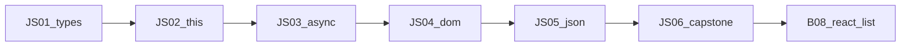

## Введение

Закрывающий выпуск языкового трека JS: не новый синтаксис, а проверка, что вы *выбираете* правильный инструмент под вопрос собеса. Пройдите чеклист JS01–JS05, закройте пробелы, затем переходите к UI-компонентам — [b08-react-list](/game/learn/b08-react-list). React не отменяет typeof/`===`, this в колбэках, `fetch`+`ok`, делегирование идейно и JSON.parse: фреймворк садится поверх этой базы.

## Раздел: Чеклист языкового трека

Пройдите вслух или письменно без подсказок:

1. **Типы (JS01):** примитивы, `===` vs `==`, falsy, `typeof null`.
2. **Функции (JS02):** first-class, потеря this, arrow vs `function`, роль `bind`.
3. **Async (JS03):** состояния Promise, `async` возвращает Promise, `fetch` ≠ авто-throw на 404.
4. **DOM (JS04):** `querySelector`, делегирование, `textContent` vs XSS через `innerHTML`.
5. **JSON/XML (JS05):** `parse`/`stringify`, SyntaxError, циклы, зачем DOMParser.

Если любой пункт «плавает» — вернитесь в соответствующий выпуск SERIES, не прыгайте сразу в React.

**Типичная ошибка:** учить хуки React, не умея объяснить, почему `await fetch` без `ok` «успешно» показывает пустой экран на 500.

## Раздел: Мини-сценарий end-to-end

Соберите в голове (или в 30–40 строках песочницы) поток:

```js
async function loadTodos(ul) {
  const res = await fetch("/api/todos");
  if (!res.ok) throw new Error(`HTTP ${res.status}`);
  const items = await res.json(); // ждать массив объектов
  ul.replaceChildren();
  for (const item of items) {
    const li = document.createElement("li");
    li.textContent = item.title; // не innerHTML
    ul.append(li);
  }
}

document.querySelector("#list").addEventListener("click", (e) => {
  const li = e.target.closest("li");
  if (li) li.classList.toggle("done");
});
```

Здесь сходятся все эпизоды: строгие проверки, async, безопасный DOM, делегирование, JSON. На собесе опишите этот поток своими словами за 2 минуты.

**Типичная ошибка:** вставлять `item.title` через `innerHTML`, «потому что так короче» — на drill это минус по безопасности.

## Раздел: Мост к React и карта серии

Дальше — компонентная модель, список и состояние: [b08-react-list](/game/learn/b08-react-list). Идеи переносятся: ключи списка ≈ стабильные id из JSON; обработчики ≈ слушатели; эффекты загрузки ≈ `async`+`fetch` с проверкой статуса. Индекс slug и порядок — в [SERIES.md](./SERIES.md) этой папки.

**Типичная ошибка:** считать capstone «можно пропустить» — на middle-собесе как раз просят связать язык с фреймворком в одном рассказе.

## Раздел: Частые вопросы с собеседования

**Вопрос.** `let`/`const`/`var` — итог серии?

**Ответ.** По умолчанию const для ссылок, let если переприсваиваете; var — legacy и hoisting-ловушки. TDZ объясняет ReferenceError до строки const.

**Вопрос.** Event loop checklist?

**Ответ.** Sync → microtasks (Promise) → macrotasks (setTimeout) → render. Связать с await/fetch и не блокировать UI sync-работой.

**Вопрос.** fetch + ok + json — минимум?

**Ответ.** await fetch; if (!res.ok) throw; await res.json(); catch network отдельно от HTTP.

**Вопрос.** Delegation + безопасный DOM?

**Ответ.** closest на списке; textContent вместо innerHTML для user/API текста.

## Лаба

**Цель.** Drill из восьми шагов + явный переход к B08.

**Шаги.**
1. Напишите два выражения: одно где `==` true, а `===` false; объясните.
2. Покажите потерю this и починку стрелкой *или* bind.
3. Напишите async-загрузку с `ok` и `json()`; сломайте URL и опишите разницу network vs HTTP.
4. Реализуйте делегированный click на списке с `closest`.
5. Поймайте SyntaxError на битом JSON и TypeError на цикле в stringify.
6. Составьте personal gap-list (что повторить из JS01–JS05).
7. Откройте [b08-react-list](/game/learn/b08-react-list) и выпишите, какие три навыка языка там понадобятся сразу.
8. Прогоните тест и Anki этого выпуска без подсматривания в шпаргалку.

**В группу:** парный drill — 10 минут вопросов с обменом ролями interviewer/candidate.

**Готово, если…**
- [ ] Чеклист JS01–JS05 закрыт без критических дыр
- [ ] Можете рассказать e2e-сценарий fetch→JSON→DOM
- [ ] Есть явный следующий шаг в React B08

## Схема: Трек JS → React



## Тест

### Куда логично идти после языкового трека JS?

**Ответ:** к React-списку B08

**Пояснение:** компоненты и state опираются на типы, async и работу с данными; язык не «закрывается» фреймворком.

### Какой оператор сравнения брать по умолчанию в условиях?

**Ответ:** строгий ===

**Пояснение:** без неявного coerce проще тесты и меньше сюрпризов на собесе и в ревью.

### Что проверить у Response до доверия к JSON?

**Ответ:** response.ok или status

**Пояснение:** fetch не reject на 404/500; без проверки можно распарсить тело ошибки как данные.

### Чем делегирование выигрывает у N listeners на li?

**Ответ:** один обработчик на родителя

**Пояснение:** динамические строки и меньше подписок; клик ловят через bubble и closest.

### Чем опасен innerHTML с полями из JSON API?

**Ответ:** риск DOM XSS

**Пояснение:** заголовок или комментарий из API может содержать разметку; для текста нужен textContent.

## Шпаргалка

<h3>Суть трека</h3>
<ul>
<li>JS01: ===, falsy, typeof null</li>
<li>JS02: this от вызова; arrow лексический; bind</li>
<li>JS03: Promise + await; fetch → ok → json</li>
<li>JS04: delegation; textContent &gt; innerHTML для user data</li>
<li>JS05: parse/stringify; XML через DOMParser</li>
<li>Далее: React B08</li>
</ul>
<h3>Мини-чеклист собеса</h3>
<pre><code>=== default | this loss demo | res.ok | closest(li) | try/catch JSON.parse
</code></pre>

## Anki

### Front: Назовите пять тем выпусков JS01–JS05 по порядку одной фразой каждую

Back: типы/coerce; функции и this; Promise/fetch; DOM/события; JSON и XML

### Front: Какой минимальный набор проверок нужен после await fetch перед рендером списка?

Back: проверить ok/status, затем json(), затем валидировать форму данных перед textContent

### Front: Как в одном рассказе связать потерю this и обработчик клика на кнопке метода объекта?

Back: метод, переданный как колбэк, теряет владельца — чинят bind, обёрткой или стрелкой с лексическим this

### Front: Почему capstone советует textContent при отрисовке title из JSON?

Back: поля API недоверенные; textContent не исполняет HTML и снижает XSS

### Front: Какой следующий учебный модуль после js-capstone в карте 9to18?

Back: выпуск b08-react-list — списки и компоненты поверх языковой базы

### Front: Чем личный gap-list после drill полезнее простого «я всё повторил»?

Back: фиксирует конкретные дыры по эпизодам и даёт план возврата в JS01–JS05 до React

## Итоги

- Языковой трек закрывается умением выбирать инструмент, а не списком API
- E2E-связка fetch → JSON → безопасный DOM — хороший рассказ на middle
- Следующий шаг — React B08, не вместо базы, а поверх неё

## Ссылки

- [MDN: JavaScript Guide](https://developer.mozilla.org/en-US/docs/Web/JavaScript/Guide)
- [MDN: fetch](https://developer.mozilla.org/en-US/docs/Web/API/fetch)
- [MDN: Document Object Model](https://developer.mozilla.org/en-US/docs/Web/API/Document_Object_Model)
- [ECMA-262](https://tc39.es/ecma262/)
- [javascript.info](https://javascript.info/)
- Карта серии: [SERIES.md](./SERIES.md)
- Назад: [JSON и XML](/game/learn/js-json-xml)
- Далее: [React list — B08](/game/learn/b08-react-list)
