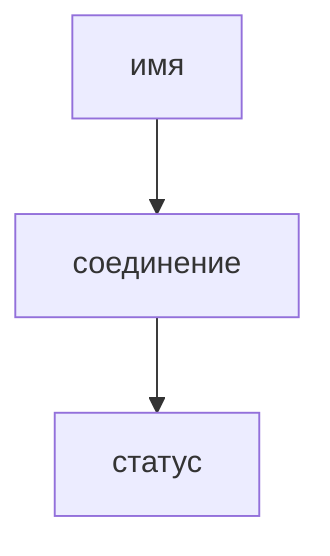

## Введение

Пока имя не превратилось в адрес, HTTP не начинался. Когда начался, у запроса есть метод и у ответа есть статус. Путать «сайт не открывается» и «сервер вернул 500» — обычная потеря времени.

## Раздел: Развести симптомы

Имя не найдено — DNS. Соединение отвалилось по таймауту — до статуса дело не дошло. 404 — маршрут. 500 — приложение уже работало и сломалось. 401 — нет узнавания, 403 — узнали, но нельзя.

## Раздел: Ответ вслух

Я сначала спрашиваю, резолвится ли имя. Потом есть ли TCP. Потом какой статус. 404 и 500 — разные этажи. 401 и 403 тоже не одно и то же: не узнали или узнали и запретили.

## Раздел: Плохой ответ

Плохой ответ: «сервер не работает» на любой симптом. Нет этажа поломки.

## Раздел: Термины

Имя — DNS. Метод — HTTP method. Не узнали — 401 Unauthorized. Нельзя — 403 Forbidden.

## Лаба

**15 минут.** Возьмите один свой недавний сбой и подпишите этаж: DNS, соединение, 4xx или 5xx.

## Схема: Этажи

## Тест

### Браузер: сервер не найден. Чинить JSON API?

**Ответ:** нет, сначала DNS

**Пояснение:** Запроса ещё не было.

### Статус 500. До приложения дошли?

**Ответ:** да

**Пояснение:** Приложение или прокси уже отвечали.

### 401 и 403. В чём разница?

**Ответ:** не узнали или нельзя

**Пояснение:** 403 бывает и у уже вошедшего.

### 404 на статике, API жив. Кто врёт?

**Ответ:** маршрут статики

**Пояснение:** Не обязательно весь сервис.

### Таймаут без статуса. Это 500?

**Ответ:** нет

**Пояснение:** Ответа не было.

## Шпаргалка

<ul><li>Сначала этаж поломки</li><li>401 не равен 403</li><li>Таймаут не статус</li></ul>

## Anki

### Front: Что делает DNS?

Back: Имя в адрес.

### Front: Таймаут — это 500?

Back: Нет, статуса не было.

### Front: 404?

Back: Ресурс или маршрут не найден.

### Front: 500?

Back: Сервер взял запрос и сломался.

### Front: 401?

Back: Не узнали вызывающего.

### Front: 403?

Back: Узнали, но действие запрещено.

## Итоги

- Сначала этаж поломки
- 401 не равен 403
- Таймаут не статус

## Ссылки

- [TCP](/game/learn/net-tcp-udp)
- [HTTP для QA](/game/learn/qa-web-http-api-basics)
