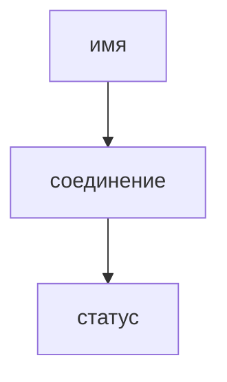
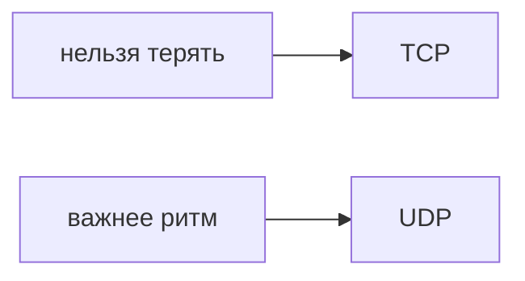
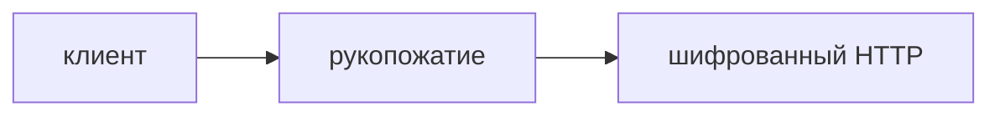
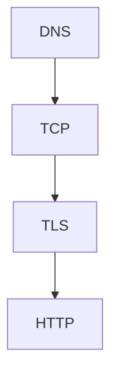

## Введение

Пока имя не превратилось в адрес, HTTP не начинался. Когда начался, у запроса есть метод и у ответа есть статус. Путать «сайт не открывается» и «сервер вернул 500» — обычная потеря времени.

**TCP и UDP.** TCP ставит соединение и досылает потерянное. UDP шлёт датаграмму и не обещает, что её приняли. Выбор — про цену задержки, не про «современность».

**TLS.** HTTPS — HTTP внутри TLS. Клиент проверяет, что сертификат выдан этому имени цепочкой, которой он верит, и дальше канал шифруется. Это не список прав пользователя.

**Разбор сетей.** Соберите путь в одну цепочку и не перескакивайте. Этого хватает на большинство вводных вопросов про «почему не открывается».

## Раздел: Как отвечать одним блоком

Этот выпуск собрал соседние короткие темы трека: «DNS и HTTP», «TCP и UDP», «TLS», «Разбор сетей». Раньше каждая занимала отдельную карточку на несколько минут, а на собеседовании их спрашивают одним блоком. Ниже у каждой темы свой раздел, затем общие лабы, один тест и одна колода карточек. В ответе сначала назовите, какую тему спросили, потом определение и один пример. Не проговаривайте все разделы, если спросили один. Лабы можно пройти по порядку исходного трека. Если времени мало, сделайте первую и последнюю: первая ставит язык, последняя проверяет, что соседние темы вы не перепутали.

## Раздел: DNS и HTTP: Развести симптомы

Имя не найдено — DNS. Соединение отвалилось по таймауту — до статуса дело не дошло. 404 — маршрут. 500 — приложение уже работало и сломалось. 401 — нет узнавания, 403 — узнали, но нельзя.

## Раздел: DNS и HTTP: Ответ вслух

Я сначала спрашиваю, резолвится ли имя. Потом есть ли TCP. Потом какой статус. 404 и 500 — разные этажи. 401 и 403 тоже не одно и то же: не узнали или узнали и запретили.

## Раздел: DNS и HTTP: Плохой ответ

Плохой ответ: «сервер не работает» на любой симптом. Нет этажа поломки.

## Раздел: DNS и HTTP: Термины

Имя — DNS. Метод — HTTP method. Не узнали — 401 Unauthorized. Нельзя — 403 Forbidden.

## Раздел: TCP и UDP: Выбор

Платёж, файл, HTTP — TCP: потеря байта ломает смысл. Голос и телеметрия иногда UDP: лучше потерять пакет, чем ждать повтор и опоздать. Поверх UDP гарантию приходится писать самим, если она всё-таки нужна.

## Раздел: TCP и UDP: Ответ вслух

Если потеря байта недопустима, я беру TCP и плачу установкой соединения и повторами. Если важнее ритм, а дырка в потоке терпима, UDP. HTTP, которым мы пользуемся, сидит на TCP.

## Раздел: TCP и UDP: Плохой ответ

Плохой ответ: «UDP быстрее, значит для API магазина тоже». Потерянный заказ никто не повторит сам.

## Раздел: TCP и UDP: Термины

Соединение — connection. Датаграмма — datagram. Повтор пакета — retransmission. Поток — stream.

## Раздел: TLS: Рукопожатие

Клиент и сервер договариваются о ключах до прикладных данных. Чужое имя в сертификате — обрыв, даже если ключ математически настоящий. Просроченный сертификат — тот же класс поломки. Секрет сессии не равен паролю пользователя.

## Раздел: TLS: Ответ вслух

TLS закрывает канал и привязывает его к имени. Я не говорю, что «данные в безопасности вообще»: пароль могут сдать фишингом, а права на удаление проверяет приложение. На собесе разделяю канал и доступ.

## Раздел: TLS: Плохой ответ

Плохой ответ: «HTTPS шифрует базу». База может лежать открытой на диске. Шифруется канал.

## Раздел: TLS: Термины

Рукопожатие — handshake. Сертификат — certificate. Цепочка доверия — trust chain. Канал — channel.

## Раздел: Разбор сетей: Цепочка

DNS → TCP или осознанный UDP → TLS, если HTTPS → метод и статус. На каждом этаже свой симптом. Платёж не переводят на UDP «для скорости».

## Раздел: Разбор сетей: Ответ вслух

Я иду сверху симптома вниз по этажам. Нет имени — DNS. Нет соединения — TCP и файрвол. Ругается сертификат — TLS. Есть статус — уже HTTP, и я различаю 401, 403, 404 и 500.

## Раздел: Разбор сетей: Плохой ответ

Плохой ответ: «перезагрузить nginx» до этажа. Можно чинить не то.

## Раздел: Разбор сетей: Термины

Этаж поломки — failure domain. Имя, соединение, рукопожатие, статус — четыре этажа.

## Раздел: Формулировки из исходных выпусков

DNS и HTTP. Вопрос «Браузер: сервер не найден. Чинить JSON API?»: нет, сначала DNS. Запроса ещё не было.

DNS и HTTP. Вопрос «Статус 500. До приложения дошли?»: да. Приложение или прокси уже отвечали.

DNS и HTTP. Вопрос «401 и 403. В чём разница?»: не узнали или нельзя. 403 бывает и у уже вошедшего.

DNS и HTTP. Вопрос «404 на статике, API жив. Кто врёт?»: маршрут статики. Не обязательно весь сервис.

DNS и HTTP. Вопрос «Таймаут без статуса. Это 500?»: нет. Ответа не было.

DNS и HTTP. Карточка «Что делает DNS?» — Имя в адрес..

DNS и HTTP. Карточка «Таймаут — это 500?» — Нет, статуса не было..

DNS и HTTP. Карточка «404?» — Ресурс или маршрут не найден..

DNS и HTTP. Карточка «500?» — Сервер взял запрос и сломался..

DNS и HTTP. Карточка «401?» — Не узнали вызывающего..

DNS и HTTP. Карточка «403?» — Узнали, но действие запрещено..

TCP и UDP. Вопрос «Платёж по UDP без своей гарантии. Принять?»: нет. Потеря датаграммы молчаливая.

TCP и UDP. Вопрос «HTTP на чём сидит в обычном вебе?»: на TCP. Поток байтов, не одна датаграмма.

TCP и UDP. Вопрос «Голос ждёт повтор каждого пакета. Чем плохо?»: опоздание хуже дырки. Поэтому часто UDP.

TCP и UDP. Вопрос «TCP «просто быстрее UDP»?»: нет. Есть рукопожатие и повторы.

TCP и UDP. Вопрос «Гарантию на UDP можно добавить?»: да, самим. Это уже свой протокол поверх.

TCP и UDP. Карточка «TCP одной фразой?» — Соединение и досылка потерянного..

TCP и UDP. Карточка «UDP одной фразой?» — Датаграмма без обещания доставки..

TCP и UDP. Карточка «Платёж куда?» — TCP или свой контроль поверх..

TCP и UDP. Карточка «Почему голос терпит UDP?» — Лучше дырка, чем пауза на повтор..

TCP и UDP. Карточка «HTTP на чём?» — На TCP..

TCP и UDP. Карточка «Кто повторяет пакет в TCP?» — Стек, не ваше приложение..

TLS. Вопрос «Сертификат на другой домен. Соединение принимать?»: нет. Имя не совпало.

TLS. Вопрос «HTTPS включён. База на диске точно шифрована?»: нет. Речь о канале.

TLS. Вопрос «Права на удаление проверяет TLS?»: нет. Это приложение.

TLS. Вопрос «Сертификат просрочен. Канал уже честный?»: нет. Клиент не должен верить.

TLS. Вопрос «Самоподписанный сертификат для чужих пользователей. Норма?»: нет. Нет общей цепочки доверия.

TLS. Карточка «Что обещает TLS?» — Шифрование канала и имя сертификата..

TLS. Карточка «Что не обещает?» — Права пользователя и шифрование диска..

TLS. Карточка «Чужое имя в сертификате?» — Клиент обрывает..

TLS. Карточка «Что такое handshake?» — Договор о ключах до данных приложения..

TLS. Карточка «HTTPS — это?» — HTTP внутри TLS..

TLS. Карточка «Просроченный сертификат?» — Та же поломка доверия, не «мелочь»..

Разбор сетей. Вопрос «Сертификат просрочен. Имеет ли смысл смотреть SQL?»: ещё нет. До приложения запрос не дошёл.

Разбор сетей. Вопрос «Статус 403. Это DNS?»: нет. Имя, соединение и TLS уже прошли.

Разбор сетей. Вопрос «Платёж хотят на UDP. Ваш первый аргумент?»: потеря без гарантии. Скорость не лечит молчаливую потерю.

Разбор сетей. Вопрос «Таймаут. Какой статус назвать?»: никакой. Ответа не было.

Разбор сетей. Вопрос «401 после успешного TLS. Канал виноват?»: нет. Канал есть, узнавание нет.

Разбор сетей. Карточка «Четыре этажа?» — DNS, TCP, TLS, HTTP..

Разбор сетей. Карточка «Нет имени?» — DNS..

Разбор сетей. Карточка «Нет статуса, долго ждём?» — Соединение или тишина, не 500..

Разбор сетей. Карточка «Плохой сертификат?» — TLS..

Разбор сетей. Карточка «403?» — Уже HTTP: нельзя..

Разбор сетей. Карточка «UDP для платежа?» — Нет, если нет своей гарантии..

## Лаба

**DNS и HTTP.**

**15 минут.** Возьмите один свой недавний сбой и подпишите этаж: DNS, соединение, 4xx или 5xx.

**TCP и UDP.**

**15 минут.** Для платежа, онлайн-игры positions и загрузки файла выберите TCP или UDP и одну фразу цены.

**TLS.**

**15 минут.** Откройте любой сайт и найдите, на какое имя выдан сертификат. Скажите, что будет, если имя не совпадёт с адресом в строке.

**Разбор сетей.**

**15 минут.** Разберите вслух один выдуманный инцидент на каждом этаже. Не повторяйте одну и ту же причину.

## Схема: DNS и HTTP: Этажи

## Схема: TCP и UDP: Гарантия

## Схема: TLS: Канал

## Схема: Разбор сетей: Четыре этажа

## Тест

### Браузер: сервер не найден. Чинить JSON API?

**Ответ:** нет, сначала DNS

**Пояснение:** Запроса ещё не было.

### Платёж по UDP без своей гарантии. Принять?

**Ответ:** нет

**Пояснение:** Потеря датаграммы молчаливая.

### Сертификат на другой домен. Соединение принимать?

**Ответ:** нет

**Пояснение:** Имя не совпало.

### Сертификат просрочен. Имеет ли смысл смотреть SQL?

**Ответ:** ещё нет

**Пояснение:** До приложения запрос не дошёл.

### Статус 500. До приложения дошли?

**Ответ:** да

**Пояснение:** Приложение или прокси уже отвечали.

## Шпаргалка

<ul><li>Сначала этаж поломки</li><li>401 не равен 403</li><li>Таймаут не статус</li><li>TCP — гарантия</li><li>UDP — без обещания</li><li>Скорость не аргумент для платежа</li><li>Канал не равен правам</li><li>Имя в сертификате важно</li><li>Диск TLS не шифрует</li><li>Один путь из четырёх этажей</li><li>Статус значит, что HTTP был</li><li>UDP не для молчаливых денег</li></ul>

## Anki

### Front: Что делает DNS?

Back: Имя в адрес.

### Front: TCP одной фразой?

Back: Соединение и досылка потерянного.

### Front: Что обещает TLS?

Back: Шифрование канала и имя сертификата.

### Front: Четыре этажа?

Back: DNS, TCP, TLS, HTTP.

### Front: Таймаут — это 500?

Back: Нет, статуса не было.

### Front: UDP одной фразой?

Back: Датаграмма без обещания доставки.

## Мнемоника

### link: Имя становится ответом

**Задание:** Путь запроса.

**Элементы:**
- DNS
- TCP
- TLS
- HTTP

**Подсказка:** HTTPS без понимания, кто кончает рукопожатие, путают с «просто портом 443».

**Ответ:** DNS → TCP → TLS → HTTP

## Итоги

- Сначала этаж поломки
- 401 не равен 403
- Таймаут не статус
- TCP — гарантия
- UDP — без обещания
- Скорость не аргумент для платежа
- Канал не равен правам
- Имя в сертификате важно

## Ссылки

- [HTTP для QA](/game/learn/qa-docs-plan-cases)
