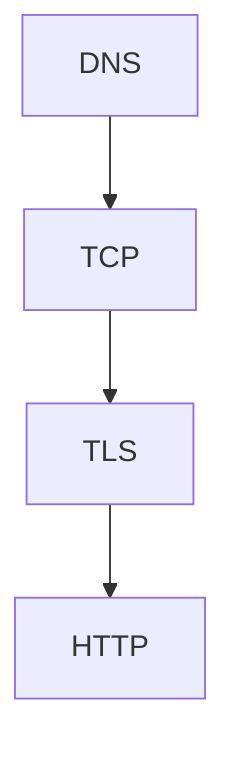

## Введение

Соберите путь в одну цепочку и не перескакивайте. Этого хватает на большинство вводных вопросов про «почему не открывается».

## Раздел: Цепочка

DNS → TCP или осознанный UDP → TLS, если HTTPS → метод и статус. На каждом этаже свой симптом. Платёж не переводят на UDP «для скорости».

## Раздел: Ответ вслух

Я иду сверху симптома вниз по этажам. Нет имени — DNS. Нет соединения — TCP и файрвол. Ругается сертификат — TLS. Есть статус — уже HTTP, и я различаю 401, 403, 404 и 500.

## Раздел: Плохой ответ

Плохой ответ: «перезагрузить nginx» до этажа. Можно чинить не то.

## Раздел: Термины

Этаж поломки — failure domain. Имя, соединение, рукопожатие, статус — четыре этажа.

## Лаба

**15 минут.** Разберите вслух один выдуманный инцидент на каждом этаже. Не повторяйте одну и ту же причину.

## Схема: Четыре этажа

## Тест

### Сертификат просрочен. Имеет ли смысл смотреть SQL?

**Ответ:** ещё нет

**Пояснение:** До приложения запрос не дошёл.

### Статус 403. Это DNS?

**Ответ:** нет

**Пояснение:** Имя, соединение и TLS уже прошли.

### Платёж хотят на UDP. Ваш первый аргумент?

**Ответ:** потеря без гарантии

**Пояснение:** Скорость не лечит молчаливую потерю.

### Таймаут. Какой статус назвать?

**Ответ:** никакой

**Пояснение:** Ответа не было.

### 401 после успешного TLS. Канал виноват?

**Ответ:** нет

**Пояснение:** Канал есть, узнавание нет.

## Шпаргалка

<ul><li>Один путь из четырёх этажей</li><li>Статус значит, что HTTP был</li><li>UDP не для молчаливых денег</li></ul>

## Anki

### Front: Четыре этажа?

Back: DNS, TCP, TLS, HTTP.

### Front: Нет имени?

Back: DNS.

### Front: Нет статуса, долго ждём?

Back: Соединение или тишина, не 500.

### Front: Плохой сертификат?

Back: TLS.

### Front: 403?

Back: Уже HTTP: нельзя.

### Front: UDP для платежа?

Back: Нет, если нет своей гарантии.

## Итоги

- Один путь из четырёх этажей
- Статус значит, что HTTP был
- UDP не для молчаливых денег

## Ссылки

- [DNS и HTTP](/game/learn/net-dns-http)
- [TLS](/game/learn/net-tls)
