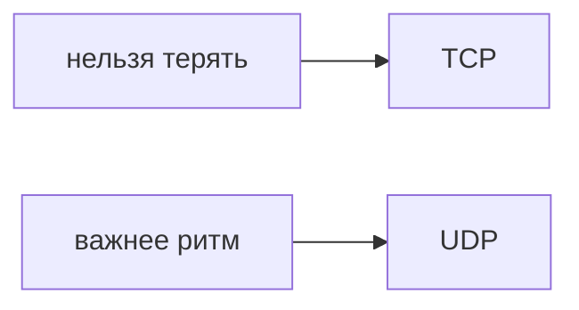

## Введение

TCP ставит соединение и досылает потерянное. UDP шлёт датаграмму и не обещает, что её приняли. Выбор — про цену задержки, не про «современность».

## Раздел: Выбор

Платёж, файл, HTTP — TCP: потеря байта ломает смысл. Голос и телеметрия иногда UDP: лучше потерять пакет, чем ждать повтор и опоздать. Поверх UDP гарантию приходится писать самим, если она всё-таки нужна.

## Раздел: Ответ вслух

Если потеря байта недопустима, я беру TCP и плачу установкой соединения и повторами. Если важнее ритм, а дырка в потоке терпима, UDP. HTTP, которым мы пользуемся, сидит на TCP.

## Раздел: Плохой ответ

Плохой ответ: «UDP быстрее, значит для API магазина тоже». Потерянный заказ никто не повторит сам.

## Раздел: Термины

Соединение — connection. Датаграмма — datagram. Повтор пакета — retransmission. Поток — stream.

## Лаба

**15 минут.** Для платежа, онлайн-игры positions и загрузки файла выберите TCP или UDP и одну фразу цены.

## Схема: Гарантия

## Тест

### Платёж по UDP без своей гарантии. Принять?

**Ответ:** нет

**Пояснение:** Потеря датаграммы молчаливая.

### HTTP на чём сидит в обычном вебе?

**Ответ:** на TCP

**Пояснение:** Поток байтов, не одна датаграмма.

### Голос ждёт повтор каждого пакета. Чем плохо?

**Ответ:** опоздание хуже дырки

**Пояснение:** Поэтому часто UDP.

### TCP «просто быстрее UDP»?

**Ответ:** нет

**Пояснение:** Есть рукопожатие и повторы.

### Гарантию на UDP можно добавить?

**Ответ:** да, самим

**Пояснение:** Это уже свой протокол поверх.

## Шпаргалка

<ul><li>TCP — гарантия</li><li>UDP — без обещания</li><li>Скорость не аргумент для платежа</li></ul>

## Anki

### Front: TCP одной фразой?

Back: Соединение и досылка потерянного.

### Front: UDP одной фразой?

Back: Датаграмма без обещания доставки.

### Front: Платёж куда?

Back: TCP или свой контроль поверх.

### Front: Почему голос терпит UDP?

Back: Лучше дырка, чем пауза на повтор.

### Front: HTTP на чём?

Back: На TCP.

### Front: Кто повторяет пакет в TCP?

Back: Стек, не ваше приложение.

## Итоги

- TCP — гарантия
- UDP — без обещания
- Скорость не аргумент для платежа

## Ссылки

- [DNS и HTTP](/game/learn/net-dns-http)
- [TLS](/game/learn/net-tls)
