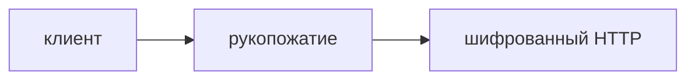

## Введение

HTTPS — HTTP внутри TLS. Клиент проверяет, что сертификат выдан этому имени цепочкой, которой он верит, и дальше канал шифруется. Это не список прав пользователя.

## Раздел: Рукопожатие

Клиент и сервер договариваются о ключах до прикладных данных. Чужое имя в сертификате — обрыв, даже если ключ математически настоящий. Просроченный сертификат — тот же класс поломки. Секрет сессии не равен паролю пользователя.

## Раздел: Ответ вслух

TLS закрывает канал и привязывает его к имени. Я не говорю, что «данные в безопасности вообще»: пароль могут сдать фишингом, а права на удаление проверяет приложение. На собесе разделяю канал и доступ.

## Раздел: Плохой ответ

Плохой ответ: «HTTPS шифрует базу». База может лежать открытой на диске. Шифруется канал.

## Раздел: Термины

Рукопожатие — handshake. Сертификат — certificate. Цепочка доверия — trust chain. Канал — channel.

## Лаба

**15 минут.** Откройте любой сайт и найдите, на какое имя выдан сертификат. Скажите, что будет, если имя не совпадёт с адресом в строке.

## Схема: Канал

## Тест

### Сертификат на другой домен. Соединение принимать?

**Ответ:** нет

**Пояснение:** Имя не совпало.

### HTTPS включён. База на диске точно шифрована?

**Ответ:** нет

**Пояснение:** Речь о канале.

### Права на удаление проверяет TLS?

**Ответ:** нет

**Пояснение:** Это приложение.

### Сертификат просрочен. Канал уже честный?

**Ответ:** нет

**Пояснение:** Клиент не должен верить.

### Самоподписанный сертификат для чужих пользователей. Норма?

**Ответ:** нет

**Пояснение:** Нет общей цепочки доверия.

## Шпаргалка

<ul><li>Канал не равен правам</li><li>Имя в сертификате важно</li><li>Диск TLS не шифрует</li></ul>

## Anki

### Front: Что обещает TLS?

Back: Шифрование канала и имя сертификата.

### Front: Что не обещает?

Back: Права пользователя и шифрование диска.

### Front: Чужое имя в сертификате?

Back: Клиент обрывает.

### Front: Что такое handshake?

Back: Договор о ключах до данных приложения.

### Front: HTTPS — это?

Back: HTTP внутри TLS.

### Front: Просроченный сертификат?

Back: Та же поломка доверия, не «мелочь».

## Итоги

- Канал не равен правам
- Имя в сертификате важно
- Диск TLS не шифрует

## Ссылки

- [Разбор](/game/learn/net-interview-drill)
