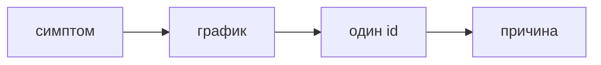

## Введение

На собесе «сервис лежит» раскладывают в порядок действий. Кто начинает с правки кода, ещё не посмотрел симптом.

## Раздел: Порядок

Что именно плохо: ошибки или хвост. С какого момента. Один correlation id. Какой вызов в трейсе. Только потом гипотеза в коде. Секрет в логе по пути — смена секрета параллельно расследованию.

## Раздел: Ответ вслух

Я спрашиваю, ошибка это или медленно, и с какого часа. Смотрю долю и хвост. Беру один id, читаю лог и трейс. Гипотезу называю после факта, не вместо него.

## Раздел: Плохой ответ

Плохой ответ: «перезапустим и посмотрим». Это стирает состояние до понимания.

## Раздел: Термины

Инцидент — incident. Симптом — symptom. Гипотеза — hypothesis. Откат — rollback.

## Лаба

**20 минут.** Опишите инцидент «с 11:00 выросла p95 чека» пятью шагами. Перезапуск не может быть шагом номер один.

## Схема: Порядок

## Тест

### Первый шаг — перезапуск. Почему слабо?

**Ответ:** стирает улику

**Пояснение:** Сначала симптом.

### p95 выросла, ошибок нет. Куда смотреть?

**Ответ:** трейс медленного

**Пояснение:** Это хвост, не доля 500.

### В логе нашли токен. Кроме починки бага?

**Ответ:** сменить токен

**Пояснение:** Утечка уже случилась.

### Гипотеза до графика. Чем рискуете?

**Ответ:** чинить не то

**Пояснение:** Факт раньше версии.

### Один id не склеивает сервисы. Что добавить в следующий раз?

**Ответ:** общий correlation id

**Пояснение:** Иначе расследование кончится на границе.

## Шпаргалка

<ul><li>Симптом раньше рестарта</li><li>Хвост и ошибки — разное</li><li>Один запрос вместо всего файла</li></ul>

## Anki

### Front: Порядок инцидента?

Back: Симптом, график, один id, причина.

### Front: Перезапуск первым?

Back: Нет, если ещё не поняли симптом.

### Front: Ошибок нет, но медленно?

Back: Смотреть хвост и трейс.

### Front: Секрет в логе во время инцидента?

Back: Менять секрет параллельно.

### Front: Зачем один id?

Back: Не читать весь журнал.

### Front: Гипотеза когда?

Back: После факта.

## Итоги

- Симптом раньше рестарта
- Хвост и ошибки — разное
- Один запрос вместо всего файла

## Ссылки

- [Метрики](/game/learn/obs-metrics-traces)
- [Отказ сервиса](/game/learn/sd-failure)
