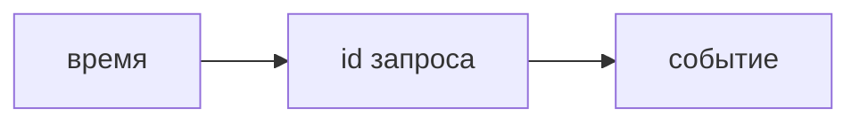

## Введение

Лог без идентификатора запроса — это дневник процесса, не расследование. На собесе ждут, какие поля вы не выбросите и почему секрет туда не попадёт.

## Раздел: Поля

Время, уровень, сервис, идентификатор запроса, что случилось. Тело запроса с паролем и токеном не логируют. Ошибка без стека на 500 и стек на каждый обычный 200 — обе крайности плохи.

## Раздел: Ответ вслух

Я ищу один запрос по correlation id. В строке есть уровень и сервис. Пароль и заголовок авторизации туда не пишу. На ошибке хочу причину, на успехе не хочу простыню.

## Раздел: Плохой ответ

Плохой ответ: «логи есть в файле на сервере». Не сказано, как найти один запрос среди всех.

## Раздел: Термины

Журнал — log. Идентификатор запроса — correlation id. Уровень — level: info, warn, error.

## Лаба

**15 минут.** Возьмите одну строку выдуманного лога и вычеркните секрет. Добавьте поле, по которому свяжете её с соседним сервисом.

## Схема: Одна строка

## Тест

### В лог попал Authorization. Что первым?

**Ответ:** убрать и сменить секрет

**Пояснение:** Строка уже могла уехать в сборщик.

### Пять сервисов, id запроса нет. Как склеить путь?

**Ответ:** почти никак

**Пояснение:** Время совпадёт у чужих запросов тоже.

### Каждый успех пишет тело ответа. Чем плохо?

**Ответ:** шумом и утечкой

**Пояснение:** Искать ошибку станет труднее.

### 500 без текста причины. Лог полезен?

**Ответ:** слабо

**Пояснение:** Нечего чинить.

### Уровень error на каждую проверку валидации 400?

**Ответ:** нет, это шум

**Пояснение:** 400 — ожидаемый отказ входа.

## Шпаргалка

<ul><li>Один id на путь</li><li>Без секретов</li><li>Ошибка отличается от шума</li></ul>

## Anki

### Front: Зачем correlation id?

Back: Склеить один запрос через сервисы.

### Front: Что не писать в лог?

Back: Пароль, токен, сырой заголовок авторизации.

### Front: Что писать на ошибке?

Back: Причину, не только слово error.

### Front: Почему не логировать все тела?

Back: Шум и риск утечки.

### Front: 400 — это error в журнале?

Back: Обычно нет, это ожидаемый отказ.

### Front: Файл на диске достаточен?

Back: Нет, если по нему нельзя найти один запрос.

## Итоги

- Один id на путь
- Без секретов
- Ошибка отличается от шума

## Ссылки

- [Метрики](/game/learn/obs-metrics-traces)
- [Секреты](/game/learn/sec-secrets)
