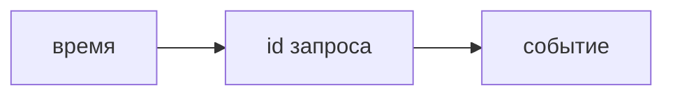
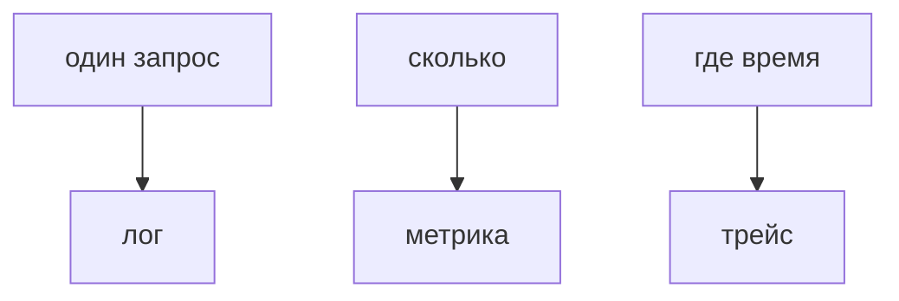
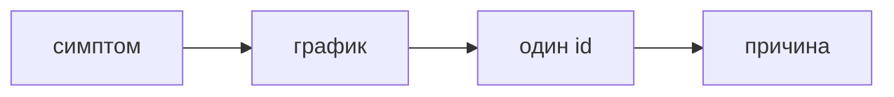

## Введение

Лог без идентификатора запроса — это дневник процесса, не расследование. На собесе ждут, какие поля вы не выбросите и почему секрет туда не попадёт.

**Метрики и трейсы.** Лог отвечает, что случилось с одним запросом. Метрика отвечает, сколько таких событий в секунду. Трейс отвечает, где на пути запрос провёл время. Это три разных вопроса.

**Инцидент.** На собесе «сервис лежит» раскладывают в порядок действий. Кто начинает с правки кода, ещё не посмотрел симптом.

## Раздел: Как отвечать одним блоком

Этот выпуск собрал соседние короткие темы трека: «Логи», «Метрики и трейсы», «Инцидент». Раньше каждая занимала отдельную карточку на несколько минут, а на собеседовании их спрашивают одним блоком. Ниже у каждой темы свой раздел, затем общие лабы, один тест и одна колода карточек. В ответе сначала назовите, какую тему спросили, потом определение и один пример. Не проговаривайте все разделы, если спросили один. Лабы можно пройти по порядку исходного трека. Если времени мало, сделайте первую и последнюю: первая ставит язык, последняя проверяет, что соседние темы вы не перепутали.

## Раздел: Логи: Поля

Время, уровень, сервис, идентификатор запроса, что случилось. Тело запроса с паролем и токеном не логируют. Ошибка без стека на 500 и стек на каждый обычный 200 — обе крайности плохи.

## Раздел: Логи: Ответ вслух

Я ищу один запрос по correlation id. В строке есть уровень и сервис. Пароль и заголовок авторизации туда не пишу. На ошибке хочу причину, на успехе не хочу простыню.

## Раздел: Логи: Плохой ответ

Плохой ответ: «логи есть в файле на сервере». Не сказано, как найти один запрос среди всех.

## Раздел: Логи: Термины

Журнал — log. Идентификатор запроса — correlation id. Уровень — level: info, warn, error.

## Раздел: Метрики и трейсы: Сигналы

Частота ошибок и задержка — метрики, по ним будят. Трейс нужен, когда задержка выросла, а лог одного запроса не показывает, какой из пяти вызовов виноват. Среднее без хвоста врёт: большинству хорошо, десятой доле плохо.

## Раздел: Метрики и трейсы: Ответ вслух

Я бужу по доле ошибок и по хвосту задержки, не по среднему. Если хвост вырос, открываю трейс одного медленного запроса и смотрю, какой вызов съел время. Лог читаю точечно, не вместо графика.

## Раздел: Метрики и трейсы: Плохой ответ

Плохой ответ: «среднее время ответа нормальное, значит всё хорошо». Хвост может быть непригоден.

## Раздел: Метрики и трейсы: Термины

Метрика — metric. Задержка — latency. Хвост — tail, часто p95 или p99. Трейс — trace. Доля ошибок — error rate.

## Раздел: Инцидент: Порядок

Что именно плохо: ошибки или хвост. С какого момента. Один correlation id. Какой вызов в трейсе. Только потом гипотеза в коде. Секрет в логе по пути — смена секрета параллельно расследованию.

## Раздел: Инцидент: Ответ вслух

Я спрашиваю, ошибка это или медленно, и с какого часа. Смотрю долю и хвост. Беру один id, читаю лог и трейс. Гипотезу называю после факта, не вместо него.

## Раздел: Инцидент: Плохой ответ

Плохой ответ: «перезапустим и посмотрим». Это стирает состояние до понимания.

## Раздел: Инцидент: Термины

Инцидент — incident. Симптом — symptom. Гипотеза — hypothesis. Откат — rollback.

## Раздел: Формулировки из исходных выпусков

Логи. Вопрос «В лог попал Authorization. Что первым?»: убрать и сменить секрет. Строка уже могла уехать в сборщик.

Логи. Вопрос «Пять сервисов, id запроса нет. Как склеить путь?»: почти никак. Время совпадёт у чужих запросов тоже.

Логи. Вопрос «Каждый успех пишет тело ответа. Чем плохо?»: шумом и утечкой. Искать ошибку станет труднее.

Логи. Вопрос «500 без текста причины. Лог полезен?»: слабо. Нечего чинить.

Логи. Вопрос «Уровень error на каждую проверку валидации 400?»: нет, это шум. 400 — ожидаемый отказ входа.

Логи. Карточка «Зачем correlation id?» — Склеить один запрос через сервисы..

Логи. Карточка «Что не писать в лог?» — Пароль, токен, сырой заголовок авторизации..

Логи. Карточка «Что писать на ошибке?» — Причину, не только слово error..

Логи. Карточка «Почему не логировать все тела?» — Шум и риск утечки..

Логи. Карточка «400 — это error в журнале?» — Обычно нет, это ожидаемый отказ..

Логи. Карточка «Файл на диске достаточен?» — Нет, если по нему нельзя найти один запрос..

Метрики и трейсы. Вопрос «Средняя задержка мала, жалобы есть. Куда смотреть?»: на хвост. Среднее прячет медленную долю.

Метрики и трейсы. Вопрос «Нужно понять, какой из пяти вызовов медленный. Лог каждого info?»: слабее трейса. Трейс показывает отрезок времени.

Метрики и трейсы. Вопрос «Доля 500 выросла. Это метрика или трейс?»: сначала метрика. Трейс — следом, на примере.

Метрики и трейсы. Вопрос «Будить человека на каждый info в логе?»: нет. Будят по симптому частоты или хвоста.

Метрики и трейсы. Вопрос «Трейс на каждый успешный байт навсегда. Чем плохо?»: дорого и шумно. След берут с выборкой или на симптоме.

Метрики и трейсы. Карточка «Лог vs метрика?» — Один случай против частоты..

Метрики и трейсы. Карточка «Зачем трейс?» — Где на пути ушло время..

Метрики и трейсы. Карточка «Почему не среднее?» — Прячет хвост..

Метрики и трейсы. Карточка «Что такое p95?» — Порог, хуже которого только 5% запросов..

Метрики и трейсы. Карточка «По чему будить?» — Доля ошибок и хвост задержки..

Метрики и трейсы. Карточка «Трейс вместо всех логов?» — Нет, вопросы разные..

Инцидент. Вопрос «Первый шаг — перезапуск. Почему слабо?»: стирает улику. Сначала симптом.

Инцидент. Вопрос «p95 выросла, ошибок нет. Куда смотреть?»: трейс медленного. Это хвост, не доля 500.

Инцидент. Вопрос «В логе нашли токен. Кроме починки бага?»: сменить токен. Утечка уже случилась.

Инцидент. Вопрос «Гипотеза до графика. Чем рискуете?»: чинить не то. Факт раньше версии.

Инцидент. Вопрос «Один id не склеивает сервисы. Что добавить в следующий раз?»: общий correlation id. Иначе расследование кончится на границе.

Инцидент. Карточка «Порядок инцидента?» — Симптом, график, один id, причина..

Инцидент. Карточка «Перезапуск первым?» — Нет, если ещё не поняли симптом..

Инцидент. Карточка «Ошибок нет, но медленно?» — Смотреть хвост и трейс..

Инцидент. Карточка «Секрет в логе во время инцидента?» — Менять секрет параллельно..

Инцидент. Карточка «Зачем один id?» — Не читать весь журнал..

Инцидент. Карточка «Гипотеза когда?» — После факта..

## Раздел: Границы соседних тем

Блок «Как отвечать одним блоком» отвечает на отдельный вопрос билета. Сначала назовите границу: когда приём уместен и какой соседний приём берут вместо него. Потом дайте один пример из лабы этого выпуска, без пересказа всего раздела. Если пример не вспоминается, вернитесь к шпаргалке и закройте только этот блок, не весь трек.

Блок «Логи: Поля» отвечает на отдельный вопрос билета. Сначала назовите границу: когда приём уместен и какой соседний приём берут вместо него. Потом дайте один пример из лабы этого выпуска, без пересказа всего раздела. Если пример не вспоминается, вернитесь к шпаргалке и закройте только этот блок, не весь трек.

Блок «Логи: Ответ вслух» отвечает на отдельный вопрос билета. Сначала назовите границу: когда приём уместен и какой соседний приём берут вместо него. Потом дайте один пример из лабы этого выпуска, без пересказа всего раздела. Если пример не вспоминается, вернитесь к шпаргалке и закройте только этот блок, не весь трек.

Блок «Логи: Плохой ответ» отвечает на отдельный вопрос билета. Сначала назовите границу: когда приём уместен и какой соседний приём берут вместо него. Потом дайте один пример из лабы этого выпуска, без пересказа всего раздела. Если пример не вспоминается, вернитесь к шпаргалке и закройте только этот блок, не весь трек.

Блок «Логи: Термины» отвечает на отдельный вопрос билета. Сначала назовите границу: когда приём уместен и какой соседний приём берут вместо него. Потом дайте один пример из лабы этого выпуска, без пересказа всего раздела. Если пример не вспоминается, вернитесь к шпаргалке и закройте только этот блок, не весь трек.

Блок «Метрики и трейсы: Сигналы» отвечает на отдельный вопрос билета. Сначала назовите границу: когда приём уместен и какой соседний приём берут вместо него. Потом дайте один пример из лабы этого выпуска, без пересказа всего раздела. Если пример не вспоминается, вернитесь к шпаргалке и закройте только этот блок, не весь трек.

Блок «Метрики и трейсы: Ответ вслух» отвечает на отдельный вопрос билета. Сначала назовите границу: когда приём уместен и какой соседний приём берут вместо него. Потом дайте один пример из лабы этого выпуска, без пересказа всего раздела. Если пример не вспоминается, вернитесь к шпаргалке и закройте только этот блок, не весь трек.

Блок «Метрики и трейсы: Плохой ответ» отвечает на отдельный вопрос билета. Сначала назовите границу: когда приём уместен и какой соседний приём берут вместо него. Потом дайте один пример из лабы этого выпуска, без пересказа всего раздела. Если пример не вспоминается, вернитесь к шпаргалке и закройте только этот блок, не весь трек.

Блок «Метрики и трейсы: Термины» отвечает на отдельный вопрос билета. Сначала назовите границу: когда приём уместен и какой соседний приём берут вместо него. Потом дайте один пример из лабы этого выпуска, без пересказа всего раздела. Если пример не вспоминается, вернитесь к шпаргалке и закройте только этот блок, не весь трек.

Блок «Инцидент: Порядок» отвечает на отдельный вопрос билета. Сначала назовите границу: когда приём уместен и какой соседний приём берут вместо него. Потом дайте один пример из лабы этого выпуска, без пересказа всего раздела. Если пример не вспоминается, вернитесь к шпаргалке и закройте только этот блок, не весь трек.

Блок «Инцидент: Ответ вслух» отвечает на отдельный вопрос билета. Сначала назовите границу: когда приём уместен и какой соседний приём берут вместо него. Потом дайте один пример из лабы этого выпуска, без пересказа всего раздела. Если пример не вспоминается, вернитесь к шпаргалке и закройте только этот блок, не весь трек.

Блок «Инцидент: Плохой ответ» отвечает на отдельный вопрос билета. Сначала назовите границу: когда приём уместен и какой соседний приём берут вместо него. Потом дайте один пример из лабы этого выпуска, без пересказа всего раздела. Если пример не вспоминается, вернитесь к шпаргалке и закройте только этот блок, не весь трек.

Блок «Инцидент: Термины» отвечает на отдельный вопрос билета. Сначала назовите границу: когда приём уместен и какой соседний приём берут вместо него. Потом дайте один пример из лабы этого выпуска, без пересказа всего раздела. Если пример не вспоминается, вернитесь к шпаргалке и закройте только этот блок, не весь трек.

Блок «Формулировки из исходных выпусков» отвечает на отдельный вопрос билета. Сначала назовите границу: когда приём уместен и какой соседний приём берут вместо него. Потом дайте один пример из лабы этого выпуска, без пересказа всего раздела. Если пример не вспоминается, вернитесь к шпаргалке и закройте только этот блок, не весь трек.

## Лаба

**Логи.**

**15 минут.** Возьмите одну строку выдуманного лога и вычеркните секрет. Добавьте поле, по которому свяжете её с соседним сервисом.

**Метрики и трейсы.**

**15 минут.** Для «иногда чек уходит минуту» выберите сигнал: лог, метрика или трейс. Объясните, почему не остальные два первыми.

**Инцидент.**

**20 минут.** Опишите инцидент «с 11:00 выросла p95 чека» пятью шагами. Перезапуск не может быть шагом номер один.

## Схема: Логи: Одна строка

## Схема: Метрики и трейсы: Три вопроса

## Схема: Инцидент: Порядок

## Тест

### В лог попал Authorization. Что первым?

**Ответ:** убрать и сменить секрет

**Пояснение:** Строка уже могла уехать в сборщик.

### Средняя задержка мала, жалобы есть. Куда смотреть?

**Ответ:** на хвост

**Пояснение:** Среднее прячет медленную долю.

### Первый шаг — перезапуск. Почему слабо?

**Ответ:** стирает улику

**Пояснение:** Сначала симптом.

### Пять сервисов, id запроса нет. Как склеить путь?

**Ответ:** почти никак

**Пояснение:** Время совпадёт у чужих запросов тоже.

### Нужно понять, какой из пяти вызовов медленный. Лог каждого info?

**Ответ:** слабее трейса

**Пояснение:** Трейс показывает отрезок времени.

## Шпаргалка

<ul><li>Один id на путь</li><li>Без секретов</li><li>Ошибка отличается от шума</li><li>Три сигнала — три вопроса</li><li>Хвост важнее среднего</li><li>Сначала симптом, потом один след</li><li>Симптом раньше рестарта</li><li>Хвост и ошибки — разное</li><li>Один запрос вместо всего файла</li></ul>

## Anki

### Front: Зачем correlation id?

Back: Склеить один запрос через сервисы.

### Front: Лог vs метрика?

Back: Один случай против частоты.

### Front: Порядок инцидента?

Back: Симптом, график, один id, причина.

### Front: Что не писать в лог?

Back: Пароль, токен, сырой заголовок авторизации.

### Front: Зачем трейс?

Back: Где на пути ушло время.

### Front: Перезапуск первым?

Back: Нет, если ещё не поняли симптом.

## Мнемоника

### acronym: Три сигнала

**Задание:** Чем лог, метрика и след отличаются.

**Элементы:**
- Лог событие
- Метрика число
- След путь

**Подсказка:** Средняя задержка прячет хвост. След показывает один запрос.

**Ответ:** log, metric, trace

## Итоги

- Один id на путь
- Без секретов
- Ошибка отличается от шума
- Три сигнала — три вопроса
- Хвост важнее среднего
- Сначала симптом, потом один след
- Симптом раньше рестарта
- Хвост и ошибки — разное

## Ссылки

- [Секреты](/game/learn/sec-authn-authz)
- [Отказ сервиса](/game/learn/sd-one-service)
