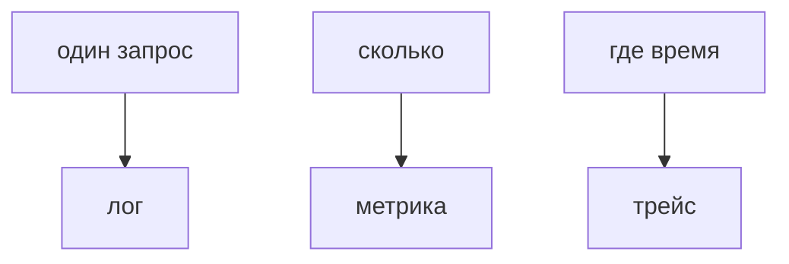

## Введение

Лог отвечает, что случилось с одним запросом. Метрика отвечает, сколько таких событий в секунду. Трейс отвечает, где на пути запрос провёл время. Это три разных вопроса.

## Раздел: Сигналы

Частота ошибок и задержка — метрики, по ним будят. Трейс нужен, когда задержка выросла, а лог одного запроса не показывает, какой из пяти вызовов виноват. Среднее без хвоста врёт: большинству хорошо, десятой доле плохо.

## Раздел: Ответ вслух

Я бужу по доле ошибок и по хвосту задержки, не по среднему. Если хвост вырос, открываю трейс одного медленного запроса и смотрю, какой вызов съел время. Лог читаю точечно, не вместо графика.

## Раздел: Плохой ответ

Плохой ответ: «среднее время ответа нормальное, значит всё хорошо». Хвост может быть непригоден.

## Раздел: Термины

Метрика — metric. Задержка — latency. Хвост — tail, часто p95 или p99. Трейс — trace. Доля ошибок — error rate.

## Лаба

**15 минут.** Для «иногда чек уходит минуту» выберите сигнал: лог, метрика или трейс. Объясните, почему не остальные два первыми.

## Схема: Три вопроса

## Тест

### Средняя задержка мала, жалобы есть. Куда смотреть?

**Ответ:** на хвост

**Пояснение:** Среднее прячет медленную долю.

### Нужно понять, какой из пяти вызовов медленный. Лог каждого info?

**Ответ:** слабее трейса

**Пояснение:** Трейс показывает отрезок времени.

### Доля 500 выросла. Это метрика или трейс?

**Ответ:** сначала метрика

**Пояснение:** Трейс — следом, на примере.

### Будить человека на каждый info в логе?

**Ответ:** нет

**Пояснение:** Будят по симптому частоты или хвоста.

### Трейс на каждый успешный байт навсегда. Чем плохо?

**Ответ:** дорого и шумно

**Пояснение:** След берут с выборкой или на симптоме.

## Шпаргалка

<ul><li>Три сигнала — три вопроса</li><li>Хвост важнее среднего</li><li>Сначала симптом, потом один след</li></ul>

## Anki

### Front: Лог vs метрика?

Back: Один случай против частоты.

### Front: Зачем трейс?

Back: Где на пути ушло время.

### Front: Почему не среднее?

Back: Прячет хвост.

### Front: Что такое p95?

Back: Порог, хуже которого только 5% запросов.

### Front: По чему будить?

Back: Доля ошибок и хвост задержки.

### Front: Трейс вместо всех логов?

Back: Нет, вопросы разные.

## Итоги

- Три сигнала — три вопроса
- Хвост важнее среднего
- Сначала симптом, потом один след

## Ссылки

- [Логи](/game/learn/obs-logs)
- [Разбор](/game/learn/obs-interview-drill)
