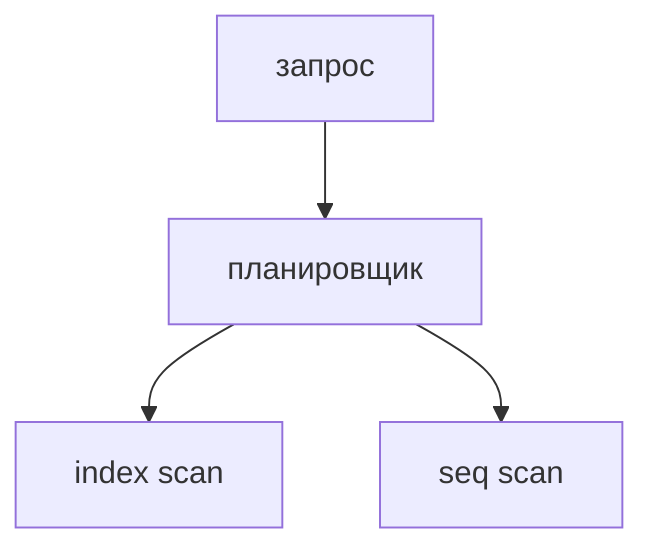

## Введение

Индекс — не талисман. Планировщик выберет последовательное чтение, если так дешевле. На собесе ждут не «создайте индекс», а «почему он мог не использоваться».

## Раздел: Причины

Условие не совпадает с порядком индекса: функция на колонке, левый LIKE с процентом в начале, слишком много строк подходит — дешевле прочитать таблицу. Составной индекс работает слева направо. Устаревшая статистика после большой загрузки тоже уводит план.

## Раздел: Ответ вслух

Я смотрю EXPLAIN, не верю индексу на слово. Если в условии функция от колонки, индекс по самой колонке молчит. Если запрос забирает половину таблицы, последовательное чтение честнее. Составной индекс называю с левой колонки.

## Раздел: Плохой ответ

Плохой ответ: «добавим индекс на все колонки». Запись станет дороже, а запрос может его не взять.

## Раздел: Термины

План — EXPLAIN. Последовательное чтение — sequential scan. Составной индекс — composite index. Статистика — statistics, ANALYZE.

## Лаба

**25 минут.** В [/game/sql](/game/sql) или на бумаге сравните `WHERE status = 'new'` и `WHERE lower(status) = 'new'` при индексе на status. Скажите, какой запрос индекс не обязан использовать.

## Схема: План

## Тест

### Индекс на email, запрос lower(email). Обязан ли взяться индекс?

**Ответ:** нет

**Пояснение:** Выражение не совпадает с ключом индекса.

### Под условие подходит 80% таблицы. Seq scan — ошибка?

**Ответ:** не обязательно

**Пояснение:** Читать индекс и потом таблицу может быть дороже.

### Индекс (a, b), условие только по b. Хороший доступ?

**Ответ:** обычно нет

**Пояснение:** Левая колонка не задана.

### После загрузки миллиона строк план странный. Что обновить?

**Ответ:** статистику

**Пояснение:** ANALYZE, не новый индекс наугад.

### Индекс на каждую колонку. Чем платите?

**Ответ:** записью и местом

**Пояснение:** Каждый INSERT обновляет все индексы.

## Шпаргалка

<ul><li>Смотрите план</li><li>Выражение может спрятать колонку</li><li>Много индексов тормозят запись</li></ul>

## Anki

### Front: Индекс всегда используется?

Back: Нет, планировщик выбирает дешевле.

### Front: Функция на колонке?

Back: Индекс по сырой колонке часто молчит.

### Front: Почему seq scan бывает лучше?

Back: Когда выбирать почти всю таблицу.

### Front: Составной индекс как читают?

Back: Слева направо, левый столбец нужен.

### Front: Зачем ANALYZE?

Back: Обновить статистику для плана.

### Front: Цена лишних индексов?

Back: Дороже запись и больше место.

## Итоги

- Смотрите план
- Выражение может спрятать колонку
- Много индексов тормозят запись

## Ссылки

- [EXPLAIN в серии SQL](/game/learn/sql-performance-explain)
- [Разбор](/game/learn/pg-interview-drill)
